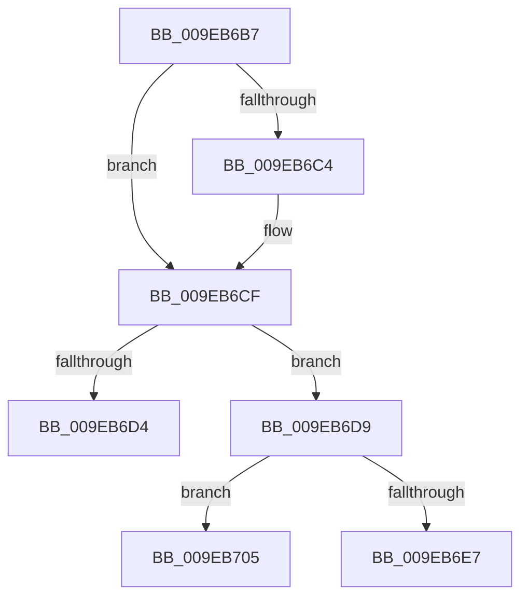

# sub_009EB6B7

- RVA: `0x009EB6B7`–`0x009EB718` (길이 `97` bytes)
- VA: `0x00000001409EB6B7`
- 실행 섹션: `PAGE`
- PDB 이름 있음: `아니요`; PDB Function 태그: `아니요`
- unwind 정보 RVA: `0x000A5588`
- 디코드: `25`개 명령, `97/97` bytes 표시
- 미해석 바이트: `0` (있으면 어셈블리에 `.byte`로 보존)

> 이 문서는 커널 이미지의 기계어와 PDB 기호를 분석해 생성했습니다. 4번과 5번은 함수 원형과 자료형을 바이너리 사용 방식에서 추정한 C 해석이며 원본 소스 복구 결과는 아닙니다.

## 1. Dependencies

- 직접 호출 지점: **2**; 고유 호출 대상: **2**
- 직접 호출자로 확인된 함수: **0**
- RIP 상대 이미지 참조: **2**

### Outgoing calls
- `0x009EB6EA` → [ObfReferenceObject](../../text/20/ObfReferenceObject_function_0020FA20.md) (function, `0x0020FA20`)
- `0x009EB6FA` → [RtlCopyUnicodeString](../../text/3F/RtlCopyUnicodeString_function_003FEF30.md) (function, `0x003FEF30`)

### Direct callers
- 이 함수 시작 RVA로 연결되는 직접 call은 확인되지 않았습니다. 간접 호출은 완전히 역산할 수 없습니다.

### Static image references
- `0x009EB6BB` → RVA `0x000147A0` (`.rdata`; read)
- `0x009EB6C8` → RVA `0x000147A8` (`.rdata`; read)

## 2. Other-region calls and transfers

- 다른 실행 섹션으로 향하는 call: **2**
  - `0x009EB6EA` → [ObfReferenceObject](../../text/20/ObfReferenceObject_function_0020FA20.md) (`PAGE` → `.text`)
  - `0x009EB6FA` → [RtlCopyUnicodeString](../../text/3F/RtlCopyUnicodeString_function_003FEF30.md) (`PAGE` → `.text`)
- call이 아닌 외부 분기/꼬리 이동: **3**
  - `0x009EB6D7` → [sub_009EB675 + 0x12](Unknown_function_009EB675.md) (`tail-transfer`)
  - `0x009EB703` → [sub_009EB675 + 0x17](Unknown_function_009EB675.md) (`tail-transfer`)
  - `0x009EB713` → [IopCheckTopDeviceHint + 0x60](IopCheckTopDeviceHint_function_009EB5F0.md) (`tail-transfer`)

## 3. Assembly (complete function range)

```asm
009EB6B7  48 8B 43 10                     mov rax, qword ptr [rbx + 0x10]
009EB6BB  48 2B 05 DE 90 62 FF            sub rax, qword ptr [rip - 0x9d6f22]
009EB6C2  75 0B                           jne 0x1409eb6cf
009EB6C4  48 8B 43 18                     mov rax, qword ptr [rbx + 0x18]
009EB6C8  48 2B 05 D9 90 62 FF            sub rax, qword ptr [rip - 0x9d6f27]
009EB6CF  48 85 C0                        test rax, rax
009EB6D2  74 05                           je 0x1409eb6d9
009EB6D4  48 8B 1B                        mov rbx, qword ptr [rbx]
009EB6D7  EB AE                           jmp 0x1409eb687
009EB6D9  83 4B 28 04                     or dword ptr [rbx + 0x28], 4
009EB6DD  41 0F B7 06                     movzx eax, word ptr [r14]
009EB6E1  66 39 43 4A                     cmp word ptr [rbx + 0x4a], ax
009EB6E5  72 1E                           jb 0x1409eb705
009EB6E7  48 8B CE                        mov rcx, rsi
009EB6EA  E8 31 43 82 FF                  call 0x14020fa20
009EB6EF  49 8B D6                        mov rdx, r14
009EB6F2  48 89 73 40                     mov qword ptr [rbx + 0x40], rsi
009EB6F6  48 8D 4B 48                     lea rcx, [rbx + 0x48]
009EB6FA  E8 31 38 A1 FF                  call 0x1403fef30
009EB6FF  83 4B 28 08                     or dword ptr [rbx + 0x28], 8
009EB703  EB 87                           jmp 0x1409eb68c
009EB705  4C 8B 7C 24 30                  mov r15, qword ptr [rsp + 0x30]
009EB70A  66 89 43 48                     mov word ptr [rbx + 0x48], ax
009EB70E  B8 96 04 00 C0                  mov eax, 0xc0000496
009EB713  E9 38 FF FF FF                  jmp 0x1409eb650
```

## 4. C-style interpretation (structured pseudocode)

```c
__int64 __fastcall sub_009EB6B7(__int64 a1, __int64 a2, __int64 a3, __int64 a4, __int64 a5, __int64 a6)
{
    __int64 result;

    result = (*(unsigned __int64 *)(v_rbx + 16)) - (*(unsigned __int64 *)(v_rip - 10317602));
    if (!(condition_is_not_equal)) {
        result = *(unsigned __int64 *)(v_rbx + 24);
        result = (result) - (*(unsigned __int64 *)(v_rip - 10317607));
    }
    if (result == 0) goto loc_009EB6D9;
loc_009EB6D9:
    if ((*(unsigned __int16 *)(*(unsigned __int64 *)(v_rbx) + 74)) < ((unsigned __int16)(*(unsigned __int16 *)(v_r14)))) goto loc_009EB705;
    result = ObfReferenceObject(v_rsi, a2, a3, a4);
    *(unsigned __int64 *)(*(unsigned __int64 *)(v_rbx) + 64) = v_rsi;
    result = RtlCopyUnicodeString(*(unsigned __int64 *)(v_rbx) + 72, v_r14, a3, a4);
loc_009EB705:
    *(unsigned __int16 *)(*(unsigned __int64 *)(v_rbx) + 72) = (unsigned __int16)(result);
}
```

## 5. (Beta) C Style

```c
int64_t sub_009EB6B7(int64_t Arg1, int64_t Arg2, int64_t Arg3, int64_t Arg4, uint64_t Arg5, int64_t Arg6)
{
    int64_t result;

    result = (*(uint64_t *)(local_rbx + 0x10)) - (*(uint64_t *)(v_rip - 0x9D6F22));
    if (!(condition_is_not_equal)) {
        result = *(uint64_t *)(local_rbx + 0x18);
        result = (result) - (*(uint64_t *)(v_rip - 0x9D6F27));
    }
    if (result == 0) goto loc_009EB6D9;
loc_009EB6D9:
    if ((*(uint16_t *)(*(uint64_t *)(local_rbx) + 0x4A)) < ((uint16_t)(*(uint16_t *)(local_r14)))) goto loc_009EB705;
    result = ObfReferenceObject(local_rsi, Arg2, Arg3, Arg4);
    *(uint64_t *)(*(uint64_t *)(local_rbx) + 0x40) = local_rsi;
    result = RtlCopyUnicodeString(*(uint64_t *)(local_rbx) + 72, local_r14, Arg3, Arg4);
loc_009EB705:
    *(uint16_t *)(*(uint64_t *)(local_rbx) + 0x48) = (uint16_t)(result);
}
```

## 6. Execution-region graph

[열기: 2D/3D 그래프와 함수 탐색 컨트롤 패널](../../../control-panel.html?section=page&rva=0x009EB6B7&view=graph)

- 2D 그래프는 위에서 아래로 흐르고, 3D 그래프는 빈 공간을 드래그해 회전합니다. Shift+드래그는 이동, 휠은 확대·축소, 함수 노드 선택은 대상 보고서 이동입니다.

### Static fallback


