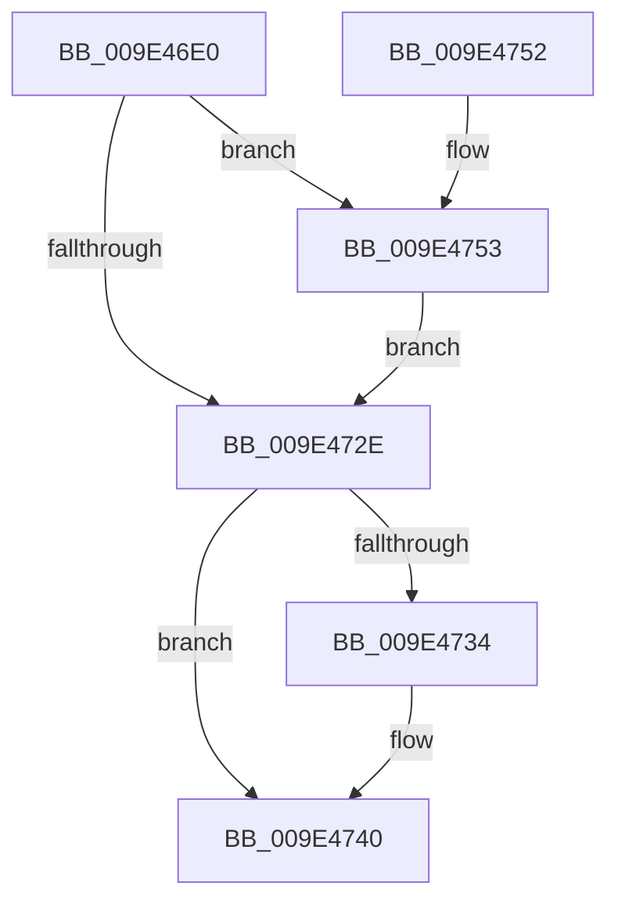

# WmiTraceRundownNotify

- RVA: `0x009E46E0`–`0x009E477A` (길이 `154` bytes)
- VA: `0x00000001409E46E0`
- 실행 섹션: `PAGE`
- PDB 이름 있음: `예`; PDB Function 태그: `아니요`
- unwind 정보 RVA: `0x000A40E0`
- 디코드: `43`개 명령, `154/154` bytes 표시
- 미해석 바이트: `0` (있으면 어셈블리에 `.byte`로 보존)

> 이 문서는 커널 이미지의 기계어와 PDB 기호를 분석해 생성했습니다. 4번과 5번은 함수 원형과 자료형을 바이너리 사용 방식에서 추정한 C 해석이며 원본 소스 복구 결과는 아닙니다.

## 1. Dependencies

- 직접 호출 지점: **3**; 고유 호출 대상: **3**
- 직접 호출자로 확인된 함수: **4**
- RIP 상대 이미지 참조: **0**

### Outgoing calls
- `0x009E4723` → [WmipBuildTraceDeviceList](../../text/49/WmipBuildTraceDeviceList_function_00494050.md) (function, `0x00494050`)
- `0x009E473B` → [WmipFreeTraceDeviceList](WmipFreeTraceDeviceList_function_009E4780.md) (function, `0x009E4780`)
- `0x009E476C` → [WmipSendWmiIrpToTraceDeviceList](WmipSendWmiIrpToTraceDeviceList_function_009E2988.md) (function, `0x009E2988`)

### Direct callers
- [EtwpLogFileNameRundown](../7C/EtwpLogFileNameRundown_function_007C00F0.md) at `0x007C0123`
- [EtwpKernelTraceRundown](EtwpKernelTraceRundown_function_009E4080.md) at `0x009E4388`
- [EtwpDisableKernelTrace](../A4/EtwpDisableKernelTrace_function_00A4F7D8.md) at `0x00A4FB90`
- [EtwpUpdateFileInfoDriverState](../A5/EtwpUpdateFileInfoDriverState_function_00A501BC.md) at `0x00A501F1`

### Static image references
- 디코드된 RIP-relative 메모리 참조가 없습니다.

## 2. Other-region calls and transfers

- 다른 실행 섹션으로 향하는 call: **1**
  - `0x009E4723` → [WmipBuildTraceDeviceList](../../text/49/WmipBuildTraceDeviceList_function_00494050.md) (`PAGE` → `.text`)
- 별도 외부 분기/꼬리 이동을 확인하지 못했습니다.

## 3. Assembly (complete function range)

```asm
009E46E0  48 89 5C 24 10                  mov qword ptr [rsp + 0x10], rbx
009E46E5  48 89 74 24 20                  mov qword ptr [rsp + 0x20], rsi
009E46EA  44 89 44 24 18                  mov dword ptr [rsp + 0x18], r8d
009E46EF  55                              push rbp
009E46F0  48 8B EC                        mov rbp, rsp
009E46F3  48 83 EC 50                     sub rsp, 0x50
009E46F7  33 F6                           xor esi, esi
009E46F9  48 89 4D E8                     mov qword ptr [rbp - 0x18], rcx
009E46FD  89 55 E4                        mov dword ptr [rbp - 0x1c], edx
009E4700  4C 8D 45 20                     lea r8, [rbp + 0x20]
009E4704  B9 00 00 40 00                  mov ecx, 0x400000
009E4709  48 89 75 10                     mov qword ptr [rbp + 0x10], rsi
009E470D  48 8D 55 10                     lea rdx, [rbp + 0x10]
009E4711  89 75 20                        mov dword ptr [rbp + 0x20], esi
009E4714  48 C7 45 F0 00 00 40 00         mov qword ptr [rbp - 0x10], 0x400000
009E471C  C7 45 E0 02 00 00 00            mov dword ptr [rbp - 0x20], 2
009E4723  E8 28 F9 AA FF                  call 0x140494050
009E4728  8B D8                           mov ebx, eax
009E472A  85 C0                           test eax, eax
009E472C  79 25                           jns 0x1409e4753
009E472E  48 39 75 10                     cmp qword ptr [rbp + 0x10], rsi
009E4732  74 0C                           je 0x1409e4740
009E4734  8B 55 20                        mov edx, dword ptr [rbp + 0x20]
009E4737  48 8B 4D 10                     mov rcx, qword ptr [rbp + 0x10]
009E473B  E8 40 00 00 00                  call 0x1409e4780
009E4740  48 8B 74 24 78                  mov rsi, qword ptr [rsp + 0x78]
009E4745  8B C3                           mov eax, ebx
009E4747  48 8B 5C 24 68                  mov rbx, qword ptr [rsp + 0x68]
009E474C  48 83 C4 50                     add rsp, 0x50
009E4750  5D                              pop rbp
009E4751  C3                              ret
009E4752  CC                              int3
009E4753  8B 55 20                        mov edx, dword ptr [rbp + 0x20]
009E4756  48 8D 45 E0                     lea rax, [rbp - 0x20]
009E475A  48 8B 4D 10                     mov rcx, qword ptr [rbp + 0x10]
009E475E  41 B9 18 00 00 00               mov r9d, 0x18
009E4764  41 B0 0C                        mov r8b, 0xc
009E4767  48 89 44 24 20                  mov qword ptr [rsp + 0x20], rax
009E476C  E8 17 E2 FF FF                  call 0x1409e2988
009E4771  85 C0                           test eax, eax
009E4773  8B D8                           mov ebx, eax
009E4775  0F 49 DE                        cmovns ebx, esi
009E4778  EB B4                           jmp 0x1409e472e
```

## 4. C-style interpretation (structured pseudocode)

```c
__int64 __fastcall WmiTraceRundownNotify(__int64 a1, int a2, int a3)
{
    __int64 result;
    __int64 v_rbx;
    __int64 v_rsi;
    __int64 v_rsp;
    unsigned __int64 v_stack_m18;
    unsigned __int64 v_stack_m20;
    unsigned int v_stack_m24;
    unsigned int v_stack_m28;
    unsigned __int64 v_stack_p10;
    unsigned int v_stack_p18;
    unsigned __int64 v_stack_p20;
    unsigned __int64 v_stack_p8;

    v_stack_p10 = v_rbx;
    v_stack_p20 = v_rsi;
    v_stack_p18 = a3;
    v_rsp = (v_rsp) - (80);
    v_rsi = 0;
    v_stack_m20 = a1;
    v_stack_m24 = a2;
    v_stack_p8 = 0;
    v_stack_p18 = 0;
    v_stack_m18 = 0x400000ULL;
    v_stack_m28 = 2;
    result = WmipBuildTraceDeviceList((unsigned int)(0x400000ULL), v_stack_p8, v_stack_p18, a4);
    if (!sign_flag) goto loc_009E4753;
loc_009E472E:
    if (v_stack_p8 != 0) {
        a2 = v_stack_p18;
        a1 = v_stack_p8;
        result = WmipFreeTraceDeviceList(a1, a2, v_stack_p18, a4);
    }
    v_rsp = (v_rsp) + (80);
    return (unsigned int)((unsigned int)((unsigned int)((unsigned int)(result))));
loc_009E4753:
    v_stack_p20 = v_stack_m28;
    result = WmipSendWmiIrpToTraceDeviceList(v_stack_p8, (unsigned int)(v_stack_p18), 12, 24);
    v_rbx = (unsigned int)((unsigned int)(result));
    if (!sign_flag) { v_rbx = (unsigned int)(v_stack_p20); }
    goto loc_009E472E;
}
```

## 5. (Beta) C Style

```c
int64_t WmiTraceRundownNotify(int64_t Arg1, int32_t Arg2, int32_t Arg3)
{
    int64_t result;
    int64_t local_rbx;
    int64_t local_rsi;
    int64_t local_rsp;
    uint64_t v_stack_m18;
    uint64_t v_stack_m20;
    uint32_t v_stack_m24;
    uint32_t v_stack_m28;
    uint64_t v_stack_p10;
    uint32_t v_stack_p18;
    uint64_t v_stack_p20;
    uint64_t v_stack_p8;

    v_stack_p10 = local_rbx;
    v_stack_p20 = local_rsi;
    v_stack_p18 = Arg3;
    local_rsp = (local_rsp) - (80);
    local_rsi = 0;
    v_stack_m20 = Arg1;
    v_stack_m24 = Arg2;
    v_stack_p8 = 0;
    v_stack_p18 = 0;
    v_stack_m18 = 0x400000ULL;
    v_stack_m28 = 2;
    result = WmipBuildTraceDeviceList((uint32_t)(0x400000ULL), v_stack_p8, v_stack_p18, a4);
    if (!sign_flag) goto loc_009E4753;
loc_009E472E:
    if (v_stack_p8 != 0) {
        Arg2 = v_stack_p18;
        Arg1 = v_stack_p8;
        result = WmipFreeTraceDeviceList(Arg1, Arg2, v_stack_p18, a4);
    }
    local_rsp = (local_rsp) + (80);
    return (uint32_t)((uint32_t)((uint32_t)((uint32_t)(result))));
loc_009E4753:
    v_stack_p20 = v_stack_m28;
    result = WmipSendWmiIrpToTraceDeviceList(v_stack_p8, (uint32_t)(v_stack_p18), 12, 24);
    local_rbx = (uint32_t)((uint32_t)(result));
    if (!sign_flag) { local_rbx = (uint32_t)(v_stack_p20); }
    goto loc_009E472E;
}
```

## 6. Execution-region graph

[열기: 2D/3D 그래프와 함수 탐색 컨트롤 패널](../../../control-panel.html?section=page&rva=0x009E46E0&view=graph)

- 2D 그래프는 위에서 아래로 흐르고, 3D 그래프는 빈 공간을 드래그해 회전합니다. Shift+드래그는 이동, 휠은 확대·축소, 함수 노드 선택은 대상 보고서 이동입니다.

### Static fallback


