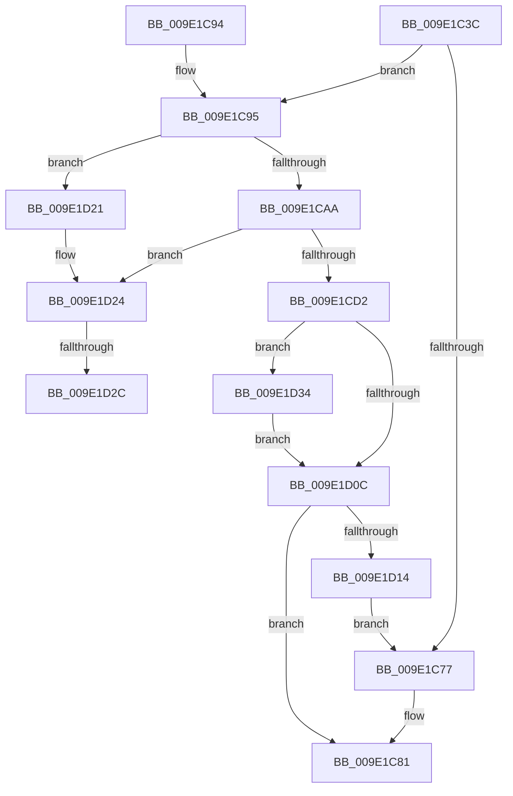

# WmipAddProviderIdToPIList

- RVA: `0x009E1C3C`–`0x009E1D40` (길이 `260` bytes)
- VA: `0x00000001409E1C3C`
- 실행 섹션: `PAGE`
- PDB 이름 있음: `예`; PDB Function 태그: `예`
- unwind 정보 RVA: `0x000A3DC8`
- 디코드: `77`개 명령, `260/260` bytes 표시
- 미해석 바이트: `0` (있으면 어셈블리에 `.byte`로 보존)

> 이 문서는 커널 이미지의 기계어와 PDB 기호를 분석해 생성했습니다. 4번과 5번은 함수 원형과 자료형을 바이너리 사용 방식에서 추정한 C 해석이며 원본 소스 복구 결과는 아닙니다.

## 1. Dependencies

- 직접 호출 지점: **3**; 고유 호출 대상: **3**
- 직접 호출자로 확인된 함수: **1**
- RIP 상대 이미지 참조: **0**

### Outgoing calls
- `0x009E1CC2` → [ExAllocatePool2](../../poolcode/B8/ExAllocatePool2_function_00B820F0.md) (function, `0x00B820F0`)
- `0x009E1CE0` → [memcpy](../../text/6C/memcpy_function_006C6840.md) (function, `0x006C6840`)
- `0x009E1D39` → [ExFreePoolWithTag](../../poolcode/B8/ExFreePoolWithTag_function_00B82870.md) (function, `0x00B82870`)

### Direct callers
- [WmipPrepareWnodeSI](WmipPrepareWnodeSI_function_009E1740.md) at `0x009E18B4`

### Static image references
- 디코드된 RIP-relative 메모리 참조가 없습니다.

## 2. Other-region calls and transfers

- 다른 실행 섹션으로 향하는 call: **3**
  - `0x009E1CC2` → [ExAllocatePool2](../../poolcode/B8/ExAllocatePool2_function_00B820F0.md) (`PAGE` → `POOLCODE`)
  - `0x009E1CE0` → [memcpy](../../text/6C/memcpy_function_006C6840.md) (`PAGE` → `.text`)
  - `0x009E1D39` → [ExFreePoolWithTag](../../poolcode/B8/ExFreePoolWithTag_function_00B82870.md) (`PAGE` → `POOLCODE`)
- call이 아닌 외부 분기/꼬리 이동: **2**
  - `0x009E1D26` → [sub_00B302EC + 0x19](../B3/Unknown_function_00B302EC.md) (`tail-transfer`)
  - `0x009E1D2F` → [sub_00B302EC](../B3/Unknown_function_00B302EC.md) (`tail-transfer`)

## 3. Assembly (complete function range)

```asm
009E1C3C  48 8B C4                        mov rax, rsp
009E1C3F  4C 89 48 20                     mov qword ptr [rax + 0x20], r9
009E1C43  4C 89 40 18                     mov qword ptr [rax + 0x18], r8
009E1C47  48 89 50 10                     mov qword ptr [rax + 0x10], rdx
009E1C4B  48 89 48 08                     mov qword ptr [rax + 8], rcx
009E1C4F  53                              push rbx
009E1C50  55                              push rbp
009E1C51  56                              push rsi
009E1C52  57                              push rdi
009E1C53  41 54                           push r12
009E1C55  41 55                           push r13
009E1C57  41 56                           push r14
009E1C59  41 57                           push r15
009E1C5B  48 83 EC 38                     sub rsp, 0x38
009E1C5F  44 8B 3A                        mov r15d, dword ptr [rdx]
009E1C62  33 DB                           xor ebx, ebx
009E1C64  41 8B 28                        mov ebp, dword ptr [r8]
009E1C67  48 8B 39                        mov rdi, qword ptr [rcx]
009E1C6A  4C 8B AC 24 A0 00 00 00         mov r13, qword ptr [rsp + 0xa0]
009E1C72  44 3B FD                        cmp r15d, ebp
009E1C75  74 1E                           je 0x1409e1c95
009E1C77  41 8D 4F 01                     lea ecx, [r15 + 1]
009E1C7B  4E 89 2C FF                     mov qword ptr [rdi + r15*8], r13
009E1C7F  89 0A                           mov dword ptr [rdx], ecx
009E1C81  8B C3                           mov eax, ebx
009E1C83  48 83 C4 38                     add rsp, 0x38
009E1C87  41 5F                           pop r15
009E1C89  41 5E                           pop r14
009E1C8B  41 5D                           pop r13
009E1C8D  41 5C                           pop r12
009E1C8F  5F                              pop rdi
009E1C90  5E                              pop rsi
009E1C91  5D                              pop rbp
009E1C92  5B                              pop rbx
009E1C93  C3                              ret
009E1C94  CC                              int3
009E1C95  48 8D 04 6D 00 00 00 00         lea rax, [rbp*2]
009E1C9D  B9 FF FF FF FF                  mov ecx, 0xffffffff
009E1CA2  4C 8B F5                        mov r14, rbp
009E1CA5  48 3B C1                        cmp rax, rcx
009E1CA8  77 77                           ja 0x1409e1d21
009E1CAA  8B C0                           mov eax, eax
009E1CAC  B9 00 01 00 00                  mov ecx, 0x100
009E1CB1  8B D0                           mov edx, eax
009E1CB3  48 89 44 24 20                  mov qword ptr [rsp + 0x20], rax
009E1CB8  48 C1 E2 03                     shl rdx, 3
009E1CBC  41 B8 57 6D 69 70               mov r8d, 0x70696d57
009E1CC2  E8 29 04 1A 00                  call 0x140b820f0
009E1CC7  48 8B F0                        mov rsi, rax
009E1CCA  4C 8B E7                        mov r12, rdi
009E1CCD  48 85 C0                        test rax, rax
009E1CD0  74 52                           je 0x1409e1d24
009E1CD2  4C 8D 04 ED 00 00 00 00         lea r8, [rbp*8]
009E1CDA  48 8B D7                        mov rdx, rdi
009E1CDD  48 8B C8                        mov rcx, rax
009E1CE0  E8 5B 4B CE FF                  call 0x1406c6840
009E1CE5  48 8B 84 24 90 00 00 00         mov rax, qword ptr [rsp + 0x90]
009E1CED  48 8B FE                        mov rdi, rsi
009E1CF0  48 8B 4C 24 20                  mov rcx, qword ptr [rsp + 0x20]
009E1CF5  89 08                           mov dword ptr [rax], ecx
009E1CF7  48 8B 84 24 80 00 00 00         mov rax, qword ptr [rsp + 0x80]
009E1CFF  48 89 30                        mov qword ptr [rax], rsi
009E1D02  4C 3B A4 24 98 00 00 00         cmp r12, qword ptr [rsp + 0x98]
009E1D0A  75 28                           jne 0x1409e1d34
009E1D0C  85 DB                           test ebx, ebx
009E1D0E  0F 88 6D FF FF FF               js 0x1409e1c81
009E1D14  48 8B 94 24 88 00 00 00         mov rdx, qword ptr [rsp + 0x88]
009E1D1C  E9 56 FF FF FF                  jmp 0x1409e1c77
009E1D21  4C 8B E7                        mov r12, rdi
009E1D24  85 ED                           test ebp, ebp
009E1D26  0F 84 D9 E5 14 00               je 0x140b30305
009E1D2C  48 8B DF                        mov rbx, rdi
009E1D2F  E9 B8 E5 14 00                  jmp 0x140b302ec
009E1D34  33 D2                           xor edx, edx
009E1D36  49 8B CC                        mov rcx, r12
009E1D39  E8 32 0B 1A 00                  call 0x140b82870
009E1D3E  EB CC                           jmp 0x1409e1d0c
```

## 4. C-style interpretation (structured pseudocode)

```c
__int64 __fastcall WmipAddProviderIdToPIList(__int64 a1, __int64 a2, __int64 a3, __int64 a4, __int64 a5)
{
    __int64 result;
    __int64 v_rbx;
    __int64 v_rsp;
    unsigned __int64 v_stack_p20;
    unsigned __int64 v_stack_p80;
    unsigned __int64 v_stack_p88;
    unsigned __int64 v_stack_p90;
    unsigned __int64 v_stack_p98;

    *(unsigned __int64 *)(v_rsp + 32) = a4;
    *(unsigned __int64 *)(v_rsp + 24) = a3;
    *(unsigned __int64 *)(v_rsp + 16) = a2;
    *(unsigned __int64 *)(v_rsp + 8) = a1;
    v_rsp = (v_rsp) - (56);
    v_rbx = 0;
    if (((unsigned int)((unsigned int)(*(unsigned int *)(a2)))) == ((unsigned int)((unsigned int)(*(unsigned int *)(a3))))) goto loc_009E1C95;
loc_009E1C77:
    *(unsigned __int64 *)(*(unsigned __int64 *)(a1) + (unsigned int)(*(unsigned int *)(a2)) * 8) = a5;
    *(unsigned int *)(a2) = (unsigned int)((unsigned int)(*(unsigned int *)(a2)) + 1);
loc_009E1C81:
    v_rsp = (v_rsp) + (56);
    return 0;
loc_009E1C95:
    if (((unsigned int)(*(unsigned int *)(a3)) * 2) > ((unsigned int)(0xFFFFFFFFULL))) goto loc_009E1D21;
    v_stack_p20 = (unsigned int)((unsigned int)((unsigned int)(*(unsigned int *)(a3)) * 2));
    a2 = ((unsigned int)((unsigned int)((unsigned int)((unsigned int)((unsigned int)(*(unsigned int *)(a3)) * 2))))) << (3);
    result = ExAllocatePool2(256, a2, (unsigned int)(0x70696D57ULL), a4);
    if (result == 0) goto loc_009E1D24;
    result = memcpy(result, *(unsigned __int64 *)(a1), (unsigned int)(*(unsigned int *)(a3)) * 8, a4);
    *(unsigned int *)(v_stack_p90) = (unsigned int)(v_stack_p20);
    *(unsigned __int64 *)(v_stack_p80) = result;
    if ((*(unsigned __int64 *)(a1)) != v_stack_p98) goto loc_009E1D34;
loc_009E1D0C:
    if (sign_flag) goto loc_009E1C81;
    goto loc_009E1C77;
loc_009E1D21:
loc_009E1D24:
loc_009E1D34:
    a2 = 0;
    result = ExFreePoolWithTag(result, a2, (unsigned int)(*(unsigned int *)(a3)) * 8, a4);
    goto loc_009E1D0C;
}
```

## 5. (Beta) C Style

```c
int64_t WmipAddProviderIdToPIList(void *Arg1, void *Arg2, void *Arg3, int64_t Arg4, int64_t Arg5)
{
    uint8_t *arg1 = (uint8_t *)Arg1;
    uint8_t *arg2 = (uint8_t *)Arg2;
    uint8_t *arg3 = (uint8_t *)Arg3;

    int64_t result;
    int64_t local_rbx;
    int64_t local_rsp;
    uint64_t v_stack_p20;
    uint64_t v_stack_p80;
    uint64_t v_stack_p88;
    uint64_t v_stack_p90;
    uint64_t v_stack_p98;

    *(uint64_t *)(local_rsp + 0x20) = Arg4;
    *(void **)(local_rsp + 0x18) = Arg3;
    *(void **)(local_rsp + 0x10) = Arg2;
    *(void **)(local_rsp + 0x8) = Arg1;
    local_rsp = (local_rsp) - (56);
    local_rbx = 0;
    if (((uint32_t)((uint32_t)(*(uint32_t *)(arg2)))) == ((uint32_t)((uint32_t)(*(uint32_t *)(arg3))))) goto loc_009E1C95;
loc_009E1C77:
    *(uint64_t *)(*(uint64_t *)(arg1) + (uint32_t)(*(uint32_t *)(arg2)) * 8) = Arg5;
    *(uint32_t *)(arg2) = (uint32_t)((uint32_t)(*(uint32_t *)(arg2)) + 1);
loc_009E1C81:
    local_rsp = (local_rsp) + (56);
    return 0;
loc_009E1C95:
    if (((uint32_t)(*(uint32_t *)(arg3)) * 2) > ((uint32_t)(0xFFFFFFFFULL))) goto loc_009E1D21;
    v_stack_p20 = (uint32_t)((uint32_t)((uint32_t)(*(uint32_t *)(arg3)) * 2));
    Arg2 = ((uint32_t)((uint32_t)((uint32_t)((uint32_t)((uint32_t)(*(uint32_t *)(arg3)) * 2))))) << (3);
    result = ExAllocatePool2(256, Arg2, (uint32_t)(0x70696D57ULL), Arg4);
    if (result == 0) goto loc_009E1D24;
    result = memcpy(result, *(uint64_t *)(arg1), (uint32_t)(*(uint32_t *)(arg3)) * 8, Arg4);
    *(uint32_t *)(v_stack_p90) = (uint32_t)(v_stack_p20);
    *(uint64_t *)(v_stack_p80) = result;
    if ((*(uint64_t *)(arg1)) != v_stack_p98) goto loc_009E1D34;
loc_009E1D0C:
    if (sign_flag) goto loc_009E1C81;
    goto loc_009E1C77;
loc_009E1D21:
loc_009E1D24:
loc_009E1D34:
    Arg2 = 0;
    result = ExFreePoolWithTag(result, Arg2, (uint32_t)(*(uint32_t *)(arg3)) * 8, Arg4);
    goto loc_009E1D0C;
}
```

### 관측된 메모리 오프셋

구조체 형식이 확인되지 않은 접근은 인자 기준의 오프셋으로만 기록했습니다.

| 기준 인자 | 오프셋 표현 | 폭 (bit) | 접근 |
|---|---:|---:|---|
| `Arg1` | `+ 0x0` | `64` | `R` |
| `Arg2` | `+ 0x0` | `32` | `R` |
| `Arg3` | `+ 0x0` | `32` | `R` |

## 6. Execution-region graph

[열기: 2D/3D 그래프와 함수 탐색 컨트롤 패널](../../../control-panel.html?section=page&rva=0x009E1C3C&view=graph)

- 2D 그래프는 위에서 아래로 흐르고, 3D 그래프는 빈 공간을 드래그해 회전합니다. Shift+드래그는 이동, 휠은 확대·축소, 함수 노드 선택은 대상 보고서 이동입니다.

### Static fallback


