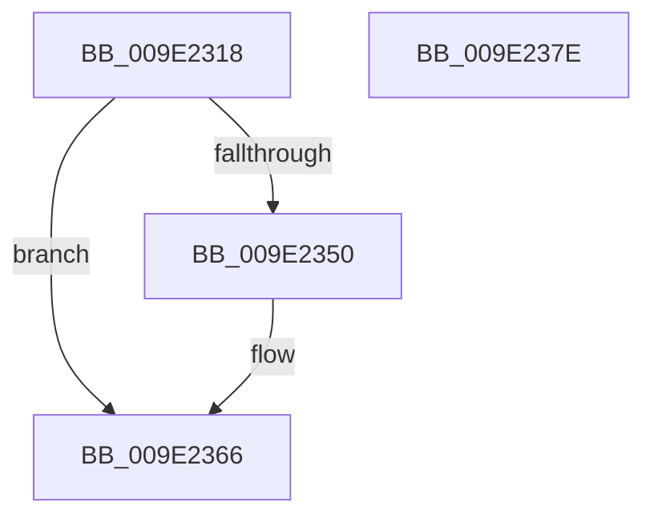

# WmipCountedToSz

- RVA: `0x009E2318`–`0x009E237F` (길이 `103` bytes)
- VA: `0x00000001409E2318`
- 실행 섹션: `PAGE`
- PDB 이름 있음: `예`; PDB Function 태그: `아니요`
- unwind 정보 RVA: `0x0005C954`
- 디코드: `29`개 명령, `103/103` bytes 표시
- 미해석 바이트: `0` (있으면 어셈블리에 `.byte`로 보존)

> 이 문서는 커널 이미지의 기계어와 PDB 기호를 분석해 생성했습니다. 4번과 5번은 함수 원형과 자료형을 바이너리 사용 방식에서 추정한 C 해석이며 원본 소스 복구 결과는 아닙니다.

## 1. Dependencies

- 직접 호출 지점: **2**; 고유 호출 대상: **2**
- 직접 호출자로 확인된 함수: **2**
- RIP 상대 이미지 참조: **0**

### Outgoing calls
- `0x009E2341` → [ExAllocatePool2](../../poolcode/B8/ExAllocatePool2_function_00B820F0.md) (function, `0x00B820F0`)
- `0x009E235A` → [memcpy](../../text/6C/memcpy_function_006C6840.md) (function, `0x006C6840`)

### Direct callers
- [WmipAddDataSource](../9D/WmipAddDataSource_function_009DDC30.md) at `0x009DDE6D`
- [WmipAddDataSource](../9D/WmipAddDataSource_function_009DDC30.md) at `0x009DDE7D`
- [WmipPrepareWnodeSI](WmipPrepareWnodeSI_function_009E1740.md) at `0x009E17D2`

### Static image references
- 디코드된 RIP-relative 메모리 참조가 없습니다.

## 2. Other-region calls and transfers

- 다른 실행 섹션으로 향하는 call: **2**
  - `0x009E2341` → [ExAllocatePool2](../../poolcode/B8/ExAllocatePool2_function_00B820F0.md) (`PAGE` → `POOLCODE`)
  - `0x009E235A` → [memcpy](../../text/6C/memcpy_function_006C6840.md) (`PAGE` → `.text`)
- 별도 외부 분기/꼬리 이동을 확인하지 못했습니다.

## 3. Assembly (complete function range)

```asm
009E2318  48 89 5C 24 08                  mov qword ptr [rsp + 8], rbx
009E231D  48 89 6C 24 10                  mov qword ptr [rsp + 0x10], rbp
009E2322  48 89 74 24 18                  mov qword ptr [rsp + 0x18], rsi
009E2327  57                              push rdi
009E2328  48 83 EC 20                     sub rsp, 0x20
009E232C  0F B7 39                        movzx edi, word ptr [rcx]
009E232F  48 8B F1                        mov rsi, rcx
009E2332  B9 00 01 00 00                  mov ecx, 0x100
009E2337  41 B8 57 6D 69 70               mov r8d, 0x70696d57
009E233D  48 8D 57 02                     lea rdx, [rdi + 2]
009E2341  E8 AA FD 19 00                  call 0x140b820f0
009E2346  33 ED                           xor ebp, ebp
009E2348  48 8B D8                        mov rbx, rax
009E234B  48 85 C0                        test rax, rax
009E234E  74 16                           je 0x1409e2366
009E2350  48 8D 56 02                     lea rdx, [rsi + 2]
009E2354  44 8B C7                        mov r8d, edi
009E2357  48 8B C8                        mov rcx, rax
009E235A  E8 E1 44 CE FF                  call 0x1406c6840
009E235F  48 D1 EF                        shr rdi, 1
009E2362  66 89 2C 7B                     mov word ptr [rbx + rdi*2], bp
009E2366  48 8B 6C 24 38                  mov rbp, qword ptr [rsp + 0x38]
009E236B  48 8B C3                        mov rax, rbx
009E236E  48 8B 5C 24 30                  mov rbx, qword ptr [rsp + 0x30]
009E2373  48 8B 74 24 40                  mov rsi, qword ptr [rsp + 0x40]
009E2378  48 83 C4 20                     add rsp, 0x20
009E237C  5F                              pop rdi
009E237D  C3                              ret
009E237E  CC                              int3
```

## 4. C-style interpretation (structured pseudocode)

```c
__int64 __fastcall WmipCountedToSz(__int64 a1)
{
    __int64 result;
    __int64 v_rbp;
    __int64 v_rdi;
    __int64 v_rsp;
    unsigned __int64 v_stack_p10;
    unsigned __int64 v_stack_p18;
    unsigned __int64 v_stack_p8;

    v_stack_p8 = v_rbx;
    v_stack_p10 = v_rbp;
    v_stack_p18 = v_rsi;
    v_rsp = (v_rsp) - (32);
    result = ExAllocatePool2(256, *(unsigned __int16 *)(a1) + 2, (unsigned int)(0x70696D57ULL), a4);
    v_rbp = 0;
    v_rdi = *(unsigned __int16 *)(a1);
    if (result != 0) {
        a2 = a1 + 2;
        a3 = (unsigned int)(*(unsigned __int16 *)(a1));
        a1 = result;
        result = memcpy(a1, a2, a3, a4);
        v_rdi = (*(unsigned __int16 *)(a1)) >> (1);
        *(unsigned __int16 *)(result + v_rdi * 2) = 0;
    }
    v_rsp = (v_rsp) + (32);
    return result;
}
```

## 5. (Beta) C Style

```c
int64_t WmipCountedToSz(void *Arg1)
{
    uint8_t *arg1 = (uint8_t *)Arg1;

    int64_t result;
    int64_t local_rbp;
    int64_t local_rdi;
    int64_t local_rsp;
    uint64_t v_stack_p10;
    uint64_t v_stack_p18;
    uint64_t v_stack_p8;

    v_stack_p8 = local_rbx;
    v_stack_p10 = local_rbp;
    v_stack_p18 = local_rsi;
    local_rsp = (local_rsp) - (32);
    result = ExAllocatePool2(256, *(uint16_t *)(arg1) + 2, (uint32_t)(0x70696D57ULL), a4);
    local_rbp = 0;
    local_rdi = *(uint16_t *)(arg1);
    if (result != 0) {
        a2 = Arg1 + 2;
        a3 = (uint32_t)(*(uint16_t *)(arg1));
        Arg1 = result;
        result = memcpy(Arg1, a2, a3, a4);
        local_rdi = (*(uint16_t *)(arg1)) >> (1);
        *(uint16_t *)(result + local_rdi * 2) = 0;
    }
    local_rsp = (local_rsp) + (32);
    return result;
}
```

### 관측된 메모리 오프셋

구조체 형식이 확인되지 않은 접근은 인자 기준의 오프셋으로만 기록했습니다.

| 기준 인자 | 오프셋 표현 | 폭 (bit) | 접근 |
|---|---:|---:|---|
| `Arg1` | `+ 0x0` | `16` | `R` |
| `Arg1` | `+ 0x2` | `64` | `R` |

## 6. Execution-region graph

[열기: 2D/3D 그래프와 함수 탐색 컨트롤 패널](../../../control-panel.html?section=page&rva=0x009E2318&view=graph)

- 2D 그래프는 위에서 아래로 흐르고, 3D 그래프는 빈 공간을 드래그해 회전합니다. Shift+드래그는 이동, 휠은 확대·축소, 함수 노드 선택은 대상 보고서 이동입니다.

### Static fallback


