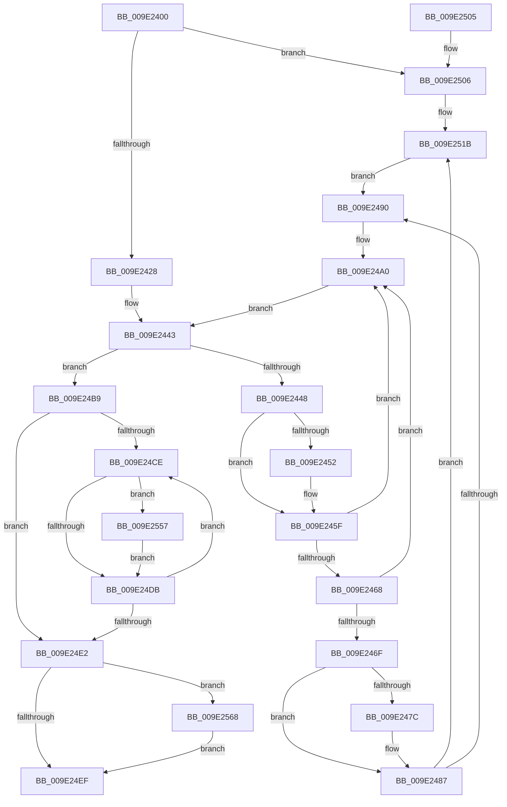

# WmipDSCleanup

- RVA: `0x009E2400`–`0x009E2579` (길이 `377` bytes)
- VA: `0x00000001409E2400`
- 실행 섹션: `PAGE`
- PDB 이름 있음: `예`; PDB Function 태그: `아니요`
- unwind 정보 RVA: `0x000A3E30`
- 디코드: `98`개 명령, `377/377` bytes 표시
- 미해석 바이트: `0` (있으면 어셈블리에 `.byte`로 보존)

> 이 문서는 커널 이미지의 기계어와 PDB 기호를 분석해 생성했습니다. 4번과 5번은 함수 원형과 자료형을 바이너리 사용 방식에서 추정한 C 해석이며 원본 소스 복구 결과는 아닙니다.

## 1. Dependencies

- 직접 호출 지점: **11**; 고유 호출 대상: **7**
- 직접 호출자로 확인된 함수: **0**
- RIP 상대 이미지 참조: **7**

### Outgoing calls
- `0x009E2437` → [KeWaitForSingleObject](../../text/20/KeWaitForSingleObject_function_0020E6B0.md) (function, `0x0020E6B0`)
- `0x009E2455` → [WmipUnlinkInstanceSetFromGuidEntry](WmipUnlinkInstanceSetFromGuidEntry_function_009E2580.md) (function, `0x009E2580`)
- `0x009E249B` → [WmipUnreferenceEntry](WmipUnreferenceEntry_function_009E0CC8.md) (function, `0x009E0CC8`)
- `0x009E24B2` → [WmipUnreferenceEntry](WmipUnreferenceEntry_function_009E0CC8.md) (function, `0x009E0CC8`)
- `0x009E24C2` → [KeReleaseMutex](../../text/39/KeReleaseMutex_function_00396810.md) (function, `0x00396810`)
- `0x009E2515` → [KeBugCheckEx](../../text/4F/KeBugCheckEx_function_004FD660.md) (function, `0x004FD660`)
- `0x009E2524` → [KeReleaseMutex](../../text/39/KeReleaseMutex_function_00396810.md) (function, `0x00396810`)
- `0x009E2533` → [WmipGenerateBinaryMofNotification](../7B/WmipGenerateBinaryMofNotification_function_007B4348.md) (function, `0x007B4348`)
- `0x009E254D` → [KeWaitForSingleObject](../../text/20/KeWaitForSingleObject_function_0020E6B0.md) (function, `0x0020E6B0`)
- `0x009E255E` → [WmipUnreferenceEntry](WmipUnreferenceEntry_function_009E0CC8.md) (function, `0x009E0CC8`)
- `0x009E256A` → [ExFreePoolWithTag](../../poolcode/B8/ExFreePoolWithTag_function_00B82870.md) (function, `0x00B82870`)

### Direct callers
- 이 함수 시작 RVA로 연결되는 직접 call은 확인되지 않았습니다. 간접 호출은 완전히 역산할 수 없습니다.

### Static image references
- `0x009E242B` → RVA `0x00EFFA60` (`.data`; read)
- `0x009E2473` → RVA `0x00B4AF40` (`WmipBinaryMofGuid`; read)
- `0x009E2480` → RVA `0x00B4AF48` (`PAGE`; read)
- `0x009E2494` → RVA `0x00E03628` (`.data`; read)
- `0x009E24A5` → RVA `0x00E03608` (`.data`; read)
- `0x009E2529` → RVA `0x00B4B0A0` (`GUID_MOF_RESOURCE_REMOVED_NOTIFICATION`; read)
- `0x009E2557` → RVA `0x00E03668` (`.data`; read)

## 2. Other-region calls and transfers

- 다른 실행 섹션으로 향하는 call: **6**
  - `0x009E2437` → [KeWaitForSingleObject](../../text/20/KeWaitForSingleObject_function_0020E6B0.md) (`PAGE` → `.text`)
  - `0x009E24C2` → [KeReleaseMutex](../../text/39/KeReleaseMutex_function_00396810.md) (`PAGE` → `.text`)
  - `0x009E2515` → [KeBugCheckEx](../../text/4F/KeBugCheckEx_function_004FD660.md) (`PAGE` → `.text`)
  - `0x009E2524` → [KeReleaseMutex](../../text/39/KeReleaseMutex_function_00396810.md) (`PAGE` → `.text`)
  - `0x009E254D` → [KeWaitForSingleObject](../../text/20/KeWaitForSingleObject_function_0020E6B0.md) (`PAGE` → `.text`)
  - `0x009E256A` → [ExFreePoolWithTag](../../poolcode/B8/ExFreePoolWithTag_function_00B82870.md) (`PAGE` → `POOLCODE`)
- 별도 외부 분기/꼬리 이동을 확인하지 못했습니다.

## 3. Assembly (complete function range)

```asm
009E2400  4C 8B DC                        mov r11, rsp
009E2403  49 89 73 08                     mov qword ptr [r11 + 8], rsi
009E2407  49 89 7B 10                     mov qword ptr [r11 + 0x10], rdi
009E240B  4D 89 73 18                     mov qword ptr [r11 + 0x18], r14
009E240F  41 57                           push r15
009E2411  48 83 EC 30                     sub rsp, 0x30
009E2415  49 83 63 E8 00                  and qword ptr [r11 - 0x18], 0
009E241A  48 8B F9                        mov rdi, rcx
009E241D  8B 41 10                        mov eax, dword ptr [rcx + 0x10]
009E2420  A8 01                           test al, 1
009E2422  0F 84 DE 00 00 00               je 0x1409e2506
009E2428  45 33 C9                        xor r9d, r9d
009E242B  48 8D 0D 2E D6 51 00            lea rcx, [rip + 0x51d62e]
009E2432  45 33 C0                        xor r8d, r8d
009E2435  33 D2                           xor edx, edx
009E2437  E8 74 C2 82 FF                  call 0x14020e6b0
009E243C  4C 8D 7F 28                     lea r15, [rdi + 0x28]
009E2440  4D 8B 37                        mov r14, qword ptr [r15]
009E2443  4D 3B F7                        cmp r14, r15
009E2446  74 71                           je 0x1409e24b9
009E2448  49 8D 76 D8                     lea rsi, [r14 - 0x28]
009E244C  48 83 3E 00                     cmp qword ptr [rsi], 0
009E2450  74 0D                           je 0x1409e245f
009E2452  48 8B CE                        mov rcx, rsi
009E2455  E8 26 01 00 00                  call 0x1409e2580
009E245A  48 83 66 40 00                  and qword ptr [rsi + 0x40], 0
009E245F  48 8B 56 38                     mov rdx, qword ptr [rsi + 0x38]
009E2463  48 85 D2                        test rdx, rdx
009E2466  74 38                           je 0x1409e24a0
009E2468  8B 46 10                        mov eax, dword ptr [rsi + 0x10]
009E246B  A8 08                           test al, 8
009E246D  75 31                           jne 0x1409e24a0
009E246F  48 8B 4A 48                     mov rcx, qword ptr [rdx + 0x48]
009E2473  48 2B 0D C6 8A 16 00            sub rcx, qword ptr [rip + 0x168ac6]
009E247A  75 0B                           jne 0x1409e2487
009E247C  48 8B 4A 50                     mov rcx, qword ptr [rdx + 0x50]
009E2480  48 2B 0D C1 8A 16 00            sub rcx, qword ptr [rip + 0x168ac1]
009E2487  48 85 C9                        test rcx, rcx
009E248A  0F 84 8B 00 00 00               je 0x1409e251b
009E2490  48 8B 56 38                     mov rdx, qword ptr [rsi + 0x38]
009E2494  48 8D 0D 8D 11 42 00            lea rcx, [rip + 0x42118d]
009E249B  E8 28 E8 FF FF                  call 0x1409e0cc8
009E24A0  48 83 66 38 00                  and qword ptr [rsi + 0x38], 0
009E24A5  48 8D 0D 5C 11 42 00            lea rcx, [rip + 0x42115c]
009E24AC  4D 8B 36                        mov r14, qword ptr [r14]
009E24AF  48 8B D6                        mov rdx, rsi
009E24B2  E8 11 E8 FF FF                  call 0x1409e0cc8
009E24B7  EB 8A                           jmp 0x1409e2443
009E24B9  33 D2                           xor edx, edx
009E24BB  48 8D 0D 9E D5 51 00            lea rcx, [rip + 0x51d59e]
009E24C2  E8 49 43 9B FF                  call 0x140396810
009E24C7  33 F6                           xor esi, esi
009E24C9  39 77 40                        cmp dword ptr [rdi + 0x40], esi
009E24CC  76 14                           jbe 0x1409e24e2
009E24CE  48 8B 47 48                     mov rax, qword ptr [rdi + 0x48]
009E24D2  48 8B 14 F0                     mov rdx, qword ptr [rax + rsi*8]
009E24D6  48 85 D2                        test rdx, rdx
009E24D9  75 7C                           jne 0x1409e2557
009E24DB  FF C6                           inc esi
009E24DD  3B 77 40                        cmp esi, dword ptr [rdi + 0x40]
009E24E0  72 EC                           jb 0x1409e24ce
009E24E2  48 8B 4F 48                     mov rcx, qword ptr [rdi + 0x48]
009E24E6  48 8D 47 50                     lea rax, [rdi + 0x50]
009E24EA  48 3B C8                        cmp rcx, rax
009E24ED  75 79                           jne 0x1409e2568
009E24EF  48 8B 74 24 40                  mov rsi, qword ptr [rsp + 0x40]
009E24F4  48 8B 7C 24 48                  mov rdi, qword ptr [rsp + 0x48]
009E24F9  4C 8B 74 24 50                  mov r14, qword ptr [rsp + 0x50]
009E24FE  48 83 C4 30                     add rsp, 0x30
009E2502  41 5F                           pop r15
009E2504  C3                              ret
009E2505  CC                              int3
009E2506  45 33 C9                        xor r9d, r9d
009E2509  4C 8B C7                        mov r8, rdi
009E250C  B9 4A 01 00 00                  mov ecx, 0x14a
009E2511  41 8D 51 01                     lea edx, [r9 + 1]
009E2515  E8 46 B1 B1 FF                  call 0x1404fd660
009E251A  CC                              int3
009E251B  33 D2                           xor edx, edx
009E251D  48 8D 0D 3C D5 51 00            lea rcx, [rip + 0x51d53c]
009E2524  E8 E7 42 9B FF                  call 0x140396810
009E2529  48 8D 15 70 8B 16 00            lea rdx, [rip + 0x168b70]
009E2530  48 8B CE                        mov rcx, rsi
009E2533  E8 10 1E DD FF                  call 0x1407b4348
009E2538  48 83 64 24 20 00               and qword ptr [rsp + 0x20], 0
009E253E  48 8D 0D 1B D5 51 00            lea rcx, [rip + 0x51d51b]
009E2545  45 33 C9                        xor r9d, r9d
009E2548  45 33 C0                        xor r8d, r8d
009E254B  33 D2                           xor edx, edx
009E254D  E8 5E C1 82 FF                  call 0x14020e6b0
009E2552  E9 39 FF FF FF                  jmp 0x1409e2490
009E2557  48 8D 0D 0A 11 42 00            lea rcx, [rip + 0x42110a]
009E255E  E8 65 E7 FF FF                  call 0x1409e0cc8
009E2563  E9 73 FF FF FF                  jmp 0x1409e24db
009E2568  33 D2                           xor edx, edx
009E256A  E8 01 03 1A 00                  call 0x140b82870
009E256F  48 83 67 48 00                  and qword ptr [rdi + 0x48], 0
009E2574  E9 76 FF FF FF                  jmp 0x1409e24ef
```

## 4. C-style interpretation (structured pseudocode)

```c
__int64 __fastcall WmipDSCleanup(__int64 a1, int a2, int a3, int a4)
{
    __int64 result;
    __int64 v_rsi;
    __int64 v_rsp;
    unsigned __int64 v_stack_p10;
    unsigned __int64 v_stack_p18;
    unsigned __int64 v_stack_p20;
    unsigned __int64 v_stack_p8;

    *(unsigned __int64 *)(v_rsp + 8) = v_rsi;
    *(unsigned __int64 *)(v_rsp + 16) = v_rdi;
    *(unsigned __int64 *)(v_rsp + 24) = v_r14;
    v_rsp = (v_rsp) - (48);
    if ((((unsigned __int8)((unsigned int)(*(unsigned int *)(a1 + 16)))) & (1)) == 0) goto loc_009E2506;
    a4 = 0;
    a3 = 0;
    a2 = 0;
    result = KeWaitForSingleObject(v_rip + 5363246, a2, a3, a4);
loc_009E2443:
    if ((*(unsigned __int64 *)(a1 + 40)) == (a1 + 40)) goto loc_009E24B9;
    if ((*(unsigned __int64 *)(*(unsigned __int64 *)(a1 + 40) - 40)) != 0) {
        a1 = *(unsigned __int64 *)(a1 + 40) - 40;
        result = WmipUnlinkInstanceSetFromGuidEntry(a1, a2, a3, a4);
    }
    if (*(unsigned __int64 *)(*(unsigned __int64 *)(a1 + 40) - 40 + 56) == 0) goto loc_009E24A0;
    if ((((unsigned __int8)((unsigned int)(*(unsigned int *)(*(unsigned __int64 *)(a1 + 40) - 40 + 16)))) & (8)) != 0) goto loc_009E24A0;
    a1 = (*(unsigned __int64 *)(*(unsigned __int64 *)(*(unsigned __int64 *)(a1 + 40) - 40 + 56) + 72)) - (*(unsigned __int64 *)(v_rip + 1477318));
    if (!(condition_is_not_equal)) {
        a1 = *(unsigned __int64 *)(*(unsigned __int64 *)(*(unsigned __int64 *)(a1 + 40) - 40 + 56) + 80);
        a1 = (a1) - (*(unsigned __int64 *)(v_rip + 1477313));
    }
    if (a1 == 0) goto loc_009E251B;
loc_009E2490:
    result = WmipUnreferenceEntry(v_rip + 4329869, *(unsigned __int64 *)(*(unsigned __int64 *)(a1 + 40) - 40 + 56), a3, a4);
loc_009E24A0:
    result = WmipUnreferenceEntry(v_rip + 4329820, *(unsigned __int64 *)(a1 + 40) - 40, a3, a4);
    goto loc_009E2443;
loc_009E24B9:
    a2 = 0;
    result = KeReleaseMutex(v_rip + 5363102, a2, a3, a4);
    v_rsi = 0;
    if ((*(unsigned int *)(a1 + 64)) <= 0) goto loc_009E24E2;
loc_009E24CE:
    if (*(unsigned __int64 *)(*(unsigned __int64 *)(a1 + 72) + v_rsi * 8) != 0) goto loc_009E2557;
loc_009E24DB:
    v_rsi = (unsigned int)((v_rsi) + 1);
    if (((unsigned int)(v_rsi)) < (*(unsigned int *)(a1 + 64))) goto loc_009E24CE;
loc_009E24E2:
    if ((*(unsigned __int64 *)(a1 + 72)) != (a1 + 80)) goto loc_009E2568;
loc_009E24EF:
    v_rsp = (v_rsp) + (48);
    return a1 + 80;
loc_009E2506:
    a4 = 0;
    result = KeBugCheckEx(330, a4 + 1, v_stack_p10, a4);
loc_009E251B:
    a2 = 0;
    result = KeReleaseMutex(v_rip + 5363004, a2, v_stack_p10, a4);
    result = WmipGenerateBinaryMofNotification(v_stack_p8, v_rip + 1477488, v_stack_p10, a4);
    a4 = 0;
    a3 = 0;
    a2 = 0;
    result = KeWaitForSingleObject(v_rip + 5362971, a2, a3, a4);
    goto loc_009E2490;
loc_009E2557:
    result = WmipUnreferenceEntry(v_rip + 4329738, a2, a3, a4);
    goto loc_009E24DB;
loc_009E2568:
    a2 = 0;
    result = ExFreePoolWithTag(v_rip + 4329738, a2, a3, a4);
    goto loc_009E24EF;
}
```

## 5. (Beta) C Style

```c
void *WmipDSCleanup(void *Arg1, int32_t Arg2, int32_t Arg3, int32_t Arg4)
{
    uint8_t *arg1 = (uint8_t *)Arg1;

    int64_t result;
    int64_t local_rsi;
    int64_t local_rsp;
    uint64_t v_stack_p10;
    uint64_t v_stack_p18;
    uint64_t v_stack_p20;
    uint64_t v_stack_p8;

    *(uint64_t *)(local_rsp + 0x8) = local_rsi;
    *(uint64_t *)(local_rsp + 0x10) = local_rdi;
    *(uint64_t *)(local_rsp + 0x18) = local_r14;
    local_rsp = (local_rsp) - (48);
    if ((((uint8_t)((uint32_t)(*(uint32_t *)(arg1 + 0x10)))) & (1)) == 0) goto loc_009E2506;
    Arg4 = 0;
    Arg3 = 0;
    Arg2 = 0;
    result = KeWaitForSingleObject(v_rip + 5363246, Arg2, Arg3, Arg4);
loc_009E2443:
    if ((*(uint64_t *)(arg1 + 0x28)) == (Arg1 + 40)) goto loc_009E24B9;
    if ((*(uint64_t *)(*(uint64_t *)(arg1 + 0x28) - 0x28)) != 0) {
        Arg1 = *(uint64_t *)(arg1 + 0x28) - 40;
        result = WmipUnlinkInstanceSetFromGuidEntry(Arg1, Arg2, Arg3, Arg4);
    }
    if (*(uint64_t *)(*(uint64_t *)(arg1 + 0x28) - 0x28 + 0x38) == 0) goto loc_009E24A0;
    if ((((uint8_t)((uint32_t)(*(uint32_t *)(*(uint64_t *)(arg1 + 0x28) - 0x28 + 0x10)))) & (8)) != 0) goto loc_009E24A0;
    Arg1 = (*(uint64_t *)(*(uint64_t *)(*(uint64_t *)(arg1 + 0x28) - 0x28 + 0x38) + 0x48)) - (*(uint64_t *)(v_rip + 0x168AC6));
    if (!(condition_is_not_equal)) {
        Arg1 = *(uint64_t *)(*(uint64_t *)(*(uint64_t *)(arg1 + 0x28) - 0x28 + 0x38) + 0x50);
        Arg1 = (Arg1) - (*(uint64_t *)(v_rip + 0x168AC1));
    }
    if (Arg1 == NULL) goto loc_009E251B;
loc_009E2490:
    result = WmipUnreferenceEntry(v_rip + 4329869, *(uint64_t *)(*(uint64_t *)(arg1 + 0x28) - 0x28 + 0x38), Arg3, Arg4);
loc_009E24A0:
    result = WmipUnreferenceEntry(v_rip + 4329820, *(uint64_t *)(arg1 + 0x28) - 40, Arg3, Arg4);
    goto loc_009E2443;
loc_009E24B9:
    Arg2 = 0;
    result = KeReleaseMutex(v_rip + 5363102, Arg2, Arg3, Arg4);
    local_rsi = 0;
    if ((*(uint32_t *)(arg1 + 0x40)) <= 0) goto loc_009E24E2;
loc_009E24CE:
    if (*(uint64_t *)(*(uint64_t *)(arg1 + 0x48) + local_rsi * 8) != 0) goto loc_009E2557;
loc_009E24DB:
    local_rsi = (uint32_t)((local_rsi) + 1);
    if (((uint32_t)(local_rsi)) < (*(uint32_t *)(arg1 + 0x40))) goto loc_009E24CE;
loc_009E24E2:
    if ((*(uint64_t *)(arg1 + 0x48)) != (Arg1 + 80)) goto loc_009E2568;
loc_009E24EF:
    local_rsp = (local_rsp) + (48);
    return Arg1 + 80;
loc_009E2506:
    Arg4 = 0;
    result = KeBugCheckEx(330, Arg4 + 1, v_stack_p10, Arg4);
loc_009E251B:
    Arg2 = 0;
    result = KeReleaseMutex(v_rip + 5363004, Arg2, v_stack_p10, Arg4);
    result = WmipGenerateBinaryMofNotification(v_stack_p8, v_rip + 1477488, v_stack_p10, Arg4);
    Arg4 = 0;
    Arg3 = 0;
    Arg2 = 0;
    result = KeWaitForSingleObject(v_rip + 5362971, Arg2, Arg3, Arg4);
    goto loc_009E2490;
loc_009E2557:
    result = WmipUnreferenceEntry(v_rip + 4329738, Arg2, Arg3, Arg4);
    goto loc_009E24DB;
loc_009E2568:
    Arg2 = 0;
    result = ExFreePoolWithTag(v_rip + 4329738, Arg2, Arg3, Arg4);
    goto loc_009E24EF;
}
```

### 관측된 메모리 오프셋

구조체 형식이 확인되지 않은 접근은 인자 기준의 오프셋으로만 기록했습니다.

| 기준 인자 | 오프셋 표현 | 폭 (bit) | 접근 |
|---|---:|---:|---|
| `Arg1` | `+ 0x0` | `64` | `R` |
| `Arg1` | `+ 0x10` | `32` | `R` |
| `Arg1` | `+ 0x28` | `64` | `R` |
| `Arg1` | `+ 0x40` | `32` | `R` |
| `Arg1` | `+ 0x48` | `64` | `R` |
| `Arg1` | `+ 0x48` | `64` | `R/W` |
| `Arg1` | `+ 0x50` | `64` | `R` |

## 6. Execution-region graph

[열기: 2D/3D 그래프와 함수 탐색 컨트롤 패널](../../../control-panel.html?section=page&rva=0x009E2400&view=graph)

- 2D 그래프는 위에서 아래로 흐르고, 3D 그래프는 빈 공간을 드래그해 회전합니다. Shift+드래그는 이동, 휠은 확대·축소, 함수 노드 선택은 대상 보고서 이동입니다.

### Static fallback


