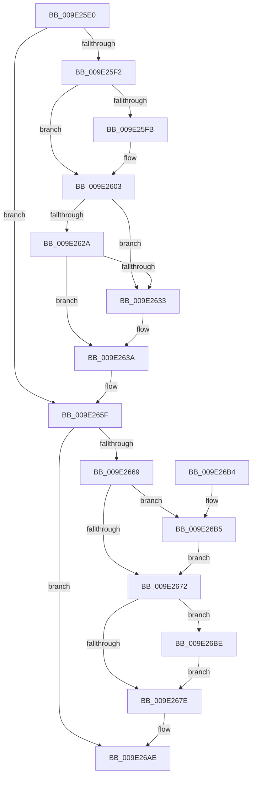

# WmipDeleteMethod

- RVA: `0x009E25E0`–`0x009E26C7` (길이 `231` bytes)
- VA: `0x00000001409E25E0`
- 실행 섹션: `PAGE`
- PDB 이름 있음: `예`; PDB Function 태그: `아니요`
- unwind 정보 RVA: `0x000A3E48`
- 디코드: `63`개 명령, `231/231` bytes 표시
- 미해석 바이트: `0` (있으면 어셈블리에 `.byte`로 보존)

> 이 문서는 커널 이미지의 기계어와 PDB 기호를 분석해 생성했습니다. 4번과 5번은 함수 원형과 자료형을 바이너리 사용 방식에서 추정한 C 해석이며 원본 소스 복구 결과는 아닙니다.

## 1. Dependencies

- 직접 호출 지점: **9**; 고유 호출 대상: **6**
- 직접 호출자로 확인된 함수: **0**
- RIP 상대 이미지 참조: **2**

### Outgoing calls
- `0x009E25FE` → [WmipDisableCollectOrEvent](WmipDisableCollectOrEvent_function_009E26D0.md) (function, `0x009E26D0`)
- `0x009E2618` → [KeWaitForSingleObject](../../text/20/KeWaitForSingleObject_function_0020E6B0.md) (function, `0x0020E6B0`)
- `0x009E264A` → [KeReleaseMutex](../../text/39/KeReleaseMutex_function_00396810.md) (function, `0x00396810`)
- `0x009E265A` → [WmipUnreferenceEntry](WmipUnreferenceEntry_function_009E0CC8.md) (function, `0x009E0CC8`)
- `0x009E2693` → [KeWaitForSingleObject](../../text/20/KeWaitForSingleObject_function_0020E6B0.md) (function, `0x0020E6B0`)
- `0x009E269B` → [WmipCompleteGuidIrpWithError](../../text/49/WmipCompleteGuidIrpWithError_function_004955BC.md) (function, `0x004955BC`)
- `0x009E26A9` → [KeReleaseMutex](../../text/39/KeReleaseMutex_function_00396810.md) (function, `0x00396810`)
- `0x009E26B7` → [ExFreePoolWithTag](../../poolcode/B8/ExFreePoolWithTag_function_00B82870.md) (function, `0x00B82870`)
- `0x009E26C0` → [ExFreePoolWithTag](../../poolcode/B8/ExFreePoolWithTag_function_00B82870.md) (function, `0x00B82870`)

### Direct callers
- 이 함수 시작 RVA로 연결되는 직접 call은 확인되지 않았습니다. 간접 호출은 완전히 역산할 수 없습니다.

### Static image references
- `0x009E2609` → RVA `0x00EFFA60` (`.data`; read)
- `0x009E2653` → RVA `0x00E03628` (`.data`; read)

## 2. Other-region calls and transfers

- 다른 실행 섹션으로 향하는 call: **7**
  - `0x009E2618` → [KeWaitForSingleObject](../../text/20/KeWaitForSingleObject_function_0020E6B0.md) (`PAGE` → `.text`)
  - `0x009E264A` → [KeReleaseMutex](../../text/39/KeReleaseMutex_function_00396810.md) (`PAGE` → `.text`)
  - `0x009E2693` → [KeWaitForSingleObject](../../text/20/KeWaitForSingleObject_function_0020E6B0.md) (`PAGE` → `.text`)
  - `0x009E269B` → [WmipCompleteGuidIrpWithError](../../text/49/WmipCompleteGuidIrpWithError_function_004955BC.md) (`PAGE` → `.text`)
  - `0x009E26A9` → [KeReleaseMutex](../../text/39/KeReleaseMutex_function_00396810.md) (`PAGE` → `.text`)
  - `0x009E26B7` → [ExFreePoolWithTag](../../poolcode/B8/ExFreePoolWithTag_function_00B82870.md) (`PAGE` → `POOLCODE`)
  - `0x009E26C0` → [ExFreePoolWithTag](../../poolcode/B8/ExFreePoolWithTag_function_00B82870.md) (`PAGE` → `POOLCODE`)
- 별도 외부 분기/꼬리 이동을 확인하지 못했습니다.

## 3. Assembly (complete function range)

```asm
009E25E0  40 53                           push rbx
009E25E2  48 83 EC 30                     sub rsp, 0x30
009E25E6  48 8B D9                        mov rbx, rcx
009E25E9  48 8B 49 38                     mov rcx, qword ptr [rcx + 0x38]
009E25ED  48 85 C9                        test rcx, rcx
009E25F0  74 6D                           je 0x1409e265f
009E25F2  80 BB A0 00 00 00 00            cmp byte ptr [rbx + 0xa0], 0
009E25F9  74 08                           je 0x1409e2603
009E25FB  8B 53 40                        mov edx, dword ptr [rbx + 0x40]
009E25FE  E8 CD 00 00 00                  call 0x1409e26d0
009E2603  48 83 64 24 20 00               and qword ptr [rsp + 0x20], 0
009E2609  48 8D 0D 50 D4 51 00            lea rcx, [rip + 0x51d450]
009E2610  45 33 C9                        xor r9d, r9d
009E2613  45 33 C0                        xor r8d, r8d
009E2616  33 D2                           xor edx, edx
009E2618  E8 93 C0 82 FF                  call 0x14020e6b0
009E261D  48 8D 43 28                     lea rax, [rbx + 0x28]
009E2621  48 8B 10                        mov rdx, qword ptr [rax]
009E2624  48 39 42 08                     cmp qword ptr [rdx + 8], rax
009E2628  75 09                           jne 0x1409e2633
009E262A  48 8B 48 08                     mov rcx, qword ptr [rax + 8]
009E262E  48 39 01                        cmp qword ptr [rcx], rax
009E2631  74 07                           je 0x1409e263a
009E2633  B9 03 00 00 00                  mov ecx, 3
009E2638  CD 29                           int 0x29
009E263A  48 89 11                        mov qword ptr [rcx], rdx
009E263D  48 89 4A 08                     mov qword ptr [rdx + 8], rcx
009E2641  33 D2                           xor edx, edx
009E2643  48 8D 0D 16 D4 51 00            lea rcx, [rip + 0x51d416]
009E264A  E8 C1 41 9B FF                  call 0x140396810
009E264F  48 8B 53 38                     mov rdx, qword ptr [rbx + 0x38]
009E2653  48 8D 0D CE 0F 42 00            lea rcx, [rip + 0x420fce]
009E265A  E8 69 E6 FF FF                  call 0x1409e0cc8
009E265F  8B 83 A4 00 00 00               mov eax, dword ptr [rbx + 0xa4]
009E2665  A8 02                           test al, 2
009E2667  75 45                           jne 0x1409e26ae
009E2669  48 8B 4B 60                     mov rcx, qword ptr [rbx + 0x60]
009E266D  48 85 C9                        test rcx, rcx
009E2670  75 43                           jne 0x1409e26b5
009E2672  48 8B 8B 80 00 00 00            mov rcx, qword ptr [rbx + 0x80]
009E2679  48 85 C9                        test rcx, rcx
009E267C  75 40                           jne 0x1409e26be
009E267E  48 83 64 24 20 00               and qword ptr [rsp + 0x20], 0
009E2684  48 8D 0D D5 D3 51 00            lea rcx, [rip + 0x51d3d5]
009E268B  45 33 C9                        xor r9d, r9d
009E268E  45 33 C0                        xor r8d, r8d
009E2691  33 D2                           xor edx, edx
009E2693  E8 18 C0 82 FF                  call 0x14020e6b0
009E2698  48 8B CB                        mov rcx, rbx
009E269B  E8 1C 2F AB FF                  call 0x1404955bc
009E26A0  33 D2                           xor edx, edx
009E26A2  48 8D 0D B7 D3 51 00            lea rcx, [rip + 0x51d3b7]
009E26A9  E8 62 41 9B FF                  call 0x140396810
009E26AE  48 83 C4 30                     add rsp, 0x30
009E26B2  5B                              pop rbx
009E26B3  C3                              ret
009E26B4  CC                              int3
009E26B5  33 D2                           xor edx, edx
009E26B7  E8 B4 01 1A 00                  call 0x140b82870
009E26BC  EB B4                           jmp 0x1409e2672
009E26BE  33 D2                           xor edx, edx
009E26C0  E8 AB 01 1A 00                  call 0x140b82870
009E26C5  EB B7                           jmp 0x1409e267e
```

## 4. C-style interpretation (structured pseudocode)

```c
__int64 __fastcall WmipDeleteMethod(__int64 a1, __int64 a2, int a3, int a4)
{
    __int64 result;
    __int64 v_rsp;
    unsigned __int64 v_stack_m18;

    v_rsp = (v_rsp) - (48);
    if (*(unsigned __int64 *)(a1 + 56) == 0) goto loc_009E265F;
    if ((*(unsigned __int8 *)(a1 + 160)) != 0) {
        a2 = *(unsigned int *)(a1 + 64);
        result = WmipDisableCollectOrEvent(*(unsigned __int64 *)(a1 + 56), a2, a3, a4);
    }
    a4 = 0;
    a3 = 0;
    a2 = 0;
    result = KeWaitForSingleObject(v_rip + 5362768, a2, a3, a4);
    if ((*(unsigned __int64 *)(*(unsigned __int64 *)(a1 + 40) + 8)) != (a1 + 40)) goto loc_009E2633;
    if ((*(unsigned __int64 *)(*(unsigned __int64 *)(a1 + 40 + 8))) != (a1 + 40)) {
        a1 = 3;
    }
    *(unsigned __int64 *)(a1) = *(unsigned __int64 *)(a1 + 40);
    *(unsigned __int64 *)(*(unsigned __int64 *)(a1 + 40) + 8) = a1;
    a2 = 0;
    result = KeReleaseMutex(v_rip + 5362710, a2, a3, a4);
    result = WmipUnreferenceEntry(v_rip + 4329422, *(unsigned __int64 *)(a1 + 56), a3, a4);
loc_009E265F:
    if ((((unsigned __int8)((unsigned int)(*(unsigned int *)(a1 + 164)))) & (2)) != 0) goto loc_009E26AE;
    if (*(unsigned __int64 *)(a1 + 96) != 0) goto loc_009E26B5;
loc_009E2672:
    if (*(unsigned __int64 *)(a1 + 128) != 0) goto loc_009E26BE;
loc_009E267E:
    a4 = 0;
    a3 = 0;
    a2 = 0;
    result = KeWaitForSingleObject(v_rip + 5362645, a2, a3, a4);
    result = WmipCompleteGuidIrpWithError(a1, a2, a3, a4);
    a2 = 0;
    result = KeReleaseMutex(v_rip + 5362615, a2, a3, a4);
loc_009E26AE:
    v_rsp = (v_rsp) + (48);
    return result;
loc_009E26B5:
    a2 = 0;
    result = ExFreePoolWithTag(v_rip + 5362615, a2, a3, a4);
    goto loc_009E2672;
loc_009E26BE:
    a2 = 0;
    result = ExFreePoolWithTag(v_rip + 5362615, a2, a3, a4);
    goto loc_009E267E;
}
```

## 5. (Beta) C Style

```c
int64_t WmipDeleteMethod(void *Arg1, int64_t Arg2, int32_t Arg3, int32_t Arg4)
{
    uint8_t *arg1 = (uint8_t *)Arg1;

    int64_t result;
    int64_t local_rsp;
    uint64_t v_stack_m18;

    local_rsp = (local_rsp) - (48);
    if (*(uint64_t *)(arg1 + 0x38) == 0) goto loc_009E265F;
    if ((*(uint8_t *)(arg1 + 0xA0)) != 0) {
        Arg2 = *(uint32_t *)(arg1 + 0x40);
        result = WmipDisableCollectOrEvent(*(uint64_t *)(arg1 + 0x38), Arg2, Arg3, Arg4);
    }
    Arg4 = 0;
    Arg3 = 0;
    Arg2 = 0;
    result = KeWaitForSingleObject(v_rip + 5362768, Arg2, Arg3, Arg4);
    if ((*(uint64_t *)(*(uint64_t *)(arg1 + 0x28) + 0x8)) != (Arg1 + 40)) goto loc_009E2633;
    if ((*(uint64_t *)(*(uint64_t *)(arg1 + 0x28 + 0x8))) != (Arg1 + 40)) {
        Arg1 = 3;
    }
    *(uint64_t *)(arg1) = *(uint64_t *)(arg1 + 0x28);
    *(void **)(*(uint64_t *)(arg1 + 0x28) + 0x8) = Arg1;
    Arg2 = 0;
    result = KeReleaseMutex(v_rip + 5362710, Arg2, Arg3, Arg4);
    result = WmipUnreferenceEntry(v_rip + 4329422, *(uint64_t *)(arg1 + 0x38), Arg3, Arg4);
loc_009E265F:
    if ((((uint8_t)((uint32_t)(*(uint32_t *)(arg1 + 0xA4)))) & (2)) != 0) goto loc_009E26AE;
    if (*(uint64_t *)(arg1 + 0x60) != 0) goto loc_009E26B5;
loc_009E2672:
    if (*(uint64_t *)(arg1 + 0x80) != 0) goto loc_009E26BE;
loc_009E267E:
    Arg4 = 0;
    Arg3 = 0;
    Arg2 = 0;
    result = KeWaitForSingleObject(v_rip + 5362645, Arg2, Arg3, Arg4);
    result = WmipCompleteGuidIrpWithError(Arg1, Arg2, Arg3, Arg4);
    Arg2 = 0;
    result = KeReleaseMutex(v_rip + 5362615, Arg2, Arg3, Arg4);
loc_009E26AE:
    local_rsp = (local_rsp) + (48);
    return result;
loc_009E26B5:
    Arg2 = 0;
    result = ExFreePoolWithTag(v_rip + 5362615, Arg2, Arg3, Arg4);
    goto loc_009E2672;
loc_009E26BE:
    Arg2 = 0;
    result = ExFreePoolWithTag(v_rip + 5362615, Arg2, Arg3, Arg4);
    goto loc_009E267E;
}
```

### 관측된 메모리 오프셋

구조체 형식이 확인되지 않은 접근은 인자 기준의 오프셋으로만 기록했습니다.

| 기준 인자 | 오프셋 표현 | 폭 (bit) | 접근 |
|---|---:|---:|---|
| `Arg1` | `+ 0x0` | `64` | `R` |
| `Arg1` | `+ 0x8` | `64` | `R` |
| `Arg1` | `+ 0x28` | `64` | `R` |
| `Arg1` | `+ 0x38` | `64` | `R` |
| `Arg1` | `+ 0x40` | `32` | `R` |
| `Arg1` | `+ 0x60` | `64` | `R` |
| `Arg1` | `+ 0x80` | `64` | `R` |
| `Arg1` | `+ 0xA0` | `8` | `R` |
| `Arg1` | `+ 0xA4` | `32` | `R` |

## 6. Execution-region graph

[열기: 2D/3D 그래프와 함수 탐색 컨트롤 패널](../../../control-panel.html?section=page&rva=0x009E25E0&view=graph)

- 2D 그래프는 위에서 아래로 흐르고, 3D 그래프는 빈 공간을 드래그해 회전합니다. Shift+드래그는 이동, 휠은 확대·축소, 함수 노드 선택은 대상 보고서 이동입니다.

### Static fallback


