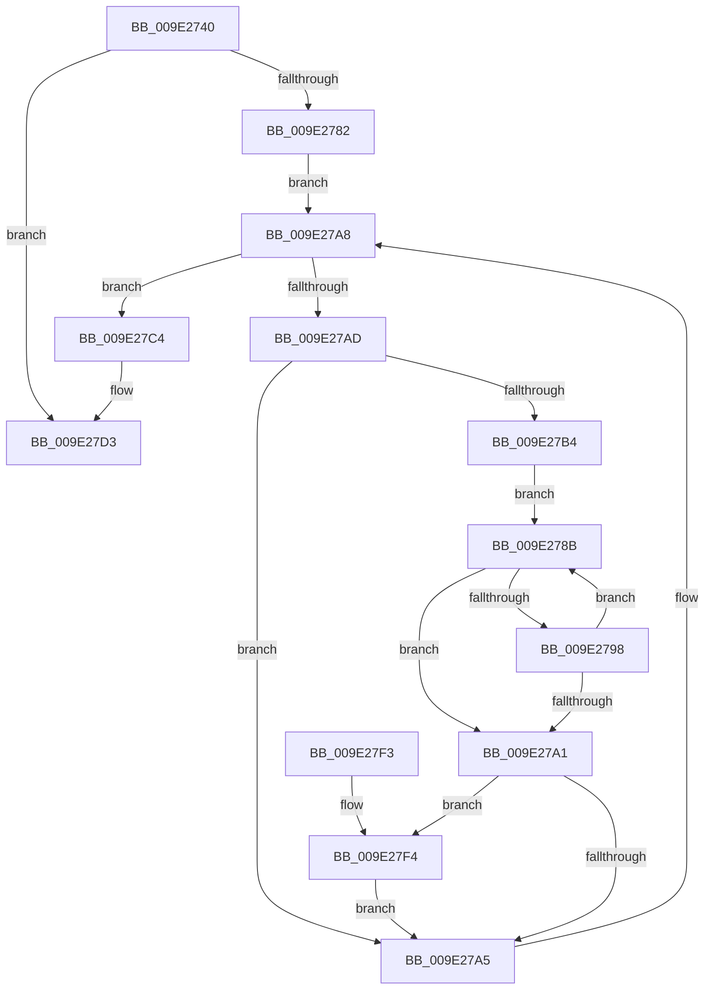

# WmipDetermineInstanceBaseIndex

- RVA: `0x009E2740`–`0x009E2800` (길이 `192` bytes)
- VA: `0x00000001409E2740`
- 실행 섹션: `PAGE`
- PDB 이름 있음: `예`; PDB Function 태그: `아니요`
- unwind 정보 RVA: `0x000A3E64`
- 디코드: `60`개 명령, `192/192` bytes 표시
- 미해석 바이트: `0` (있으면 어셈블리에 `.byte`로 보존)

> 이 문서는 커널 이미지의 기계어와 PDB 기호를 분석해 생성했습니다. 4번과 5번은 함수 원형과 자료형을 바이너리 사용 방식에서 추정한 C 해석이며 원본 소스 복구 결과는 아닙니다.

## 1. Dependencies

- 직접 호출 지점: **4**; 고유 호출 대상: **4**
- 직접 호출자로 확인된 함수: **1**
- RIP 상대 이미지 참조: **2**

### Outgoing calls
- `0x009E276B` → [KeWaitForSingleObject](../../text/20/KeWaitForSingleObject_function_0020E6B0.md) (function, `0x0020E6B0`)
- `0x009E2775` → [WmipFindGEByGuid](WmipFindGEByGuid_function_009E03A4.md) (function, `0x009E03A4`)
- `0x009E27CE` → [WmipUnreferenceEntry](WmipUnreferenceEntry_function_009E0CC8.md) (function, `0x009E0CC8`)
- `0x009E27DC` → [KeReleaseMutex](../../text/39/KeReleaseMutex_function_00396810.md) (function, `0x00396810`)

### Direct callers
- [WmipBuildInstanceSet](../9D/WmipBuildInstanceSet_function_009DDFC4.md) at `0x009DE0D9`

### Static image references
- `0x009E2757` → RVA `0x00EFFA60` (`.data`; read)
- `0x009E27C7` → RVA `0x00E03628` (`.data`; read)

## 2. Other-region calls and transfers

- 다른 실행 섹션으로 향하는 call: **2**
  - `0x009E276B` → [KeWaitForSingleObject](../../text/20/KeWaitForSingleObject_function_0020E6B0.md) (`PAGE` → `.text`)
  - `0x009E27DC` → [KeReleaseMutex](../../text/39/KeReleaseMutex_function_00396810.md) (`PAGE` → `.text`)
- 별도 외부 분기/꼬리 이동을 확인하지 못했습니다.

## 3. Assembly (complete function range)

```asm
009E2740  48 89 5C 24 08                  mov qword ptr [rsp + 8], rbx
009E2745  48 89 74 24 10                  mov qword ptr [rsp + 0x10], rsi
009E274A  57                              push rdi
009E274B  48 83 EC 30                     sub rsp, 0x30
009E274F  48 8B F2                        mov rsi, rdx
009E2752  48 8B D9                        mov rbx, rcx
009E2755  33 FF                           xor edi, edi
009E2757  48 8D 0D 02 D3 51 00            lea rcx, [rip + 0x51d302]
009E275E  48 21 7C 24 20                  and qword ptr [rsp + 0x20], rdi
009E2763  33 D2                           xor edx, edx
009E2765  45 33 C9                        xor r9d, r9d
009E2768  45 33 C0                        xor r8d, r8d
009E276B  E8 40 BF 82 FF                  call 0x14020e6b0
009E2770  33 D2                           xor edx, edx
009E2772  48 8B CB                        mov rcx, rbx
009E2775  E8 2A DC FF FF                  call 0x1409e03a4
009E277A  4C 8B D8                        mov r11, rax
009E277D  48 85 C0                        test rax, rax
009E2780  74 51                           je 0x1409e27d3
009E2782  4C 8D 40 38                     lea r8, [rax + 0x38]
009E2786  49 8B 10                        mov rdx, qword ptr [r8]
009E2789  EB 1D                           jmp 0x1409e27a8
009E278B  0F B7 08                        movzx ecx, word ptr [rax]
009E278E  46 0F B7 14 08                  movzx r10d, word ptr [rax + r9]
009E2793  41 2B CA                        sub ecx, r10d
009E2796  75 09                           jne 0x1409e27a1
009E2798  48 83 C0 02                     add rax, 2
009E279C  45 85 D2                        test r10d, r10d
009E279F  75 EA                           jne 0x1409e278b
009E27A1  85 C9                           test ecx, ecx
009E27A3  74 4F                           je 0x1409e27f4
009E27A5  48 8B 12                        mov rdx, qword ptr [rdx]
009E27A8  49 3B D0                        cmp rdx, r8
009E27AB  74 17                           je 0x1409e27c4
009E27AD  8B 42 10                        mov eax, dword ptr [rdx + 0x10]
009E27B0  A8 01                           test al, 1
009E27B2  74 F1                           je 0x1409e27a5
009E27B4  48 8B 5A 58                     mov rbx, qword ptr [rdx + 0x58]
009E27B8  48 8B C6                        mov rax, rsi
009E27BB  4C 8D 4B 04                     lea r9, [rbx + 4]
009E27BF  4C 2B CE                        sub r9, rsi
009E27C2  EB C7                           jmp 0x1409e278b
009E27C4  49 8B D3                        mov rdx, r11
009E27C7  48 8D 0D 5A 0E 42 00            lea rcx, [rip + 0x420e5a]
009E27CE  E8 F5 E4 FF FF                  call 0x1409e0cc8
009E27D3  33 D2                           xor edx, edx
009E27D5  48 8D 0D 84 D2 51 00            lea rcx, [rip + 0x51d284]
009E27DC  E8 2F 40 9B FF                  call 0x140396810
009E27E1  48 8B 5C 24 40                  mov rbx, qword ptr [rsp + 0x40]
009E27E6  8B C7                           mov eax, edi
009E27E8  48 8B 74 24 48                  mov rsi, qword ptr [rsp + 0x48]
009E27ED  48 83 C4 30                     add rsp, 0x30
009E27F1  5F                              pop rdi
009E27F2  C3                              ret
009E27F3  CC                              int3
009E27F4  8B 42 48                        mov eax, dword ptr [rdx + 0x48]
009E27F7  03 03                           add eax, dword ptr [rbx]
009E27F9  3B F8                           cmp edi, eax
009E27FB  0F 46 F8                        cmovbe edi, eax
009E27FE  EB A5                           jmp 0x1409e27a5
```

## 4. C-style interpretation (structured pseudocode)

```c
__int64 __fastcall WmipDetermineInstanceBaseIndex(__int64 a1, __int64 a2, int a3, int a4)
{
    __int64 result;
    __int64 v_rdi;
    __int64 v_rsp;
    unsigned __int64 v_stack_m18;
    unsigned __int64 v_stack_p10;
    unsigned __int64 v_stack_p8;

    v_stack_p8 = v_rbx;
    v_stack_p10 = v_rsi;
    v_rsp = (v_rsp) - (48);
    v_rdi = 0;
    a2 = 0;
    a4 = 0;
    a3 = 0;
    result = KeWaitForSingleObject(v_rip + 5362434, a2, a3, a4);
    a2 = 0;
    result = WmipFindGEByGuid(a1, a2, a3, a4);
    if (result == 0) goto loc_009E27D3;
    goto loc_009E27A8;
loc_009E278B:
    a1 = (unsigned int)((*(unsigned __int16 *)(result)) - ((unsigned int)(*(unsigned __int16 *)(result + a4 * 1))));
    if (condition_is_not_equal) goto loc_009E27A1;
    result = (result) + (2);
    if ((unsigned int)(*(unsigned __int16 *)(result + a4 * 1)) != 0) goto loc_009E278B;
loc_009E27A1:
    if ((unsigned int)(a1) == 0) goto loc_009E27F4;
loc_009E27A5:
loc_009E27A8:
    if ((*(unsigned __int64 *)(*(unsigned __int64 *)(result + 56))) == (result + 56)) goto loc_009E27C4;
    if ((((unsigned __int8)((unsigned int)(*(unsigned int *)(*(unsigned __int64 *)(*(unsigned __int64 *)(result + 56)) + 16)))) & (1)) == 0) goto loc_009E27A5;
    a4 = (*(unsigned __int64 *)(*(unsigned __int64 *)(*(unsigned __int64 *)(result + 56)) + 88) + 4) - (0);
    goto loc_009E278B;
loc_009E27C4:
    result = WmipUnreferenceEntry(v_rip + 4329050, result, result + 56, a4);
loc_009E27D3:
    a2 = 0;
    result = KeReleaseMutex(v_rip + 5362308, a2, result + 56, a4);
    v_rsp = (v_rsp) + (48);
    return 0;
loc_009E27F4:
    result = (unsigned int)(((unsigned int)(*(unsigned int *)(a2 + 72))) + (*(unsigned int *)(v_stack_p8)));
    if (0 <= ((unsigned int)(result))) { v_rdi = (unsigned int)(result); }
    goto loc_009E27A5;
}
```

## 5. (Beta) C Style

```c
int64_t WmipDetermineInstanceBaseIndex(int64_t Arg1, void *Arg2, int32_t Arg3, int32_t Arg4)
{
    uint8_t *arg2 = (uint8_t *)Arg2;

    int64_t result;
    int64_t local_rdi;
    int64_t local_rsp;
    uint64_t v_stack_m18;
    uint64_t v_stack_p10;
    uint64_t v_stack_p8;

    v_stack_p8 = local_rbx;
    v_stack_p10 = local_rsi;
    local_rsp = (local_rsp) - (48);
    local_rdi = 0;
    Arg2 = 0;
    Arg4 = 0;
    Arg3 = 0;
    result = KeWaitForSingleObject(v_rip + 5362434, Arg2, Arg3, Arg4);
    Arg2 = 0;
    result = WmipFindGEByGuid(Arg1, Arg2, Arg3, Arg4);
    if (result == 0) goto loc_009E27D3;
    goto loc_009E27A8;
loc_009E278B:
    Arg1 = (uint32_t)((*(uint16_t *)(result)) - ((uint32_t)(*(uint16_t *)(result + Arg4 * 1))));
    if (condition_is_not_equal) goto loc_009E27A1;
    result = (result) + (2);
    if ((uint32_t)(*(uint16_t *)(result + Arg4 * 1)) != 0) goto loc_009E278B;
loc_009E27A1:
    if ((uint32_t)(Arg1) == 0) goto loc_009E27F4;
loc_009E27A5:
loc_009E27A8:
    if ((*(uint64_t *)(*(uint64_t *)(result + 0x38))) == (result + 56)) goto loc_009E27C4;
    if ((((uint8_t)((uint32_t)(*(uint32_t *)(*(uint64_t *)(*(uint64_t *)(result + 0x38)) + 0x10)))) & (1)) == 0) goto loc_009E27A5;
    Arg4 = (*(uint64_t *)(*(uint64_t *)(*(uint64_t *)(result + 0x38)) + 0x58) + 4) - (0);
    goto loc_009E278B;
loc_009E27C4:
    result = WmipUnreferenceEntry(v_rip + 4329050, result, result + 56, Arg4);
loc_009E27D3:
    Arg2 = 0;
    result = KeReleaseMutex(v_rip + 5362308, Arg2, result + 56, Arg4);
    local_rsp = (local_rsp) + (48);
    return 0;
loc_009E27F4:
    result = (uint32_t)(((uint32_t)(*(uint32_t *)(arg2 + 0x48))) + (*(uint32_t *)(v_stack_p8)));
    if (0 <= ((uint32_t)(result))) { local_rdi = (uint32_t)(result); }
    goto loc_009E27A5;
}
```

### 관측된 메모리 오프셋

구조체 형식이 확인되지 않은 접근은 인자 기준의 오프셋으로만 기록했습니다.

| 기준 인자 | 오프셋 표현 | 폭 (bit) | 접근 |
|---|---:|---:|---|
| `Arg2` | `+ 0x0` | `16` | `R` |
| `Arg2` | `+ 0x0 + r9*1` | `16` | `R` |

## 6. Execution-region graph

[열기: 2D/3D 그래프와 함수 탐색 컨트롤 패널](../../../control-panel.html?section=page&rva=0x009E2740&view=graph)

- 2D 그래프는 위에서 아래로 흐르고, 3D 그래프는 빈 공간을 드래그해 회전합니다. Shift+드래그는 이동, 휠은 확대·축소, 함수 노드 선택은 대상 보고서 이동입니다.

### Static fallback


