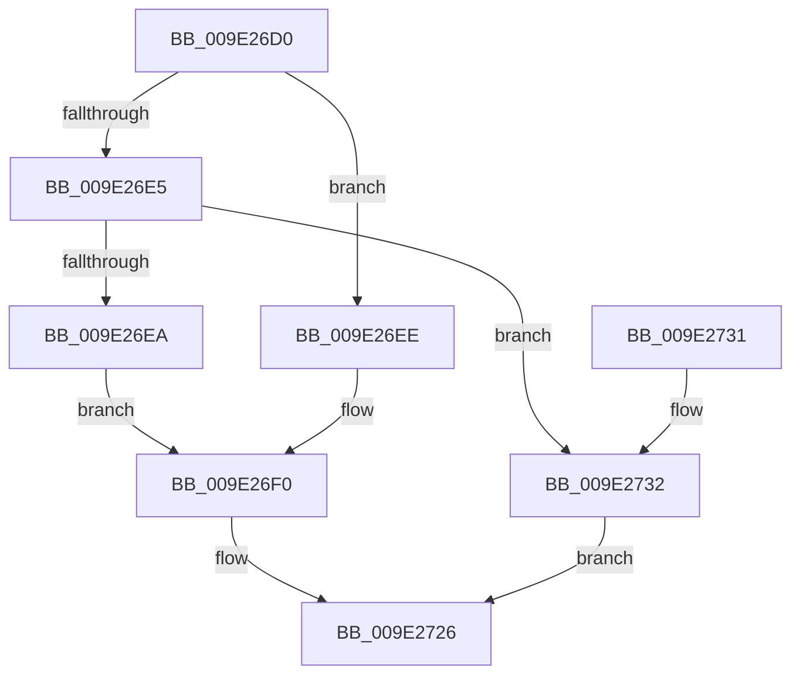

# WmipDisableCollectOrEvent

- RVA: `0x009E26D0`–`0x009E2739` (길이 `105` bytes)
- VA: `0x00000001409E26D0`
- 실행 섹션: `PAGE`
- PDB 이름 있음: `예`; PDB Function 태그: `아니요`
- unwind 정보 RVA: `0x000A3E54`
- 디코드: `32`개 명령, `105/105` bytes 표시
- 미해석 바이트: `0` (있으면 어셈블리에 `.byte`로 보존)

> 이 문서는 커널 이미지의 기계어와 PDB 기호를 분석해 생성했습니다. 4번과 5번은 함수 원형과 자료형을 바이너리 사용 방식에서 추정한 C 해석이며 원본 소스 복구 결과는 아닙니다.

## 1. Dependencies

- 직접 호출 지점: **3**; 고유 호출 대상: **3**
- 직접 호출자로 확인된 함수: **1**
- RIP 상대 이미지 참조: **1**

### Outgoing calls
- `0x009E2705` → [KeWaitForSingleObject](../../text/20/KeWaitForSingleObject_function_0020E6B0.md) (function, `0x0020E6B0`)
- `0x009E270F` → [WmipSendDisableRequest](WmipSendDisableRequest_function_009E2EB8.md) (function, `0x009E2EB8`)
- `0x009E271F` → [KeReleaseMutex](../../text/39/KeReleaseMutex_function_00396810.md) (function, `0x00396810`)

### Direct callers
- [WmipDeleteMethod](WmipDeleteMethod_function_009E25E0.md) at `0x009E25FE`

### Static image references
- `0x009E26F6` → RVA `0x00EFFA60` (`.data`; read)

## 2. Other-region calls and transfers

- 다른 실행 섹션으로 향하는 call: **2**
  - `0x009E2705` → [KeWaitForSingleObject](../../text/20/KeWaitForSingleObject_function_0020E6B0.md) (`PAGE` → `.text`)
  - `0x009E271F` → [KeReleaseMutex](../../text/39/KeReleaseMutex_function_00396810.md) (`PAGE` → `.text`)
- 별도 외부 분기/꼬리 이동을 확인하지 못했습니다.

## 3. Assembly (complete function range)

```asm
009E26D0  48 89 5C 24 08                  mov qword ptr [rsp + 8], rbx
009E26D5  57                              push rdi
009E26D6  48 83 EC 30                     sub rsp, 0x30
009E26DA  48 8B F9                        mov rdi, rcx
009E26DD  81 EA 3C 41 22 00               sub edx, 0x22413c
009E26E3  74 09                           je 0x1409e26ee
009E26E5  83 FA 04                        cmp edx, 4
009E26E8  75 48                           jne 0x1409e2732
009E26EA  B3 01                           mov bl, 1
009E26EC  EB 02                           jmp 0x1409e26f0
009E26EE  32 DB                           xor bl, bl
009E26F0  48 83 64 24 20 00               and qword ptr [rsp + 0x20], 0
009E26F6  48 8D 0D 63 D3 51 00            lea rcx, [rip + 0x51d363]
009E26FD  45 33 C9                        xor r9d, r9d
009E2700  45 33 C0                        xor r8d, r8d
009E2703  33 D2                           xor edx, edx
009E2705  E8 A6 BF 82 FF                  call 0x14020e6b0
009E270A  8A D3                           mov dl, bl
009E270C  48 8B CF                        mov rcx, rdi
009E270F  E8 A4 07 00 00                  call 0x1409e2eb8
009E2714  33 D2                           xor edx, edx
009E2716  48 8D 0D 43 D3 51 00            lea rcx, [rip + 0x51d343]
009E271D  8B D8                           mov ebx, eax
009E271F  E8 EC 40 9B FF                  call 0x140396810
009E2724  8B C3                           mov eax, ebx
009E2726  48 8B 5C 24 40                  mov rbx, qword ptr [rsp + 0x40]
009E272B  48 83 C4 30                     add rsp, 0x30
009E272F  5F                              pop rdi
009E2730  C3                              ret
009E2731  CC                              int3
009E2732  B8 AF 00 00 C0                  mov eax, 0xc00000af
009E2737  EB ED                           jmp 0x1409e2726
```

## 4. C-style interpretation (structured pseudocode)

```c
__int64 __fastcall WmipDisableCollectOrEvent(__int64 a1, int a2, int a3, int a4)
{
    __int64 result;
    __int64 v_rbx;
    __int64 v_rsp;
    unsigned __int64 v_stack_m18;
    unsigned __int64 v_stack_p8;

    v_stack_p8 = v_rbx;
    v_rsp = (v_rsp) - (48);
    a2 = (unsigned int)((a2) - (0x22413CULL));
    if (condition_is_equal) goto loc_009E26EE;
    if (a2 != 4) goto loc_009E2732;
    goto loc_009E26F0;
loc_009E26EE:
    v_rbx = 0;
loc_009E26F0:
    a4 = 0;
    a3 = 0;
    a2 = 0;
    result = KeWaitForSingleObject(v_rip + 5362531, a2, a3, a4);
    result = WmipSendDisableRequest(a1, 0, a3, a4);
    a2 = 0;
    result = KeReleaseMutex(v_rip + 5362499, a2, a3, a4);
loc_009E2726:
    v_rsp = (v_rsp) + (48);
    return (unsigned int)((unsigned int)((unsigned int)((unsigned int)(result))));
loc_009E2732:
    goto loc_009E2726;
}
```

## 5. (Beta) C Style

```c
int64_t WmipDisableCollectOrEvent(int64_t Arg1, int32_t Arg2, int32_t Arg3, int32_t Arg4)
{
    int64_t result;
    int64_t local_rbx;
    int64_t local_rsp;
    uint64_t v_stack_m18;
    uint64_t v_stack_p8;

    v_stack_p8 = local_rbx;
    local_rsp = (local_rsp) - (48);
    Arg2 = (uint32_t)((Arg2) - (0x22413CULL));
    if (condition_is_equal) goto loc_009E26EE;
    if (Arg2 != 4) goto loc_009E2732;
    goto loc_009E26F0;
loc_009E26EE:
    local_rbx = 0;
loc_009E26F0:
    Arg4 = 0;
    Arg3 = 0;
    Arg2 = 0;
    result = KeWaitForSingleObject(v_rip + 5362531, Arg2, Arg3, Arg4);
    result = WmipSendDisableRequest(Arg1, 0, Arg3, Arg4);
    Arg2 = 0;
    result = KeReleaseMutex(v_rip + 5362499, Arg2, Arg3, Arg4);
loc_009E2726:
    local_rsp = (local_rsp) + (48);
    return (uint32_t)((uint32_t)((uint32_t)((uint32_t)(result))));
loc_009E2732:
    goto loc_009E2726;
}
```

## 6. Execution-region graph

[열기: 2D/3D 그래프와 함수 탐색 컨트롤 패널](../../../control-panel.html?section=page&rva=0x009E26D0&view=graph)

- 2D 그래프는 위에서 아래로 흐르고, 3D 그래프는 빈 공간을 드래그해 회전합니다. Shift+드래그는 이동, 휠은 확대·축소, 함수 노드 선택은 대상 보고서 이동입니다.

### Static fallback


