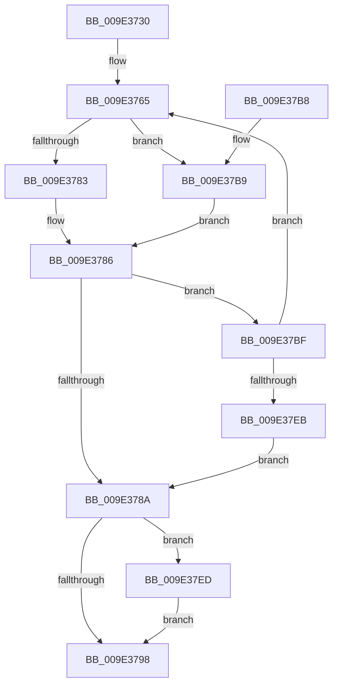

# WmipDoDisableRequest

- RVA: `0x009E3730`–`0x009E37F7` (길이 `199` bytes)
- VA: `0x00000001409E3730`
- 실행 섹션: `PAGE`
- PDB 이름 있음: `예`; PDB Function 태그: `아니요`
- unwind 정보 RVA: `0x000A3FA0`
- 디코드: `66`개 명령, `199/199` bytes 표시
- 미해석 바이트: `0` (있으면 어셈블리에 `.byte`로 보존)

> 이 문서는 커널 이미지의 기계어와 PDB 기호를 분석해 생성했습니다. 4번과 5번은 함수 원형과 자료형을 바이너리 사용 방식에서 추정한 C 해석이며 원본 소스 복구 결과는 아닙니다.

## 1. Dependencies

- 직접 호출 지점: **3**; 고유 호출 대상: **2**
- 직접 호출자로 확인된 함수: **3**
- RIP 상대 이미지 참조: **0**

### Outgoing calls
- `0x009E376E` → [WmipSendEnableDisableRequest](WmipSendEnableDisableRequest_function_009E3800.md) (function, `0x009E3800`)
- `0x009E37D2` → [WmipSendEnableDisableRequest](WmipSendEnableDisableRequest_function_009E3800.md) (function, `0x009E3800`)
- `0x009E37F0` → [WmipReleaseCollectionEnabled](../AD/WmipReleaseCollectionEnabled_function_00AD6750.md) (function, `0x00AD6750`)

### Direct callers
- [WmipSendDisableRequest](WmipSendDisableRequest_function_009E2EB8.md) at `0x009E2EFE`
- [sub_00B2FD86](../B2/Unknown_function_00B2FD86.md) at `0x00B2FDF1`
- [sub_00B2FF46](../B2/Unknown_function_00B2FF46.md) at `0x00B2FFC1`

### Static image references
- 디코드된 RIP-relative 메모리 참조가 없습니다.

## 2. Other-region calls and transfers

- 다른 실행 섹션으로 향하는 call: **0**
- 별도 외부 분기/꼬리 이동을 확인하지 못했습니다.

## 3. Assembly (complete function range)

```asm
009E3730  48 8B C4                        mov rax, rsp
009E3733  48 89 58 08                     mov qword ptr [rax + 8], rbx
009E3737  48 89 68 10                     mov qword ptr [rax + 0x10], rbp
009E373B  48 89 70 20                     mov qword ptr [rax + 0x20], rsi
009E373F  44 89 40 18                     mov dword ptr [rax + 0x18], r8d
009E3743  57                              push rdi
009E3744  41 54                           push r12
009E3746  41 55                           push r13
009E3748  41 56                           push r14
009E374A  41 57                           push r15
009E374C  48 83 EC 20                     sub rsp, 0x20
009E3750  8A C2                           mov al, dl
009E3752  40 8A FA                        mov dil, dl
009E3755  F6 D8                           neg al
009E3757  48 8B D9                        mov rbx, rcx
009E375A  40 1A ED                        sbb bpl, bpl
009E375D  40 80 E5 FE                     and bpl, 0xfe
009E3761  40 80 C5 07                     add bpl, 7
009E3765  44 8A C7                        mov r8b, dil
009E3768  48 8B D3                        mov rdx, rbx
009E376B  40 8A CD                        mov cl, bpl
009E376E  E8 8D 00 00 00                  call 0x1409e3800
009E3773  4C 8D 73 58                     lea r14, [rbx + 0x58]
009E3777  44 8B F8                        mov r15d, eax
009E377A  4C 8D 63 5C                     lea r12, [rbx + 0x5c]
009E377E  40 84 FF                        test dil, dil
009E3781  74 36                           je 0x1409e37b9
009E3783  41 8B 06                        mov eax, dword ptr [r14]
009E3786  85 C0                           test eax, eax
009E3788  75 35                           jne 0x1409e37bf
009E378A  8B 74 24 60                     mov esi, dword ptr [rsp + 0x60]
009E378E  F7 D6                           not esi
009E3790  21 73 10                        and dword ptr [rbx + 0x10], esi
009E3793  40 84 FF                        test dil, dil
009E3796  74 55                           je 0x1409e37ed
009E3798  48 8B 5C 24 50                  mov rbx, qword ptr [rsp + 0x50]
009E379D  41 8B C7                        mov eax, r15d
009E37A0  48 8B 6C 24 58                  mov rbp, qword ptr [rsp + 0x58]
009E37A5  48 8B 74 24 68                  mov rsi, qword ptr [rsp + 0x68]
009E37AA  48 83 C4 20                     add rsp, 0x20
009E37AE  41 5F                           pop r15
009E37B0  41 5E                           pop r14
009E37B2  41 5D                           pop r13
009E37B4  41 5C                           pop r12
009E37B6  5F                              pop rdi
009E37B7  C3                              ret
009E37B8  CC                              int3
009E37B9  41 8B 04 24                     mov eax, dword ptr [r12]
009E37BD  EB C7                           jmp 0x1409e3786
009E37BF  40 8A C7                        mov al, dil
009E37C2  44 8A C7                        mov r8b, dil
009E37C5  F6 D8                           neg al
009E37C7  48 8B D3                        mov rdx, rbx
009E37CA  1A C9                           sbb cl, cl
009E37CC  80 E1 FE                        and cl, 0xfe
009E37CF  80 C1 06                        add cl, 6
009E37D2  E8 29 00 00 00                  call 0x1409e3800
009E37D7  40 84 FF                        test dil, dil
009E37DA  44 8B F8                        mov r15d, eax
009E37DD  4D 0F 44 F4                     cmove r14, r12
009E37E1  41 83 3E 00                     cmp dword ptr [r14], 0
009E37E5  0F 84 7A FF FF FF               je 0x1409e3765
009E37EB  EB 9D                           jmp 0x1409e378a
009E37ED  48 8B CB                        mov rcx, rbx
009E37F0  E8 5B 2F 0F 00                  call 0x140ad6750
009E37F5  EB A1                           jmp 0x1409e3798
```

## 4. C-style interpretation (structured pseudocode)

```c
__int64 __fastcall WmipDoDisableRequest(__int64 a1, unsigned __int8 a2, int a3)
{
    __int64 result;
    __int64 v_r14;
    __int64 v_rbp;
    __int64 v_rsi;
    __int64 v_rsp;
    unsigned __int64 v_stack_p10;
    unsigned int v_stack_p18;
    unsigned __int64 v_stack_p20;
    unsigned __int64 v_stack_p8;

    *(unsigned __int64 *)(v_rsp + 8) = v_rbx;
    *(unsigned __int64 *)(v_rsp + 16) = v_rbp;
    *(unsigned __int64 *)(v_rsp + 32) = v_rsi;
    *(unsigned int *)(v_rsp + 24) = a3;
    v_rsp = (v_rsp) - (32);
    result = (unsigned __int8)(-(a2));
    v_rbp = (unsigned __int8)((v_rbp) & (254));
    v_rbp = (unsigned __int8)((v_rbp) + (7));
loc_009E3765:
    result = WmipSendEnableDisableRequest((unsigned __int8)(v_rbp), a1, a2, a4);
    if (a2 == 0) goto loc_009E37B9;
loc_009E3786:
    if ((unsigned int)((unsigned int)(*(unsigned int *)(a1 + 88))) != 0) goto loc_009E37BF;
loc_009E378A:
    v_rsi = (unsigned int)(~((unsigned int)(v_stack_p18)));
    if (a2 == 0) goto loc_009E37ED;
loc_009E3798:
    v_rsp = (v_rsp) + (32);
    return (unsigned int)((unsigned int)((unsigned int)((unsigned int)(result))));
loc_009E37B9:
    goto loc_009E3786;
loc_009E37BF:
    result = (unsigned __int8)(-(a2));
    a1 = (unsigned __int8)(((unsigned __int8)(v_rbp)) & (254));
    a1 = (unsigned __int8)((a1) + (6));
    result = WmipSendEnableDisableRequest(a1, v_stack_p8, a2, a4);
    v_r14 = a1 + 88;
    if (a2 == 0) { v_r14 = a1 + 92; }
    if ((*(unsigned int *)(v_r14)) == 0) goto loc_009E3765;
    goto loc_009E378A;
loc_009E37ED:
    result = WmipReleaseCollectionEnabled(v_stack_p8, v_stack_p8, a2, a4);
    goto loc_009E3798;
}
```

## 5. (Beta) C Style

```c
int64_t WmipDoDisableRequest(void *Arg1, uint8_t Arg2, int32_t Arg3)
{
    uint8_t *arg1 = (uint8_t *)Arg1;

    int64_t result;
    int64_t local_r14;
    int64_t local_rbp;
    int64_t local_rsi;
    int64_t local_rsp;
    uint64_t v_stack_p10;
    uint32_t v_stack_p18;
    uint64_t v_stack_p20;
    uint64_t v_stack_p8;

    *(uint64_t *)(local_rsp + 0x8) = local_rbx;
    *(uint64_t *)(local_rsp + 0x10) = local_rbp;
    *(uint64_t *)(local_rsp + 0x20) = local_rsi;
    *(uint32_t *)(local_rsp + 0x18) = Arg3;
    local_rsp = (local_rsp) - (32);
    result = (uint8_t)(-(Arg2));
    local_rbp = (uint8_t)((local_rbp) & (254));
    local_rbp = (uint8_t)((local_rbp) + (7));
loc_009E3765:
    result = WmipSendEnableDisableRequest((uint8_t)(local_rbp), Arg1, Arg2, a4);
    if (Arg2 == 0) goto loc_009E37B9;
loc_009E3786:
    if ((uint32_t)((uint32_t)(*(uint32_t *)(arg1 + 0x58))) != 0) goto loc_009E37BF;
loc_009E378A:
    local_rsi = (uint32_t)(~((uint32_t)(v_stack_p18)));
    if (Arg2 == 0) goto loc_009E37ED;
loc_009E3798:
    local_rsp = (local_rsp) + (32);
    return (uint32_t)((uint32_t)((uint32_t)((uint32_t)(result))));
loc_009E37B9:
    goto loc_009E3786;
loc_009E37BF:
    result = (uint8_t)(-(Arg2));
    Arg1 = (uint8_t)(((uint8_t)(local_rbp)) & (254));
    Arg1 = (uint8_t)((Arg1) + (6));
    result = WmipSendEnableDisableRequest(Arg1, v_stack_p8, Arg2, a4);
    local_r14 = Arg1 + 88;
    if (Arg2 == 0) { local_r14 = Arg1 + 92; }
    if ((*(uint32_t *)(local_r14)) == 0) goto loc_009E3765;
    goto loc_009E378A;
loc_009E37ED:
    result = WmipReleaseCollectionEnabled(v_stack_p8, v_stack_p8, Arg2, a4);
    goto loc_009E3798;
}
```

### 관측된 메모리 오프셋

구조체 형식이 확인되지 않은 접근은 인자 기준의 오프셋으로만 기록했습니다.

| 기준 인자 | 오프셋 표현 | 폭 (bit) | 접근 |
|---|---:|---:|---|
| `Arg1` | `+ 0x0` | `32` | `R` |
| `Arg1` | `+ 0x10` | `32` | `R/W` |
| `Arg1` | `+ 0x58` | `64` | `R` |
| `Arg1` | `+ 0x5C` | `64` | `R` |

## 6. Execution-region graph

[열기: 2D/3D 그래프와 함수 탐색 컨트롤 패널](../../../control-panel.html?section=page&rva=0x009E3730&view=graph)

- 2D 그래프는 위에서 아래로 흐르고, 3D 그래프는 빈 공간을 드래그해 회전합니다. Shift+드래그는 이동, 휠은 확대·축소, 함수 노드 선택은 대상 보고서 이동입니다.

### Static fallback


