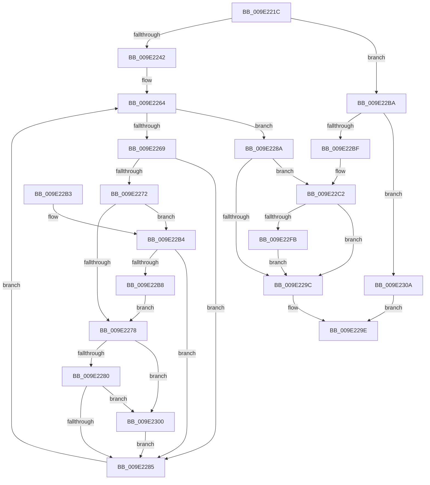

# WmipEnableCollectOrEvent

- RVA: `0x009E221C`–`0x009E2311` (길이 `245` bytes)
- VA: `0x00000001409E221C`
- 실행 섹션: `PAGE`
- PDB 이름 있음: `예`; PDB Function 태그: `아니요`
- unwind 정보 RVA: `0x000A3E0C`
- 디코드: `73`개 명령, `245/245` bytes 표시
- 미해석 바이트: `0` (있으면 어셈블리에 `.byte`로 보존)

> 이 문서는 커널 이미지의 기계어와 PDB 기호를 분석해 생성했습니다. 4번과 5번은 함수 원형과 자료형을 바이너리 사용 방식에서 추정한 C 해석이며 원본 소스 복구 결과는 아닙니다.

## 1. Dependencies

- 직접 호출 지점: **5**; 고유 호출 대상: **3**
- 직접 호출자로 확인된 함수: **1**
- RIP 상대 이미지 참조: **1**

### Outgoing calls
- `0x009E2258` → [KeWaitForSingleObject](../../text/20/KeWaitForSingleObject_function_0020E6B0.md) (function, `0x0020E6B0`)
- `0x009E2293` → [KeReleaseMutex](../../text/39/KeReleaseMutex_function_00396810.md) (function, `0x00396810`)
- `0x009E22D7` → [KeWaitForSingleObject](../../text/20/KeWaitForSingleObject_function_0020E6B0.md) (function, `0x0020E6B0`)
- `0x009E22E2` → [WmipSendEnableRequest](WmipSendEnableRequest_function_009E367C.md) (function, `0x009E367C`)
- `0x009E22F2` → [KeReleaseMutex](../../text/39/KeReleaseMutex_function_00396810.md) (function, `0x00396810`)

### Direct callers
- [WmipOpenBlock](WmipOpenBlock_function_009E00D0.md) at `0x009E01E9`

### Static image references
- `0x009E2244` → RVA `0x00EFFA60` (`.data`; read)

## 2. Other-region calls and transfers

- 다른 실행 섹션으로 향하는 call: **4**
  - `0x009E2258` → [KeWaitForSingleObject](../../text/20/KeWaitForSingleObject_function_0020E6B0.md) (`PAGE` → `.text`)
  - `0x009E2293` → [KeReleaseMutex](../../text/39/KeReleaseMutex_function_00396810.md) (`PAGE` → `.text`)
  - `0x009E22D7` → [KeWaitForSingleObject](../../text/20/KeWaitForSingleObject_function_0020E6B0.md) (`PAGE` → `.text`)
  - `0x009E22F2` → [KeReleaseMutex](../../text/39/KeReleaseMutex_function_00396810.md) (`PAGE` → `.text`)
- 별도 외부 분기/꼬리 이동을 확인하지 못했습니다.

## 3. Assembly (complete function range)

```asm
009E221C  48 8B C4                        mov rax, rsp
009E221F  48 89 58 08                     mov qword ptr [rax + 8], rbx
009E2223  48 89 68 10                     mov qword ptr [rax + 0x10], rbp
009E2227  48 89 70 18                     mov qword ptr [rax + 0x18], rsi
009E222B  57                              push rdi
009E222C  48 83 EC 30                     sub rsp, 0x30
009E2230  41 C6 00 00                     mov byte ptr [r8], 0
009E2234  49 8B F8                        mov rdi, r8
009E2237  48 8B E9                        mov rbp, rcx
009E223A  81 EA 3C 41 22 00               sub edx, 0x22413c
009E2240  75 78                           jne 0x1409e22ba
009E2242  33 DB                           xor ebx, ebx
009E2244  48 8D 0D 15 D8 51 00            lea rcx, [rip + 0x51d815]
009E224B  48 21 58 E8                     and qword ptr [rax - 0x18], rbx
009E224F  40 32 F6                        xor sil, sil
009E2252  45 33 C9                        xor r9d, r9d
009E2255  45 33 C0                        xor r8d, r8d
009E2258  E8 53 C4 82 FF                  call 0x14020e6b0
009E225D  48 8D 55 38                     lea rdx, [rbp + 0x38]
009E2261  48 8B 02                        mov rax, qword ptr [rdx]
009E2264  48 3B C2                        cmp rax, rdx
009E2267  74 21                           je 0x1409e228a
009E2269  8B 48 10                        mov ecx, dword ptr [rax + 0x10]
009E226C  0F BA E1 0C                     bt ecx, 0xc
009E2270  72 13                           jb 0x1409e2285
009E2272  0F BA E1 0F                     bt ecx, 0xf
009E2276  72 3C                           jb 0x1409e22b4
009E2278  85 DB                           test ebx, ebx
009E227A  0F 85 80 00 00 00               jne 0x1409e2300
009E2280  F6 C1 04                        test cl, 4
009E2283  75 7B                           jne 0x1409e2300
009E2285  48 8B 00                        mov rax, qword ptr [rax]
009E2288  EB DA                           jmp 0x1409e2264
009E228A  33 D2                           xor edx, edx
009E228C  48 8D 0D CD D7 51 00            lea rcx, [rip + 0x51d7cd]
009E2293  E8 78 45 9B FF                  call 0x140396810
009E2298  85 DB                           test ebx, ebx
009E229A  75 26                           jne 0x1409e22c2
009E229C  8B C3                           mov eax, ebx
009E229E  48 8B 5C 24 40                  mov rbx, qword ptr [rsp + 0x40]
009E22A3  48 8B 6C 24 48                  mov rbp, qword ptr [rsp + 0x48]
009E22A8  48 8B 74 24 50                  mov rsi, qword ptr [rsp + 0x50]
009E22AD  48 83 C4 30                     add rsp, 0x30
009E22B1  5F                              pop rdi
009E22B2  C3                              ret
009E22B3  CC                              int3
009E22B4  85 DB                           test ebx, ebx
009E22B6  75 CD                           jne 0x1409e2285
009E22B8  EB BE                           jmp 0x1409e2278
009E22BA  83 FA 04                        cmp edx, 4
009E22BD  75 4B                           jne 0x1409e230a
009E22BF  40 B6 01                        mov sil, 1
009E22C2  48 83 64 24 20 00               and qword ptr [rsp + 0x20], 0
009E22C8  48 8D 0D 91 D7 51 00            lea rcx, [rip + 0x51d791]
009E22CF  45 33 C9                        xor r9d, r9d
009E22D2  45 33 C0                        xor r8d, r8d
009E22D5  33 D2                           xor edx, edx
009E22D7  E8 D4 C3 82 FF                  call 0x14020e6b0
009E22DC  40 8A D6                        mov dl, sil
009E22DF  48 8B CD                        mov rcx, rbp
009E22E2  E8 95 13 00 00                  call 0x1409e367c
009E22E7  33 D2                           xor edx, edx
009E22E9  48 8D 0D 70 D7 51 00            lea rcx, [rip + 0x51d770]
009E22F0  8B D8                           mov ebx, eax
009E22F2  E8 19 45 9B FF                  call 0x140396810
009E22F7  85 DB                           test ebx, ebx
009E22F9  78 A1                           js 0x1409e229c
009E22FB  C6 07 01                        mov byte ptr [rdi], 1
009E22FE  EB 9C                           jmp 0x1409e229c
009E2300  BB 01 00 00 00                  mov ebx, 1
009E2305  E9 7B FF FF FF                  jmp 0x1409e2285
009E230A  B8 AF 00 00 C0                  mov eax, 0xc00000af
009E230F  EB 8D                           jmp 0x1409e229e
```

## 4. C-style interpretation (structured pseudocode)

```c
__int64 __fastcall WmipEnableCollectOrEvent(__int64 a1, int a2, __int64 a3, int a4)
{
    __int64 result;
    __int64 v_rbx;
    __int64 v_rsi;
    __int64 v_rsp;
    unsigned __int64 v_stack_p10;
    unsigned __int64 v_stack_p18;
    unsigned __int64 v_stack_p20;
    unsigned __int64 v_stack_p8;

    *(unsigned __int64 *)(v_rsp + 8) = v_rbx;
    *(unsigned __int64 *)(v_rsp + 16) = v_rbp;
    *(unsigned __int64 *)(v_rsp + 24) = v_rsi;
    v_rsp = (v_rsp) - (48);
    *(unsigned __int8 *)(a3) = 0;
    a2 = (unsigned int)((a2) - (0x22413CULL));
    if (condition_is_not_equal) goto loc_009E22BA;
    v_rbx = 0;
    v_rsi = 0;
    a4 = 0;
    a3 = 0;
    result = KeWaitForSingleObject(v_rip + 5363733, a2, a3, a4);
loc_009E2264:
    if ((*(unsigned __int64 *)(a1 + 56)) == (a1 + 56)) goto loc_009E228A;
    if ((*(unsigned __int64 *)(a1 + 56)) < (a1 + 56)) goto loc_009E2285;
    if ((*(unsigned __int64 *)(a1 + 56)) < (a1 + 56)) goto loc_009E22B4;
loc_009E2278:
    if (0 != 0) goto loc_009E2300;
    if ((((unsigned __int8)((unsigned int)(*(unsigned int *)(*(unsigned __int64 *)(a1 + 56) + 16)))) & (4)) != 0) goto loc_009E2300;
loc_009E2285:
    goto loc_009E2264;
loc_009E228A:
    a2 = 0;
    result = KeReleaseMutex(v_rip + 5363661, a2, a3, a4);
    if (0 != 0) goto loc_009E22C2;
loc_009E229C:
loc_009E229E:
    v_rsp = (v_rsp) + (48);
    return 0;
loc_009E22B4:
    if ((unsigned int)(v_stack_p8) != 0) goto loc_009E2285;
    goto loc_009E2278;
loc_009E22BA:
    if (0 != 4) goto loc_009E230A;
loc_009E22C2:
    a4 = 0;
    a3 = 0;
    a2 = 0;
    result = KeWaitForSingleObject(v_rip + 5363601, a2, a3, a4);
    result = WmipSendEnableRequest(v_stack_p10, 1, a3, a4);
    a2 = 0;
    result = KeReleaseMutex(v_rip + 5363568, a2, a3, a4);
    if (sign_flag) goto loc_009E229C;
    *(unsigned __int8 *)(a3) = 1;
    goto loc_009E229C;
loc_009E2300:
    goto loc_009E2285;
loc_009E230A:
    goto loc_009E229E;
}
```

## 5. (Beta) C Style

```c
int64_t WmipEnableCollectOrEvent(void *Arg1, int32_t Arg2, void *Arg3, int32_t Arg4)
{
    uint8_t *arg1 = (uint8_t *)Arg1;
    uint8_t *arg3 = (uint8_t *)Arg3;

    int64_t result;
    int64_t local_rbx;
    int64_t local_rsi;
    int64_t local_rsp;
    uint64_t v_stack_p10;
    uint64_t v_stack_p18;
    uint64_t v_stack_p20;
    uint64_t v_stack_p8;

    *(uint64_t *)(local_rsp + 0x8) = local_rbx;
    *(uint64_t *)(local_rsp + 0x10) = local_rbp;
    *(uint64_t *)(local_rsp + 0x18) = local_rsi;
    local_rsp = (local_rsp) - (48);
    *(uint8_t *)(arg3) = 0;
    Arg2 = (uint32_t)((Arg2) - (0x22413CULL));
    if (condition_is_not_equal) goto loc_009E22BA;
    local_rbx = 0;
    local_rsi = 0;
    Arg4 = 0;
    Arg3 = 0;
    result = KeWaitForSingleObject(v_rip + 5363733, Arg2, Arg3, Arg4);
loc_009E2264:
    if ((*(uint64_t *)(arg1 + 0x38)) == (Arg1 + 56)) goto loc_009E228A;
    if ((*(uint64_t *)(arg1 + 0x38)) < (Arg1 + 56)) goto loc_009E2285;
    if ((*(uint64_t *)(arg1 + 0x38)) < (Arg1 + 56)) goto loc_009E22B4;
loc_009E2278:
    if (0 != 0) goto loc_009E2300;
    if ((((uint8_t)((uint32_t)(*(uint32_t *)(*(uint64_t *)(arg1 + 0x38) + 0x10)))) & (4)) != 0) goto loc_009E2300;
loc_009E2285:
    goto loc_009E2264;
loc_009E228A:
    Arg2 = 0;
    result = KeReleaseMutex(v_rip + 5363661, Arg2, Arg3, Arg4);
    if (0 != 0) goto loc_009E22C2;
loc_009E229C:
loc_009E229E:
    local_rsp = (local_rsp) + (48);
    return 0;
loc_009E22B4:
    if ((uint32_t)(v_stack_p8) != 0) goto loc_009E2285;
    goto loc_009E2278;
loc_009E22BA:
    if (0 != 4) goto loc_009E230A;
loc_009E22C2:
    Arg4 = 0;
    Arg3 = 0;
    Arg2 = 0;
    result = KeWaitForSingleObject(v_rip + 5363601, Arg2, Arg3, Arg4);
    result = WmipSendEnableRequest(v_stack_p10, 1, Arg3, Arg4);
    Arg2 = 0;
    result = KeReleaseMutex(v_rip + 5363568, Arg2, Arg3, Arg4);
    if (sign_flag) goto loc_009E229C;
    *(uint8_t *)(arg3) = 1;
    goto loc_009E229C;
loc_009E2300:
    goto loc_009E2285;
loc_009E230A:
    goto loc_009E229E;
}
```

### 관측된 메모리 오프셋

구조체 형식이 확인되지 않은 접근은 인자 기준의 오프셋으로만 기록했습니다.

| 기준 인자 | 오프셋 표현 | 폭 (bit) | 접근 |
|---|---:|---:|---|
| `Arg1` | `+ 0x0` | `64` | `R` |
| `Arg1` | `+ 0x38` | `64` | `R` |
| `Arg3` | `+ 0x0` | `8` | `W` |

## 6. Execution-region graph

[열기: 2D/3D 그래프와 함수 탐색 컨트롤 패널](../../../control-panel.html?section=page&rva=0x009E221C&view=graph)

- 2D 그래프는 위에서 아래로 흐르고, 3D 그래프는 빈 공간을 드래그해 회전합니다. Shift+드래그는 이동, 휠은 확대·축소, 함수 노드 선택은 대상 보고서 이동입니다.

### Static fallback


