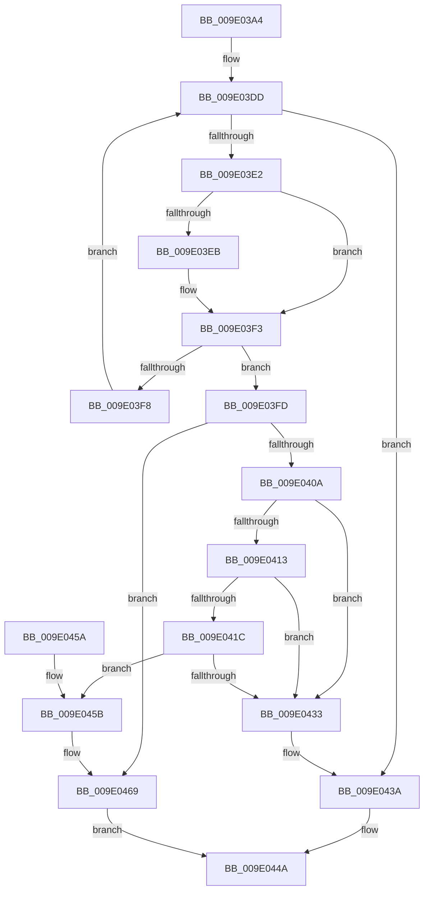

# WmipFindGEByGuid

- RVA: `0x009E03A4`–`0x009E047C` (길이 `216` bytes)
- VA: `0x00000001409E03A4`
- 실행 섹션: `PAGE`
- PDB 이름 있음: `예`; PDB Function 태그: `아니요`
- unwind 정보 RVA: `0x00064F74`
- 디코드: `62`개 명령, `216/216` bytes 표시
- 미해석 바이트: `0` (있으면 어셈블리에 `.byte`로 보존)

> 이 문서는 커널 이미지의 기계어와 PDB 기호를 분석해 생성했습니다. 4번과 5번은 함수 원형과 자료형을 바이너리 사용 방식에서 추정한 C 해석이며 원본 소스 복구 결과는 아닙니다.

## 1. Dependencies

- 직접 호출 지점: **4**; 고유 호출 대상: **3**
- 직접 호출자로 확인된 함수: **8**
- RIP 상대 이미지 참조: **2**

### Outgoing calls
- `0x009E03CE` → [KeWaitForSingleObject](../../text/20/KeWaitForSingleObject_function_0020E6B0.md) (function, `0x0020E6B0`)
- `0x009E0400` → [WmipReferenceEntry](WmipReferenceEntry_function_009E1BF8.md) (function, `0x009E1BF8`)
- `0x009E0443` → [KeReleaseMutex](../../text/39/KeReleaseMutex_function_00396810.md) (function, `0x00396810`)
- `0x009E0472` → [KeReleaseMutex](../../text/39/KeReleaseMutex_function_00396810.md) (function, `0x00396810`)

### Direct callers
- [WmipMangleInstanceName](../9D/WmipMangleInstanceName_function_009DE2DC.md) at `0x009DE368`
- [WmipDisableCollectionForRemovedGuid](../9D/WmipDisableCollectionForRemovedGuid_function_009DE88C.md) at `0x009DE8C9`
- [WmipLinkDataSourceToList](../9D/WmipLinkDataSourceToList_function_009DF4D4.md) at `0x009DF519`
- [WmipIncludeStaticNames](../9D/WmipIncludeStaticNames_function_009DF754.md) at `0x009DF794`
- [WmipProcessEvent](../9D/WmipProcessEvent_function_009DFA40.md) at `0x009DFA98`
- [WmipEnableCollectionForNewGuid](../9D/WmipEnableCollectionForNewGuid_function_009DFC0C.md) at `0x009DFC49`
- [WmipOpenBlock](WmipOpenBlock_function_009E00D0.md) at `0x009E014F`
- [WmipDetermineInstanceBaseIndex](WmipDetermineInstanceBaseIndex_function_009E2740.md) at `0x009E2775`

### Static image references
- `0x009E03C1` → RVA `0x00EFFA60` (`.data`; read)
- `0x009E03D3` → RVA `0x00EFFB28` (`.data`; read)

## 2. Other-region calls and transfers

- 다른 실행 섹션으로 향하는 call: **3**
  - `0x009E03CE` → [KeWaitForSingleObject](../../text/20/KeWaitForSingleObject_function_0020E6B0.md) (`PAGE` → `.text`)
  - `0x009E0443` → [KeReleaseMutex](../../text/39/KeReleaseMutex_function_00396810.md) (`PAGE` → `.text`)
  - `0x009E0472` → [KeReleaseMutex](../../text/39/KeReleaseMutex_function_00396810.md) (`PAGE` → `.text`)
- 별도 외부 분기/꼬리 이동을 확인하지 못했습니다.

## 3. Assembly (complete function range)

```asm
009E03A4  48 89 5C 24 08                  mov qword ptr [rsp + 8], rbx
009E03A9  48 89 74 24 10                  mov qword ptr [rsp + 0x10], rsi
009E03AE  57                              push rdi
009E03AF  48 83 EC 30                     sub rsp, 0x30
009E03B3  48 83 64 24 20 00               and qword ptr [rsp + 0x20], 0
009E03B9  40 8A F2                        mov sil, dl
009E03BC  48 8B F9                        mov rdi, rcx
009E03BF  33 D2                           xor edx, edx
009E03C1  48 8D 0D 98 F6 51 00            lea rcx, [rip + 0x51f698]
009E03C8  45 33 C9                        xor r9d, r9d
009E03CB  45 33 C0                        xor r8d, r8d
009E03CE  E8 DD E2 82 FF                  call 0x14020e6b0
009E03D3  4C 8B 05 4E F7 51 00            mov r8, qword ptr [rip + 0x51f74e]
009E03DA  49 8B 18                        mov rbx, qword ptr [r8]
009E03DD  49 3B D8                        cmp rbx, r8
009E03E0  74 58                           je 0x1409e043a
009E03E2  48 8B 0F                        mov rcx, qword ptr [rdi]
009E03E5  48 2B 4B 48                     sub rcx, qword ptr [rbx + 0x48]
009E03E9  75 08                           jne 0x1409e03f3
009E03EB  48 8B 4F 08                     mov rcx, qword ptr [rdi + 8]
009E03EF  48 2B 4B 50                     sub rcx, qword ptr [rbx + 0x50]
009E03F3  48 85 C9                        test rcx, rcx
009E03F6  74 05                           je 0x1409e03fd
009E03F8  48 8B 1B                        mov rbx, qword ptr [rbx]
009E03FB  EB E0                           jmp 0x1409e03dd
009E03FD  48 8B CB                        mov rcx, rbx
009E0400  E8 F3 17 00 00                  call 0x1409e1bf8
009E0405  40 84 F6                        test sil, sil
009E0408  74 5F                           je 0x1409e0469
009E040A  48 8B 03                        mov rax, qword ptr [rbx]
009E040D  48 39 58 08                     cmp qword ptr [rax + 8], rbx
009E0411  75 20                           jne 0x1409e0433
009E0413  48 8B 4B 08                     mov rcx, qword ptr [rbx + 8]
009E0417  48 39 19                        cmp qword ptr [rcx], rbx
009E041A  75 17                           jne 0x1409e0433
009E041C  48 89 01                        mov qword ptr [rcx], rax
009E041F  48 89 48 08                     mov qword ptr [rax + 8], rcx
009E0423  48 8B 05 FE F6 51 00            mov rax, qword ptr [rip + 0x51f6fe]
009E042A  48 8B 08                        mov rcx, qword ptr [rax]
009E042D  48 39 41 08                     cmp qword ptr [rcx + 8], rax
009E0431  74 28                           je 0x1409e045b
009E0433  B9 03 00 00 00                  mov ecx, 3
009E0438  CD 29                           int 0x29
009E043A  33 D2                           xor edx, edx
009E043C  48 8D 0D 1D F6 51 00            lea rcx, [rip + 0x51f61d]
009E0443  E8 C8 63 9B FF                  call 0x140396810
009E0448  33 C0                           xor eax, eax
009E044A  48 8B 5C 24 40                  mov rbx, qword ptr [rsp + 0x40]
009E044F  48 8B 74 24 48                  mov rsi, qword ptr [rsp + 0x48]
009E0454  48 83 C4 30                     add rsp, 0x30
009E0458  5F                              pop rdi
009E0459  C3                              ret
009E045A  CC                              int3
009E045B  48 89 0B                        mov qword ptr [rbx], rcx
009E045E  48 89 43 08                     mov qword ptr [rbx + 8], rax
009E0462  48 89 59 08                     mov qword ptr [rcx + 8], rbx
009E0466  48 89 18                        mov qword ptr [rax], rbx
009E0469  33 D2                           xor edx, edx
009E046B  48 8D 0D EE F5 51 00            lea rcx, [rip + 0x51f5ee]
009E0472  E8 99 63 9B FF                  call 0x140396810
009E0477  48 8B C3                        mov rax, rbx
009E047A  EB CE                           jmp 0x1409e044a
```

## 4. C-style interpretation (structured pseudocode)

```c
__int64 __fastcall WmipFindGEByGuid(__int64 a1, int a2, int a3, int a4)
{
    __int64 result;
    __int64 v_rsp;
    unsigned __int64 v_stack_m18;
    unsigned __int64 v_stack_p10;
    unsigned __int64 v_stack_p8;

    v_stack_p8 = v_rbx;
    v_stack_p10 = v_rsi;
    v_rsp = (v_rsp) - (48);
    a2 = 0;
    a4 = 0;
    a3 = 0;
    result = KeWaitForSingleObject(v_rip + 5371544, a2, a3, a4);
loc_009E03DD:
    if ((*(unsigned __int64 *)(*(unsigned __int64 *)(v_rip + 5371726))) == (*(unsigned __int64 *)(v_rip + 5371726))) goto loc_009E043A;
    a1 = (*(unsigned __int64 *)(a1)) - (*(unsigned __int64 *)(*(unsigned __int64 *)(*(unsigned __int64 *)(v_rip + 5371726)) + 72));
    if (!(condition_is_not_equal)) {
        a1 = *(unsigned __int64 *)(a1 + 8);
        a1 = (a1) - (*(unsigned __int64 *)(*(unsigned __int64 *)(*(unsigned __int64 *)(v_rip + 5371726)) + 80));
    }
    if (a1 == 0) goto loc_009E03FD;
    goto loc_009E03DD;
loc_009E03FD:
    result = WmipReferenceEntry(*(unsigned __int64 *)(*(unsigned __int64 *)(*(unsigned __int64 *)(v_rip + 5371726))), a2, *(unsigned __int64 *)(v_rip + 5371726), a4);
    if ((unsigned __int8)((unsigned __int8)(a2)) == 0) goto loc_009E0469;
    if ((*(unsigned __int64 *)(*(unsigned __int64 *)(*(unsigned __int64 *)(*(unsigned __int64 *)(*(unsigned __int64 *)(v_rip + 5371726)))) + 8)) != (*(unsigned __int64 *)(*(unsigned __int64 *)(*(unsigned __int64 *)(v_rip + 5371726))))) goto loc_009E0433;
    if ((*(unsigned __int64 *)(*(unsigned __int64 *)(*(unsigned __int64 *)(*(unsigned __int64 *)(*(unsigned __int64 *)(v_rip + 5371726))) + 8))) != (*(unsigned __int64 *)(*(unsigned __int64 *)(*(unsigned __int64 *)(v_rip + 5371726))))) goto loc_009E0433;
    *(unsigned __int64 *)(*(unsigned __int64 *)(*(unsigned __int64 *)(*(unsigned __int64 *)(*(unsigned __int64 *)(v_rip + 5371726))) + 8)) = *(unsigned __int64 *)(*(unsigned __int64 *)(*(unsigned __int64 *)(*(unsigned __int64 *)(v_rip + 5371726))));
    *(unsigned __int64 *)(*(unsigned __int64 *)(*(unsigned __int64 *)(*(unsigned __int64 *)(*(unsigned __int64 *)(v_rip + 5371726)))) + 8) = *(unsigned __int64 *)(*(unsigned __int64 *)(*(unsigned __int64 *)(*(unsigned __int64 *)(v_rip + 5371726))) + 8);
    if ((*(unsigned __int64 *)(*(unsigned __int64 *)(*(unsigned __int64 *)(v_rip + 5371646)) + 8)) == (*(unsigned __int64 *)(v_rip + 5371646))) goto loc_009E045B;
loc_009E0433:
loc_009E043A:
    a2 = 0;
    result = KeReleaseMutex(v_rip + 5371421, a2, *(unsigned __int64 *)(v_rip + 5371726), a4);
    result = 0;
loc_009E044A:
    v_rsp = (v_rsp) + (48);
    return result;
loc_009E045B:
    *(unsigned __int64 *)(v_stack_p8) = v_rip + 5371421;
    *(unsigned __int64 *)(v_stack_p8 + 8) = 0;
    *(unsigned __int64 *)(v_rip + 5371421 + 8) = v_stack_p8;
    *(unsigned __int64 *)(result) = v_stack_p8;
loc_009E0469:
    a2 = 0;
    result = KeReleaseMutex(v_rip + 5371374, a2, *(unsigned __int64 *)(v_rip + 5371726), a4);
    goto loc_009E044A;
}
```

## 5. (Beta) C Style

```c
int64_t WmipFindGEByGuid(void *Arg1, int32_t Arg2, int32_t Arg3, int32_t Arg4)
{
    uint8_t *arg1 = (uint8_t *)Arg1;

    int64_t result;
    int64_t local_rsp;
    uint64_t v_stack_m18;
    uint64_t v_stack_p10;
    uint64_t v_stack_p8;

    v_stack_p8 = local_rbx;
    v_stack_p10 = local_rsi;
    local_rsp = (local_rsp) - (48);
    Arg2 = 0;
    Arg4 = 0;
    Arg3 = 0;
    result = KeWaitForSingleObject(v_rip + 5371544, Arg2, Arg3, Arg4);
loc_009E03DD:
    if ((*(uint64_t *)(*(uint64_t *)(v_rip + 0x51F74E))) == (*(uint64_t *)(v_rip + 0x51F74E))) goto loc_009E043A;
    Arg1 = (*(uint64_t *)(arg1)) - (*(uint64_t *)(*(uint64_t *)(*(uint64_t *)(v_rip + 0x51F74E)) + 0x48));
    if (!(condition_is_not_equal)) {
        Arg1 = *(uint64_t *)(arg1 + 0x8);
        Arg1 = (Arg1) - (*(uint64_t *)(*(uint64_t *)(*(uint64_t *)(v_rip + 0x51F74E)) + 0x50));
    }
    if (Arg1 == NULL) goto loc_009E03FD;
    goto loc_009E03DD;
loc_009E03FD:
    result = WmipReferenceEntry(*(uint64_t *)(*(uint64_t *)(*(uint64_t *)(v_rip + 0x51F74E))), Arg2, *(uint64_t *)(v_rip + 0x51F74E), Arg4);
    if ((uint8_t)((uint8_t)(Arg2)) == 0) goto loc_009E0469;
    if ((*(uint64_t *)(*(uint64_t *)(*(uint64_t *)(*(uint64_t *)(*(uint64_t *)(v_rip + 0x51F74E)))) + 0x8)) != (*(uint64_t *)(*(uint64_t *)(*(uint64_t *)(v_rip + 0x51F74E))))) goto loc_009E0433;
    if ((*(uint64_t *)(*(uint64_t *)(*(uint64_t *)(*(uint64_t *)(*(uint64_t *)(v_rip + 0x51F74E))) + 0x8))) != (*(uint64_t *)(*(uint64_t *)(*(uint64_t *)(v_rip + 0x51F74E))))) goto loc_009E0433;
    *(uint64_t *)(*(uint64_t *)(*(uint64_t *)(*(uint64_t *)(*(uint64_t *)(v_rip + 0x51F74E))) + 0x8)) = *(uint64_t *)(*(uint64_t *)(*(uint64_t *)(*(uint64_t *)(v_rip + 0x51F74E))));
    *(uint64_t *)(*(uint64_t *)(*(uint64_t *)(*(uint64_t *)(*(uint64_t *)(v_rip + 0x51F74E)))) + 0x8) = *(uint64_t *)(*(uint64_t *)(*(uint64_t *)(*(uint64_t *)(v_rip + 0x51F74E))) + 0x8);
    if ((*(uint64_t *)(*(uint64_t *)(*(uint64_t *)(v_rip + 0x51F6FE)) + 0x8)) == (*(uint64_t *)(v_rip + 0x51F6FE))) goto loc_009E045B;
loc_009E0433:
loc_009E043A:
    Arg2 = 0;
    result = KeReleaseMutex(v_rip + 5371421, Arg2, *(uint64_t *)(v_rip + 0x51F74E), Arg4);
    result = 0;
loc_009E044A:
    local_rsp = (local_rsp) + (48);
    return result;
loc_009E045B:
    *(uint64_t *)(v_stack_p8) = v_rip + 5371421;
    *(uint64_t *)(v_stack_p8 + 0x8) = 0;
    *(uint64_t *)(v_rip + 0x51F61D + 0x8) = v_stack_p8;
    *(uint64_t *)(result) = v_stack_p8;
loc_009E0469:
    Arg2 = 0;
    result = KeReleaseMutex(v_rip + 5371374, Arg2, *(uint64_t *)(v_rip + 0x51F74E), Arg4);
    goto loc_009E044A;
}
```

### 관측된 메모리 오프셋

구조체 형식이 확인되지 않은 접근은 인자 기준의 오프셋으로만 기록했습니다.

| 기준 인자 | 오프셋 표현 | 폭 (bit) | 접근 |
|---|---:|---:|---|
| `Arg1` | `+ 0x0` | `64` | `R` |
| `Arg1` | `+ 0x8` | `64` | `R` |

## 6. Execution-region graph

[열기: 2D/3D 그래프와 함수 탐색 컨트롤 패널](../../../control-panel.html?section=page&rva=0x009E03A4&view=graph)

- 2D 그래프는 위에서 아래로 흐르고, 3D 그래프는 빈 공간을 드래그해 회전합니다. Shift+드래그는 이동, 휠은 확대·축소, 함수 노드 선택은 대상 보고서 이동입니다.

### Static fallback


