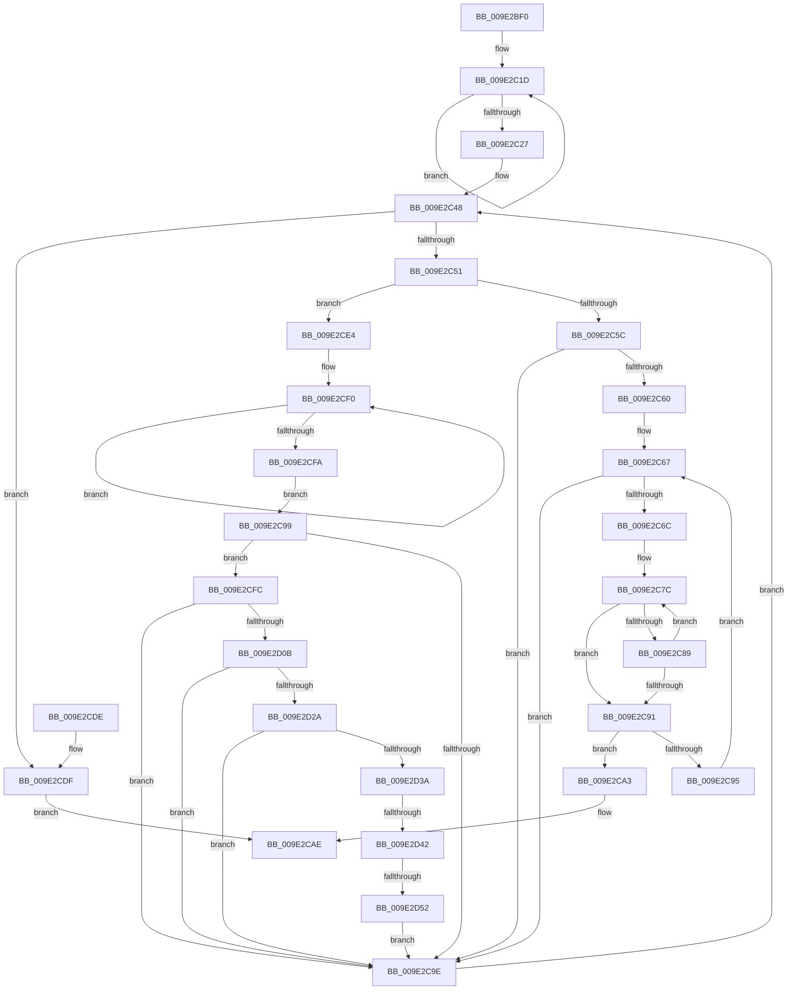

# WmipFindISinGEbyName

- RVA: `0x009E2BF0`–`0x009E2D57` (길이 `359` bytes)
- VA: `0x00000001409E2BF0`
- 실행 섹션: `PAGE`
- PDB 이름 있음: `예`; PDB Function 태그: `예`
- unwind 정보 RVA: `0x000A3EB8`
- 디코드: `106`개 명령, `359/359` bytes 표시
- 미해석 바이트: `0` (있으면 어셈블리에 `.byte`로 보존)

> 이 문서는 커널 이미지의 기계어와 PDB 기호를 분석해 생성했습니다. 4번과 5번은 함수 원형과 자료형을 바이너리 사용 방식에서 추정한 C 해석이며 원본 소스 복구 결과는 아닙니다.

## 1. Dependencies

- 직접 호출 지점: **6**; 고유 호출 대상: **6**
- 직접 호출자로 확인된 함수: **1**
- RIP 상대 이미지 참조: **1**

### Outgoing calls
- `0x009E2C3B` → [KeWaitForSingleObject](../../text/20/KeWaitForSingleObject_function_0020E6B0.md) (function, `0x0020E6B0`)
- `0x009E2CA9` → [WmipReferenceEntry](WmipReferenceEntry_function_009E1BF8.md) (function, `0x009E1BF8`)
- `0x009E2CB7` → [KeReleaseMutex](../../text/39/KeReleaseMutex_function_00396810.md) (function, `0x00396810`)
- `0x009E2D02` → [wcsncmp](../../text/50/wcsncmp_function_00501CA0.md) (function, `0x00501CA0`)
- `0x009E2D12` → [wtoi](../../text/50/wtoi_function_005003E0.md) (function, `0x005003E0`)
- `0x009E2D45` → [WmipIsNumber](WmipIsNumber_function_009E2388.md) (function, `0x009E2388`)

### Direct callers
- [WmipMangleInstanceName](../9D/WmipMangleInstanceName_function_009DE2DC.md) at `0x009DE3AD`

### Static image references
- `0x009E2C32` → RVA `0x00EFFA60` (`.data`; read)

## 2. Other-region calls and transfers

- 다른 실행 섹션으로 향하는 call: **4**
  - `0x009E2C3B` → [KeWaitForSingleObject](../../text/20/KeWaitForSingleObject_function_0020E6B0.md) (`PAGE` → `.text`)
  - `0x009E2CB7` → [KeReleaseMutex](../../text/39/KeReleaseMutex_function_00396810.md) (`PAGE` → `.text`)
  - `0x009E2D02` → [wcsncmp](../../text/50/wcsncmp_function_00501CA0.md) (`PAGE` → `.text`)
  - `0x009E2D12` → [wtoi](../../text/50/wtoi_function_005003E0.md) (`PAGE` → `.text`)
- call이 아닌 외부 분기/꼬리 이동: **2**
  - `0x009E2D3C` → [sub_00B30320](../B3/Unknown_function_00B30320.md) (`tail-transfer`)
  - `0x009E2D4C` → [sub_00B30320](../B3/Unknown_function_00B30320.md) (`tail-transfer`)

## 3. Assembly (complete function range)

```asm
009E2BF0  48 8B C4                        mov rax, rsp
009E2BF3  48 89 58 08                     mov qword ptr [rax + 8], rbx
009E2BF7  48 89 68 10                     mov qword ptr [rax + 0x10], rbp
009E2BFB  48 89 70 18                     mov qword ptr [rax + 0x18], rsi
009E2BFF  48 89 78 20                     mov qword ptr [rax + 0x20], rdi
009E2C03  41 54                           push r12
009E2C05  41 56                           push r14
009E2C07  41 57                           push r15
009E2C09  48 83 EC 30                     sub rsp, 0x30
009E2C0D  48 83 CE FF                     or rsi, 0xffffffffffffffff
009E2C11  4D 8B F8                        mov r15, r8
009E2C14  45 33 E4                        xor r12d, r12d
009E2C17  4C 8B F2                        mov r14, rdx
009E2C1A  48 8B D9                        mov rbx, rcx
009E2C1D  48 FF C6                        inc rsi
009E2C20  66 44 39 24 72                  cmp word ptr [rdx + rsi*2], r12w
009E2C25  75 F6                           jne 0x1409e2c1d
009E2C27  45 33 C9                        xor r9d, r9d
009E2C2A  4C 89 64 24 20                  mov qword ptr [rsp + 0x20], r12
009E2C2F  45 33 C0                        xor r8d, r8d
009E2C32  48 8D 0D 27 CE 51 00            lea rcx, [rip + 0x51ce27]
009E2C39  33 D2                           xor edx, edx
009E2C3B  E8 70 BA 82 FF                  call 0x14020e6b0
009E2C40  48 8D 6B 38                     lea rbp, [rbx + 0x38]
009E2C44  48 8B 5D 00                     mov rbx, qword ptr [rbp]
009E2C48  48 3B DD                        cmp rbx, rbp
009E2C4B  0F 84 8E 00 00 00               je 0x1409e2cdf
009E2C51  8B 43 10                        mov eax, dword ptr [rbx + 0x10]
009E2C54  A8 01                           test al, 1
009E2C56  0F 85 88 00 00 00               jne 0x1409e2ce4
009E2C5C  A8 02                           test al, 2
009E2C5E  74 3E                           je 0x1409e2c9e
009E2C60  44 8B 53 48                     mov r10d, dword ptr [rbx + 0x48]
009E2C64  41 8B D4                        mov edx, r12d
009E2C67  41 3B D2                        cmp edx, r10d
009E2C6A  73 32                           jae 0x1409e2c9e
009E2C6C  48 8B 43 58                     mov rax, qword ptr [rbx + 0x58]
009E2C70  4D 8B C6                        mov r8, r14
009E2C73  8B CA                           mov ecx, edx
009E2C75  4C 8B 0C C8                     mov r9, qword ptr [rax + rcx*8]
009E2C79  4D 2B CE                        sub r9, r14
009E2C7C  41 0F B7 00                     movzx eax, word ptr [r8]
009E2C80  43 0F B7 0C 08                  movzx ecx, word ptr [r8 + r9]
009E2C85  2B C1                           sub eax, ecx
009E2C87  75 08                           jne 0x1409e2c91
009E2C89  49 83 C0 02                     add r8, 2
009E2C8D  85 C9                           test ecx, ecx
009E2C8F  75 EB                           jne 0x1409e2c7c
009E2C91  85 C0                           test eax, eax
009E2C93  74 0E                           je 0x1409e2ca3
009E2C95  FF C2                           inc edx
009E2C97  EB CE                           jmp 0x1409e2c67
009E2C99  48 3B FE                        cmp rdi, rsi
009E2C9C  72 5E                           jb 0x1409e2cfc
009E2C9E  48 8B 1B                        mov rbx, qword ptr [rbx]
009E2CA1  EB A5                           jmp 0x1409e2c48
009E2CA3  41 89 17                        mov dword ptr [r15], edx
009E2CA6  48 8B CB                        mov rcx, rbx
009E2CA9  E8 4A EF FF FF                  call 0x1409e1bf8
009E2CAE  33 D2                           xor edx, edx
009E2CB0  48 8D 0D A9 CD 51 00            lea rcx, [rip + 0x51cda9]
009E2CB7  E8 54 3B 9B FF                  call 0x140396810
009E2CBC  48 8B 6C 24 58                  mov rbp, qword ptr [rsp + 0x58]
009E2CC1  48 8B C3                        mov rax, rbx
009E2CC4  48 8B 5C 24 50                  mov rbx, qword ptr [rsp + 0x50]
009E2CC9  48 8B 74 24 60                  mov rsi, qword ptr [rsp + 0x60]
009E2CCE  48 8B 7C 24 68                  mov rdi, qword ptr [rsp + 0x68]
009E2CD3  48 83 C4 30                     add rsp, 0x30
009E2CD7  41 5F                           pop r15
009E2CD9  41 5E                           pop r14
009E2CDB  41 5C                           pop r12
009E2CDD  C3                              ret
009E2CDE  CC                              int3
009E2CDF  49 8B DC                        mov rbx, r12
009E2CE2  EB CA                           jmp 0x1409e2cae
009E2CE4  48 8B 53 58                     mov rdx, qword ptr [rbx + 0x58]
009E2CE8  48 83 C2 04                     add rdx, 4
009E2CEC  48 83 CF FF                     or rdi, 0xffffffffffffffff
009E2CF0  48 FF C7                        inc rdi
009E2CF3  66 44 39 24 7A                  cmp word ptr [rdx + rdi*2], r12w
009E2CF8  75 F6                           jne 0x1409e2cf0
009E2CFA  EB 9D                           jmp 0x1409e2c99
009E2CFC  4C 8B C7                        mov r8, rdi
009E2CFF  49 8B CE                        mov rcx, r14
009E2D02  E8 99 EF B1 FF                  call 0x140501ca0
009E2D07  85 C0                           test eax, eax
009E2D09  75 93                           jne 0x1409e2c9e
009E2D0B  49 8D 3C 7E                     lea rdi, [r14 + rdi*2]
009E2D0F  48 8B CF                        mov rcx, rdi
009E2D12  E8 C9 D6 B1 FF                  call 0x1405003e0
009E2D17  48 8B 53 58                     mov rdx, qword ptr [rbx + 0x58]
009E2D1B  44 8B C8                        mov r9d, eax
009E2D1E  44 8B 12                        mov r10d, dword ptr [rdx]
009E2D21  41 3B C2                        cmp eax, r10d
009E2D24  0F 82 74 FF FF FF               jb 0x1409e2c9e
009E2D2A  44 8B 43 48                     mov r8d, dword ptr [rbx + 0x48]
009E2D2E  45 03 C2                        add r8d, r10d
009E2D31  41 3B C0                        cmp eax, r8d
009E2D34  0F 83 64 FF FF FF               jae 0x1409e2c9e
009E2D3A  85 C0                           test eax, eax
009E2D3C  0F 85 DE D5 14 00               jne 0x140b30320
009E2D42  48 8B CF                        mov rcx, rdi
009E2D45  E8 3E F6 FF FF                  call 0x1409e2388
009E2D4A  84 C0                           test al, al
009E2D4C  0F 85 CE D5 14 00               jne 0x140b30320
009E2D52  E9 47 FF FF FF                  jmp 0x1409e2c9e
```

## 4. C-style interpretation (structured pseudocode)

```c
__int64 __fastcall WmipFindISinGEbyName(__int64 a1, __int64 a2, __int64 a3, int a4)
{
    __int64 result;
    __int64 v_r12;
    __int64 v_rdi;
    __int64 v_rsi;
    __int64 v_rsp;
    unsigned __int64 v_stack_m28;
    unsigned __int64 v_stack_p10;
    unsigned __int64 v_stack_p18;
    unsigned __int64 v_stack_p20;
    unsigned __int64 v_stack_p8;

    *(unsigned __int64 *)(v_rsp + 8) = v_rbx;
    *(unsigned __int64 *)(v_rsp + 16) = v_rbp;
    *(unsigned __int64 *)(v_rsp + 24) = v_rsi;
    *(unsigned __int64 *)(v_rsp + 32) = v_rdi;
    v_rsp = (v_rsp) - (48);
    v_rsi = (v_rsi) | (-1);
    v_r12 = 0;
loc_009E2C1D:
    v_rsi = (v_rsi) + 1;
    if ((*(unsigned __int16 *)(a2 + v_rsi * 2)) != 0) goto loc_009E2C1D;
    a4 = 0;
    v_stack_m28 = 0;
    a3 = 0;
    a2 = 0;
    result = KeWaitForSingleObject(v_rip + 5361191, a2, a3, a4);
loc_009E2C48:
    if ((*(unsigned __int64 *)(a1 + 56)) == (a1 + 56)) goto loc_009E2CDF;
    if ((((unsigned __int8)((unsigned int)(*(unsigned int *)(*(unsigned __int64 *)(a1 + 56) + 16)))) & (1)) != 0) goto loc_009E2CE4;
    if ((((unsigned __int8)((unsigned int)(*(unsigned int *)(*(unsigned __int64 *)(a1 + 56) + 16)))) & (2)) == 0) goto loc_009E2C9E;
loc_009E2C67:
    if (0 >= ((unsigned int)((unsigned int)(*(unsigned int *)(*(unsigned __int64 *)(a1 + 56) + 72))))) goto loc_009E2C9E;
    a4 = (*(unsigned __int64 *)(*(unsigned __int64 *)(*(unsigned __int64 *)(a1 + 56) + 88) + 0 * 8)) - (0);
loc_009E2C7C:
    result = (unsigned int)((*(unsigned __int16 *)(0)) - ((unsigned int)(*(unsigned __int16 *)(0 + a4 * 1))));
    if (condition_is_not_equal) goto loc_009E2C91;
    a3 = (0) + (2);
    if ((unsigned int)(*(unsigned __int16 *)(0 + a4 * 1)) != 0) goto loc_009E2C7C;
loc_009E2C91:
    if ((unsigned int)(result) == 0) goto loc_009E2CA3;
    a2 = (unsigned int)((0) + 1);
    goto loc_009E2C67;
loc_009E2C99:
    if (v_rdi < v_rsi) goto loc_009E2CFC;
loc_009E2C9E:
    goto loc_009E2C48;
loc_009E2CA3:
    *(unsigned int *)(a3) = (unsigned int)(a2);
    result = WmipReferenceEntry(*(unsigned __int64 *)(*(unsigned __int64 *)(a1 + 56)), a2, a3, a4);
loc_009E2CAE:
    a2 = 0;
    result = KeReleaseMutex(v_rip + 5361065, a2, a3, a4);
    v_rsp = (v_rsp) + (48);
    return *(unsigned __int64 *)(*(unsigned __int64 *)(a1 + 56));
loc_009E2CDF:
    goto loc_009E2CAE;
loc_009E2CE4:
    a2 = (*(unsigned __int64 *)(0 + 88)) + (4);
    v_rdi = (v_stack_p20) | (-1);
loc_009E2CF0:
    v_rdi = (v_rdi) + 1;
    if ((*(unsigned __int16 *)(a2 + v_rdi * 2)) != 0) goto loc_009E2CF0;
    goto loc_009E2C99;
loc_009E2CFC:
    result = wcsncmp(a2, a2, v_rdi, a4);
    if ((unsigned int)(result) != 0) goto loc_009E2C9E;
    result = wtoi(a2 + v_rdi * 2, a2, v_rdi, a4);
    if (((unsigned int)(result)) < ((unsigned int)((unsigned int)(*(unsigned int *)(*(unsigned __int64 *)(0 + 88)))))) goto loc_009E2C9E;
    a3 = (unsigned int)(((unsigned int)(*(unsigned int *)(0 + 72))) + ((unsigned int)((unsigned int)(*(unsigned int *)(*(unsigned __int64 *)(0 + 88))))));
    if (((unsigned int)(result)) >= ((unsigned int)(a3))) goto loc_009E2C9E;
    result = WmipIsNumber(a2 + v_rdi * 2, *(unsigned __int64 *)(0 + 88), a3, (unsigned int)((unsigned int)(result)));
    goto loc_009E2C9E;
}
```

## 5. (Beta) C Style

```c
int64_t WmipFindISinGEbyName(void *Arg1, void *Arg2, void *Arg3, int32_t Arg4)
{
    uint8_t *arg1 = (uint8_t *)Arg1;
    uint8_t *arg2 = (uint8_t *)Arg2;
    uint8_t *arg3 = (uint8_t *)Arg3;

    int64_t result;
    int64_t local_r12;
    int64_t local_rdi;
    int64_t local_rsi;
    int64_t local_rsp;
    uint64_t v_stack_m28;
    uint64_t v_stack_p10;
    uint64_t v_stack_p18;
    uint64_t v_stack_p20;
    uint64_t v_stack_p8;

    *(uint64_t *)(local_rsp + 0x8) = local_rbx;
    *(uint64_t *)(local_rsp + 0x10) = local_rbp;
    *(uint64_t *)(local_rsp + 0x18) = local_rsi;
    *(uint64_t *)(local_rsp + 0x20) = local_rdi;
    local_rsp = (local_rsp) - (48);
    local_rsi = (local_rsi) | (-1);
    local_r12 = 0;
loc_009E2C1D:
    local_rsi = (local_rsi) + 1;
    if ((*(uint16_t *)(arg2 + local_rsi * 2)) != 0) goto loc_009E2C1D;
    Arg4 = 0;
    v_stack_m28 = 0;
    Arg3 = 0;
    Arg2 = 0;
    result = KeWaitForSingleObject(v_rip + 5361191, Arg2, Arg3, Arg4);
loc_009E2C48:
    if ((*(uint64_t *)(arg1 + 0x38)) == (Arg1 + 56)) goto loc_009E2CDF;
    if ((((uint8_t)((uint32_t)(*(uint32_t *)(*(uint64_t *)(arg1 + 0x38) + 0x10)))) & (1)) != 0) goto loc_009E2CE4;
    if ((((uint8_t)((uint32_t)(*(uint32_t *)(*(uint64_t *)(arg1 + 0x38) + 0x10)))) & (2)) == 0) goto loc_009E2C9E;
loc_009E2C67:
    if (0 >= ((uint32_t)((uint32_t)(*(uint32_t *)(*(uint64_t *)(arg1 + 0x38) + 0x48))))) goto loc_009E2C9E;
    Arg4 = (*(uint64_t *)(*(uint64_t *)(*(uint64_t *)(arg1 + 0x38) + 0x58) + 0x0 * 8)) - (0);
loc_009E2C7C:
    result = (uint32_t)((*(uint16_t *)(0)) - ((uint32_t)(*(uint16_t *)(0 + Arg4 * 1))));
    if (condition_is_not_equal) goto loc_009E2C91;
    Arg3 = (0) + (2);
    if ((uint32_t)(*(uint16_t *)(0 + Arg4 * 1)) != 0) goto loc_009E2C7C;
loc_009E2C91:
    if ((uint32_t)(result) == 0) goto loc_009E2CA3;
    Arg2 = (uint32_t)((0) + 1);
    goto loc_009E2C67;
loc_009E2C99:
    if (local_rdi < local_rsi) goto loc_009E2CFC;
loc_009E2C9E:
    goto loc_009E2C48;
loc_009E2CA3:
    *(uint32_t *)(arg3) = (uint32_t)(Arg2);
    result = WmipReferenceEntry(*(uint64_t *)(*(uint64_t *)(arg1 + 0x38)), Arg2, Arg3, Arg4);
loc_009E2CAE:
    Arg2 = 0;
    result = KeReleaseMutex(v_rip + 5361065, Arg2, Arg3, Arg4);
    local_rsp = (local_rsp) + (48);
    return *(uint64_t *)(*(uint64_t *)(arg1 + 0x38));
loc_009E2CDF:
    goto loc_009E2CAE;
loc_009E2CE4:
    Arg2 = (*(uint64_t *)(0 + 0x58)) + (4);
    local_rdi = (v_stack_p20) | (-1);
loc_009E2CF0:
    local_rdi = (local_rdi) + 1;
    if ((*(uint16_t *)(arg2 + local_rdi * 2)) != 0) goto loc_009E2CF0;
    goto loc_009E2C99;
loc_009E2CFC:
    result = wcsncmp(Arg2, Arg2, local_rdi, Arg4);
    if ((uint32_t)(result) != 0) goto loc_009E2C9E;
    result = wtoi(Arg2 + local_rdi * 2, Arg2, local_rdi, Arg4);
    if (((uint32_t)(result)) < ((uint32_t)((uint32_t)(*(uint32_t *)(*(uint64_t *)(0 + 0x58)))))) goto loc_009E2C9E;
    Arg3 = (uint32_t)(((uint32_t)(*(uint32_t *)(0 + 0x48))) + ((uint32_t)((uint32_t)(*(uint32_t *)(*(uint64_t *)(0 + 0x58))))));
    if (((uint32_t)(result)) >= ((uint32_t)(Arg3))) goto loc_009E2C9E;
    result = WmipIsNumber(Arg2 + local_rdi * 2, *(uint64_t *)(0 + 0x58), Arg3, (uint32_t)((uint32_t)(result)));
    goto loc_009E2C9E;
}
```

### 관측된 메모리 오프셋

구조체 형식이 확인되지 않은 접근은 인자 기준의 오프셋으로만 기록했습니다.

| 기준 인자 | 오프셋 표현 | 폭 (bit) | 접근 |
|---|---:|---:|---|
| `Arg1` | `+ 0x0` | `64` | `R` |
| `Arg1` | `+ 0x38` | `64` | `R` |
| `Arg2` | `+ 0x0` | `16` | `R` |
| `Arg2` | `+ 0x0 + r9*1` | `16` | `R` |
| `Arg2` | `+ 0x0 + rdi*2` | `64` | `R` |
| `Arg2` | `+ 0x0 + rsi*2` | `16` | `R` |
| `Arg3` | `+ 0x0` | `32` | `W` |

## 6. Execution-region graph

[열기: 2D/3D 그래프와 함수 탐색 컨트롤 패널](../../../control-panel.html?section=page&rva=0x009E2BF0&view=graph)

- 2D 그래프는 위에서 아래로 흐르고, 3D 그래프는 빈 공간을 드래그해 회전합니다. Shift+드래그는 이동, 휠은 확대·축소, 함수 노드 선택은 대상 보고서 이동입니다.

### Static fallback


