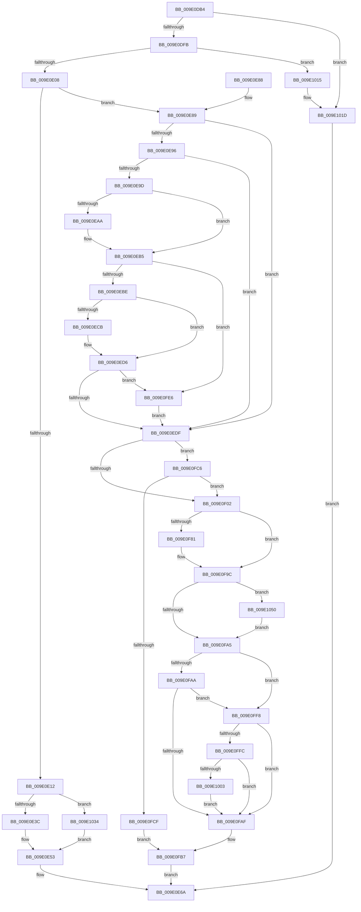

# WmipForwardWmiIrp

- RVA: `0x009E0DB4`–`0x009E105D` (길이 `681` bytes)
- VA: `0x00000001409E0DB4`
- 실행 섹션: `PAGE`
- PDB 이름 있음: `예`; PDB Function 태그: `아니요`
- unwind 정보 RVA: `0x000A3CAC`
- 디코드: `173`개 명령, `681/681` bytes 표시
- 미해석 바이트: `0` (있으면 어셈블리에 `.byte`로 보존)

> 이 문서는 커널 이미지의 기계어와 PDB 기호를 분석해 생성했습니다. 4번과 5번은 함수 원형과 자료형을 바이너리 사용 방식에서 추정한 C 해석이며 원본 소스 복구 결과는 아닙니다.

## 1. Dependencies

- 직접 호출 지점: **14**; 고유 호출 대상: **11**
- 직접 호출자로 확인된 함수: **5**
- RIP 상대 이미지 참조: **7**

### Outgoing calls
- `0x009E0DEA` → [WmipFindRegEntryByProviderId](../../text/38/WmipFindRegEntryByProviderId_function_00386908.md) (function, `0x00386908`)
- `0x009E0E4E` → [PpmWmiDispatch](PpmWmiDispatch_function_009E13A0.md) (function, `0x009E13A0`)
- `0x009E0E63` → [WmipUnreferenceRegEntry](../../text/47/WmipUnreferenceRegEntry_function_0047B6F0.md) (function, `0x0047B6F0`)
- `0x009E0EE2` → [IoGetAttachedDeviceReference](../../text/41/IoGetAttachedDeviceReference_function_0041D940.md) (function, `0x0041D940`)
- `0x009E0F0E` → [KeInitializeEvent](../../text/40/KeInitializeEvent_function_0040DD10.md) (function, `0x0040DD10`)
- `0x009E0F73` → [IofCallDriver](../../text/29/IofCallDriver_function_0029B4B0.md) (function, `0x0029B4B0`)
- `0x009E0F94` → [KeWaitForSingleObject](../../text/20/KeWaitForSingleObject_function_0020E6B0.md) (function, `0x0020E6B0`)
- `0x009E0FB2` → [WmipUnreferenceRegEntry](../../text/47/WmipUnreferenceRegEntry_function_0047B6F0.md) (function, `0x0047B6F0`)
- `0x009E0FBA` → [ObfDereferenceObject](../../text/2F/ObfDereferenceObject_function_002F9350.md) (function, `0x002F9350`)
- `0x009E0FD2` → [WmipUnreferenceRegEntry](../../text/47/WmipUnreferenceRegEntry_function_0047B6F0.md) (function, `0x0047B6F0`)
- `0x009E0FDA` → [WmipUpdateDeviceStackSize](WmipUpdateDeviceStackSize_function_009E23B0.md) (function, `0x009E23B0`)
- `0x009E100E` → [WmipTranslatePDOInstanceNames](WmipTranslatePDOInstanceNames_function_009E2F0C.md) (function, `0x009E2F0C`)
- `0x009E1018` → [WmipUnreferenceRegEntry](../../text/47/WmipUnreferenceRegEntry_function_0047B6F0.md) (function, `0x0047B6F0`)
- `0x009E1046` → [guard_dispatch_icall](../../text/6B/guard_dispatch_icall_function_006BAAD0.md) (function, `0x006BAAD0`)

### Direct callers
- [WmipSendWmiIrp](WmipSendWmiIrp_function_009E0484.md) at `0x009E0521`
- [WmipQuerySetExecuteSI](WmipQuerySetExecuteSI_function_009E0574.md) at `0x009E07B9`
- [WmipQuerySetExecuteSI](WmipQuerySetExecuteSI_function_009E0574.md) at `0x009E0812`
- [WmipQueryAllData](WmipQueryAllData_function_009E086C.md) at `0x009E0A5B`
- [WmipSendWmiIrpToTraceDeviceList](WmipSendWmiIrpToTraceDeviceList_function_009E2988.md) at `0x009E2A7B`
- [WmipSetTraceNotify](../AB/WmipSetTraceNotify_function_00ABF0E0.md) at `0x00ABF1D9`

### Static image references
- `0x009E0E17` → RVA `0x009E13A0` (`PpmWmiDispatch`; read)
- `0x009E0EA1` → RVA `0x000145D8` (`.rdata`; read)
- `0x009E0EAE` → RVA `0x000145E0` (`.rdata`; read)
- `0x009E0EC2` → RVA `0x000145C8` (`.rdata`; read)
- `0x009E0ECF` → RVA `0x000145D0` (`.rdata`; read)
- `0x009E0EEE` → RVA `0x00EFFA98` (`.data`; read)
- `0x009E0F1A` → RVA `0x0048B010` (`CmpCompleteFlushAndPurgeIrp`; read)

## 2. Other-region calls and transfers

- 다른 실행 섹션으로 향하는 call: **11**
  - `0x009E0DEA` → [WmipFindRegEntryByProviderId](../../text/38/WmipFindRegEntryByProviderId_function_00386908.md) (`PAGE` → `.text`)
  - `0x009E0E63` → [WmipUnreferenceRegEntry](../../text/47/WmipUnreferenceRegEntry_function_0047B6F0.md) (`PAGE` → `.text`)
  - `0x009E0EE2` → [IoGetAttachedDeviceReference](../../text/41/IoGetAttachedDeviceReference_function_0041D940.md) (`PAGE` → `.text`)
  - `0x009E0F0E` → [KeInitializeEvent](../../text/40/KeInitializeEvent_function_0040DD10.md) (`PAGE` → `.text`)
  - `0x009E0F73` → [IofCallDriver](../../text/29/IofCallDriver_function_0029B4B0.md) (`PAGE` → `.text`)
  - `0x009E0F94` → [KeWaitForSingleObject](../../text/20/KeWaitForSingleObject_function_0020E6B0.md) (`PAGE` → `.text`)
  - `0x009E0FB2` → [WmipUnreferenceRegEntry](../../text/47/WmipUnreferenceRegEntry_function_0047B6F0.md) (`PAGE` → `.text`)
  - `0x009E0FBA` → [ObfDereferenceObject](../../text/2F/ObfDereferenceObject_function_002F9350.md) (`PAGE` → `.text`)
  - `0x009E0FD2` → [WmipUnreferenceRegEntry](../../text/47/WmipUnreferenceRegEntry_function_0047B6F0.md) (`PAGE` → `.text`)
  - `0x009E1018` → [WmipUnreferenceRegEntry](../../text/47/WmipUnreferenceRegEntry_function_0047B6F0.md) (`PAGE` → `.text`)
  - `0x009E1046` → [guard_dispatch_icall](../../text/6B/guard_dispatch_icall_function_006BAAD0.md) (`PAGE` → `.text`)
- 별도 외부 분기/꼬리 이동을 확인하지 못했습니다.

## 3. Assembly (complete function range)

```asm
009E0DB4  4C 8B DC                        mov r11, rsp
009E0DB7  49 89 5B 08                     mov qword ptr [r11 + 8], rbx
009E0DBB  49 89 6B 10                     mov qword ptr [r11 + 0x10], rbp
009E0DBF  49 89 73 18                     mov qword ptr [r11 + 0x18], rsi
009E0DC3  57                              push rdi
009E0DC4  41 54                           push r12
009E0DC6  41 55                           push r13
009E0DC8  41 56                           push r14
009E0DCA  41 57                           push r15
009E0DCC  48 83 EC 60                     sub rsp, 0x60
009E0DD0  0F 57 C0                        xorps xmm0, xmm0
009E0DD3  0F B6 DA                        movzx ebx, dl
009E0DD6  48 8B E9                        mov rbp, rcx
009E0DD9  33 C0                           xor eax, eax
009E0DDB  0F 11 44 24 48                  movups xmmword ptr [rsp + 0x48], xmm0
009E0DE0  41 8B C8                        mov ecx, r8d
009E0DE3  49 89 43 D0                     mov qword ptr [r11 - 0x30], rax
009E0DE7  4D 8B E1                        mov r12, r9
009E0DEA  E8 19 5B 9A FF                  call 0x140386908
009E0DEF  48 8B F8                        mov rdi, rax
009E0DF2  48 85 C0                        test rax, rax
009E0DF5  0F 84 22 02 00 00               je 0x1409e101d
009E0DFB  8B 40 30                        mov eax, dword ptr [rax + 0x30]
009E0DFE  0F BA E0 1D                     bt eax, 0x1d
009E0E02  0F 82 0D 02 00 00               jb 0x1409e1015
009E0E08  48 8B 77 10                     mov rsi, qword ptr [rdi + 0x10]
009E0E0C  0F BA E0 1C                     bt eax, 0x1c
009E0E10  73 77                           jae 0x1409e0e89
009E0E12  83 64 24 40 00                  and dword ptr [rsp + 0x40], 0
009E0E17  48 8D 15 82 05 00 00            lea rdx, [rip + 0x582]
009E0E1E  48 8B 06                        mov rax, qword ptr [rsi]
009E0E21  8B CB                           mov ecx, ebx
009E0E23  4C 8B 8C 24 B8 00 00 00         mov r9, qword ptr [rsp + 0xb8]
009E0E2B  44 8B 84 24 B0 00 00 00         mov r8d, dword ptr [rsp + 0xb0]
009E0E33  48 3B C2                        cmp rax, rdx
009E0E36  0F 85 F8 01 00 00               jne 0x1409e1034
009E0E3C  48 8D 44 24 40                  lea rax, [rsp + 0x40]
009E0E41  49 8B D4                        mov rdx, r12
009E0E44  48 89 44 24 28                  mov qword ptr [rsp + 0x28], rax
009E0E49  48 89 74 24 20                  mov qword ptr [rsp + 0x20], rsi
009E0E4E  E8 4D 05 00 00                  call 0x1409e13a0
009E0E53  8B D8                           mov ebx, eax
009E0E55  89 45 30                        mov dword ptr [rbp + 0x30], eax
009E0E58  8B 44 24 40                     mov eax, dword ptr [rsp + 0x40]
009E0E5C  48 8B CF                        mov rcx, rdi
009E0E5F  48 89 45 38                     mov qword ptr [rbp + 0x38], rax
009E0E63  E8 88 A8 A9 FF                  call 0x14047b6f0
009E0E68  8B C3                           mov eax, ebx
009E0E6A  4C 8D 5C 24 60                  lea r11, [rsp + 0x60]
009E0E6F  49 8B 5B 30                     mov rbx, qword ptr [r11 + 0x30]
009E0E73  49 8B 6B 38                     mov rbp, qword ptr [r11 + 0x38]
009E0E77  49 8B 73 40                     mov rsi, qword ptr [r11 + 0x40]
009E0E7B  49 8B E3                        mov rsp, r11
009E0E7E  41 5F                           pop r15
009E0E80  41 5E                           pop r14
009E0E82  41 5D                           pop r13
009E0E84  41 5C                           pop r12
009E0E86  5F                              pop rdi
009E0E87  C3                              ret
009E0E88  CC                              int3
009E0E89  4C 8B B4 24 B8 00 00 00         mov r14, qword ptr [rsp + 0xb8]
009E0E91  80 FB 08                        cmp bl, 8
009E0E94  74 49                           je 0x1409e0edf
009E0E96  8D 43 F6                        lea eax, [rbx - 0xa]
009E0E99  3C 03                           cmp al, 3
009E0E9B  76 42                           jbe 0x1409e0edf
009E0E9D  49 8B 46 18                     mov rax, qword ptr [r14 + 0x18]
009E0EA1  48 2B 05 30 37 63 FF            sub rax, qword ptr [rip - 0x9cc8d0]
009E0EA8  75 0B                           jne 0x1409e0eb5
009E0EAA  49 8B 46 20                     mov rax, qword ptr [r14 + 0x20]
009E0EAE  48 2B 05 2B 37 63 FF            sub rax, qword ptr [rip - 0x9cc8d5]
009E0EB5  48 85 C0                        test rax, rax
009E0EB8  0F 84 28 01 00 00               je 0x1409e0fe6
009E0EBE  49 8B 46 18                     mov rax, qword ptr [r14 + 0x18]
009E0EC2  48 2B 05 FF 36 63 FF            sub rax, qword ptr [rip - 0x9cc901]
009E0EC9  75 0B                           jne 0x1409e0ed6
009E0ECB  49 8B 46 20                     mov rax, qword ptr [r14 + 0x20]
009E0ECF  48 2B 05 FA 36 63 FF            sub rax, qword ptr [rip - 0x9cc906]
009E0ED6  48 85 C0                        test rax, rax
009E0ED9  0F 84 07 01 00 00               je 0x1409e0fe6
009E0EDF  48 8B CE                        mov rcx, rsi
009E0EE2  E8 59 CA A3 FF                  call 0x14041d940
009E0EE7  4C 8B E8                        mov r13, rax
009E0EEA  44 8A 78 4C                     mov r15b, byte ptr [rax + 0x4c]
009E0EEE  48 8B 05 A3 EB 51 00            mov rax, qword ptr [rip + 0x51eba3]
009E0EF5  41 FE C7                        inc r15b
009E0EF8  44 3A 78 4C                     cmp r15b, byte ptr [rax + 0x4c]
009E0EFC  0F 8F C4 00 00 00               jg 0x1409e0fc6
009E0F02  45 33 C0                        xor r8d, r8d
009E0F05  48 8D 4C 24 48                  lea rcx, [rsp + 0x48]
009E0F0A  41 8D 50 01                     lea edx, [r8 + 1]
009E0F0E  E8 FD CD A2 FF                  call 0x14040dd10
009E0F13  48 8B 85 B8 00 00 00            mov rax, qword ptr [rbp + 0xb8]
009E0F1A  48 8D 0D EF A0 AA FF            lea rcx, [rip - 0x555f11]
009E0F21  44 8B BC 24 B0 00 00 00         mov r15d, dword ptr [rsp + 0xb0]
009E0F29  48 8B D5                        mov rdx, rbp
009E0F2C  48 89 48 F0                     mov qword ptr [rax - 0x10], rcx
009E0F30  48 8D 4C 24 48                  lea rcx, [rsp + 0x48]
009E0F35  48 89 48 F8                     mov qword ptr [rax - 8], rcx
009E0F39  49 8B CD                        mov rcx, r13
009E0F3C  C6 40 BB E0                     mov byte ptr [rax - 0x45], 0xe0
009E0F40  48 8B 85 B8 00 00 00            mov rax, qword ptr [rbp + 0xb8]
009E0F47  4C 89 70 D8                     mov qword ptr [rax - 0x28], r14
009E0F4B  41 BE BB 00 00 C0               mov r14d, 0xc00000bb
009E0F51  C6 40 B8 17                     mov byte ptr [rax - 0x48], 0x17
009E0F55  88 58 B9                        mov byte ptr [rax - 0x47], bl
009E0F58  48 89 70 C0                     mov qword ptr [rax - 0x40], rsi
009E0F5C  4C 89 60 C8                     mov qword ptr [rax - 0x38], r12
009E0F60  44 89 78 D0                     mov dword ptr [rax - 0x30], r15d
009E0F64  48 8B 85 B8 00 00 00            mov rax, qword ptr [rbp + 0xb8]
009E0F6B  44 89 75 30                     mov dword ptr [rbp + 0x30], r14d
009E0F6F  80 48 03 01                     or byte ptr [rax + 3], 1
009E0F73  E8 38 A5 8B FF                  call 0x14029b4b0
009E0F78  8B F0                           mov esi, eax
009E0F7A  3D 03 01 00 00                  cmp eax, 0x103
009E0F7F  75 1B                           jne 0x1409e0f9c
009E0F81  48 83 64 24 20 00               and qword ptr [rsp + 0x20], 0
009E0F87  48 8D 4C 24 48                  lea rcx, [rsp + 0x48]
009E0F8C  45 33 C9                        xor r9d, r9d
009E0F8F  45 33 C0                        xor r8d, r8d
009E0F92  33 D2                           xor edx, edx
009E0F94  E8 17 D7 82 FF                  call 0x14020e6b0
009E0F99  8B 75 30                        mov esi, dword ptr [rbp + 0x30]
009E0F9C  41 3B F6                        cmp esi, r14d
009E0F9F  0F 84 AB 00 00 00               je 0x1409e1050
009E0FA5  80 FB 08                        cmp bl, 8
009E0FA8  74 4E                           je 0x1409e0ff8
009E0FAA  80 FB 0B                        cmp bl, 0xb
009E0FAD  74 49                           je 0x1409e0ff8
009E0FAF  48 8B CF                        mov rcx, rdi
009E0FB2  E8 39 A7 A9 FF                  call 0x14047b6f0
009E0FB7  49 8B CD                        mov rcx, r13
009E0FBA  E8 91 83 91 FF                  call 0x1402f9350
009E0FBF  8B C6                           mov eax, esi
009E0FC1  E9 A4 FE FF FF                  jmp 0x1409e0e6a
009E0FC6  4C 3B E8                        cmp r13, rax
009E0FC9  0F 84 33 FF FF FF               je 0x1409e0f02
009E0FCF  48 8B CF                        mov rcx, rdi
009E0FD2  E8 19 A7 A9 FF                  call 0x14047b6f0
009E0FD7  41 8A CF                        mov cl, r15b
009E0FDA  E8 D1 13 00 00                  call 0x1409e23b0
009E0FDF  BE 98 02 00 C0                  mov esi, 0xc0000298
009E0FE4  EB D1                           jmp 0x1409e0fb7
009E0FE6  48 83 7F 18 00                  cmp qword ptr [rdi + 0x18], 0
009E0FEB  48 0F 45 35 A5 EA 51 00         cmovne rsi, qword ptr [rip + 0x51eaa5]
009E0FF3  E9 E7 FE FF FF                  jmp 0x1409e0edf
009E0FF8  85 F6                           test esi, esi
009E0FFA  78 B3                           js 0x1409e0faf
009E0FFC  48 83 7D 38 18                  cmp qword ptr [rbp + 0x38], 0x18
009E1001  76 AC                           jbe 0x1409e0faf
009E1003  4C 8B CF                        mov r9, rdi
009E1006  45 8B C7                        mov r8d, r15d
009E1009  8A D3                           mov dl, bl
009E100B  48 8B CD                        mov rcx, rbp
009E100E  E8 F9 1E 00 00                  call 0x1409e2f0c
009E1013  EB 9A                           jmp 0x1409e0faf
009E1015  48 8B CF                        mov rcx, rdi
009E1018  E8 D3 A6 A9 FF                  call 0x14047b6f0
009E101D  FE CB                           dec bl
009E101F  B8 96 02 00 C0                  mov eax, 0xc0000296
009E1024  80 FB 01                        cmp bl, 1
009E1027  B9 01 00 00 C0                  mov ecx, 0xc0000001
009E102C  0F 47 C1                        cmova eax, ecx
009E102F  E9 36 FE FF FF                  jmp 0x1409e0e6a
009E1034  48 8D 54 24 40                  lea rdx, [rsp + 0x40]
009E1039  48 89 54 24 28                  mov qword ptr [rsp + 0x28], rdx
009E103E  49 8B D4                        mov rdx, r12
009E1041  48 89 74 24 20                  mov qword ptr [rsp + 0x20], rsi
009E1046  E8 85 9A CD FF                  call 0x1406baad0
009E104B  E9 03 FE FF FF                  jmp 0x1409e0e53
009E1050  BE 95 02 00 C0                  mov esi, 0xc0000295
009E1055  89 75 30                        mov dword ptr [rbp + 0x30], esi
009E1058  E9 48 FF FF FF                  jmp 0x1409e0fa5
```

## 4. C-style interpretation (structured pseudocode)

```c
__int64 __fastcall WmipForwardWmiIrp(__int64 a1, unsigned __int8 a2, int a3, __int64 a4, unsigned int a5, __int64 a6)
{
    __int64 result;
    __int64 v_r15;
    __int64 v_rbx;
    __int64 v_rsi;
    __int64 v_rsp;
    unsigned __int64 v_stack_m18;
    unsigned __int64 v_stack_m20;
    unsigned __int64 v_stack_m28;
    unsigned __int64 v_stack_m38;
    unsigned __int64 v_stack_m40;
    unsigned int v_stack_m48;
    unsigned __int64 v_stack_m60;
    unsigned __int64 v_stack_m68;

    *(unsigned __int64 *)(v_rsp + 8) = v_rbx;
    *(unsigned __int64 *)(v_rsp + 16) = v_rbp;
    *(unsigned __int64 *)(v_rsp + 24) = v_rsi;
    v_rsp = (v_rsp) - (96);
    result = 0;
    v_stack_m40 = v_xmm0;
    *(unsigned __int64 *)(v_rsp - 48) = 0;
    result = WmipFindRegEntryByProviderId((unsigned int)(a3), a2, a3, a4);
    if (result == 0) goto loc_009E101D;
    if (condition_is_below) goto loc_009E1015;
    if (condition_is_above_or_equal) goto loc_009E0E89;
    if ((*(unsigned __int64 *)(*(unsigned __int64 *)(result + 16))) != (v_rip + 1410)) goto loc_009E1034;
    v_stack_m60 = v_stack_m48;
    v_stack_m68 = *(unsigned __int64 *)(result + 16);
    result = PpmWmiDispatch((unsigned int)(a2), a4, (unsigned int)(a5), a6);
loc_009E0E53:
    *(unsigned int *)(a1 + 48) = (unsigned int)(result);
    *(unsigned __int64 *)(a1 + 56) = (unsigned int)(v_stack_m48);
    result = WmipUnreferenceRegEntry(result, a4, (unsigned int)(a5), a6);
loc_009E0E6A:
    return (unsigned int)((unsigned int)((unsigned int)((unsigned int)(result))));
loc_009E0E89:
    if (((unsigned __int8)(*(unsigned __int64 *)(v_stack_m28 + 48))) == 8) goto loc_009E0EDF;
    if (((unsigned __int8)(*(unsigned __int64 *)(v_stack_m28 + 48) - 10)) <= 3) goto loc_009E0EDF;
    result = (*(unsigned __int64 *)(a6 + 24)) - (*(unsigned __int64 *)(v_rip - 10275024));
    if (!(condition_is_not_equal)) {
        result = *(unsigned __int64 *)(a6 + 32);
        result = (result) - (*(unsigned __int64 *)(v_rip - 10275029));
    }
    if (result == 0) goto loc_009E0FE6;
    result = (*(unsigned __int64 *)(a6 + 24)) - (*(unsigned __int64 *)(v_rip - 10275073));
    if (!(condition_is_not_equal)) {
        result = *(unsigned __int64 *)(a6 + 32);
        result = (result) - (*(unsigned __int64 *)(v_rip - 10275078));
    }
    if (result == 0) goto loc_009E0FE6;
loc_009E0EDF:
    result = IoGetAttachedDeviceReference(*(unsigned __int64 *)(v_stack_m28 + 64), a4, (unsigned int)(a5), a6);
    v_r15 = (unsigned __int8)((*(unsigned __int8 *)(result + 76)) + 1);
    if (((unsigned __int8)(v_r15)) > (*(unsigned __int8 *)(*(unsigned __int64 *)(v_rip + 5368739) + 76))) goto loc_009E0FC6;
loc_009E0F02:
    a3 = 0;
    result = KeInitializeEvent(v_stack_m18, a3 + 1, a3, a6);
    *(unsigned __int64 *)(*(unsigned __int64 *)(*(unsigned __int64 *)(v_stack_m28 + 56) + 184) - 16) = v_rip - 5594897;
    *(unsigned __int64 *)(*(unsigned __int64 *)(*(unsigned __int64 *)(v_stack_m28 + 56) + 184) - 8) = v_stack_m18;
    *(unsigned __int8 *)(*(unsigned __int64 *)(*(unsigned __int64 *)(v_stack_m28 + 56) + 184) - 69) = 224;
    *(unsigned __int64 *)(*(unsigned __int64 *)(*(unsigned __int64 *)(v_stack_m28 + 56) + 184) - 40) = a6;
    *(unsigned __int8 *)(*(unsigned __int64 *)(*(unsigned __int64 *)(v_stack_m28 + 56) + 184) - 72) = 23;
    *(unsigned __int8 *)(*(unsigned __int64 *)(*(unsigned __int64 *)(v_stack_m28 + 56) + 184) - 71) = (unsigned __int8)(*(unsigned __int64 *)(v_stack_m28 + 48));
    *(unsigned __int64 *)(*(unsigned __int64 *)(*(unsigned __int64 *)(v_stack_m28 + 56) + 184) - 64) = *(unsigned __int64 *)(v_stack_m28 + 64);
    *(unsigned __int64 *)(*(unsigned __int64 *)(*(unsigned __int64 *)(v_stack_m28 + 56) + 184) - 56) = a4;
    *(unsigned int *)(*(unsigned __int64 *)(*(unsigned __int64 *)(v_stack_m28 + 56) + 184) - 48) = (unsigned int)((unsigned int)(a5));
    *(unsigned int *)(*(unsigned __int64 *)(v_stack_m28 + 56) + 48) = (unsigned int)((unsigned int)(0xC00000BBULL));
    result = IofCallDriver(result, *(unsigned __int64 *)(v_stack_m28 + 56), a3, a6);
    v_rsi = (unsigned int)((unsigned int)(result));
    if (((unsigned int)(result)) == 259) {
        a1 = v_stack_m18;
        a4 = 0;
        a3 = 0;
        a2 = 0;
        result = KeWaitForSingleObject(a1, a2, a3, a4);
        v_rsi = *(unsigned int *)(*(unsigned __int64 *)(v_stack_m28 + 56) + 48);
    }
    if (((unsigned int)(v_rsi)) == ((unsigned int)((unsigned int)(0xC00000BBULL)))) goto loc_009E1050;
loc_009E0FA5:
    if (((unsigned __int8)(*(unsigned __int64 *)(v_stack_m28 + 48))) == 8) goto loc_009E0FF8;
    if (((unsigned __int8)(*(unsigned __int64 *)(v_stack_m28 + 48))) == 11) goto loc_009E0FF8;
loc_009E0FAF:
    result = WmipUnreferenceRegEntry(result, a2, a3, a4);
loc_009E0FB7:
    result = ObfDereferenceObject(result, a2, a3, a4);
    goto loc_009E0E6A;
loc_009E0FC6:
    if (result == ((unsigned int)((unsigned int)(v_rsi)))) goto loc_009E0F02;
    result = WmipUnreferenceRegEntry(result, a2, a3, a4);
    result = WmipUpdateDeviceStackSize((unsigned __int8)((unsigned int)(a5)), a2, a3, a4);
    goto loc_009E0FB7;
loc_009E0FE6:
    v_rsi = (unsigned int)(0xC0000298ULL);
    if ((*(unsigned __int64 *)(result + 24)) != 0) { v_rsi = *(unsigned __int64 *)(v_rip + 5368485); }
    goto loc_009E0EDF;
loc_009E0FF8:
    if (sign_flag) goto loc_009E0FAF;
    if ((*(unsigned __int64 *)(*(unsigned __int64 *)(v_stack_m28 + 56) + 56)) <= 24) goto loc_009E0FAF;
    result = WmipTranslatePDOInstanceNames(*(unsigned __int64 *)(v_stack_m28 + 56), (unsigned __int8)(*(unsigned __int64 *)(v_stack_m28 + 48)), (unsigned int)((unsigned int)((unsigned int)(a5))), result);
    goto loc_009E0FAF;
loc_009E1015:
    result = WmipUnreferenceRegEntry(result, (unsigned __int8)(*(unsigned __int64 *)(v_stack_m28 + 48)), (unsigned int)((unsigned int)((unsigned int)(a5))), result);
loc_009E101D:
    v_rbx = (unsigned __int8)((*(unsigned __int64 *)(v_stack_m28 + 48)) - 1);
    result = (unsigned int)(0xC0000296ULL);
    if (((unsigned __int8)(v_rbx)) > 1) { result = (unsigned int)((unsigned int)(0xC0000001ULL)); }
    goto loc_009E0E6A;
loc_009E1034:
    v_stack_m38 = v_stack_m20;
    v_stack_m40 = v_rsi;
    result = guard_dispatch_icall((unsigned int)(0xC0000001ULL), 0, (unsigned int)((unsigned int)((unsigned int)(a5))), result);
    goto loc_009E0E53;
loc_009E1050:
    *(unsigned int *)(*(unsigned __int64 *)(v_stack_m28 + 56) + 48) = (unsigned int)((unsigned int)(0xC0000295ULL));
    goto loc_009E0FA5;
}
```

## 5. (Beta) C Style

```c
int64_t WmipForwardWmiIrp(void *Arg1, uint8_t Arg2, int32_t Arg3, int64_t Arg4, uint32_t Arg5, void *Arg6)
{
    uint8_t *arg1 = (uint8_t *)Arg1;
    uint8_t *arg6 = (uint8_t *)Arg6;

    int64_t result;
    int64_t local_r15;
    int64_t local_rbx;
    int64_t local_rsi;
    int64_t local_rsp;
    uint64_t v_stack_m18;
    uint64_t v_stack_m20;
    uint64_t v_stack_m28;
    uint64_t v_stack_m38;
    uint64_t v_stack_m40;
    uint32_t v_stack_m48;
    uint64_t v_stack_m60;
    uint64_t v_stack_m68;

    *(uint64_t *)(local_rsp + 0x8) = local_rbx;
    *(uint64_t *)(local_rsp + 0x10) = local_rbp;
    *(uint64_t *)(local_rsp + 0x18) = local_rsi;
    local_rsp = (local_rsp) - (96);
    result = 0;
    v_stack_m40 = v_xmm0;
    *(uint64_t *)(local_rsp - 0x30) = 0;
    result = WmipFindRegEntryByProviderId((uint32_t)(Arg3), Arg2, Arg3, Arg4);
    if (result == 0) goto loc_009E101D;
    if (condition_is_below) goto loc_009E1015;
    if (condition_is_above_or_equal) goto loc_009E0E89;
    if ((*(uint64_t *)(*(uint64_t *)(result + 0x10))) != (v_rip + 1410)) goto loc_009E1034;
    v_stack_m60 = v_stack_m48;
    v_stack_m68 = *(uint64_t *)(result + 0x10);
    result = PpmWmiDispatch((uint32_t)(Arg2), Arg4, (uint32_t)(Arg5), Arg6);
loc_009E0E53:
    *(uint32_t *)(arg1 + 0x30) = (uint32_t)(result);
    *(uint64_t *)(arg1 + 0x38) = (uint32_t)(v_stack_m48);
    result = WmipUnreferenceRegEntry(result, Arg4, (uint32_t)(Arg5), Arg6);
loc_009E0E6A:
    return (uint32_t)((uint32_t)((uint32_t)((uint32_t)(result))));
loc_009E0E89:
    if (((uint8_t)(*(uint64_t *)(v_stack_m28 + 0x30))) == 8) goto loc_009E0EDF;
    if (((uint8_t)(*(uint64_t *)(v_stack_m28 + 0x30) - 10)) <= 3) goto loc_009E0EDF;
    result = (*(uint64_t *)(arg6 + 0x18)) - (*(uint64_t *)(v_rip - 0x9CC8D0));
    if (!(condition_is_not_equal)) {
        result = *(uint64_t *)(arg6 + 0x20);
        result = (result) - (*(uint64_t *)(v_rip - 0x9CC8D5));
    }
    if (result == 0) goto loc_009E0FE6;
    result = (*(uint64_t *)(arg6 + 0x18)) - (*(uint64_t *)(v_rip - 0x9CC901));
    if (!(condition_is_not_equal)) {
        result = *(uint64_t *)(arg6 + 0x20);
        result = (result) - (*(uint64_t *)(v_rip - 0x9CC906));
    }
    if (result == 0) goto loc_009E0FE6;
loc_009E0EDF:
    result = IoGetAttachedDeviceReference(*(uint64_t *)(v_stack_m28 + 0x40), Arg4, (uint32_t)(Arg5), Arg6);
    local_r15 = (uint8_t)((*(uint8_t *)(result + 0x4C)) + 1);
    if (((uint8_t)(local_r15)) > (*(uint8_t *)(*(uint64_t *)(v_rip + 0x51EBA3) + 0x4C))) goto loc_009E0FC6;
loc_009E0F02:
    Arg3 = 0;
    result = KeInitializeEvent(v_stack_m18, Arg3 + 1, Arg3, Arg6);
    *(uint64_t *)(*(uint64_t *)(*(uint64_t *)(v_stack_m28 + 0x38) + 0xB8) - 0x10) = v_rip - 5594897;
    *(uint64_t *)(*(uint64_t *)(*(uint64_t *)(v_stack_m28 + 0x38) + 0xB8) - 0x8) = v_stack_m18;
    *(uint8_t *)(*(uint64_t *)(*(uint64_t *)(v_stack_m28 + 0x38) + 0xB8) - 0x45) = 224;
    *(void **)(*(uint64_t *)(*(uint64_t *)(v_stack_m28 + 0x38) + 0xB8) - 0x28) = Arg6;
    *(uint8_t *)(*(uint64_t *)(*(uint64_t *)(v_stack_m28 + 0x38) + 0xB8) - 0x48) = 23;
    *(uint8_t *)(*(uint64_t *)(*(uint64_t *)(v_stack_m28 + 0x38) + 0xB8) - 0x47) = (uint8_t)(*(uint64_t *)(v_stack_m28 + 0x30));
    *(uint64_t *)(*(uint64_t *)(*(uint64_t *)(v_stack_m28 + 0x38) + 0xB8) - 0x40) = *(uint64_t *)(v_stack_m28 + 0x40);
    *(uint64_t *)(*(uint64_t *)(*(uint64_t *)(v_stack_m28 + 0x38) + 0xB8) - 0x38) = Arg4;
    *(uint32_t *)(*(uint64_t *)(*(uint64_t *)(v_stack_m28 + 0x38) + 0xB8) - 0x30) = (uint32_t)((uint32_t)(Arg5));
    *(uint32_t *)(*(uint64_t *)(v_stack_m28 + 0x38) + 0x30) = (uint32_t)((uint32_t)(0xC00000BBULL));
    result = IofCallDriver(result, *(uint64_t *)(v_stack_m28 + 0x38), Arg3, Arg6);
    local_rsi = (uint32_t)((uint32_t)(result));
    if (((uint32_t)(result)) == 259) {
        Arg1 = v_stack_m18;
        Arg4 = 0;
        Arg3 = 0;
        Arg2 = 0;
        result = KeWaitForSingleObject(Arg1, Arg2, Arg3, Arg4);
        local_rsi = *(uint32_t *)(*(uint64_t *)(v_stack_m28 + 0x38) + 0x30);
    }
    if (((uint32_t)(local_rsi)) == ((uint32_t)((uint32_t)(0xC00000BBULL)))) goto loc_009E1050;
loc_009E0FA5:
    if (((uint8_t)(*(uint64_t *)(v_stack_m28 + 0x30))) == 8) goto loc_009E0FF8;
    if (((uint8_t)(*(uint64_t *)(v_stack_m28 + 0x30))) == 11) goto loc_009E0FF8;
loc_009E0FAF:
    result = WmipUnreferenceRegEntry(result, Arg2, Arg3, Arg4);
loc_009E0FB7:
    result = ObfDereferenceObject(result, Arg2, Arg3, Arg4);
    goto loc_009E0E6A;
loc_009E0FC6:
    if (result == ((uint32_t)((uint32_t)(local_rsi)))) goto loc_009E0F02;
    result = WmipUnreferenceRegEntry(result, Arg2, Arg3, Arg4);
    result = WmipUpdateDeviceStackSize((uint8_t)((uint32_t)(Arg5)), Arg2, Arg3, Arg4);
    goto loc_009E0FB7;
loc_009E0FE6:
    local_rsi = (uint32_t)(0xC0000298ULL);
    if ((*(uint64_t *)(result + 0x18)) != 0) { local_rsi = *(uint64_t *)(v_rip + 0x51EAA5); }
    goto loc_009E0EDF;
loc_009E0FF8:
    if (sign_flag) goto loc_009E0FAF;
    if ((*(uint64_t *)(*(uint64_t *)(v_stack_m28 + 0x38) + 0x38)) <= 24) goto loc_009E0FAF;
    result = WmipTranslatePDOInstanceNames(*(uint64_t *)(v_stack_m28 + 0x38), (uint8_t)(*(uint64_t *)(v_stack_m28 + 0x30)), (uint32_t)((uint32_t)((uint32_t)(Arg5))), result);
    goto loc_009E0FAF;
loc_009E1015:
    result = WmipUnreferenceRegEntry(result, (uint8_t)(*(uint64_t *)(v_stack_m28 + 0x30)), (uint32_t)((uint32_t)((uint32_t)(Arg5))), result);
loc_009E101D:
    local_rbx = (uint8_t)((*(uint64_t *)(v_stack_m28 + 0x30)) - 1);
    result = (uint32_t)(0xC0000296ULL);
    if (((uint8_t)(local_rbx)) > 1) { result = (uint32_t)((uint32_t)(0xC0000001ULL)); }
    goto loc_009E0E6A;
loc_009E1034:
    v_stack_m38 = v_stack_m20;
    v_stack_m40 = local_rsi;
    result = guard_dispatch_icall((uint32_t)(0xC0000001ULL), 0, (uint32_t)((uint32_t)((uint32_t)(Arg5))), result);
    goto loc_009E0E53;
loc_009E1050:
    *(uint32_t *)(*(uint64_t *)(v_stack_m28 + 0x38) + 0x30) = (uint32_t)((uint32_t)(0xC0000295ULL));
    goto loc_009E0FA5;
}
```

### 관측된 메모리 오프셋

구조체 형식이 확인되지 않은 접근은 인자 기준의 오프셋으로만 기록했습니다.

| 기준 인자 | 오프셋 표현 | 폭 (bit) | 접근 |
|---|---:|---:|---|
| `Arg1` | `+ 0x30` | `32` | `R` |
| `Arg1` | `+ 0x30` | `32` | `W` |
| `Arg1` | `+ 0x38` | `64` | `R` |
| `Arg1` | `+ 0x38` | `64` | `W` |
| `Arg1` | `+ 0xB8` | `64` | `R` |
| `Arg6` | `+ 0x18` | `64` | `R` |
| `Arg6` | `+ 0x20` | `64` | `R` |

## 6. Execution-region graph

[열기: 2D/3D 그래프와 함수 탐색 컨트롤 패널](../../../control-panel.html?section=page&rva=0x009E0DB4&view=graph)

- 2D 그래프는 위에서 아래로 흐르고, 3D 그래프는 빈 공간을 드래그해 회전합니다. Shift+드래그는 이동, 휠은 확대·축소, 함수 노드 선택은 대상 보고서 이동입니다.

### Static fallback


