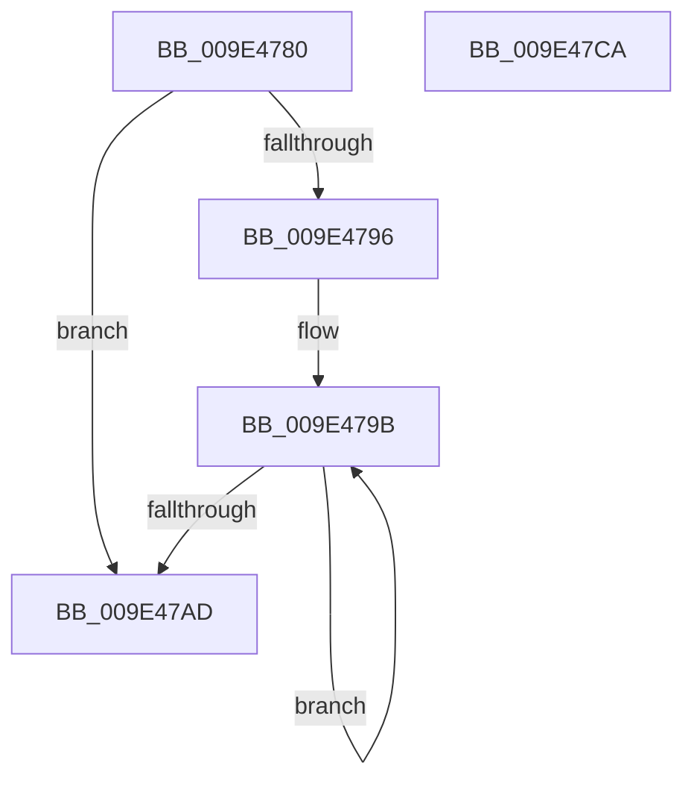

# WmipFreeTraceDeviceList

- RVA: `0x009E4780`–`0x009E47CB` (길이 `75` bytes)
- VA: `0x00000001409E4780`
- 실행 섹션: `PAGE`
- PDB 이름 있음: `예`; PDB Function 태그: `아니요`
- unwind 정보 RVA: `0x00060BC4`
- 디코드: `23`개 명령, `75/75` bytes 표시
- 미해석 바이트: `0` (있으면 어셈블리에 `.byte`로 보존)

> 이 문서는 커널 이미지의 기계어와 PDB 기호를 분석해 생성했습니다. 4번과 5번은 함수 원형과 자료형을 바이너리 사용 방식에서 추정한 C 해석이며 원본 소스 복구 결과는 아닙니다.

## 1. Dependencies

- 직접 호출 지점: **2**; 고유 호출 대상: **2**
- 직접 호출자로 확인된 함수: **3**
- RIP 상대 이미지 참조: **0**

### Outgoing calls
- `0x009E479E` → [WmipUnreferenceRegEntry](../../text/47/WmipUnreferenceRegEntry_function_0047B6F0.md) (function, `0x0047B6F0`)
- `0x009E47B5` → [ExFreePoolWithTag](../../poolcode/B8/ExFreePoolWithTag_function_00B82870.md) (function, `0x00B82870`)

### Direct callers
- [WmipBuildTraceDeviceList](../../text/49/WmipBuildTraceDeviceList_function_00494050.md) at `0x00494142`
- [WmiSetNetworkNotify](../7B/WmiSetNetworkNotify_function_007B3EE4.md) at `0x007B3F4B`
- [WmiTraceRundownNotify](WmiTraceRundownNotify_function_009E46E0.md) at `0x009E473B`

### Static image references
- 디코드된 RIP-relative 메모리 참조가 없습니다.

## 2. Other-region calls and transfers

- 다른 실행 섹션으로 향하는 call: **2**
  - `0x009E479E` → [WmipUnreferenceRegEntry](../../text/47/WmipUnreferenceRegEntry_function_0047B6F0.md) (`PAGE` → `.text`)
  - `0x009E47B5` → [ExFreePoolWithTag](../../poolcode/B8/ExFreePoolWithTag_function_00B82870.md) (`PAGE` → `POOLCODE`)
- 별도 외부 분기/꼬리 이동을 확인하지 못했습니다.

## 3. Assembly (complete function range)

```asm
009E4780  48 89 5C 24 08                  mov qword ptr [rsp + 8], rbx
009E4785  48 89 74 24 10                  mov qword ptr [rsp + 0x10], rsi
009E478A  57                              push rdi
009E478B  48 83 EC 20                     sub rsp, 0x20
009E478F  48 8B F9                        mov rdi, rcx
009E4792  85 D2                           test edx, edx
009E4794  74 17                           je 0x1409e47ad
009E4796  48 8B D9                        mov rbx, rcx
009E4799  8B F2                           mov esi, edx
009E479B  48 8B 0B                        mov rcx, qword ptr [rbx]
009E479E  E8 4D 6F A9 FF                  call 0x14047b6f0
009E47A3  48 8D 5B 10                     lea rbx, [rbx + 0x10]
009E47A7  48 83 EE 01                     sub rsi, 1
009E47AB  75 EE                           jne 0x1409e479b
009E47AD  BA 57 6D 69 70                  mov edx, 0x70696d57
009E47B2  48 8B CF                        mov rcx, rdi
009E47B5  E8 B6 E0 19 00                  call 0x140b82870
009E47BA  48 8B 5C 24 30                  mov rbx, qword ptr [rsp + 0x30]
009E47BF  48 8B 74 24 38                  mov rsi, qword ptr [rsp + 0x38]
009E47C4  48 83 C4 20                     add rsp, 0x20
009E47C8  5F                              pop rdi
009E47C9  C3                              ret
009E47CA  CC                              int3
```

## 4. C-style interpretation (structured pseudocode)

```c
__int64 __fastcall WmipFreeTraceDeviceList(__int64 a1, int a2)
{
    __int64 result;
    __int64 v_rsi;
    __int64 v_rsp;
    unsigned __int64 v_stack_p10;
    unsigned __int64 v_stack_p8;

    v_stack_p8 = v_rbx;
    v_stack_p10 = v_rsi;
    v_rsp = (v_rsp) - (32);
    if (a2 == 0) goto loc_009E47AD;
loc_009E479B:
    result = WmipUnreferenceRegEntry(*(unsigned __int64 *)(a1), a2, a3, a4);
    v_rsi = ((unsigned int)(a2)) - (1);
    if (condition_is_not_equal) goto loc_009E479B;
loc_009E47AD:
    result = ExFreePoolWithTag(a1, (unsigned int)(0x70696D57ULL), a3, a4);
    v_rsp = (v_rsp) + (32);
    return result;
}
```

## 5. (Beta) C Style

```c
int64_t WmipFreeTraceDeviceList(void *Arg1, int32_t Arg2)
{
    uint8_t *arg1 = (uint8_t *)Arg1;

    int64_t result;
    int64_t local_rsi;
    int64_t local_rsp;
    uint64_t v_stack_p10;
    uint64_t v_stack_p8;

    v_stack_p8 = local_rbx;
    v_stack_p10 = local_rsi;
    local_rsp = (local_rsp) - (32);
    if (Arg2 == 0) goto loc_009E47AD;
loc_009E479B:
    result = WmipUnreferenceRegEntry(*(uint64_t *)(arg1), Arg2, a3, a4);
    local_rsi = ((uint32_t)(Arg2)) - (1);
    if (condition_is_not_equal) goto loc_009E479B;
loc_009E47AD:
    result = ExFreePoolWithTag(Arg1, (uint32_t)(0x70696D57ULL), a3, a4);
    local_rsp = (local_rsp) + (32);
    return result;
}
```

### 관측된 메모리 오프셋

구조체 형식이 확인되지 않은 접근은 인자 기준의 오프셋으로만 기록했습니다.

| 기준 인자 | 오프셋 표현 | 폭 (bit) | 접근 |
|---|---:|---:|---|
| `Arg1` | `+ 0x0` | `64` | `R` |
| `Arg1` | `+ 0x10` | `64` | `R` |

## 6. Execution-region graph

[열기: 2D/3D 그래프와 함수 탐색 컨트롤 패널](../../../control-panel.html?section=page&rva=0x009E4780&view=graph)

- 2D 그래프는 위에서 아래로 흐르고, 3D 그래프는 빈 공간을 드래그해 회전합니다. Shift+드래그는 이동, 휠은 확대·축소, 함수 노드 선택은 대상 보고서 이동입니다.

### Static fallback


