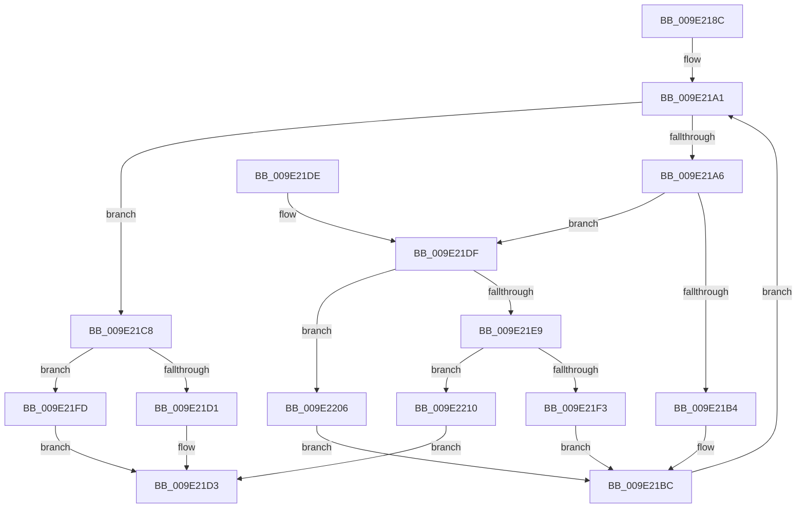

# WmipHexStringToDword

- RVA: `0x009E218C`–`0x009E2214` (길이 `136` bytes)
- VA: `0x00000001409E218C`
- 실행 섹션: `PAGE`
- PDB 이름 있음: `예`; PDB Function 태그: `아니요`
- unwind 정보 RVA: `0x000901E0`
- 디코드: `43`개 명령, `136/136` bytes 표시
- 미해석 바이트: `0` (있으면 어셈블리에 `.byte`로 보존)

> 이 문서는 커널 이미지의 기계어와 PDB 기호를 분석해 생성했습니다. 4번과 5번은 함수 원형과 자료형을 바이너리 사용 방식에서 추정한 C 해석이며 원본 소스 복구 결과는 아닙니다.

## 1. Dependencies

- 직접 호출 지점: **0**; 고유 호출 대상: **0**
- 직접 호출자로 확인된 함수: **1**
- RIP 상대 이미지 참조: **0**

### Outgoing calls
- 직접 디코드된 call 명령이 없습니다.

### Direct callers
- [WmipUuidFromString](WmipUuidFromString_function_009E1D48.md) at `0x009E1D6E`

### Static image references
- 디코드된 RIP-relative 메모리 참조가 없습니다.

## 2. Other-region calls and transfers

- 다른 실행 섹션으로 향하는 call: **0**
- 별도 외부 분기/꼬리 이동을 확인하지 못했습니다.

## 3. Assembly (complete function range)

```asm
009E218C  48 89 5C 24 08                  mov qword ptr [rsp + 8], rbx
009E2191  48 89 7C 24 10                  mov qword ptr [rsp + 0x10], rdi
009E2196  33 FF                           xor edi, edi
009E2198  41 8B D8                        mov ebx, r8d
009E219B  44 8B D7                        mov r10d, edi
009E219E  44 8B DF                        mov r11d, edi
009E21A1  44 3B DB                        cmp r11d, ebx
009E21A4  73 22                           jae 0x1409e21c8
009E21A6  44 0F B7 01                     movzx r8d, word ptr [rcx]
009E21AA  41 8D 40 D0                     lea eax, [r8 - 0x30]
009E21AE  66 83 F8 09                     cmp ax, 9
009E21B2  77 2B                           ja 0x1409e21df
009E21B4  41 C1 E2 04                     shl r10d, 4
009E21B8  41 83 C2 D0                     add r10d, -0x30
009E21BC  45 03 D0                        add r10d, r8d
009E21BF  41 FF C3                        inc r11d
009E21C2  48 83 C1 02                     add rcx, 2
009E21C6  EB D9                           jmp 0x1409e21a1
009E21C8  44 89 12                        mov dword ptr [rdx], r10d
009E21CB  66 45 85 C9                     test r9w, r9w
009E21CF  75 2C                           jne 0x1409e21fd
009E21D1  B0 01                           mov al, 1
009E21D3  48 8B 5C 24 08                  mov rbx, qword ptr [rsp + 8]
009E21D8  48 8B 7C 24 10                  mov rdi, qword ptr [rsp + 0x10]
009E21DD  C3                              ret
009E21DE  CC                              int3
009E21DF  41 8D 40 BF                     lea eax, [r8 - 0x41]
009E21E3  66 83 F8 05                     cmp ax, 5
009E21E7  76 1D                           jbe 0x1409e2206
009E21E9  41 8D 40 9F                     lea eax, [r8 - 0x61]
009E21ED  66 83 F8 05                     cmp ax, 5
009E21F1  77 1D                           ja 0x1409e2210
009E21F3  41 C1 E2 04                     shl r10d, 4
009E21F7  41 83 C2 A9                     add r10d, -0x57
009E21FB  EB BF                           jmp 0x1409e21bc
009E21FD  66 44 39 09                     cmp word ptr [rcx], r9w
009E2201  0F 94 C0                        sete al
009E2204  EB CD                           jmp 0x1409e21d3
009E2206  41 C1 E2 04                     shl r10d, 4
009E220A  41 83 C2 C9                     add r10d, -0x37
009E220E  EB AC                           jmp 0x1409e21bc
009E2210  32 C0                           xor al, al
009E2212  EB BF                           jmp 0x1409e21d3
```

## 4. C-style interpretation (structured pseudocode)

```c
__int64 __fastcall WmipHexStringToDword(__int64 a1, __int64 a2, int a3, unsigned __int16 a4)
{
    __int64 result;
    __int64 v_r10;
    __int64 v_r11;
    __int64 v_rdi;
    unsigned __int64 v_stack_p10;
    unsigned __int64 v_stack_p8;

    v_stack_p8 = v_rbx;
    v_stack_p10 = v_rdi;
    v_rdi = 0;
loc_009E21A1:
    if (0 >= ((unsigned int)((unsigned int)(a3)))) goto loc_009E21C8;
    if (((unsigned __int16)(*(unsigned __int16 *)(a1) - 48)) > 9) goto loc_009E21DF;
    v_r10 = (unsigned int)((0) << (4));
    v_r10 = (unsigned int)((v_r10) + (-48));
loc_009E21BC:
    v_r10 = (unsigned int)((v_r10) + ((unsigned int)(*(unsigned __int16 *)(a1))));
    v_r11 = (unsigned int)((0) + 1);
    a1 = (a1) + (2);
    goto loc_009E21A1;
loc_009E21C8:
    *(unsigned int *)(a2) = (unsigned int)(v_r10);
    if (a4 != 0) goto loc_009E21FD;
loc_009E21D3:
    return 1;
loc_009E21DF:
    if (((unsigned __int16)(*(unsigned __int16 *)(a1) - 65)) <= 5) goto loc_009E2206;
    if (((unsigned __int16)(*(unsigned __int16 *)(a1) - 97)) > 5) goto loc_009E2210;
    v_r10 = (unsigned int)((v_r10) << (4));
    v_r10 = (unsigned int)((v_r10) + (-87));
    goto loc_009E21BC;
loc_009E21FD:
    result = ((*(unsigned __int16 *)(a1)) == a4) ? 1 : 0;
    goto loc_009E21D3;
loc_009E2206:
    v_r10 = (unsigned int)((v_r10) << (4));
    v_r10 = (unsigned int)((v_r10) + (-55));
    goto loc_009E21BC;
loc_009E2210:
    result = 0;
    goto loc_009E21D3;
}
```

## 5. (Beta) C Style

```c
int64_t WmipHexStringToDword(void *Arg1, void *Arg2, int32_t Arg3, uint16_t Arg4)
{
    uint8_t *arg1 = (uint8_t *)Arg1;
    uint8_t *arg2 = (uint8_t *)Arg2;

    int64_t result;
    int64_t local_r10;
    int64_t local_r11;
    int64_t local_rdi;
    uint64_t v_stack_p10;
    uint64_t v_stack_p8;

    v_stack_p8 = local_rbx;
    v_stack_p10 = local_rdi;
    local_rdi = 0;
loc_009E21A1:
    if (0 >= ((uint32_t)((uint32_t)(Arg3)))) goto loc_009E21C8;
    if (((uint16_t)(*(uint16_t *)(arg1) - 48)) > 9) goto loc_009E21DF;
    local_r10 = (uint32_t)((0) << (4));
    local_r10 = (uint32_t)((local_r10) + (-48));
loc_009E21BC:
    local_r10 = (uint32_t)((local_r10) + ((uint32_t)(*(uint16_t *)(arg1))));
    local_r11 = (uint32_t)((0) + 1);
    Arg1 = (Arg1) + (2);
    goto loc_009E21A1;
loc_009E21C8:
    *(uint32_t *)(arg2) = (uint32_t)(local_r10);
    if (Arg4 != 0) goto loc_009E21FD;
loc_009E21D3:
    return 1;
loc_009E21DF:
    if (((uint16_t)(*(uint16_t *)(arg1) - 65)) <= 5) goto loc_009E2206;
    if (((uint16_t)(*(uint16_t *)(arg1) - 97)) > 5) goto loc_009E2210;
    local_r10 = (uint32_t)((local_r10) << (4));
    local_r10 = (uint32_t)((local_r10) + (-87));
    goto loc_009E21BC;
loc_009E21FD:
    result = ((*(uint16_t *)(arg1)) == Arg4) ? 1 : 0;
    goto loc_009E21D3;
loc_009E2206:
    local_r10 = (uint32_t)((local_r10) << (4));
    local_r10 = (uint32_t)((local_r10) + (-55));
    goto loc_009E21BC;
loc_009E2210:
    result = 0;
    goto loc_009E21D3;
}
```

### 관측된 메모리 오프셋

구조체 형식이 확인되지 않은 접근은 인자 기준의 오프셋으로만 기록했습니다.

| 기준 인자 | 오프셋 표현 | 폭 (bit) | 접근 |
|---|---:|---:|---|
| `Arg1` | `+ 0x0` | `16` | `R` |
| `Arg2` | `+ 0x0` | `32` | `W` |

## 6. Execution-region graph

[열기: 2D/3D 그래프와 함수 탐색 컨트롤 패널](../../../control-panel.html?section=page&rva=0x009E218C&view=graph)

- 2D 그래프는 위에서 아래로 흐르고, 3D 그래프는 빈 공간을 드래그해 회전합니다. Shift+드래그는 이동, 휠은 확대·축소, 함수 노드 선택은 대상 보고서 이동입니다.

### Static fallback


