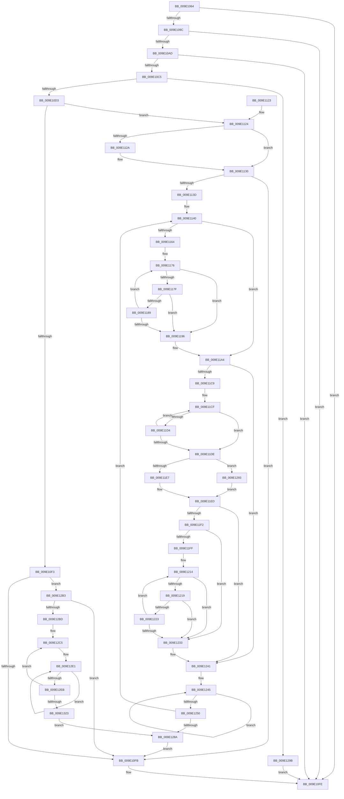

# WmipInsertStaticNames

- RVA: `0x009E1064`–`0x009E1328` (길이 `708` bytes)
- VA: `0x00000001409E1064`
- 실행 섹션: `PAGE`
- PDB 이름 있음: `예`; PDB Function 태그: `아니요`
- unwind 정보 RVA: `0x000A3CCC`
- 디코드: `206`개 명령, `708/708` bytes 표시
- 미해석 바이트: `0` (있으면 어셈블리에 `.byte`로 보존)

> 이 문서는 커널 이미지의 기계어와 PDB 기호를 분석해 생성했습니다. 4번과 5번은 함수 원형과 자료형을 바이너리 사용 방식에서 추정한 C 해석이며 원본 소스 복구 결과는 아닙니다.

## 1. Dependencies

- 직접 호출 지점: **4**; 고유 호출 대상: **4**
- 직접 호출자로 확인된 함수: **2**
- RIP 상대 이미지 참조: **2**

### Outgoing calls
- `0x009E10B5` → [WmipStaticInstanceNameSize](WmipStaticInstanceNameSize_function_009E1330.md) (function, `0x009E1330`)
- `0x009E1106` → [_security_check_cookie](../../text/6A/_security_check_cookie_function_006AC640.md) (function, `0x006AC640`)
- `0x009E11BF` → [RtlStringCbPrintfW](../../text/40/RtlStringCbPrintfW_function_0040FB40.md) (function, `0x0040FB40`)
- `0x009E1303` → [RtlStringCbCopyW](../../text/43/RtlStringCbCopyW_function_0043B910.md) (function, `0x0043B910`)

### Direct callers
- [WmipQueryAllData](WmipQueryAllData_function_009E086C.md) at `0x009E0AA1`
- [sub_00B2FEB2](../B2/Unknown_function_00B2FEB2.md) at `0x00B2FF1F`

### Static image references
- `0x009E1078` → RVA `0x00E0A740` (`.data`; read)
- `0x009E11A8` → RVA `0x00AFCAE0` (` ?? ::NNGAKEGL::`string'`; read)

## 2. Other-region calls and transfers

- 다른 실행 섹션으로 향하는 call: **3**
  - `0x009E1106` → [_security_check_cookie](../../text/6A/_security_check_cookie_function_006AC640.md) (`PAGE` → `.text`)
  - `0x009E11BF` → [RtlStringCbPrintfW](../../text/40/RtlStringCbPrintfW_function_0040FB40.md) (`PAGE` → `.text`)
  - `0x009E1303` → [RtlStringCbCopyW](../../text/43/RtlStringCbCopyW_function_0043B910.md) (`PAGE` → `.text`)
- 별도 외부 분기/꼬리 이동을 확인하지 못했습니다.

## 3. Assembly (complete function range)

```asm
009E1064  48 89 5C 24 10                  mov qword ptr [rsp + 0x10], rbx
009E1069  55                              push rbp
009E106A  56                              push rsi
009E106B  57                              push rdi
009E106C  41 54                           push r12
009E106E  41 55                           push r13
009E1070  41 56                           push r14
009E1072  41 57                           push r15
009E1074  48 83 EC 50                     sub rsp, 0x50
009E1078  48 8B 05 C1 96 42 00            mov rax, qword ptr [rip + 0x4296c1]
009E107F  48 33 C4                        xor rax, rsp
009E1082  48 89 44 24 48                  mov qword ptr [rsp + 0x48], rax
009E1087  41 8B 40 10                     mov eax, dword ptr [r8 + 0x10]
009E108B  4D 8B F8                        mov r15, r8
009E108E  4C 89 44 24 38                  mov qword ptr [rsp + 0x38], r8
009E1093  8B FA                           mov edi, edx
009E1095  4C 8B F1                        mov r14, rcx
009E1098  A8 03                           test al, 3
009E109A  74 62                           je 0x1409e10fe
009E109C  41 8B 40 48                     mov eax, dword ptr [r8 + 0x48]
009E10A0  89 44 24 20                     mov dword ptr [rsp + 0x20], eax
009E10A4  8B 01                           mov eax, dword ptr [rcx]
009E10A6  8D 68 03                        lea ebp, [rax + 3]
009E10A9  3B E8                           cmp ebp, eax
009E10AB  72 51                           jb 0x1409e10fe
009E10AD  83 E5 FC                        and ebp, 0xfffffffc
009E10B0  49 8B C8                        mov rcx, r8
009E10B3  8B DD                           mov ebx, ebp
009E10B5  E8 76 02 00 00                  call 0x1409e1330
009E10BA  8B CD                           mov ecx, ebp
009E10BC  44 8B E0                        mov r12d, eax
009E10BF  F7 D1                           not ecx
009E10C1  3B C1                           cmp eax, ecx
009E10C3  77 39                           ja 0x1409e10fe
009E10C5  03 E8                           add ebp, eax
009E10C7  89 6C 24 24                     mov dword ptr [rsp + 0x24], ebp
009E10CB  3B EF                           cmp ebp, edi
009E10CD  0F 87 C8 01 00 00               ja 0x1409e129b
009E10D3  8B 7C 24 20                     mov edi, dword ptr [rsp + 0x20]
009E10D7  49 8D 0C 1E                     lea rcx, [r14 + rbx]
009E10DB  41 89 5E 38                     mov dword ptr [r14 + 0x38], ebx
009E10DF  44 8B EF                        mov r13d, edi
009E10E2  41 8B 47 10                     mov eax, dword ptr [r15 + 0x10]
009E10E6  48 8D 14 B9                     lea rdx, [rcx + rdi*4]
009E10EA  48 89 54 24 30                  mov qword ptr [rsp + 0x30], rdx
009E10EF  A8 01                           test al, 1
009E10F1  75 31                           jne 0x1409e1124
009E10F3  A8 02                           test al, 2
009E10F5  0F 85 B8 01 00 00               jne 0x1409e12b3
009E10FB  41 89 2E                        mov dword ptr [r14], ebp
009E10FE  48 8B 4C 24 48                  mov rcx, qword ptr [rsp + 0x48]
009E1103  48 33 CC                        xor rcx, rsp
009E1106  E8 35 B5 CC FF                  call 0x1406ac640
009E110B  48 8B 9C 24 98 00 00 00         mov rbx, qword ptr [rsp + 0x98]
009E1113  48 83 C4 50                     add rsp, 0x50
009E1117  41 5F                           pop r15
009E1119  41 5E                           pop r14
009E111B  41 5D                           pop r13
009E111D  41 5C                           pop r12
009E111F  5F                              pop rdi
009E1120  5E                              pop rsi
009E1121  5D                              pop rbp
009E1122  C3                              ret
009E1123  CC                              int3
009E1124  0F BA E0 11                     bt eax, 0x11
009E1128  73 06                           jae 0x1409e1130
009E112A  41 0F BA 6E 2C 10               bts dword ptr [r14 + 0x2c], 0x10
009E1130  33 F6                           xor esi, esi
009E1132  89 74 24 20                     mov dword ptr [rsp + 0x20], esi
009E1136  44 8B D6                        mov r10d, esi
009E1139  85 FF                           test edi, edi
009E113B  74 BE                           je 0x1409e10fb
009E113D  48 8B E9                        mov rbp, rcx
009E1140  41 83 C4 FE                     add r12d, -2
009E1144  4C 8D 6A 02                     lea r13, [rdx + 2]
009E1148  8B C2                           mov eax, edx
009E114A  41 8B DC                        mov ebx, r12d
009E114D  41 2B C6                        sub eax, r14d
009E1150  89 45 00                        mov dword ptr [rbp], eax
009E1153  48 8D 6D 04                     lea rbp, [rbp + 4]
009E1157  4D 8B 47 58                     mov r8, qword ptr [r15 + 0x58]
009E115B  49 83 C0 04                     add r8, 4
009E115F  48 D1 EB                        shr rbx, 1
009E1162  74 40                           je 0x1409e11a4
009E1164  41 B9 FE FF FF 7F               mov r9d, 0x7ffffffe
009E116A  48 8B D3                        mov rdx, rbx
009E116D  4C 2B CB                        sub r9, rbx
009E1170  49 8B CD                        mov rcx, r13
009E1173  4D 2B C5                        sub r8, r13
009E1176  49 8D 04 11                     lea rax, [r9 + rdx]
009E117A  48 85 C0                        test rax, rax
009E117D  74 17                           je 0x1409e1196
009E117F  41 0F B7 04 08                  movzx eax, word ptr [r8 + rcx]
009E1184  66 85 C0                        test ax, ax
009E1187  74 0D                           je 0x1409e1196
009E1189  66 89 01                        mov word ptr [rcx], ax
009E118C  48 83 C1 02                     add rcx, 2
009E1190  48 83 EA 01                     sub rdx, 1
009E1194  75 E0                           jne 0x1409e1176
009E1196  48 85 D2                        test rdx, rdx
009E1199  48 8D 41 FE                     lea rax, [rcx - 2]
009E119D  48 0F 45 C1                     cmovne rax, rcx
009E11A1  66 89 30                        mov word ptr [rax], si
009E11A4  49 8B 47 58                     mov rax, qword ptr [r15 + 0x58]
009E11A8  4C 8D 05 31 B9 11 00            lea r8, [rip + 0x11b931]
009E11AF  BA 0E 00 00 00                  mov edx, 0xe
009E11B4  48 8D 4C 24 38                  lea rcx, [rsp + 0x38]
009E11B9  44 8B 08                        mov r9d, dword ptr [rax]
009E11BC  45 03 CA                        add r9d, r10d
009E11BF  E8 7C E9 A2 FF                  call 0x14040fb40
009E11C4  48 85 DB                        test rbx, rbx
009E11C7  74 78                           je 0x1409e1241
009E11C9  48 8B CB                        mov rcx, rbx
009E11CC  49 8B C5                        mov rax, r13
009E11CF  66 39 30                        cmp word ptr [rax], si
009E11D2  74 0A                           je 0x1409e11de
009E11D4  48 83 C0 02                     add rax, 2
009E11D8  48 83 E9 01                     sub rcx, 1
009E11DC  75 F1                           jne 0x1409e11cf
009E11DE  48 85 C9                        test rcx, rcx
009E11E1  0F 84 AC 00 00 00               je 0x1409e1293
009E11E7  48 8B C3                        mov rax, rbx
009E11EA  48 2B C1                        sub rax, rcx
009E11ED  48 85 C9                        test rcx, rcx
009E11F0  74 4F                           je 0x1409e1241
009E11F2  48 8B D3                        mov rdx, rbx
009E11F5  49 8D 4C 45 00                  lea rcx, [r13 + rax*2]
009E11FA  48 2B D0                        sub rdx, rax
009E11FD  74 34                           je 0x1409e1233
009E11FF  48 2B C3                        sub rax, rbx
009E1202  4C 8D 4C 24 38                  lea r9, [rsp + 0x38]
009E1207  4C 8D 80 FE FF FF 7F            lea r8, [rax + 0x7ffffffe]
009E120E  4C 03 C2                        add r8, rdx
009E1211  4C 2B C9                        sub r9, rcx
009E1214  4D 85 C0                        test r8, r8
009E1217  74 1A                           je 0x1409e1233
009E1219  41 0F B7 04 09                  movzx eax, word ptr [r9 + rcx]
009E121E  66 85 C0                        test ax, ax
009E1221  74 10                           je 0x1409e1233
009E1223  66 89 01                        mov word ptr [rcx], ax
009E1226  49 FF C8                        dec r8
009E1229  48 83 C1 02                     add rcx, 2
009E122D  48 83 EA 01                     sub rdx, 1
009E1231  75 E1                           jne 0x1409e1214
009E1233  48 85 D2                        test rdx, rdx
009E1236  48 8D 41 FE                     lea rax, [rcx - 2]
009E123A  48 0F 45 C1                     cmovne rax, rcx
009E123E  66 89 30                        mov word ptr [rax], si
009E1241  48 83 C9 FF                     or rcx, 0xffffffffffffffff
009E1245  48 FF C1                        inc rcx
009E1248  66 41 39 74 4D 00               cmp word ptr [r13 + rcx*2], si
009E124E  75 F5                           jne 0x1409e1245
009E1250  48 8B 54 24 30                  mov rdx, qword ptr [rsp + 0x30]
009E1255  8D 0C 4D 02 00 00 00            lea ecx, [rcx*2 + 2]
009E125C  44 8B 54 24 20                  mov r10d, dword ptr [rsp + 0x20]
009E1261  44 2B E1                        sub r12d, ecx
009E1264  41 FF C2                        inc r10d
009E1267  8B C1                           mov eax, ecx
009E1269  48 D1 E8                        shr rax, 1
009E126C  66 89 0A                        mov word ptr [rdx], cx
009E126F  44 89 54 24 20                  mov dword ptr [rsp + 0x20], r10d
009E1274  48 8D 14 42                     lea rdx, [rdx + rax*2]
009E1278  48 83 C2 02                     add rdx, 2
009E127C  48 89 54 24 30                  mov qword ptr [rsp + 0x30], rdx
009E1281  44 3B D7                        cmp r10d, edi
009E1284  0F 82 B6 FE FF FF               jb 0x1409e1140
009E128A  8B 6C 24 24                     mov ebp, dword ptr [rsp + 0x24]
009E128E  E9 68 FE FF FF                  jmp 0x1409e10fb
009E1293  48 8B C6                        mov rax, rsi
009E1296  E9 52 FF FF FF                  jmp 0x1409e11ed
009E129B  41 C7 06 38 00 00 00            mov dword ptr [r14], 0x38
009E12A2  41 C7 46 2C 20 00 00 00         mov dword ptr [r14 + 0x2c], 0x20
009E12AA  41 89 6E 30                     mov dword ptr [r14 + 0x30], ebp
009E12AE  E9 4B FE FF FF                  jmp 0x1409e10fe
009E12B3  33 F6                           xor esi, esi
009E12B5  85 FF                           test edi, edi
009E12B7  0F 84 3E FE FF FF               je 0x1409e10fb
009E12BD  48 8B 6C 24 38                  mov rbp, qword ptr [rsp + 0x38]
009E12C2  44 8B FE                        mov r15d, esi
009E12C5  8B C2                           mov eax, edx
009E12C7  41 2B C6                        sub eax, r14d
009E12CA  89 01                           mov dword ptr [rcx], eax
009E12CC  48 83 C1 04                     add rcx, 4
009E12D0  48 8B 45 58                     mov rax, qword ptr [rbp + 0x58]
009E12D4  48 83 CB FF                     or rbx, 0xffffffffffffffff
009E12D8  48 89 4C 24 28                  mov qword ptr [rsp + 0x28], rcx
009E12DD  4D 8B 04 07                     mov r8, qword ptr [r15 + rax]
009E12E1  48 FF C3                        inc rbx
009E12E4  66 41 39 34 58                  cmp word ptr [r8 + rbx*2], si
009E12E9  75 F6                           jne 0x1409e12e1
009E12EB  48 8D 7A 02                     lea rdi, [rdx + 2]
009E12EF  41 83 C4 FE                     add r12d, -2
009E12F3  8D 1C 5D 02 00 00 00            lea ebx, [rbx*2 + 2]
009E12FA  48 8B CF                        mov rcx, rdi
009E12FD  66 89 1A                        mov word ptr [rdx], bx
009E1300  41 8B D4                        mov edx, r12d
009E1303  E8 08 A6 A5 FF                  call 0x14043b910
009E1308  48 8B 4C 24 28                  mov rcx, qword ptr [rsp + 0x28]
009E130D  44 2B E3                        sub r12d, ebx
009E1310  8B C3                           mov eax, ebx
009E1312  49 83 C7 08                     add r15, 8
009E1316  48 D1 E8                        shr rax, 1
009E1319  48 8D 14 47                     lea rdx, [rdi + rax*2]
009E131D  49 83 ED 01                     sub r13, 1
009E1321  75 A2                           jne 0x1409e12c5
009E1323  E9 62 FF FF FF                  jmp 0x1409e128a
```

## 4. C-style interpretation (structured pseudocode)

```c
__int64 __fastcall WmipInsertStaticNames(__int64 a1, int a2, __int64 a3)
{
    __int64 result;
    __int64 v_r10;
    __int64 v_r12;
    __int64 v_r13;
    __int64 v_r15;
    __int64 v_rbp;
    __int64 v_rbx;
    __int64 v_rsi;
    __int64 v_rsp;
    unsigned __int64 v_stack_m40;
    unsigned __int64 v_stack_m50;
    unsigned __int64 v_stack_m58;
    unsigned int v_stack_m64;
    unsigned int v_stack_m68;
    unsigned __int64 v_stack_p10;
    unsigned int v_stack_p20;
    unsigned int v_stack_p24;
    unsigned __int64 v_stack_p28;
    unsigned __int64 v_stack_p30;
    unsigned __int64 v_stack_p38;

    v_stack_p10 = v_rbx;
    v_rsp = (v_rsp) - (80);
    result = (*(unsigned __int64 *)(v_rip + 4363969)) ^ (v_rsp);
    v_stack_m40 = result;
    v_stack_m50 = a3;
    if ((((unsigned __int8)((unsigned int)(*(unsigned int *)(a3 + 16)))) & (3)) == 0) goto loc_009E10FE;
    v_stack_m68 = (unsigned int)((unsigned int)(*(unsigned int *)(a3 + 72)));
    if (((unsigned int)((unsigned int)(*(unsigned int *)(a1)) + 3)) < ((unsigned int)((unsigned int)(*(unsigned int *)(a1))))) goto loc_009E10FE;
    v_rbp = (unsigned int)(((unsigned int)(*(unsigned int *)(a1)) + 3) & (0xFFFFFFFCULL));
    result = WmipStaticInstanceNameSize(a3, a2, a3, a4);
    a1 = (unsigned int)(~((unsigned int)((unsigned int)(v_rbp))));
    if (((unsigned int)(result)) > ((unsigned int)(a1))) goto loc_009E10FE;
    v_rbp = (unsigned int)((v_rbp) + ((unsigned int)(result)));
    v_stack_m64 = (unsigned int)(v_rbp);
    if (((unsigned int)(v_rbp)) > ((unsigned int)((unsigned int)(a2)))) goto loc_009E129B;
    *(unsigned int *)(a1 + 56) = (unsigned int)((unsigned int)((unsigned int)(v_rbp)));
    v_stack_m58 = a1 + (unsigned int)((unsigned int)(v_rbp)) * 1 + (unsigned int)(v_stack_m68) * 4;
    if ((((unsigned __int8)((unsigned int)(*(unsigned int *)(a3 + 16)))) & (1)) != 0) goto loc_009E1124;
    if ((((unsigned __int8)((unsigned int)(*(unsigned int *)(a3 + 16)))) & (2)) != 0) goto loc_009E12B3;
loc_009E10FB:
    *(unsigned int *)(a1) = (unsigned int)(v_rbp);
loc_009E10FE:
    a1 = (v_stack_m40) ^ (v_rsp);
    result = _security_check_cookie(a1, a1 + (unsigned int)((unsigned int)(v_rbp)) * 1 + (unsigned int)(v_stack_m68) * 4, a3, a4);
    v_rsp = (v_rsp) + (80);
    return result;
loc_009E1124:
    if (!(condition_is_above_or_equal)) {
    }
    v_rsi = 0;
    v_stack_p20 = 0;
    if ((unsigned int)((unsigned int)(v_stack_m68)) == 0) goto loc_009E10FB;
loc_009E1140:
    v_r12 = (unsigned int)(((unsigned int)((unsigned int)(result))) + (-2));
    result = (unsigned int)(((unsigned int)((unsigned int)(a1 + (unsigned int)((unsigned int)(v_rbp)) * 1 + (unsigned int)(v_stack_m68) * 4))) - ((unsigned int)(a1)));
    *(unsigned int *)(a1) = (unsigned int)(result);
    a3 = (*(unsigned __int64 *)(a3 + 88)) + (4);
    v_rbx = ((unsigned int)((unsigned int)(v_r12))) >> (1);
    if (condition_is_equal) goto loc_009E11A4;
    a4 = ((unsigned int)(0x7FFFFFFEULL)) - (v_rbx);
    a3 = (a3) - (a1 + (unsigned int)((unsigned int)(v_rbp)) * 1 + (unsigned int)(v_stack_m68) * 4 + 2);
loc_009E1176:
    if (a4 + v_rbx * 1 == 0) goto loc_009E1196;
    if ((unsigned __int16)(*(unsigned __int16 *)(a3 + a1 + (unsigned int)((unsigned int)(v_rbp)) * 1 + (unsigned int)(v_stack_m68) * 4 + 2 * 1)) == 0) goto loc_009E1196;
    *(unsigned __int16 *)(a1 + (unsigned int)((unsigned int)(v_rbp)) * 1 + (unsigned int)(v_stack_m68) * 4 + 2) = (unsigned __int16)(*(unsigned __int16 *)(a3 + a1 + (unsigned int)((unsigned int)(v_rbp)) * 1 + (unsigned int)(v_stack_m68) * 4 + 2 * 1));
    a1 = (a1 + (unsigned int)((unsigned int)(v_rbp)) * 1 + (unsigned int)(v_stack_m68) * 4 + 2) + (2);
    a2 = (v_rbx) - (1);
    if (condition_is_not_equal) goto loc_009E1176;
loc_009E1196:
    result = a1 - 2;
    if (a2 != 0) { result = a1; }
    *(unsigned __int16 *)(result) = 0;
loc_009E11A4:
    a4 = (unsigned int)(((unsigned int)(*(unsigned int *)(*(unsigned __int64 *)(a3 + 88)))) + (0));
    result = RtlStringCbPrintfW(v_stack_p38, 14, v_rip + 1161521, a4);
    if (v_rbx == 0) goto loc_009E1241;
loc_009E11CF:
    if ((*(unsigned __int16 *)(a1 + (unsigned int)((unsigned int)(v_rbp)) * 1 + (unsigned int)(v_stack_m68) * 4 + 2)) == 0) goto loc_009E11DE;
    result = (a1 + (unsigned int)((unsigned int)(v_rbp)) * 1 + (unsigned int)(v_stack_m68) * 4 + 2) + (2);
    a1 = (v_rbx) - (1);
    if (condition_is_not_equal) goto loc_009E11CF;
loc_009E11DE:
    if (a1 == 0) goto loc_009E1293;
    result = (v_rbx) - (a1);
loc_009E11ED:
    if (a1 == 0) goto loc_009E1241;
    a2 = (v_rbx) - (result);
    if (condition_is_equal) goto loc_009E1233;
    result = (result) - (v_rbx);
    a3 = (result + 2147483646) + (a2);
    a4 = (v_stack_p38) - (a1 + (unsigned int)((unsigned int)(v_rbp)) * 1 + (unsigned int)(v_stack_m68) * 4 + 2 + result * 2);
loc_009E1214:
    if (a3 == 0) goto loc_009E1233;
    if ((unsigned __int16)(*(unsigned __int16 *)(a4 + a1 + (unsigned int)((unsigned int)(v_rbp)) * 1 + (unsigned int)(v_stack_m68) * 4 + 2 + result * 2 * 1)) == 0) goto loc_009E1233;
    *(unsigned __int16 *)(a1 + (unsigned int)((unsigned int)(v_rbp)) * 1 + (unsigned int)(v_stack_m68) * 4 + 2 + result * 2) = (unsigned __int16)(*(unsigned __int16 *)(a4 + a1 + (unsigned int)((unsigned int)(v_rbp)) * 1 + (unsigned int)(v_stack_m68) * 4 + 2 + result * 2 * 1));
    a3 = (a3) - 1;
    a1 = (a1 + (unsigned int)((unsigned int)(v_rbp)) * 1 + (unsigned int)(v_stack_m68) * 4 + 2 + result * 2) + (2);
    a2 = (a2) - (1);
    if (condition_is_not_equal) goto loc_009E1214;
loc_009E1233:
    result = a1 - 2;
    if (a2 != 0) { result = a1; }
    *(unsigned __int16 *)(result) = 0;
loc_009E1241:
    a1 = (a1) | (-1);
loc_009E1245:
    a1 = (a1) + 1;
    if ((*(unsigned __int16 *)(a1 + (unsigned int)((unsigned int)(v_rbp)) * 1 + (unsigned int)(v_stack_m68) * 4 + 2 + a1 * 2)) != 0) goto loc_009E1245;
    v_r12 = (unsigned int)((v_r12) - ((unsigned int)(a1 * 2 + 2)));
    v_r10 = (unsigned int)(((unsigned int)(v_stack_p20)) + 1);
    result = ((unsigned int)((unsigned int)(a1 * 2 + 2))) >> (1);
    *(unsigned __int16 *)(v_stack_p30) = (unsigned __int16)(a1 * 2 + 2);
    v_stack_p20 = (unsigned int)(v_r10);
    a2 = (v_stack_p30 + result * 2) + (2);
    v_stack_p30 = a2;
    if (((unsigned int)(v_r10)) < ((unsigned int)((unsigned int)(v_stack_m68)))) goto loc_009E1140;
loc_009E128A:
    goto loc_009E10FB;
loc_009E1293:
    goto loc_009E11ED;
loc_009E129B:
    *(unsigned int *)(a1) = 56;
    *(unsigned int *)(a1 + 44) = 32;
    *(unsigned int *)(a1 + 48) = (unsigned int)((unsigned int)(v_stack_p24));
    goto loc_009E10FE;
loc_009E12B3:
    v_rsi = 0;
    if ((unsigned int)((unsigned int)(v_stack_m68)) == 0) goto loc_009E10FB;
loc_009E12C5:
    result = (unsigned int)(((unsigned int)(a2)) - ((unsigned int)(a1)));
    *(unsigned int *)(a1 * 2 + 2) = (unsigned int)(result);
    a1 = (a1 * 2 + 2) + (4);
    v_rbx = (v_rbx) | (-1);
    v_stack_p28 = a1;
loc_009E12E1:
    v_rbx = (v_rbx) + 1;
    if ((*(unsigned __int16 *)(*(unsigned __int64 *)(0 + *(unsigned __int64 *)(v_stack_p38 + 88) * 1) + v_rbx * 2)) != 0) goto loc_009E12E1;
    v_r12 = (unsigned int)((v_r12) + (-2));
    *(unsigned __int16 *)(a2) = (unsigned __int16)(v_rbx * 2 + 2);
    result = RtlStringCbCopyW(a2 + 2, (unsigned int)((unsigned int)(v_r12)), *(unsigned __int64 *)(0 + *(unsigned __int64 *)(v_stack_p38 + 88) * 1), a4);
    v_r12 = (unsigned int)((v_r12) - ((unsigned int)(v_rbx * 2 + 2)));
    v_r15 = (0) + (8);
    result = ((unsigned int)((unsigned int)(v_rbx * 2 + 2))) >> (1);
    v_r13 = (a1 + (unsigned int)((unsigned int)(v_rbp)) * 1 + (unsigned int)(v_stack_m68) * 4 + 2) - (1);
    if (condition_is_not_equal) goto loc_009E12C5;
    goto loc_009E128A;
}
```

## 5. (Beta) C Style

```c
int64_t WmipInsertStaticNames(void *Arg1, int32_t Arg2, void *Arg3)
{
    uint8_t *arg1 = (uint8_t *)Arg1;
    uint8_t *arg3 = (uint8_t *)Arg3;

    int64_t result;
    int64_t local_r10;
    int64_t local_r12;
    int64_t local_r13;
    int64_t local_r15;
    int64_t local_rbp;
    int64_t local_rbx;
    int64_t local_rsi;
    int64_t local_rsp;
    uint64_t v_stack_m40;
    uint64_t v_stack_m50;
    uint64_t v_stack_m58;
    uint32_t v_stack_m64;
    uint32_t v_stack_m68;
    uint64_t v_stack_p10;
    uint32_t v_stack_p20;
    uint32_t v_stack_p24;
    uint64_t v_stack_p28;
    uint64_t v_stack_p30;
    uint64_t v_stack_p38;

    v_stack_p10 = local_rbx;
    local_rsp = (local_rsp) - (80);
    result = (*(uint64_t *)(v_rip + 0x4296C1)) ^ (local_rsp);
    v_stack_m40 = result;
    v_stack_m50 = Arg3;
    if ((((uint8_t)((uint32_t)(*(uint32_t *)(arg3 + 0x10)))) & (3)) == 0) goto loc_009E10FE;
    v_stack_m68 = (uint32_t)((uint32_t)(*(uint32_t *)(arg3 + 0x48)));
    if (((uint32_t)((uint32_t)(*(uint32_t *)(arg1)) + 3)) < ((uint32_t)((uint32_t)(*(uint32_t *)(arg1))))) goto loc_009E10FE;
    local_rbp = (uint32_t)(((uint32_t)(*(uint32_t *)(arg1)) + 3) & (0xFFFFFFFCULL));
    result = WmipStaticInstanceNameSize(Arg3, Arg2, Arg3, a4);
    Arg1 = (uint32_t)(~((uint32_t)((uint32_t)(local_rbp))));
    if (((uint32_t)(result)) > ((uint32_t)(Arg1))) goto loc_009E10FE;
    local_rbp = (uint32_t)((local_rbp) + ((uint32_t)(result)));
    v_stack_m64 = (uint32_t)(local_rbp);
    if (((uint32_t)(local_rbp)) > ((uint32_t)((uint32_t)(Arg2)))) goto loc_009E129B;
    *(uint32_t *)(arg1 + 0x38) = (uint32_t)((uint32_t)((uint32_t)(local_rbp)));
    v_stack_m58 = Arg1 + (uint32_t)((uint32_t)(local_rbp)) * 1 + (uint32_t)(v_stack_m68) * 4;
    if ((((uint8_t)((uint32_t)(*(uint32_t *)(arg3 + 0x10)))) & (1)) != 0) goto loc_009E1124;
    if ((((uint8_t)((uint32_t)(*(uint32_t *)(arg3 + 0x10)))) & (2)) != 0) goto loc_009E12B3;
loc_009E10FB:
    *(uint32_t *)(arg1) = (uint32_t)(local_rbp);
loc_009E10FE:
    Arg1 = (v_stack_m40) ^ (local_rsp);
    result = _security_check_cookie(Arg1, Arg1 + (uint32_t)((uint32_t)(local_rbp)) * 1 + (uint32_t)(v_stack_m68) * 4, Arg3, a4);
    local_rsp = (local_rsp) + (80);
    return result;
loc_009E1124:
    if (!(condition_is_above_or_equal)) {
    }
    local_rsi = 0;
    v_stack_p20 = 0;
    if ((uint32_t)((uint32_t)(v_stack_m68)) == 0) goto loc_009E10FB;
loc_009E1140:
    local_r12 = (uint32_t)(((uint32_t)((uint32_t)(result))) + (-2));
    result = (uint32_t)(((uint32_t)((uint32_t)(Arg1 + (uint32_t)((uint32_t)(local_rbp)) * 1 + (uint32_t)(v_stack_m68) * 4))) - ((uint32_t)(Arg1)));
    *(uint32_t *)(arg1) = (uint32_t)(result);
    Arg3 = (*(uint64_t *)(arg3 + 0x58)) + (4);
    local_rbx = ((uint32_t)((uint32_t)(local_r12))) >> (1);
    if (condition_is_equal) goto loc_009E11A4;
    a4 = ((uint32_t)(0x7FFFFFFEULL)) - (local_rbx);
    Arg3 = (Arg3) - (Arg1 + (uint32_t)((uint32_t)(local_rbp)) * 1 + (uint32_t)(v_stack_m68) * 4 + 2);
loc_009E1176:
    if (a4 + local_rbx * 1 == 0) goto loc_009E1196;
    if ((uint16_t)(*(uint16_t *)(arg3 + arg1 + (uint32_t)((uint32_t)(local_rbp)) * 1 + (uint32_t)(v_stack_m68) * 4 + 0x2 * 1)) == 0) goto loc_009E1196;
    *(uint16_t *)(arg1 + (uint32_t)((uint32_t)(local_rbp)) * 1 + (uint32_t)(v_stack_m68) * 4 + 0x2) = (uint16_t)(*(uint16_t *)(arg3 + arg1 + (uint32_t)((uint32_t)(local_rbp)) * 1 + (uint32_t)(v_stack_m68) * 4 + 0x2 * 1));
    Arg1 = (Arg1 + (uint32_t)((uint32_t)(local_rbp)) * 1 + (uint32_t)(v_stack_m68) * 4 + 2) + (2);
    Arg2 = (local_rbx) - (1);
    if (condition_is_not_equal) goto loc_009E1176;
loc_009E1196:
    result = Arg1 - 2;
    if (Arg2 != 0) { result = Arg1; }
    *(uint16_t *)(result) = 0;
loc_009E11A4:
    a4 = (uint32_t)(((uint32_t)(*(uint32_t *)(*(uint64_t *)(arg3 + 0x58)))) + (0));
    result = RtlStringCbPrintfW(v_stack_p38, 14, v_rip + 1161521, a4);
    if (local_rbx == 0) goto loc_009E1241;
loc_009E11CF:
    if ((*(uint16_t *)(arg1 + (uint32_t)((uint32_t)(local_rbp)) * 1 + (uint32_t)(v_stack_m68) * 4 + 0x2)) == 0) goto loc_009E11DE;
    result = (Arg1 + (uint32_t)((uint32_t)(local_rbp)) * 1 + (uint32_t)(v_stack_m68) * 4 + 2) + (2);
    Arg1 = (local_rbx) - (1);
    if (condition_is_not_equal) goto loc_009E11CF;
loc_009E11DE:
    if (Arg1 == NULL) goto loc_009E1293;
    result = (local_rbx) - (Arg1);
loc_009E11ED:
    if (Arg1 == NULL) goto loc_009E1241;
    Arg2 = (local_rbx) - (result);
    if (condition_is_equal) goto loc_009E1233;
    result = (result) - (local_rbx);
    Arg3 = (result + 2147483646) + (Arg2);
    a4 = (v_stack_p38) - (Arg1 + (uint32_t)((uint32_t)(local_rbp)) * 1 + (uint32_t)(v_stack_m68) * 4 + 2 + result * 2);
loc_009E1214:
    if (Arg3 == NULL) goto loc_009E1233;
    if ((uint16_t)(*(uint16_t *)(a4 + arg1 + (uint32_t)((uint32_t)(local_rbp)) * 1 + (uint32_t)(v_stack_m68) * 4 + 0x2 + result * 2 * 1)) == 0) goto loc_009E1233;
    *(uint16_t *)(arg1 + (uint32_t)((uint32_t)(local_rbp)) * 1 + (uint32_t)(v_stack_m68) * 4 + 0x2 + result * 2) = (uint16_t)(*(uint16_t *)(a4 + arg1 + (uint32_t)((uint32_t)(local_rbp)) * 1 + (uint32_t)(v_stack_m68) * 4 + 0x2 + result * 2 * 1));
    Arg3 = (Arg3) - 1;
    Arg1 = (Arg1 + (uint32_t)((uint32_t)(local_rbp)) * 1 + (uint32_t)(v_stack_m68) * 4 + 2 + result * 2) + (2);
    Arg2 = (Arg2) - (1);
    if (condition_is_not_equal) goto loc_009E1214;
loc_009E1233:
    result = Arg1 - 2;
    if (Arg2 != 0) { result = Arg1; }
    *(uint16_t *)(result) = 0;
loc_009E1241:
    Arg1 = (Arg1) | (-1);
loc_009E1245:
    Arg1 = (Arg1) + 1;
    if ((*(uint16_t *)(arg1 + (uint32_t)((uint32_t)(local_rbp)) * 1 + (uint32_t)(v_stack_m68) * 4 + 0x2 + arg1 * 2)) != 0) goto loc_009E1245;
    local_r12 = (uint32_t)((local_r12) - ((uint32_t)(Arg1 * 2 + 2)));
    local_r10 = (uint32_t)(((uint32_t)(v_stack_p20)) + 1);
    result = ((uint32_t)((uint32_t)(Arg1 * 2 + 2))) >> (1);
    *(uint16_t *)(v_stack_p30) = (uint16_t)(Arg1 * 2 + 2);
    v_stack_p20 = (uint32_t)(local_r10);
    Arg2 = (v_stack_p30 + result * 2) + (2);
    v_stack_p30 = Arg2;
    if (((uint32_t)(local_r10)) < ((uint32_t)((uint32_t)(v_stack_m68)))) goto loc_009E1140;
loc_009E128A:
    goto loc_009E10FB;
loc_009E1293:
    goto loc_009E11ED;
loc_009E129B:
    *(uint32_t *)(arg1) = 56;
    *(uint32_t *)(arg1 + 0x2C) = 32;
    *(uint32_t *)(arg1 + 0x30) = (uint32_t)((uint32_t)(v_stack_p24));
    goto loc_009E10FE;
loc_009E12B3:
    local_rsi = 0;
    if ((uint32_t)((uint32_t)(v_stack_m68)) == 0) goto loc_009E10FB;
loc_009E12C5:
    result = (uint32_t)(((uint32_t)(Arg2)) - ((uint32_t)(Arg1)));
    *(uint32_t *)(arg1 * 2 + 0x2) = (uint32_t)(result);
    Arg1 = (Arg1 * 2 + 2) + (4);
    local_rbx = (local_rbx) | (-1);
    v_stack_p28 = Arg1;
loc_009E12E1:
    local_rbx = (local_rbx) + 1;
    if ((*(uint16_t *)(*(uint64_t *)(0 + *(uint64_t *)(v_stack_p38 + 0x58) * 1) + local_rbx * 2)) != 0) goto loc_009E12E1;
    local_r12 = (uint32_t)((local_r12) + (-2));
    *(uint16_t *)(Arg2) = (uint16_t)(local_rbx * 2 + 2);
    result = RtlStringCbCopyW(Arg2 + 2, (uint32_t)((uint32_t)(local_r12)), *(uint64_t *)(0 + *(uint64_t *)(v_stack_p38 + 0x58) * 1), a4);
    local_r12 = (uint32_t)((local_r12) - ((uint32_t)(local_rbx * 2 + 2)));
    local_r15 = (0) + (8);
    result = ((uint32_t)((uint32_t)(local_rbx * 2 + 2))) >> (1);
    local_r13 = (Arg1 + (uint32_t)((uint32_t)(local_rbp)) * 1 + (uint32_t)(v_stack_m68) * 4 + 2) - (1);
    if (condition_is_not_equal) goto loc_009E12C5;
    goto loc_009E128A;
}
```

### 관측된 메모리 오프셋

구조체 형식이 확인되지 않은 접근은 인자 기준의 오프셋으로만 기록했습니다.

| 기준 인자 | 오프셋 표현 | 폭 (bit) | 접근 |
|---|---:|---:|---|
| `Arg1` | `+ 0x0` | `16` | `W` |
| `Arg1` | `+ 0x0` | `32` | `R` |
| `Arg1` | `+ 0x0` | `32` | `W` |
| `Arg1` | `+ 0x0 + rax*2` | `64` | `R` |
| `Arg1` | `+ 0x0 + rbx*1` | `64` | `R` |
| `Arg1` | `+ 0x0 + rdi*4` | `64` | `R` |
| `Arg1` | `+ 0x2` | `64` | `R` |
| `Arg1` | `+ 0x4` | `64` | `R` |
| `Arg1` | `+ 0x2C` | `32` | `R/W` |
| `Arg1` | `+ 0x2C` | `32` | `W` |
| `Arg1` | `+ 0x30` | `32` | `W` |
| `Arg1` | `+ 0x38` | `32` | `W` |
| `Arg3` | `+ 0x10` | `32` | `R` |
| `Arg3` | `+ 0x48` | `32` | `R` |
| `Arg3` | `+ 0x58` | `64` | `R` |

## 6. Execution-region graph

[열기: 2D/3D 그래프와 함수 탐색 컨트롤 패널](../../../control-panel.html?section=page&rva=0x009E1064&view=graph)

- 2D 그래프는 위에서 아래로 흐르고, 3D 그래프는 빈 공간을 드래그해 회전합니다. Shift+드래그는 이동, 휠은 확대·축소, 함수 노드 선택은 대상 보고서 이동입니다.

### Static fallback


