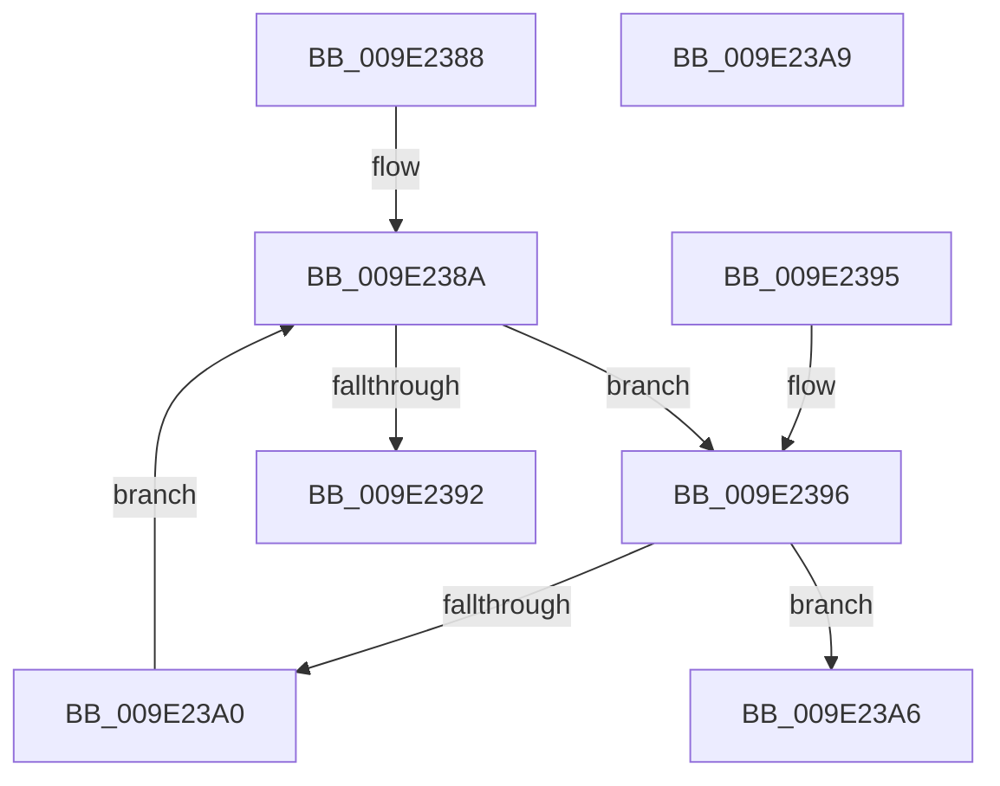

# WmipIsNumber

- RVA: `0x009E2388`–`0x009E23AA` (길이 `34` bytes)
- VA: `0x00000001409E2388`
- 실행 섹션: `PAGE`
- PDB 이름 있음: `예`; PDB Function 태그: `아니요`
- unwind 정보 RVA: `0x000DB714`
- 디코드: `15`개 명령, `34/34` bytes 표시
- 미해석 바이트: `0` (있으면 어셈블리에 `.byte`로 보존)

> 이 문서는 커널 이미지의 기계어와 PDB 기호를 분석해 생성했습니다. 4번과 5번은 함수 원형과 자료형을 바이너리 사용 방식에서 추정한 C 해석이며 원본 소스 복구 결과는 아닙니다.

## 1. Dependencies

- 직접 호출 지점: **0**; 고유 호출 대상: **0**
- 직접 호출자로 확인된 함수: **2**
- RIP 상대 이미지 참조: **0**

### Outgoing calls
- 직접 디코드된 call 명령이 없습니다.

### Direct callers
- [WmipPrepareWnodeSI](WmipPrepareWnodeSI_function_009E1740.md) at `0x009E1965`
- [WmipFindISinGEbyName](WmipFindISinGEbyName_function_009E2BF0.md) at `0x009E2D45`

### Static image references
- 디코드된 RIP-relative 메모리 참조가 없습니다.

## 2. Other-region calls and transfers

- 다른 실행 섹션으로 향하는 call: **0**
- 별도 외부 분기/꼬리 이동을 확인하지 못했습니다.

## 3. Assembly (complete function range)

```asm
009E2388  66 90                           nop
009E238A  0F B7 01                        movzx eax, word ptr [rcx]
009E238D  66 85 C0                        test ax, ax
009E2390  75 04                           jne 0x1409e2396
009E2392  B0 01                           mov al, 1
009E2394  C3                              ret
009E2395  CC                              int3
009E2396  66 83 E8 30                     sub ax, 0x30
009E239A  66 83 F8 09                     cmp ax, 9
009E239E  77 06                           ja 0x1409e23a6
009E23A0  48 83 C1 02                     add rcx, 2
009E23A4  EB E4                           jmp 0x1409e238a
009E23A6  32 C0                           xor al, al
009E23A8  C3                              ret
009E23A9  CC                              int3
```

## 4. C-style interpretation (structured pseudocode)

```c
__int64 __fastcall WmipIsNumber(__int64 a1)
{
    __int64 result;

loc_009E238A:
    if ((unsigned __int16)(*(unsigned __int16 *)(a1)) != 0) goto loc_009E2396;
    return 1;
loc_009E2396:
    result = (unsigned __int16)((1) - (48));
    if (((unsigned __int16)(result)) > 9) goto loc_009E23A6;
    a1 = (a1) + (2);
    goto loc_009E238A;
loc_009E23A6:
    result = 0;
    return result;
}
```

## 5. (Beta) C Style

```c
int64_t WmipIsNumber(void *Arg1)
{
    uint8_t *arg1 = (uint8_t *)Arg1;

    int64_t result;

loc_009E238A:
    if ((uint16_t)(*(uint16_t *)(arg1)) != 0) goto loc_009E2396;
    return 1;
loc_009E2396:
    result = (uint16_t)((1) - (48));
    if (((uint16_t)(result)) > 9) goto loc_009E23A6;
    Arg1 = (Arg1) + (2);
    goto loc_009E238A;
loc_009E23A6:
    result = 0;
    return result;
}
```

### 관측된 메모리 오프셋

구조체 형식이 확인되지 않은 접근은 인자 기준의 오프셋으로만 기록했습니다.

| 기준 인자 | 오프셋 표현 | 폭 (bit) | 접근 |
|---|---:|---:|---|
| `Arg1` | `+ 0x0` | `16` | `R` |

## 6. Execution-region graph

[열기: 2D/3D 그래프와 함수 탐색 컨트롤 패널](../../../control-panel.html?section=page&rva=0x009E2388&view=graph)

- 2D 그래프는 위에서 아래로 흐르고, 3D 그래프는 빈 공간을 드래그해 회전합니다. Shift+드래그는 이동, 휠은 확대·축소, 함수 노드 선택은 대상 보고서 이동입니다.

### Static fallback


