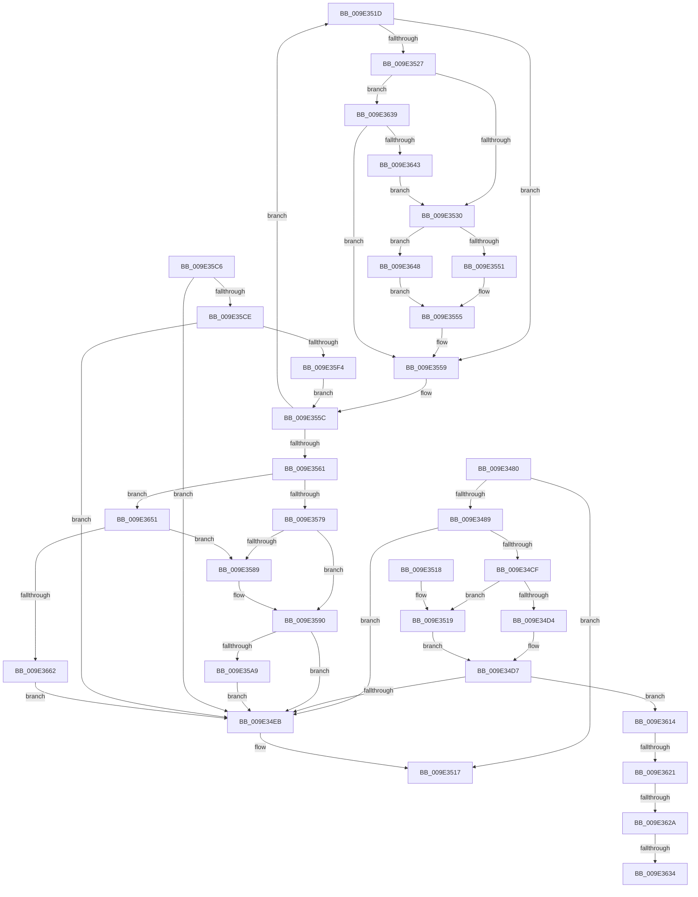

# WmipLegacyEtwCallback

- RVA: `0x009E3480`–`0x009E3675` (길이 `501` bytes)
- VA: `0x00000001409E3480`
- 실행 섹션: `PAGE`
- PDB 이름 있음: `예`; PDB Function 태그: `예`
- unwind 정보 RVA: `0x000A3F40`
- 디코드: `129`개 명령, `501/501` bytes 표시
- 미해석 바이트: `0` (있으면 어셈블리에 `.byte`로 보존)

> 이 문서는 커널 이미지의 기계어와 PDB 기호를 분석해 생성했습니다. 4번과 5번은 함수 원형과 자료형을 바이너리 사용 방식에서 추정한 C 해석이며 원본 소스 복구 결과는 아닙니다.

## 1. Dependencies

- 직접 호출 지점: **6**; 고유 호출 대상: **5**
- 직접 호출자로 확인된 함수: **0**
- RIP 상대 이미지 참조: **1**

### Outgoing calls
- `0x009E34C4` → [KeWaitForSingleObject](../../text/20/KeWaitForSingleObject_function_0020E6B0.md) (function, `0x0020E6B0`)
- `0x009E34F4` → [KeReleaseMutex](../../text/39/KeReleaseMutex_function_00396810.md) (function, `0x00396810`)
- `0x009E3537` → [WmipReferenceEntry](WmipReferenceEntry_function_009E1BF8.md) (function, `0x009E1BF8`)
- `0x009E3564` → [WmipReferenceEntry](WmipReferenceEntry_function_009E1BF8.md) (function, `0x009E1BF8`)
- `0x009E35BC` → [ExQueueWorkItem](../../text/2F/ExQueueWorkItem_function_002F9520.md) (function, `0x002F9520`)
- `0x009E35E3` → [ExAllocatePool2](../../poolcode/B8/ExAllocatePool2_function_00B820F0.md) (function, `0x00B820F0`)

### Direct callers
- 이 함수 시작 RVA로 연결되는 직접 call은 확인되지 않았습니다. 간접 호출은 완전히 역산할 수 없습니다.

### Static image references
- `0x009E34A9` → RVA `0x00EFFA60` (`.data`; read)

## 2. Other-region calls and transfers

- 다른 실행 섹션으로 향하는 call: **4**
  - `0x009E34C4` → [KeWaitForSingleObject](../../text/20/KeWaitForSingleObject_function_0020E6B0.md) (`PAGE` → `.text`)
  - `0x009E34F4` → [KeReleaseMutex](../../text/39/KeReleaseMutex_function_00396810.md) (`PAGE` → `.text`)
  - `0x009E35BC` → [ExQueueWorkItem](../../text/2F/ExQueueWorkItem_function_002F9520.md) (`PAGE` → `.text`)
  - `0x009E35E3` → [ExAllocatePool2](../../poolcode/B8/ExAllocatePool2_function_00B820F0.md) (`PAGE` → `POOLCODE`)
- call이 아닌 외부 분기/꼬리 이동: **4**
  - `0x009E361B` → [sub_00B3051A + 0x2](../B3/Unknown_function_00B3051A.md) (`tail-transfer`)
  - `0x009E3624` → [sub_00B3051A](../B3/Unknown_function_00B3051A.md) (`tail-transfer`)
  - `0x009E362E` → [sub_00B3051A](../B3/Unknown_function_00B3051A.md) (`tail-transfer`)
  - `0x009E3634` → [sub_00B3051A + 0x2](../B3/Unknown_function_00B3051A.md) (`tail-transfer`)

## 3. Assembly (complete function range)

```asm
009E3480  80 FA 01                        cmp dl, 1
009E3483  0F 87 8E 00 00 00               ja 0x1409e3517
009E3489  48 8B C4                        mov rax, rsp
009E348C  48 89 58 08                     mov qword ptr [rax + 8], rbx
009E3490  48 89 68 10                     mov qword ptr [rax + 0x10], rbp
009E3494  48 89 70 18                     mov qword ptr [rax + 0x18], rsi
009E3498  48 89 78 20                     mov qword ptr [rax + 0x20], rdi
009E349C  41 54                           push r12
009E349E  41 56                           push r14
009E34A0  41 57                           push r15
009E34A2  48 83 EC 30                     sub rsp, 0x30
009E34A6  49 8B F1                        mov rsi, r9
009E34A9  48 8D 0D B0 C5 51 00            lea rcx, [rip + 0x51c5b0]
009E34B0  4D 8B F0                        mov r14, r8
009E34B3  40 8A EA                        mov bpl, dl
009E34B6  33 DB                           xor ebx, ebx
009E34B8  45 33 C9                        xor r9d, r9d
009E34BB  48 21 58 D8                     and qword ptr [rax - 0x28], rbx
009E34BF  45 33 C0                        xor r8d, r8d
009E34C2  33 D2                           xor edx, edx
009E34C4  E8 E7 B1 82 FF                  call 0x14020e6b0
009E34C9  48 39 5E 70                     cmp qword ptr [rsi + 0x70], rbx
009E34CD  74 1C                           je 0x1409e34eb
009E34CF  40 84 ED                        test bpl, bpl
009E34D2  74 45                           je 0x1409e3519
009E34D4  49 8B 06                        mov rax, qword ptr [r14]
009E34D7  4C 8D 7E 38                     lea r15, [rsi + 0x38]
009E34DB  48 89 46 78                     mov qword ptr [rsi + 0x78], rax
009E34DF  49 8B 07                        mov rax, qword ptr [r15]
009E34E2  49 3B C7                        cmp rax, r15
009E34E5  0F 85 29 01 00 00               jne 0x1409e3614
009E34EB  33 D2                           xor edx, edx
009E34ED  48 8D 0D 6C C5 51 00            lea rcx, [rip + 0x51c56c]
009E34F4  E8 17 33 9B FF                  call 0x140396810
009E34F9  48 8B 5C 24 50                  mov rbx, qword ptr [rsp + 0x50]
009E34FE  48 8B 6C 24 58                  mov rbp, qword ptr [rsp + 0x58]
009E3503  48 8B 74 24 60                  mov rsi, qword ptr [rsp + 0x60]
009E3508  48 8B 7C 24 68                  mov rdi, qword ptr [rsp + 0x68]
009E350D  48 83 C4 30                     add rsp, 0x30
009E3511  41 5F                           pop r15
009E3513  41 5E                           pop r14
009E3515  41 5C                           pop r12
009E3517  C3                              ret
009E3518  CC                              int3
009E3519  33 C0                           xor eax, eax
009E351B  EB BA                           jmp 0x1409e34d7
009E351D  41 8B 46 10                     mov eax, dword ptr [r14 + 0x10]
009E3521  0F BA E0 14                     bt eax, 0x14
009E3525  73 32                           jae 0x1409e3559
009E3527  40 84 ED                        test bpl, bpl
009E352A  0F 84 09 01 00 00               je 0x1409e3639
009E3530  49 8B 5E 40                     mov rbx, qword ptr [r14 + 0x40]
009E3534  48 8B CB                        mov rcx, rbx
009E3537  E8 BC E6 FF FF                  call 0x1409e1bf8
009E353C  4A 89 5C E7 28                  mov qword ptr [rdi + r12*8 + 0x28], rbx
009E3541  41 FF C4                        inc r12d
009E3544  41 8B 46 10                     mov eax, dword ptr [r14 + 0x10]
009E3548  40 84 ED                        test bpl, bpl
009E354B  0F 84 F7 00 00 00               je 0x1409e3648
009E3551  0F BA E8 15                     bts eax, 0x15
009E3555  41 89 46 10                     mov dword ptr [r14 + 0x10], eax
009E3559  4D 8B 36                        mov r14, qword ptr [r14]
009E355C  4D 3B F7                        cmp r14, r15
009E355F  75 BC                           jne 0x1409e351d
009E3561  48 8B CE                        mov rcx, rsi
009E3564  E8 8F E6 FF FF                  call 0x1409e1bf8
009E3569  48 8B 86 80 00 00 00            mov rax, qword ptr [rsi + 0x80]
009E3570  48 85 C0                        test rax, rax
009E3573  0F 85 D8 00 00 00               jne 0x1409e3651
009E3579  48 8D 86 88 00 00 00            lea rax, [rsi + 0x88]
009E3580  48 8B 48 08                     mov rcx, qword ptr [rax + 8]
009E3584  48 39 01                        cmp qword ptr [rcx], rax
009E3587  74 07                           je 0x1409e3590
009E3589  B9 03 00 00 00                  mov ecx, 3
009E358E  CD 29                           int 0x29
009E3590  48 89 07                        mov qword ptr [rdi], rax
009E3593  48 89 4F 08                     mov qword ptr [rdi + 8], rcx
009E3597  48 89 39                        mov qword ptr [rcx], rdi
009E359A  48 89 78 08                     mov qword ptr [rax + 8], rdi
009E359E  8B 46 10                        mov eax, dword ptr [rsi + 0x10]
009E35A1  A8 10                           test al, 0x10
009E35A3  0F 85 42 FF FF FF               jne 0x1409e34eb
009E35A9  48 8B 4E 60                     mov rcx, qword ptr [rsi + 0x60]
009E35AD  83 C8 10                        or eax, 0x10
009E35B0  48 83 C1 18                     add rcx, 0x18
009E35B4  89 46 10                        mov dword ptr [rsi + 0x10], eax
009E35B7  BA 01 00 00 00                  mov edx, 1
009E35BC  E8 5F 5F 91 FF                  call 0x1402f9520
009E35C1  E9 25 FF FF FF                  jmp 0x1409e34eb
009E35C6  85 DB                           test ebx, ebx
009E35C8  0F 84 1D FF FF FF               je 0x1409e34eb
009E35CE  8D 04 DD 28 00 00 00            lea eax, [rbx*8 + 0x28]
009E35D5  B9 00 01 00 00                  mov ecx, 0x100
009E35DA  48 63 D0                        movsxd rdx, eax
009E35DD  41 B8 57 6D 69 70               mov r8d, 0x70696d57
009E35E3  E8 08 EB 19 00                  call 0x140b820f0
009E35E8  48 8B F8                        mov rdi, rax
009E35EB  48 85 C0                        test rax, rax
009E35EE  0F 84 F7 FE FF FF               je 0x1409e34eb
009E35F4  C7 40 10 02 00 00 00            mov dword ptr [rax + 0x10], 2
009E35FB  45 33 E4                        xor r12d, r12d
009E35FE  49 8B 0E                        mov rcx, qword ptr [r14]
009E3601  48 89 48 18                     mov qword ptr [rax + 0x18], rcx
009E3605  40 88 68 24                     mov byte ptr [rax + 0x24], bpl
009E3609  89 58 20                        mov dword ptr [rax + 0x20], ebx
009E360C  4D 8B 37                        mov r14, qword ptr [r15]
009E360F  E9 48 FF FF FF                  jmp 0x1409e355c
009E3614  8B 48 10                        mov ecx, dword ptr [rax + 0x10]
009E3617  0F BA E1 14                     bt ecx, 0x14
009E361B  0F 83 FB CE 14 00               jae 0x140b3051c
009E3621  40 84 ED                        test bpl, bpl
009E3624  0F 85 F0 CE 14 00               jne 0x140b3051a
009E362A  0F BA E1 15                     bt ecx, 0x15
009E362E  0F 82 E6 CE 14 00               jb 0x140b3051a
009E3634  E9 E3 CE 14 00                  jmp 0x140b3051c
009E3639  0F BA E0 15                     bt eax, 0x15
009E363D  0F 83 16 FF FF FF               jae 0x1409e3559
009E3643  E9 E8 FE FF FF                  jmp 0x1409e3530
009E3648  0F BA F0 15                     btr eax, 0x15
009E364C  E9 04 FF FF FF                  jmp 0x1409e3555
009E3651  48 8B 48 20                     mov rcx, qword ptr [rax + 0x20]
009E3655  48 83 C0 18                     add rax, 0x18
009E3659  48 39 01                        cmp qword ptr [rcx], rax
009E365C  0F 85 27 FF FF FF               jne 0x1409e3589
009E3662  48 89 07                        mov qword ptr [rdi], rax
009E3665  48 89 4F 08                     mov qword ptr [rdi + 8], rcx
009E3669  48 89 39                        mov qword ptr [rcx], rdi
009E366C  48 89 78 08                     mov qword ptr [rax + 8], rdi
009E3670  E9 76 FE FF FF                  jmp 0x1409e34eb
```

## 4. C-style interpretation (structured pseudocode)

```c
__int64 __fastcall WmipLegacyEtwCallback(__int64 a1, int a2, __int64 a3, __int64 a4)
{
    __int64 result;
    __int64 v_rbx;
    __int64 v_rsp;
    unsigned __int64 v_stack_p10;
    unsigned __int64 v_stack_p18;
    unsigned __int64 v_stack_p20;
    unsigned __int64 v_stack_p8;

    if (((unsigned __int8)(a2)) > 1) goto loc_009E3517;
    *(unsigned __int64 *)(v_rsp + 8) = v_rbx;
    *(unsigned __int64 *)(v_rsp + 16) = v_rbp;
    *(unsigned __int64 *)(v_rsp + 24) = v_rsi;
    *(unsigned __int64 *)(v_rsp + 32) = v_rdi;
    v_rsp = (v_rsp) - (48);
    v_rbx = 0;
    a4 = 0;
    a3 = 0;
    a2 = 0;
    result = KeWaitForSingleObject(v_rip + 5359024, a2, a3, a4);
    if ((*(unsigned __int64 *)(a4 + 112)) == 0) goto loc_009E34EB;
    if ((unsigned __int8)((unsigned __int8)(a2)) == 0) goto loc_009E3519;
loc_009E34D7:
    *(unsigned __int64 *)(a4 + 120) = *(unsigned __int64 *)(a3);
    if ((*(unsigned __int64 *)(a4 + 56)) != (a4 + 56)) goto loc_009E3614;
loc_009E34EB:
    a2 = 0;
    result = KeReleaseMutex(v_rip + 5358956, a2, a3, a4);
    v_rsp = (v_rsp) + (48);
loc_009E3517:
    return result;
loc_009E3519:
    result = 0;
    goto loc_009E34D7;
loc_009E3614:
}
```

## 5. (Beta) C Style

```c
int64_t WmipLegacyEtwCallback(int64_t Arg1, int32_t Arg2, void *Arg3, void *Arg4)
{
    uint8_t *arg3 = (uint8_t *)Arg3;
    uint8_t *arg4 = (uint8_t *)Arg4;

    int64_t result;
    int64_t local_rbx;
    int64_t local_rsp;
    uint64_t v_stack_p10;
    uint64_t v_stack_p18;
    uint64_t v_stack_p20;
    uint64_t v_stack_p8;

    if (((uint8_t)(Arg2)) > 1) goto loc_009E3517;
    *(uint64_t *)(local_rsp + 0x8) = local_rbx;
    *(uint64_t *)(local_rsp + 0x10) = local_rbp;
    *(uint64_t *)(local_rsp + 0x18) = local_rsi;
    *(uint64_t *)(local_rsp + 0x20) = local_rdi;
    local_rsp = (local_rsp) - (48);
    local_rbx = 0;
    Arg4 = 0;
    Arg3 = 0;
    Arg2 = 0;
    result = KeWaitForSingleObject(v_rip + 5359024, Arg2, Arg3, Arg4);
    if ((*(uint64_t *)(arg4 + 0x70)) == 0) goto loc_009E34EB;
    if ((uint8_t)((uint8_t)(Arg2)) == 0) goto loc_009E3519;
loc_009E34D7:
    *(uint64_t *)(arg4 + 0x78) = *(uint64_t *)(arg3);
    if ((*(uint64_t *)(arg4 + 0x38)) != (Arg4 + 56)) goto loc_009E3614;
loc_009E34EB:
    Arg2 = 0;
    result = KeReleaseMutex(v_rip + 5358956, Arg2, Arg3, Arg4);
    local_rsp = (local_rsp) + (48);
loc_009E3517:
    return result;
loc_009E3519:
    result = 0;
    goto loc_009E34D7;
loc_009E3614:
}
```

### 관측된 메모리 오프셋

구조체 형식이 확인되지 않은 접근은 인자 기준의 오프셋으로만 기록했습니다.

| 기준 인자 | 오프셋 표현 | 폭 (bit) | 접근 |
|---|---:|---:|---|
| `Arg3` | `+ 0x0` | `64` | `R` |
| `Arg4` | `+ 0x0` | `64` | `R` |
| `Arg4` | `+ 0x38` | `64` | `R` |
| `Arg4` | `+ 0x70` | `64` | `R` |
| `Arg4` | `+ 0x78` | `64` | `W` |

## 6. Execution-region graph

[열기: 2D/3D 그래프와 함수 탐색 컨트롤 패널](../../../control-panel.html?section=page&rva=0x009E3480&view=graph)

- 2D 그래프는 위에서 아래로 흐르고, 3D 그래프는 빈 공간을 드래그해 회전합니다. Shift+드래그는 이동, 휠은 확대·축소, 함수 노드 선택은 대상 보고서 이동입니다.

### Static fallback


