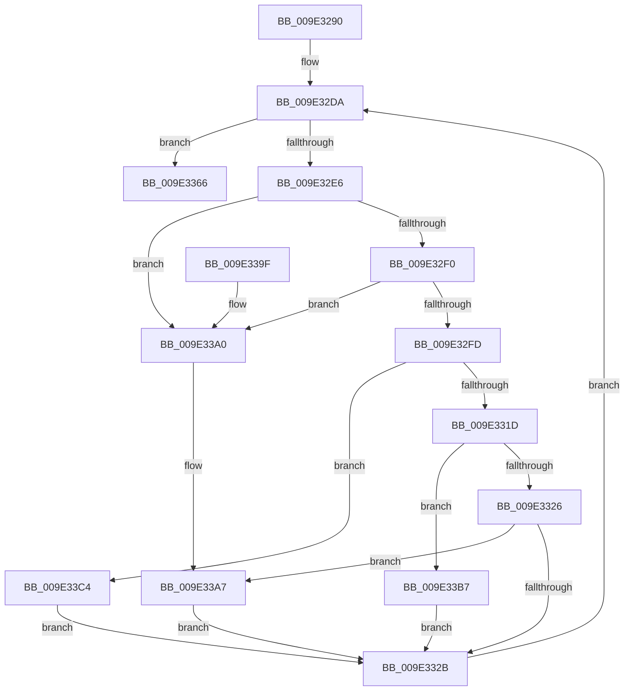

# WmipLegacyEtwWorker

- RVA: `0x009E3290`–`0x009E33D4` (길이 `324` bytes)
- VA: `0x00000001409E3290`
- 실행 섹션: `PAGE`
- PDB 이름 있음: `예`; PDB Function 태그: `아니요`
- unwind 정보 RVA: `0x0005FE7C`
- 디코드: `77`개 명령, `324/324` bytes 표시
- 미해석 바이트: `0` (있으면 어셈블리에 `.byte`로 보존)

> 이 문서는 커널 이미지의 기계어와 PDB 기호를 분석해 생성했습니다. 4번과 5번은 함수 원형과 자료형을 바이너리 사용 방식에서 추정한 C 해석이며 원본 소스 복구 결과는 아닙니다.

## 1. Dependencies

- 직접 호출 지점: **11**; 고유 호출 대상: **8**
- 직접 호출자로 확인된 함수: **1**
- RIP 상대 이미지 참조: **2**

### Outgoing calls
- `0x009E32A2` → [WmipReferenceEntry](WmipReferenceEntry_function_009E1BF8.md) (function, `0x009E1BF8`)
- `0x009E32BC` → [KeWaitForSingleObject](../../text/20/KeWaitForSingleObject_function_0020E6B0.md) (function, `0x0020E6B0`)
- `0x009E330D` → [KeReleaseMutex](../../text/39/KeReleaseMutex_function_00396810.md) (function, `0x00396810`)
- `0x009E3335` → [WmipUnreferenceEntry](WmipUnreferenceEntry_function_009E0CC8.md) (function, `0x009E0CC8`)
- `0x009E3342` → [ExFreePoolWithTag](../../poolcode/B8/ExFreePoolWithTag_function_00B82870.md) (function, `0x00B82870`)
- `0x009E335C` → [KeWaitForSingleObject](../../text/20/KeWaitForSingleObject_function_0020E6B0.md) (function, `0x0020E6B0`)
- `0x009E337B` → [KeReleaseMutex](../../text/39/KeReleaseMutex_function_00396810.md) (function, `0x00396810`)
- `0x009E338A` → [WmipUnreferenceEntry](WmipUnreferenceEntry_function_009E0CC8.md) (function, `0x009E0CC8`)
- `0x009E33AD` → [WmipProcessLegacyEtwCallback](../AA/WmipProcessLegacyEtwCallback_function_00AA59E8.md) (function, `0x00AA59E8`)
- `0x009E33BA` → [WmipProcessLegacyEtwUnregister](../7B/WmipProcessLegacyEtwUnregister_function_007B404C.md) (function, `0x007B404C`)
- `0x009E33CA` → [WmipProcessLegacyEtwRegister](../7B/WmipProcessLegacyEtwRegister_function_007B3F64.md) (function, `0x007B3F64`)

### Direct callers
- [WmipProcessSynchronousEtw](../AC/WmipProcessSynchronousEtw_function_00ACE5FC.md) at `0x00ACE638`

### Static image references
- `0x009E32AD` → RVA `0x00EFFA60` (`.data`; read)
- `0x009E332E` → RVA `0x00E03628` (`.data`; read)

## 2. Other-region calls and transfers

- 다른 실행 섹션으로 향하는 call: **5**
  - `0x009E32BC` → [KeWaitForSingleObject](../../text/20/KeWaitForSingleObject_function_0020E6B0.md) (`PAGE` → `.text`)
  - `0x009E330D` → [KeReleaseMutex](../../text/39/KeReleaseMutex_function_00396810.md) (`PAGE` → `.text`)
  - `0x009E3342` → [ExFreePoolWithTag](../../poolcode/B8/ExFreePoolWithTag_function_00B82870.md) (`PAGE` → `POOLCODE`)
  - `0x009E335C` → [KeWaitForSingleObject](../../text/20/KeWaitForSingleObject_function_0020E6B0.md) (`PAGE` → `.text`)
  - `0x009E337B` → [KeReleaseMutex](../../text/39/KeReleaseMutex_function_00396810.md) (`PAGE` → `.text`)
- 별도 외부 분기/꼬리 이동을 확인하지 못했습니다.

## 3. Assembly (complete function range)

```asm
009E3290  48 89 5C 24 08                  mov qword ptr [rsp + 8], rbx
009E3295  48 89 74 24 10                  mov qword ptr [rsp + 0x10], rsi
009E329A  57                              push rdi
009E329B  48 83 EC 30                     sub rsp, 0x30
009E329F  48 8B F9                        mov rdi, rcx
009E32A2  E8 51 E9 FF FF                  call 0x1409e1bf8
009E32A7  48 83 64 24 20 00               and qword ptr [rsp + 0x20], 0
009E32AD  48 8D 0D AC C7 51 00            lea rcx, [rip + 0x51c7ac]
009E32B4  45 33 C9                        xor r9d, r9d
009E32B7  45 33 C0                        xor r8d, r8d
009E32BA  33 D2                           xor edx, edx
009E32BC  E8 EF B3 82 FF                  call 0x14020e6b0
009E32C1  48 8B 8F 80 00 00 00            mov rcx, qword ptr [rdi + 0x80]
009E32C8  48 8D 87 88 00 00 00            lea rax, [rdi + 0x88]
009E32CF  48 85 C9                        test rcx, rcx
009E32D2  48 8D 71 18                     lea rsi, [rcx + 0x18]
009E32D6  48 0F 44 F0                     cmove rsi, rax
009E32DA  48 8B 1E                        mov rbx, qword ptr [rsi]
009E32DD  48 3B DE                        cmp rbx, rsi
009E32E0  0F 84 80 00 00 00               je 0x1409e3366
009E32E6  48 39 73 08                     cmp qword ptr [rbx + 8], rsi
009E32EA  0F 85 B0 00 00 00               jne 0x1409e33a0
009E32F0  48 8B 03                        mov rax, qword ptr [rbx]
009E32F3  48 39 58 08                     cmp qword ptr [rax + 8], rbx
009E32F7  0F 85 A3 00 00 00               jne 0x1409e33a0
009E32FD  48 89 06                        mov qword ptr [rsi], rax
009E3300  48 8D 0D 59 C7 51 00            lea rcx, [rip + 0x51c759]
009E3307  33 D2                           xor edx, edx
009E3309  48 89 70 08                     mov qword ptr [rax + 8], rsi
009E330D  E8 FE 34 9B FF                  call 0x140396810
009E3312  8B 4B 10                        mov ecx, dword ptr [rbx + 0x10]
009E3315  85 C9                           test ecx, ecx
009E3317  0F 84 A7 00 00 00               je 0x1409e33c4
009E331D  83 E9 01                        sub ecx, 1
009E3320  0F 84 91 00 00 00               je 0x1409e33b7
009E3326  83 F9 01                        cmp ecx, 1
009E3329  74 7C                           je 0x1409e33a7
009E332B  48 8B D7                        mov rdx, rdi
009E332E  48 8D 0D F3 02 42 00            lea rcx, [rip + 0x4202f3]
009E3335  E8 8E D9 FF FF                  call 0x1409e0cc8
009E333A  BA 57 6D 69 70                  mov edx, 0x70696d57
009E333F  48 8B CB                        mov rcx, rbx
009E3342  E8 29 F5 19 00                  call 0x140b82870
009E3347  48 83 64 24 20 00               and qword ptr [rsp + 0x20], 0
009E334D  48 8D 0D 0C C7 51 00            lea rcx, [rip + 0x51c70c]
009E3354  45 33 C9                        xor r9d, r9d
009E3357  45 33 C0                        xor r8d, r8d
009E335A  33 D2                           xor edx, edx
009E335C  E8 4F B3 82 FF                  call 0x14020e6b0
009E3361  E9 74 FF FF FF                  jmp 0x1409e32da
009E3366  83 67 10 EF                     and dword ptr [rdi + 0x10], 0xffffffef
009E336A  48 8D 0D EF C6 51 00            lea rcx, [rip + 0x51c6ef]
009E3371  48 83 A7 80 00 00 00 00         and qword ptr [rdi + 0x80], 0
009E3379  33 D2                           xor edx, edx
009E337B  E8 90 34 9B FF                  call 0x140396810
009E3380  48 8B D7                        mov rdx, rdi
009E3383  48 8D 0D 9E 02 42 00            lea rcx, [rip + 0x42029e]
009E338A  E8 39 D9 FF FF                  call 0x1409e0cc8
009E338F  48 8B 5C 24 40                  mov rbx, qword ptr [rsp + 0x40]
009E3394  48 8B 74 24 48                  mov rsi, qword ptr [rsp + 0x48]
009E3399  48 83 C4 30                     add rsp, 0x30
009E339D  5F                              pop rdi
009E339E  C3                              ret
009E339F  CC                              int3
009E33A0  B9 03 00 00 00                  mov ecx, 3
009E33A5  CD 29                           int 0x29
009E33A7  48 8B D7                        mov rdx, rdi
009E33AA  48 8B CB                        mov rcx, rbx
009E33AD  E8 36 26 0C 00                  call 0x140aa59e8
009E33B2  E9 74 FF FF FF                  jmp 0x1409e332b
009E33B7  48 8B CF                        mov rcx, rdi
009E33BA  E8 8D 0C DD FF                  call 0x1407b404c
009E33BF  E9 67 FF FF FF                  jmp 0x1409e332b
009E33C4  48 8B D3                        mov rdx, rbx
009E33C7  48 8B CF                        mov rcx, rdi
009E33CA  E8 95 0B DD FF                  call 0x1407b3f64
009E33CF  E9 57 FF FF FF                  jmp 0x1409e332b
```

## 4. C-style interpretation (structured pseudocode)

```c
__int64 __fastcall WmipLegacyEtwWorker(__int64 a1, int a2, int a3, int a4)
{
    __int64 result;
    __int64 v_rsi;
    __int64 v_rsp;
    unsigned __int64 v_stack_m18;
    unsigned __int64 v_stack_p10;
    unsigned __int64 v_stack_p8;

    v_stack_p8 = v_rbx;
    v_stack_p10 = v_rsi;
    v_rsp = (v_rsp) - (48);
    result = WmipReferenceEntry(a1, a2, a3, a4);
    a4 = 0;
    a3 = 0;
    a2 = 0;
    result = KeWaitForSingleObject(v_rip + 5359532, a2, a3, a4);
    v_rsi = *(unsigned __int64 *)(a1 + 128) + 24;
    if (*(unsigned __int64 *)(a1 + 128) == 0) { v_rsi = a1 + 136; }
loc_009E32DA:
    if ((*(unsigned __int64 *)(v_rsi)) == v_rsi) goto loc_009E3366;
    if ((*(unsigned __int64 *)(*(unsigned __int64 *)(v_rsi) + 8)) != v_rsi) goto loc_009E33A0;
    if ((*(unsigned __int64 *)(*(unsigned __int64 *)(*(unsigned __int64 *)(v_rsi)) + 8)) != (*(unsigned __int64 *)(v_rsi))) goto loc_009E33A0;
    *(unsigned __int64 *)(v_rsi) = *(unsigned __int64 *)(*(unsigned __int64 *)(v_rsi));
    a2 = 0;
    *(unsigned __int64 *)(*(unsigned __int64 *)(*(unsigned __int64 *)(v_rsi)) + 8) = v_rsi;
    result = KeReleaseMutex(v_rip + 5359449, a2, a3, a4);
    if ((unsigned int)((unsigned int)(*(unsigned int *)(*(unsigned __int64 *)(v_rsi) + 16))) == 0) goto loc_009E33C4;
    a1 = (unsigned int)(((unsigned int)(*(unsigned int *)(*(unsigned __int64 *)(v_rsi) + 16))) - (1));
    if (condition_is_equal) goto loc_009E33B7;
    if (((unsigned int)(a1)) == 1) goto loc_009E33A7;
loc_009E332B:
    result = WmipUnreferenceEntry(v_rip + 4326131, a1, a3, a4);
    result = ExFreePoolWithTag(*(unsigned __int64 *)(v_rsi), (unsigned int)(0x70696D57ULL), a3, a4);
    a4 = 0;
    a3 = 0;
    a2 = 0;
    result = KeWaitForSingleObject(v_rip + 5359372, a2, a3, a4);
    goto loc_009E32DA;
loc_009E3366:
    a2 = 0;
    result = KeReleaseMutex(v_rip + 5359343, a2, a3, a4);
    result = WmipUnreferenceEntry(v_rip + 4326046, a1, a3, a4);
    v_rsp = (v_rsp) + (48);
    return result;
loc_009E33A0:
loc_009E33A7:
    result = WmipProcessLegacyEtwCallback(v_stack_p8, a1, a3, a4);
    goto loc_009E332B;
loc_009E33B7:
    result = WmipProcessLegacyEtwUnregister(a1, a1, a3, a4);
    goto loc_009E332B;
loc_009E33C4:
    result = WmipProcessLegacyEtwRegister(a1, v_stack_p8, a3, a4);
    goto loc_009E332B;
}
```

## 5. (Beta) C Style

```c
int64_t WmipLegacyEtwWorker(void *Arg1, int32_t Arg2, int32_t Arg3, int32_t Arg4)
{
    uint8_t *arg1 = (uint8_t *)Arg1;

    int64_t result;
    int64_t local_rsi;
    int64_t local_rsp;
    uint64_t v_stack_m18;
    uint64_t v_stack_p10;
    uint64_t v_stack_p8;

    v_stack_p8 = local_rbx;
    v_stack_p10 = local_rsi;
    local_rsp = (local_rsp) - (48);
    result = WmipReferenceEntry(Arg1, Arg2, Arg3, Arg4);
    Arg4 = 0;
    Arg3 = 0;
    Arg2 = 0;
    result = KeWaitForSingleObject(v_rip + 5359532, Arg2, Arg3, Arg4);
    local_rsi = *(uint64_t *)(arg1 + 0x80) + 24;
    if (*(uint64_t *)(arg1 + 0x80) == 0) { local_rsi = Arg1 + 136; }
loc_009E32DA:
    if ((*(uint64_t *)(local_rsi)) == local_rsi) goto loc_009E3366;
    if ((*(uint64_t *)(*(uint64_t *)(local_rsi) + 0x8)) != local_rsi) goto loc_009E33A0;
    if ((*(uint64_t *)(*(uint64_t *)(*(uint64_t *)(local_rsi)) + 0x8)) != (*(uint64_t *)(local_rsi))) goto loc_009E33A0;
    *(uint64_t *)(local_rsi) = *(uint64_t *)(*(uint64_t *)(local_rsi));
    Arg2 = 0;
    *(uint64_t *)(*(uint64_t *)(*(uint64_t *)(local_rsi)) + 0x8) = local_rsi;
    result = KeReleaseMutex(v_rip + 5359449, Arg2, Arg3, Arg4);
    if ((uint32_t)((uint32_t)(*(uint32_t *)(*(uint64_t *)(local_rsi) + 0x10))) == 0) goto loc_009E33C4;
    Arg1 = (uint32_t)(((uint32_t)(*(uint32_t *)(*(uint64_t *)(local_rsi) + 0x10))) - (1));
    if (condition_is_equal) goto loc_009E33B7;
    if (((uint32_t)(Arg1)) == 1) goto loc_009E33A7;
loc_009E332B:
    result = WmipUnreferenceEntry(v_rip + 4326131, Arg1, Arg3, Arg4);
    result = ExFreePoolWithTag(*(uint64_t *)(local_rsi), (uint32_t)(0x70696D57ULL), Arg3, Arg4);
    Arg4 = 0;
    Arg3 = 0;
    Arg2 = 0;
    result = KeWaitForSingleObject(v_rip + 5359372, Arg2, Arg3, Arg4);
    goto loc_009E32DA;
loc_009E3366:
    Arg2 = 0;
    result = KeReleaseMutex(v_rip + 5359343, Arg2, Arg3, Arg4);
    result = WmipUnreferenceEntry(v_rip + 4326046, Arg1, Arg3, Arg4);
    local_rsp = (local_rsp) + (48);
    return result;
loc_009E33A0:
loc_009E33A7:
    result = WmipProcessLegacyEtwCallback(v_stack_p8, Arg1, Arg3, Arg4);
    goto loc_009E332B;
loc_009E33B7:
    result = WmipProcessLegacyEtwUnregister(Arg1, Arg1, Arg3, Arg4);
    goto loc_009E332B;
loc_009E33C4:
    result = WmipProcessLegacyEtwRegister(Arg1, v_stack_p8, Arg3, Arg4);
    goto loc_009E332B;
}
```

### 관측된 메모리 오프셋

구조체 형식이 확인되지 않은 접근은 인자 기준의 오프셋으로만 기록했습니다.

| 기준 인자 | 오프셋 표현 | 폭 (bit) | 접근 |
|---|---:|---:|---|
| `Arg1` | `+ 0x10` | `32` | `R/W` |
| `Arg1` | `+ 0x80` | `64` | `R` |
| `Arg1` | `+ 0x80` | `64` | `R/W` |
| `Arg1` | `+ 0x88` | `64` | `R` |

## 6. Execution-region graph

[열기: 2D/3D 그래프와 함수 탐색 컨트롤 패널](../../../control-panel.html?section=page&rva=0x009E3290&view=graph)

- 2D 그래프는 위에서 아래로 흐르고, 3D 그래프는 빈 공간을 드래그해 회전합니다. Shift+드래그는 이동, 휠은 확대·축소, 함수 노드 선택은 대상 보고서 이동입니다.

### Static fallback


