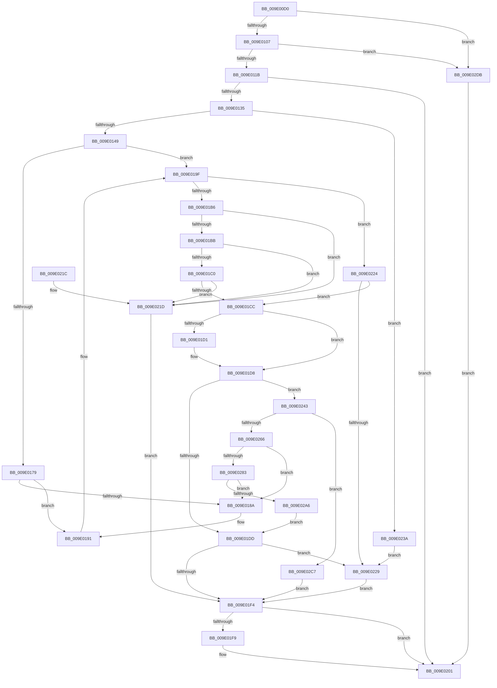

# WmipOpenBlock

- RVA: `0x009E00D0`–`0x009E02E5` (길이 `533` bytes)
- VA: `0x00000001409E00D0`
- 실행 섹션: `PAGE`
- PDB 이름 있음: `예`; PDB Function 태그: `아니요`
- unwind 정보 RVA: `0x000A3BF4`
- 디코드: `147`개 명령, `533/533` bytes 표시
- 미해석 바이트: `0` (있으면 어셈블리에 `.byte`로 보존)

> 이 문서는 커널 이미지의 기계어와 PDB 기호를 분석해 생성했습니다. 4번과 5번은 함수 원형과 자료형을 바이너리 사용 방식에서 추정한 C 해석이며 원본 소스 복구 결과는 아닙니다.

## 1. Dependencies

- 직접 호출 지점: **11**; 고유 호출 대상: **8**
- 직접 호출자로 확인된 함수: **2**
- RIP 상대 이미지 참조: **2**

### Outgoing calls
- `0x009E0126` → [WmipOpenGuidObject](WmipOpenGuidObject_function_009E02EC.md) (function, `0x009E02EC`)
- `0x009E014F` → [WmipFindGEByGuid](WmipFindGEByGuid_function_009E03A4.md) (function, `0x009E03A4`)
- `0x009E016F` → [KeWaitForSingleObject](../../text/20/KeWaitForSingleObject_function_0020E6B0.md) (function, `0x0020E6B0`)
- `0x009E01A8` → [KeReleaseMutex](../../text/39/KeReleaseMutex_function_00396810.md) (function, `0x00396810`)
- `0x009E01C3` → [WmipIsQuerySetGuid](../9D/WmipIsQuerySetGuid_function_009DFEB0.md) (function, `0x009DFEB0`)
- `0x009E01E9` → [WmipEnableCollectOrEvent](WmipEnableCollectOrEvent_function_009E221C.md) (function, `0x009E221C`)
- `0x009E01FC` → [ObfDereferenceObject](../../text/2F/ObfDereferenceObject_function_002F9350.md) (function, `0x002F9350`)
- `0x009E0254` → [KeWaitForSingleObject](../../text/20/KeWaitForSingleObject_function_0020E6B0.md) (function, `0x0020E6B0`)
- `0x009E0259` → [WmipAllocGuidEntry](../9D/WmipAllocGuidEntry_function_009DD93C.md) (function, `0x009DD93C`)
- `0x009E02BD` → [KeReleaseMutex](../../text/39/KeReleaseMutex_function_00396810.md) (function, `0x00396810`)
- `0x009E02CC` → [KeReleaseMutex](../../text/39/KeReleaseMutex_function_00396810.md) (function, `0x00396810`)

### Direct callers
- [WmipIoControl](../9D/WmipIoControl_function_009DEBD0.md) at `0x009DEE2D`
- [IoWMIOpenBlock](../9D/IoWMIOpenBlock_function_009DFF20.md) at `0x009E0083`

### Static image references
- `0x009E015A` → RVA `0x00EFFA60` (`.data`; read)
- `0x009E026F` → RVA `0x00EFFB28` (`.data`; read)

## 2. Other-region calls and transfers

- 다른 실행 섹션으로 향하는 call: **6**
  - `0x009E016F` → [KeWaitForSingleObject](../../text/20/KeWaitForSingleObject_function_0020E6B0.md) (`PAGE` → `.text`)
  - `0x009E01A8` → [KeReleaseMutex](../../text/39/KeReleaseMutex_function_00396810.md) (`PAGE` → `.text`)
  - `0x009E01FC` → [ObfDereferenceObject](../../text/2F/ObfDereferenceObject_function_002F9350.md) (`PAGE` → `.text`)
  - `0x009E0254` → [KeWaitForSingleObject](../../text/20/KeWaitForSingleObject_function_0020E6B0.md) (`PAGE` → `.text`)
  - `0x009E02BD` → [KeReleaseMutex](../../text/39/KeReleaseMutex_function_00396810.md) (`PAGE` → `.text`)
  - `0x009E02CC` → [KeReleaseMutex](../../text/39/KeReleaseMutex_function_00396810.md) (`PAGE` → `.text`)
- 별도 외부 분기/꼬리 이동을 확인하지 못했습니다.

## 3. Assembly (complete function range)

```asm
009E00D0  48 8B C4                        mov rax, rsp
009E00D3  48 89 58 08                     mov qword ptr [rax + 8], rbx
009E00D7  48 89 68 10                     mov qword ptr [rax + 0x10], rbp
009E00DB  48 89 70 18                     mov qword ptr [rax + 0x18], rsi
009E00DF  57                              push rdi
009E00E0  41 54                           push r12
009E00E2  41 56                           push r14
009E00E4  48 83 EC 40                     sub rsp, 0x40
009E00E8  48 83 60 D8 00                  and qword ptr [rax - 0x28], 0
009E00ED  45 8B D1                        mov r10d, r9d
009E00F0  8D 81 F8 BE DD FF               lea eax, [rcx - 0x224108]
009E00F6  4D 8B D8                        mov r11, r8
009E00F9  40 8A EA                        mov bpl, dl
009E00FC  8B F1                           mov esi, ecx
009E00FE  83 F8 38                        cmp eax, 0x38
009E0101  0F 87 D4 01 00 00               ja 0x1409e02db
009E0107  48 B9 01 00 00 00 00 00 10 01   movabs rcx, 0x110000000000001
009E0111  48 0F A3 C1                     bt rcx, rax
009E0115  0F 83 C0 01 00 00               jae 0x1409e02db
009E011B  4C 8D 4C 24 30                  lea r9, [rsp + 0x30]
009E0120  45 8B C2                        mov r8d, r10d
009E0123  49 8B CB                        mov rcx, r11
009E0126  E8 C1 01 00 00                  call 0x1409e02ec
009E012B  8B F8                           mov edi, eax
009E012D  85 C0                           test eax, eax
009E012F  0F 88 CC 00 00 00               js 0x1409e0201
009E0135  48 8B 5C 24 30                  mov rbx, qword ptr [rsp + 0x30]
009E013A  89 73 40                        mov dword ptr [rbx + 0x40], esi
009E013D  81 FE 08 41 22 00               cmp esi, 0x224108
009E0143  0F 84 F1 00 00 00               je 0x1409e023a
009E0149  33 D2                           xor edx, edx
009E014B  48 8D 4B 18                     lea rcx, [rbx + 0x18]
009E014F  E8 50 02 00 00                  call 0x1409e03a4
009E0154  48 83 64 24 20 00               and qword ptr [rsp + 0x20], 0
009E015A  4C 8D 25 FF F8 51 00            lea r12, [rip + 0x51f8ff]
009E0161  49 8B CC                        mov rcx, r12
009E0164  45 33 C9                        xor r9d, r9d
009E0167  45 33 C0                        xor r8d, r8d
009E016A  33 D2                           xor edx, edx
009E016C  48 8B F8                        mov rdi, rax
009E016F  E8 3C E5 82 FF                  call 0x14020e6b0
009E0174  48 85 FF                        test rdi, rdi
009E0177  74 26                           je 0x1409e019f
009E0179  48 8D 4F 28                     lea rcx, [rdi + 0x28]
009E017D  48 8B 51 08                     mov rdx, qword ptr [rcx + 8]
009E0181  48 8D 43 28                     lea rax, [rbx + 0x28]
009E0185  48 39 0A                        cmp qword ptr [rdx], rcx
009E0188  74 07                           je 0x1409e0191
009E018A  B9 03 00 00 00                  mov ecx, 3
009E018F  CD 29                           int 0x29
009E0191  48 89 08                        mov qword ptr [rax], rcx
009E0194  48 89 50 08                     mov qword ptr [rax + 8], rdx
009E0198  48 89 02                        mov qword ptr [rdx], rax
009E019B  48 89 41 08                     mov qword ptr [rcx + 8], rax
009E019F  33 D2                           xor edx, edx
009E01A1  48 89 7B 38                     mov qword ptr [rbx + 0x38], rdi
009E01A5  49 8B CC                        mov rcx, r12
009E01A8  E8 63 66 9B FF                  call 0x140396810
009E01AD  8B C6                           mov eax, esi
009E01AF  2D 3C 41 22 00                  sub eax, 0x22413c
009E01B4  75 6E                           jne 0x1409e0224
009E01B6  48 85 FF                        test rdi, rdi
009E01B9  74 62                           je 0x1409e021d
009E01BB  39 47 24                        cmp dword ptr [rdi + 0x24], eax
009E01BE  74 5D                           je 0x1409e021d
009E01C0  48 8B CF                        mov rcx, rdi
009E01C3  E8 E8 FC FF FF                  call 0x1409dfeb0
009E01C8  84 C0                           test al, al
009E01CA  74 51                           je 0x1409e021d
009E01CC  40 84 ED                        test bpl, bpl
009E01CF  75 07                           jne 0x1409e01d8
009E01D1  83 8B A4 00 00 00 02            or dword ptr [rbx + 0xa4], 2
009E01D8  48 85 FF                        test rdi, rdi
009E01DB  74 66                           je 0x1409e0243
009E01DD  4C 8D 83 A0 00 00 00            lea r8, [rbx + 0xa0]
009E01E4  8B D6                           mov edx, esi
009E01E6  48 8B CF                        mov rcx, rdi
009E01E9  E8 2E 20 00 00                  call 0x1409e221c
009E01EE  8B F8                           mov edi, eax
009E01F0  85 C0                           test eax, eax
009E01F2  79 35                           jns 0x1409e0229
009E01F4  48 85 DB                        test rbx, rbx
009E01F7  74 08                           je 0x1409e0201
009E01F9  48 8B CB                        mov rcx, rbx
009E01FC  E8 4F 91 91 FF                  call 0x1402f9350
009E0201  48 8B 5C 24 60                  mov rbx, qword ptr [rsp + 0x60]
009E0206  8B C7                           mov eax, edi
009E0208  48 8B 6C 24 68                  mov rbp, qword ptr [rsp + 0x68]
009E020D  48 8B 74 24 70                  mov rsi, qword ptr [rsp + 0x70]
009E0212  48 83 C4 40                     add rsp, 0x40
009E0216  41 5E                           pop r14
009E0218  41 5C                           pop r12
009E021A  5F                              pop rdi
009E021B  C3                              ret
009E021C  CC                              int3
009E021D  BF 95 02 00 C0                  mov edi, 0xc0000295
009E0222  EB D0                           jmp 0x1409e01f4
009E0224  83 F8 04                        cmp eax, 4
009E0227  74 A3                           je 0x1409e01cc
009E0229  48 8B 84 24 80 00 00 00         mov rax, qword ptr [rsp + 0x80]
009E0231  48 89 18                        mov qword ptr [rax], rbx
009E0234  33 DB                           xor ebx, ebx
009E0236  33 FF                           xor edi, edi
009E0238  EB BA                           jmp 0x1409e01f4
009E023A  83 8B A4 00 00 00 01            or dword ptr [rbx + 0xa4], 1
009E0241  EB E6                           jmp 0x1409e0229
009E0243  48 83 64 24 20 00               and qword ptr [rsp + 0x20], 0
009E0249  45 33 C9                        xor r9d, r9d
009E024C  45 33 C0                        xor r8d, r8d
009E024F  33 D2                           xor edx, edx
009E0251  49 8B CC                        mov rcx, r12
009E0254  E8 57 E4 82 FF                  call 0x14020e6b0
009E0259  E8 DE D6 FF FF                  call 0x1409dd93c
009E025E  48 8B F8                        mov rdi, rax
009E0261  48 85 C0                        test rax, rax
009E0264  74 61                           je 0x1409e02c7
009E0266  0F 10 43 18                     movups xmm0, xmmword ptr [rbx + 0x18]
009E026A  F3 0F 7F 40 48                  movdqu xmmword ptr [rax + 0x48], xmm0
009E026F  48 8B 05 B2 F8 51 00            mov rax, qword ptr [rip + 0x51f8b2]
009E0276  48 8B 08                        mov rcx, qword ptr [rax]
009E0279  48 39 41 08                     cmp qword ptr [rcx + 8], rax
009E027D  0F 85 07 FF FF FF               jne 0x1409e018a
009E0283  48 89 0F                        mov qword ptr [rdi], rcx
009E0286  48 89 47 08                     mov qword ptr [rdi + 8], rax
009E028A  48 89 79 08                     mov qword ptr [rcx + 8], rdi
009E028E  48 8D 4F 28                     lea rcx, [rdi + 0x28]
009E0292  48 89 38                        mov qword ptr [rax], rdi
009E0295  48 8D 43 28                     lea rax, [rbx + 0x28]
009E0299  48 8B 51 08                     mov rdx, qword ptr [rcx + 8]
009E029D  48 39 0A                        cmp qword ptr [rdx], rcx
009E02A0  0F 85 E4 FE FF FF               jne 0x1409e018a
009E02A6  48 89 08                        mov qword ptr [rax], rcx
009E02A9  48 89 50 08                     mov qword ptr [rax + 8], rdx
009E02AD  48 89 02                        mov qword ptr [rdx], rax
009E02B0  33 D2                           xor edx, edx
009E02B2  48 89 41 08                     mov qword ptr [rcx + 8], rax
009E02B6  49 8B CC                        mov rcx, r12
009E02B9  48 89 7B 38                     mov qword ptr [rbx + 0x38], rdi
009E02BD  E8 4E 65 9B FF                  call 0x140396810
009E02C2  E9 16 FF FF FF                  jmp 0x1409e01dd
009E02C7  33 D2                           xor edx, edx
009E02C9  49 8B CC                        mov rcx, r12
009E02CC  E8 3F 65 9B FF                  call 0x140396810
009E02D1  BF 9A 00 00 C0                  mov edi, 0xc000009a
009E02D6  E9 19 FF FF FF                  jmp 0x1409e01f4
009E02DB  BF AF 00 00 C0                  mov edi, 0xc00000af
009E02E0  E9 1C FF FF FF                  jmp 0x1409e0201
```

## 4. C-style interpretation (structured pseudocode)

```c
__int64 __fastcall WmipOpenBlock(__int64 a1, int a2, __int64 a3, int a4, __int64 a5)
{
    __int64 result;
    __int64 v_rbx;
    __int64 v_rdi;
    __int64 v_rsp;
    unsigned __int64 v_stack_m28;
    unsigned __int64 v_stack_m38;
    unsigned __int64 v_stack_p10;
    unsigned __int64 v_stack_p18;
    unsigned __int64 v_stack_p20;
    unsigned __int64 v_stack_p8;

    *(unsigned __int64 *)(v_rsp + 8) = v_rbx;
    *(unsigned __int64 *)(v_rsp + 16) = v_rbp;
    *(unsigned __int64 *)(v_rsp + 24) = v_rsi;
    v_rsp = (v_rsp) - (64);
    if (((unsigned int)(a1 - 2244872)) > 56) goto loc_009E02DB;
    if (((unsigned int)(a1 - 2244872)) >= 56) goto loc_009E02DB;
    result = WmipOpenGuidObject(a3, a2, (unsigned int)((unsigned int)((unsigned int)(a4))), v_stack_m28);
    if (sign_flag) goto loc_009E0201;
    *(unsigned int *)(v_stack_m28 + 64) = (unsigned int)((unsigned int)((unsigned int)(a1)));
    if (((unsigned int)((unsigned int)((unsigned int)(a1)))) == 0x224108ULL) goto loc_009E023A;
    a2 = 0;
    result = WmipFindGEByGuid(v_stack_m28 + 24, a2, (unsigned int)((unsigned int)((unsigned int)(a4))), v_stack_m28);
    a4 = 0;
    a3 = 0;
    a2 = 0;
    result = KeWaitForSingleObject(v_rip + 5372159, a2, a3, a4);
    if (result == 0) goto loc_009E019F;
    if ((*(unsigned __int64 *)(*(unsigned __int64 *)(result + 40 + 8))) != (result + 40)) {
        a1 = 3;
    }
    *(unsigned __int64 *)(v_stack_m28 + 40) = a1;
    *(unsigned __int64 *)(v_stack_m28 + 40 + 8) = *(unsigned __int64 *)(result + 40 + 8);
    *(unsigned __int64 *)(*(unsigned __int64 *)(result + 40 + 8)) = v_stack_m28 + 40;
    *(unsigned __int64 *)(a1 + 8) = v_stack_m28 + 40;
loc_009E019F:
    a2 = 0;
    *(unsigned __int64 *)(v_stack_m28 + 56) = result;
    result = KeReleaseMutex(v_rip + 5372159, a2, a3, a4);
    result = (unsigned int)(((unsigned int)((unsigned int)((unsigned int)((unsigned int)(a1))))) - (0x22413CULL));
    if (condition_is_not_equal) goto loc_009E0224;
    if (result == 0) goto loc_009E021D;
    if ((*(unsigned int *)(result + 36)) == ((unsigned int)(result))) goto loc_009E021D;
    result = WmipIsQuerySetGuid(result, a2, a3, a4);
    if ((unsigned __int8)(result) == 0) goto loc_009E021D;
loc_009E01CC:
    if ((unsigned __int8)((unsigned __int8)(a2)) == 0) {
    }
    if (result == 0) goto loc_009E0243;
loc_009E01DD:
    result = WmipEnableCollectOrEvent(result, (unsigned int)((unsigned int)((unsigned int)((unsigned int)(a1)))), v_stack_m28 + 160, a4);
    if (!sign_flag) goto loc_009E0229;
loc_009E01F4:
    if (v_stack_m28 != 0) {
        a1 = v_stack_m28;
        result = ObfDereferenceObject(a1, (unsigned int)((unsigned int)((unsigned int)((unsigned int)(a1)))), v_stack_m28 + 160, a4);
    }
    v_rsp = (v_rsp) + (64);
    return (unsigned int)((unsigned int)((unsigned int)((unsigned int)(result))));
loc_009E021D:
    goto loc_009E01F4;
loc_009E0224:
    if (((unsigned int)((unsigned int)((unsigned int)((unsigned int)((unsigned int)(result)))))) == 4) goto loc_009E01CC;
loc_009E0229:
    *(unsigned __int64 *)(a5) = v_stack_p8;
    v_rbx = 0;
    v_rdi = 0;
    goto loc_009E01F4;
loc_009E023A:
    goto loc_009E0229;
loc_009E0243:
    a4 = 0;
    a3 = 0;
    a2 = 0;
    result = KeWaitForSingleObject(v_rip + 5372159, a2, a3, a4);
    result = WmipAllocGuidEntry(v_rip + 5372159, a2, a3, a4);
    if (result == 0) goto loc_009E02C7;
    *(unsigned __int64 *)(result + 72) = v_xmm0;
    if ((*(unsigned __int64 *)(*(unsigned __int64 *)(*(unsigned __int64 *)(v_rip + 5372082)) + 8)) != (*(unsigned __int64 *)(v_rip + 5372082))) goto loc_009E018A;
    *(unsigned __int64 *)(result) = *(unsigned __int64 *)(*(unsigned __int64 *)(v_rip + 5372082));
    *(unsigned __int64 *)(result + 8) = *(unsigned __int64 *)(v_rip + 5372082);
    *(unsigned __int64 *)(*(unsigned __int64 *)(*(unsigned __int64 *)(v_rip + 5372082)) + 8) = result;
    *(unsigned __int64 *)(*(unsigned __int64 *)(v_rip + 5372082)) = result;
    if ((*(unsigned __int64 *)(*(unsigned __int64 *)(result + 40 + 8))) != (result + 40)) goto loc_009E018A;
    *(unsigned __int64 *)(v_rbx + 40) = result + 40;
    *(unsigned __int64 *)(v_rbx + 40 + 8) = *(unsigned __int64 *)(result + 40 + 8);
    *(unsigned __int64 *)(*(unsigned __int64 *)(result + 40 + 8)) = v_rbx + 40;
    a2 = 0;
    *(unsigned __int64 *)(result + 40 + 8) = v_rbx + 40;
    *(unsigned __int64 *)(v_rbx + 56) = result;
    result = KeReleaseMutex(v_rip + 5372159, a2, a3, a4);
    goto loc_009E01DD;
loc_009E02C7:
    a2 = 0;
    result = KeReleaseMutex(v_rip + 5372159, a2, a3, a4);
    goto loc_009E01F4;
loc_009E02DB:
    goto loc_009E0201;
}
```

## 5. (Beta) C Style

```c
int64_t WmipOpenBlock(void *Arg1, int32_t Arg2, int64_t Arg3, int32_t Arg4, void *Arg5)
{
    uint8_t *arg1 = (uint8_t *)Arg1;
    uint8_t *arg5 = (uint8_t *)Arg5;

    int64_t result;
    int64_t local_rbx;
    int64_t local_rdi;
    int64_t local_rsp;
    uint64_t v_stack_m28;
    uint64_t v_stack_m38;
    uint64_t v_stack_p10;
    uint64_t v_stack_p18;
    uint64_t v_stack_p20;
    uint64_t v_stack_p8;

    *(uint64_t *)(local_rsp + 0x8) = local_rbx;
    *(uint64_t *)(local_rsp + 0x10) = local_rbp;
    *(uint64_t *)(local_rsp + 0x18) = local_rsi;
    local_rsp = (local_rsp) - (64);
    if (((uint32_t)(Arg1 - 2244872)) > 56) goto loc_009E02DB;
    if (((uint32_t)(Arg1 - 2244872)) >= 56) goto loc_009E02DB;
    result = WmipOpenGuidObject(Arg3, Arg2, (uint32_t)((uint32_t)((uint32_t)(Arg4))), v_stack_m28);
    if (sign_flag) goto loc_009E0201;
    *(uint32_t *)(v_stack_m28 + 0x40) = (uint32_t)((uint32_t)((uint32_t)(Arg1)));
    if (((uint32_t)((uint32_t)((uint32_t)(Arg1)))) == 0x224108ULL) goto loc_009E023A;
    Arg2 = 0;
    result = WmipFindGEByGuid(v_stack_m28 + 24, Arg2, (uint32_t)((uint32_t)((uint32_t)(Arg4))), v_stack_m28);
    Arg4 = 0;
    Arg3 = 0;
    Arg2 = 0;
    result = KeWaitForSingleObject(v_rip + 5372159, Arg2, Arg3, Arg4);
    if (result == 0) goto loc_009E019F;
    if ((*(uint64_t *)(*(uint64_t *)(result + 0x28 + 0x8))) != (result + 40)) {
        Arg1 = 3;
    }
    *(void **)(v_stack_m28 + 0x28) = Arg1;
    *(uint64_t *)(v_stack_m28 + 0x28 + 0x8) = *(uint64_t *)(result + 0x28 + 0x8);
    *(uint64_t *)(*(uint64_t *)(result + 0x28 + 0x8)) = v_stack_m28 + 40;
    *(uint64_t *)(arg1 + 0x8) = v_stack_m28 + 40;
loc_009E019F:
    Arg2 = 0;
    *(uint64_t *)(v_stack_m28 + 0x38) = result;
    result = KeReleaseMutex(v_rip + 5372159, Arg2, Arg3, Arg4);
    result = (uint32_t)(((uint32_t)((uint32_t)((uint32_t)((uint32_t)(Arg1))))) - (0x22413CULL));
    if (condition_is_not_equal) goto loc_009E0224;
    if (result == 0) goto loc_009E021D;
    if ((*(uint32_t *)(result + 0x24)) == ((uint32_t)(result))) goto loc_009E021D;
    result = WmipIsQuerySetGuid(result, Arg2, Arg3, Arg4);
    if ((uint8_t)(result) == 0) goto loc_009E021D;
loc_009E01CC:
    if ((uint8_t)((uint8_t)(Arg2)) == 0) {
    }
    if (result == 0) goto loc_009E0243;
loc_009E01DD:
    result = WmipEnableCollectOrEvent(result, (uint32_t)((uint32_t)((uint32_t)((uint32_t)(Arg1)))), v_stack_m28 + 160, Arg4);
    if (!sign_flag) goto loc_009E0229;
loc_009E01F4:
    if (v_stack_m28 != 0) {
        Arg1 = v_stack_m28;
        result = ObfDereferenceObject(Arg1, (uint32_t)((uint32_t)((uint32_t)((uint32_t)(Arg1)))), v_stack_m28 + 160, Arg4);
    }
    local_rsp = (local_rsp) + (64);
    return (uint32_t)((uint32_t)((uint32_t)((uint32_t)(result))));
loc_009E021D:
    goto loc_009E01F4;
loc_009E0224:
    if (((uint32_t)((uint32_t)((uint32_t)((uint32_t)((uint32_t)(result)))))) == 4) goto loc_009E01CC;
loc_009E0229:
    *(uint64_t *)(arg5) = v_stack_p8;
    local_rbx = 0;
    local_rdi = 0;
    goto loc_009E01F4;
loc_009E023A:
    goto loc_009E0229;
loc_009E0243:
    Arg4 = 0;
    Arg3 = 0;
    Arg2 = 0;
    result = KeWaitForSingleObject(v_rip + 5372159, Arg2, Arg3, Arg4);
    result = WmipAllocGuidEntry(v_rip + 5372159, Arg2, Arg3, Arg4);
    if (result == 0) goto loc_009E02C7;
    *(uint64_t *)(result + 0x48) = v_xmm0;
    if ((*(uint64_t *)(*(uint64_t *)(*(uint64_t *)(v_rip + 0x51F8B2)) + 0x8)) != (*(uint64_t *)(v_rip + 0x51F8B2))) goto loc_009E018A;
    *(uint64_t *)(result) = *(uint64_t *)(*(uint64_t *)(v_rip + 0x51F8B2));
    *(uint64_t *)(result + 0x8) = *(uint64_t *)(v_rip + 0x51F8B2);
    *(uint64_t *)(*(uint64_t *)(*(uint64_t *)(v_rip + 0x51F8B2)) + 0x8) = result;
    *(uint64_t *)(*(uint64_t *)(v_rip + 0x51F8B2)) = result;
    if ((*(uint64_t *)(*(uint64_t *)(result + 0x28 + 0x8))) != (result + 40)) goto loc_009E018A;
    *(uint64_t *)(local_rbx + 0x28) = result + 40;
    *(uint64_t *)(local_rbx + 0x28 + 0x8) = *(uint64_t *)(result + 0x28 + 0x8);
    *(uint64_t *)(*(uint64_t *)(result + 0x28 + 0x8)) = local_rbx + 40;
    Arg2 = 0;
    *(uint64_t *)(result + 0x28 + 0x8) = local_rbx + 40;
    *(uint64_t *)(local_rbx + 0x38) = result;
    result = KeReleaseMutex(v_rip + 5372159, Arg2, Arg3, Arg4);
    goto loc_009E01DD;
loc_009E02C7:
    Arg2 = 0;
    result = KeReleaseMutex(v_rip + 5372159, Arg2, Arg3, Arg4);
    goto loc_009E01F4;
loc_009E02DB:
    goto loc_009E0201;
}
```

### 관측된 메모리 오프셋

구조체 형식이 확인되지 않은 접근은 인자 기준의 오프셋으로만 기록했습니다.

| 기준 인자 | 오프셋 표현 | 폭 (bit) | 접근 |
|---|---:|---:|---|
| `Arg1` | `- 0x224108` | `32` | `R` |
| `Arg5` | `+ 0x0` | `64` | `W` |

## 6. Execution-region graph

[열기: 2D/3D 그래프와 함수 탐색 컨트롤 패널](../../../control-panel.html?section=page&rva=0x009E00D0&view=graph)

- 2D 그래프는 위에서 아래로 흐르고, 3D 그래프는 빈 공간을 드래그해 회전합니다. Shift+드래그는 이동, 휠은 확대·축소, 함수 노드 선택은 대상 보고서 이동입니다.

### Static fallback


