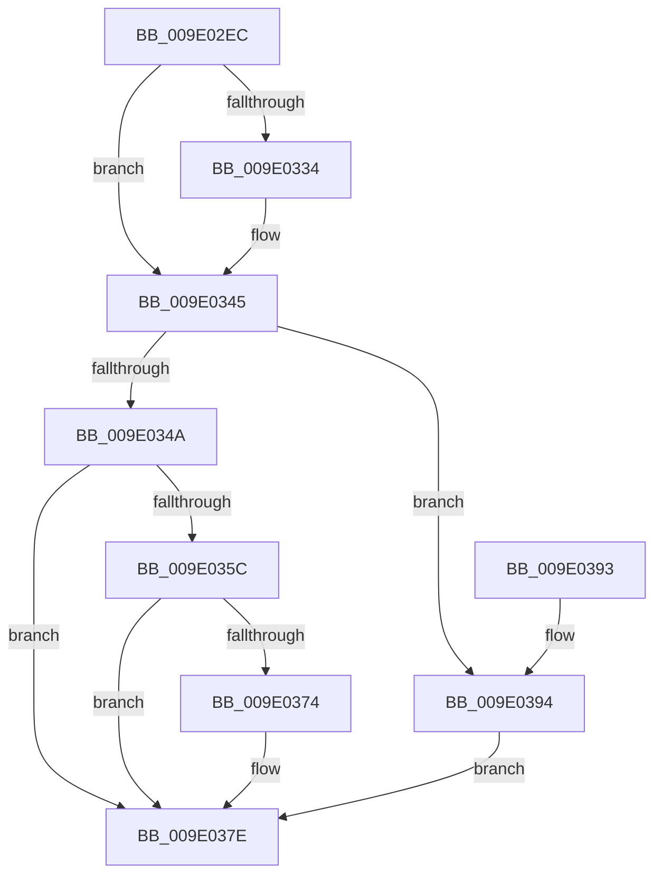

# WmipOpenGuidObject

- RVA: `0x009E02EC`–`0x009E039B` (길이 `175` bytes)
- VA: `0x00000001409E02EC`
- 실행 섹션: `PAGE`
- PDB 이름 있음: `예`; PDB Function 태그: `아니요`
- unwind 정보 RVA: `0x000A3C10`
- 디코드: `50`개 명령, `175/175` bytes 표시
- 미해석 바이트: `0` (있으면 어셈블리에 `.byte`로 보존)

> 이 문서는 커널 이미지의 기계어와 PDB 기호를 분석해 생성했습니다. 4번과 5번은 함수 원형과 자료형을 바이너리 사용 방식에서 추정한 C 해석이며 원본 소스 복구 결과는 아닙니다.

## 1. Dependencies

- 직접 호출 지점: **3**; 고유 호출 대상: **3**
- 직접 호출자로 확인된 함수: **1**
- RIP 상대 이미지 참조: **1**

### Outgoing calls
- `0x009E0353` → [WmipUuidFromString](WmipUuidFromString_function_009E1D48.md) (function, `0x009E1D48`)
- `0x009E036B` → [WmipCreateGuidObject](../8C/WmipCreateGuidObject_function_008C7930.md) (function, `0x008C7930`)
- `0x009E0386` → [_security_check_cookie](../../text/6A/_security_check_cookie_function_006AC640.md) (function, `0x006AC640`)

### Direct callers
- [WmipOpenBlock](WmipOpenBlock_function_009E00D0.md) at `0x009E0126`

### Static image references
- `0x009E02F4` → RVA `0x00E0A740` (`.data`; read)

## 2. Other-region calls and transfers

- 다른 실행 섹션으로 향하는 call: **1**
  - `0x009E0386` → [_security_check_cookie](../../text/6A/_security_check_cookie_function_006AC640.md) (`PAGE` → `.text`)
- 별도 외부 분기/꼬리 이동을 확인하지 못했습니다.

## 3. Assembly (complete function range)

```asm
009E02EC  40 53                           push rbx
009E02EE  56                              push rsi
009E02EF  57                              push rdi
009E02F0  48 83 EC 40                     sub rsp, 0x40
009E02F4  48 8B 05 45 A4 42 00            mov rax, qword ptr [rip + 0x42a445]
009E02FB  48 33 C4                        xor rax, rsp
009E02FE  48 89 44 24 38                  mov qword ptr [rsp + 0x38], rax
009E0303  48 8B 41 10                     mov rax, qword ptr [rcx + 0x10]
009E0307  48 8B F9                        mov rdi, rcx
009E030A  48 83 64 24 20 00               and qword ptr [rsp + 0x20], 0
009E0310  48 BA 5C 00 57 00 6D 00 69 00   movabs rdx, 0x69006d0057005c
009E031A  0F 57 C0                        xorps xmm0, xmm0
009E031D  49 8B D9                        mov rbx, r9
009E0320  41 8B F0                        mov esi, r8d
009E0323  48 8B 48 08                     mov rcx, qword ptr [rax + 8]
009E0327  0F 11 44 24 28                  movups xmmword ptr [rsp + 0x28], xmm0
009E032C  48 8B 01                        mov rax, qword ptr [rcx]
009E032F  48 2B C2                        sub rax, rdx
009E0332  75 11                           jne 0x1409e0345
009E0334  48 8B 41 08                     mov rax, qword ptr [rcx + 8]
009E0338  48 BA 47 00 75 00 69 00 64 00   movabs rdx, 0x64006900750047
009E0342  48 2B C2                        sub rax, rdx
009E0345  48 85 C0                        test rax, rax
009E0348  75 4A                           jne 0x1409e0394
009E034A  48 83 C1 12                     add rcx, 0x12
009E034E  48 8D 54 24 28                  lea rdx, [rsp + 0x28]
009E0353  E8 F0 19 00 00                  call 0x1409e1d48
009E0358  85 C0                           test eax, eax
009E035A  78 22                           js 0x1409e037e
009E035C  4C 8D 4C 24 20                  lea r9, [rsp + 0x20]
009E0361  8B D6                           mov edx, esi
009E0363  4C 8D 44 24 28                  lea r8, [rsp + 0x28]
009E0368  48 8B CF                        mov rcx, rdi
009E036B  E8 C0 75 EE FF                  call 0x1408c7930
009E0370  85 C0                           test eax, eax
009E0372  78 0A                           js 0x1409e037e
009E0374  48 8B 44 24 20                  mov rax, qword ptr [rsp + 0x20]
009E0379  48 89 03                        mov qword ptr [rbx], rax
009E037C  33 C0                           xor eax, eax
009E037E  48 8B 4C 24 38                  mov rcx, qword ptr [rsp + 0x38]
009E0383  48 33 CC                        xor rcx, rsp
009E0386  E8 B5 C2 CC FF                  call 0x1406ac640
009E038B  48 83 C4 40                     add rsp, 0x40
009E038F  5F                              pop rdi
009E0390  5E                              pop rsi
009E0391  5B                              pop rbx
009E0392  C3                              ret
009E0393  CC                              int3
009E0394  B8 0D 00 00 C0                  mov eax, 0xc000000d
009E0399  EB E3                           jmp 0x1409e037e
```

## 4. C-style interpretation (structured pseudocode)

```c
__int64 __fastcall WmipOpenGuidObject(__int64 a1, __int64 a2, int a3, __int64 a4)
{
    __int64 result;
    __int64 v_rsp;
    unsigned __int64 v_stack_m20;
    unsigned __int64 v_stack_m30;
    unsigned __int64 v_stack_m38;

    v_rsp = (v_rsp) - (64);
    result = (*(unsigned __int64 *)(v_rip + 4367429)) ^ (v_rsp);
    v_stack_m20 = result;
    v_stack_m30 = v_xmm0;
    result = (*(unsigned __int64 *)(*(unsigned __int64 *)(*(unsigned __int64 *)(a1 + 16) + 8))) - (a2);
    if (!(condition_is_not_equal)) {
        result = *(unsigned __int64 *)(*(unsigned __int64 *)(*(unsigned __int64 *)(a1 + 16) + 8) + 8);
        result = (result) - (a2);
    }
    if (result != 0) goto loc_009E0394;
    a1 = (*(unsigned __int64 *)(*(unsigned __int64 *)(a1 + 16) + 8)) + (18);
    result = WmipUuidFromString(a1, v_stack_m30, a3, a4);
    if (sign_flag) goto loc_009E037E;
    result = WmipCreateGuidObject(a1, (unsigned int)((unsigned int)((unsigned int)(a3))), v_stack_m30, v_stack_m38);
    if (!(sign_flag)) {
        result = v_stack_m38;
        *(unsigned __int64 *)(a4) = result;
        result = 0;
    }
    a1 = (v_stack_m20) ^ (v_rsp);
    result = _security_check_cookie(a1, (unsigned int)((unsigned int)((unsigned int)(a3))), v_stack_m30, v_stack_m38);
    v_rsp = (v_rsp) + (64);
    return result;
loc_009E0394:
    goto loc_009E037E;
}
```

## 5. (Beta) C Style

```c
int64_t WmipOpenGuidObject(void *Arg1, int64_t Arg2, int32_t Arg3, void *Arg4)
{
    uint8_t *arg1 = (uint8_t *)Arg1;
    uint8_t *arg4 = (uint8_t *)Arg4;

    int64_t result;
    int64_t local_rsp;
    uint64_t v_stack_m20;
    uint64_t v_stack_m30;
    uint64_t v_stack_m38;

    local_rsp = (local_rsp) - (64);
    result = (*(uint64_t *)(v_rip + 0x42A445)) ^ (local_rsp);
    v_stack_m20 = result;
    v_stack_m30 = v_xmm0;
    result = (*(uint64_t *)(*(uint64_t *)(*(uint64_t *)(arg1 + 0x10) + 0x8))) - (Arg2);
    if (!(condition_is_not_equal)) {
        result = *(uint64_t *)(*(uint64_t *)(*(uint64_t *)(arg1 + 0x10) + 0x8) + 0x8);
        result = (result) - (Arg2);
    }
    if (result != 0) goto loc_009E0394;
    Arg1 = (*(uint64_t *)(*(uint64_t *)(arg1 + 0x10) + 0x8)) + (18);
    result = WmipUuidFromString(Arg1, v_stack_m30, Arg3, Arg4);
    if (sign_flag) goto loc_009E037E;
    result = WmipCreateGuidObject(Arg1, (uint32_t)((uint32_t)((uint32_t)(Arg3))), v_stack_m30, v_stack_m38);
    if (!(sign_flag)) {
        result = v_stack_m38;
        *(uint64_t *)(arg4) = result;
        result = 0;
    }
    Arg1 = (v_stack_m20) ^ (local_rsp);
    result = _security_check_cookie(Arg1, (uint32_t)((uint32_t)((uint32_t)(Arg3))), v_stack_m30, v_stack_m38);
    local_rsp = (local_rsp) + (64);
    return result;
loc_009E0394:
    goto loc_009E037E;
}
```

### 관측된 메모리 오프셋

구조체 형식이 확인되지 않은 접근은 인자 기준의 오프셋으로만 기록했습니다.

| 기준 인자 | 오프셋 표현 | 폭 (bit) | 접근 |
|---|---:|---:|---|
| `Arg1` | `+ 0x10` | `64` | `R` |
| `Arg4` | `+ 0x0` | `64` | `W` |

## 6. Execution-region graph

[열기: 2D/3D 그래프와 함수 탐색 컨트롤 패널](../../../control-panel.html?section=page&rva=0x009E02EC&view=graph)

- 2D 그래프는 위에서 아래로 흐르고, 3D 그래프는 빈 공간을 드래그해 회전합니다. Shift+드래그는 이동, 휠은 확대·축소, 함수 노드 선택은 대상 보고서 이동입니다.

### Static fallback


