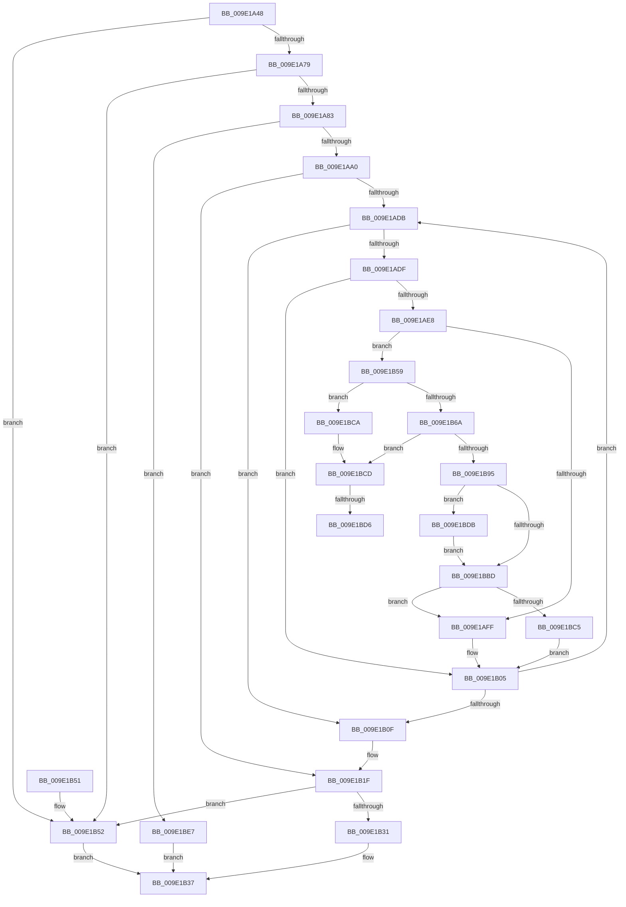

# WmipPrepareForWnodeAD

- RVA: `0x009E1A48`–`0x009E1BEF` (길이 `423` bytes)
- VA: `0x00000001409E1A48`
- 실행 섹션: `PAGE`
- PDB 이름 있음: `예`; PDB Function 태그: `예`
- unwind 정보 RVA: `0x000A3D8C`
- 디코드: `120`개 명령, `423/423` bytes 표시
- 미해석 바이트: `0` (있으면 어셈블리에 `.byte`로 보존)

> 이 문서는 커널 이미지의 기계어와 PDB 기호를 분석해 생성했습니다. 4번과 5번은 함수 원형과 자료형을 바이너리 사용 방식에서 추정한 C 해석이며 원본 소스 복구 결과는 아닙니다.

## 1. Dependencies

- 직접 호출 지점: **6**; 고유 호출 대상: **6**
- 직접 호출자로 확인된 함수: **1**
- RIP 상대 이미지 참조: **1**

### Outgoing calls
- `0x009E1AC5` → [KeWaitForSingleObject](../../text/20/KeWaitForSingleObject_function_0020E6B0.md) (function, `0x0020E6B0`)
- `0x009E1AEB` → [WmipReferenceEntry](WmipReferenceEntry_function_009E1BF8.md) (function, `0x009E1BF8`)
- `0x009E1B28` → [KeReleaseMutex](../../text/39/KeReleaseMutex_function_00396810.md) (function, `0x00396810`)
- `0x009E1B85` → [ExAllocatePool2](../../poolcode/B8/ExAllocatePool2_function_00B820F0.md) (function, `0x00B820F0`)
- `0x009E1BA3` → [memcpy](../../text/6C/memcpy_function_006C6840.md) (function, `0x006C6840`)
- `0x009E1BE0` → [ExFreePoolWithTag](../../poolcode/B8/ExFreePoolWithTag_function_00B82870.md) (function, `0x00B82870`)

### Direct callers
- [WmipQueryAllData](WmipQueryAllData_function_009E086C.md) at `0x009E0967`

### Static image references
- `0x009E1AA3` → RVA `0x00EFFA60` (`.data`; read)

## 2. Other-region calls and transfers

- 다른 실행 섹션으로 향하는 call: **5**
  - `0x009E1AC5` → [KeWaitForSingleObject](../../text/20/KeWaitForSingleObject_function_0020E6B0.md) (`PAGE` → `.text`)
  - `0x009E1B28` → [KeReleaseMutex](../../text/39/KeReleaseMutex_function_00396810.md) (`PAGE` → `.text`)
  - `0x009E1B85` → [ExAllocatePool2](../../poolcode/B8/ExAllocatePool2_function_00B820F0.md) (`PAGE` → `POOLCODE`)
  - `0x009E1BA3` → [memcpy](../../text/6C/memcpy_function_006C6840.md) (`PAGE` → `.text`)
  - `0x009E1BE0` → [ExFreePoolWithTag](../../poolcode/B8/ExFreePoolWithTag_function_00B82870.md) (`PAGE` → `POOLCODE`)
- call이 아닌 외부 분기/꼬리 이동: **2**
  - `0x009E1BD0` → [sub_00B3029E](../B3/Unknown_function_00B3029E.md) (`tail-transfer`)
  - `0x009E1BD6` → [sub_00B3029E + 0x19](../B3/Unknown_function_00B3029E.md) (`tail-transfer`)

## 3. Assembly (complete function range)

```asm
009E1A48  4C 8B DC                        mov r11, rsp
009E1A4B  49 89 5B 10                     mov qword ptr [r11 + 0x10], rbx
009E1A4F  4D 89 4B 20                     mov qword ptr [r11 + 0x20], r9
009E1A53  4D 89 43 18                     mov qword ptr [r11 + 0x18], r8
009E1A57  55                              push rbp
009E1A58  56                              push rsi
009E1A59  57                              push rdi
009E1A5A  41 54                           push r12
009E1A5C  41 55                           push r13
009E1A5E  41 56                           push r14
009E1A60  41 57                           push r15
009E1A62  48 83 EC 50                     sub rsp, 0x50
009E1A66  48 8B 79 38                     mov rdi, qword ptr [rcx + 0x38]
009E1A6A  4D 8B F1                        mov r14, r9
009E1A6D  4D 8B F8                        mov r15, r8
009E1A70  48 85 FF                        test rdi, rdi
009E1A73  0F 84 D9 00 00 00               je 0x1409e1b52
009E1A79  83 7F 24 00                     cmp dword ptr [rdi + 0x24], 0
009E1A7D  0F 86 CF 00 00 00               jbe 0x1409e1b52
009E1A83  8B 47 10                        mov eax, dword ptr [rdi + 0x10]
009E1A86  33 DB                           xor ebx, ebx
009E1A88  0F 10 47 48                     movups xmm0, xmmword ptr [rdi + 0x48]
009E1A8C  A8 01                           test al, 1
009E1A8E  48 8B 84 24 B0 00 00 00         mov rax, qword ptr [rsp + 0xb0]
009E1A96  F3 0F 7F 02                     movdqu xmmword ptr [rdx], xmm0
009E1A9A  0F 85 47 01 00 00               jne 0x1409e1be7
009E1AA0  45 8B 20                        mov r12d, dword ptr [r8]
009E1AA3  48 8D 0D B6 DF 51 00            lea rcx, [rip + 0x51dfb6]
009E1AAA  49 21 5B 98                     and qword ptr [r11 - 0x68], rbx
009E1AAE  45 33 C0                        xor r8d, r8d
009E1AB1  88 18                           mov byte ptr [rax], bl
009E1AB3  33 D2                           xor edx, edx
009E1AB5  49 8B 01                        mov rax, qword ptr [r9]
009E1AB8  33 ED                           xor ebp, ebp
009E1ABA  45 33 C9                        xor r9d, r9d
009E1ABD  48 89 44 24 38                  mov qword ptr [rsp + 0x38], rax
009E1AC2  48 8B F0                        mov rsi, rax
009E1AC5  E8 E6 CB 82 FF                  call 0x14020e6b0
009E1ACA  48 8D 47 38                     lea rax, [rdi + 0x38]
009E1ACE  48 8B 38                        mov rdi, qword ptr [rax]
009E1AD1  48 89 44 24 40                  mov qword ptr [rsp + 0x40], rax
009E1AD6  48 3B F8                        cmp rdi, rax
009E1AD9  74 44                           je 0x1409e1b1f
009E1ADB  85 DB                           test ebx, ebx
009E1ADD  78 30                           js 0x1409e1b0f
009E1ADF  F7 47 10 00 90 08 00            test dword ptr [rdi + 0x10], 0x89000
009E1AE6  75 1D                           jne 0x1409e1b05
009E1AE8  48 8B CF                        mov rcx, rdi
009E1AEB  E8 08 01 00 00                  call 0x1409e1bf8
009E1AF0  33 DB                           xor ebx, ebx
009E1AF2  48 89 74 24 30                  mov qword ptr [rsp + 0x30], rsi
009E1AF7  4C 8B F6                        mov r14, rsi
009E1AFA  41 3B EC                        cmp ebp, r12d
009E1AFD  74 5A                           je 0x1409e1b59
009E1AFF  49 89 3C EE                     mov qword ptr [r14 + rbp*8], rdi
009E1B03  FF C5                           inc ebp
009E1B05  48 8B 3F                        mov rdi, qword ptr [rdi]
009E1B08  48 3B 7C 24 40                  cmp rdi, qword ptr [rsp + 0x40]
009E1B0D  75 CC                           jne 0x1409e1adb
009E1B0F  4C 8B B4 24 A8 00 00 00         mov r14, qword ptr [rsp + 0xa8]
009E1B17  4C 8B BC 24 A0 00 00 00         mov r15, qword ptr [rsp + 0xa0]
009E1B1F  33 D2                           xor edx, edx
009E1B21  48 8D 0D 38 DF 51 00            lea rcx, [rip + 0x51df38]
009E1B28  E8 E3 4C 9B FF                  call 0x140396810
009E1B2D  85 ED                           test ebp, ebp
009E1B2F  74 21                           je 0x1409e1b52
009E1B31  41 89 2F                        mov dword ptr [r15], ebp
009E1B34  49 89 36                        mov qword ptr [r14], rsi
009E1B37  8B C3                           mov eax, ebx
009E1B39  48 8B 9C 24 98 00 00 00         mov rbx, qword ptr [rsp + 0x98]
009E1B41  48 83 C4 50                     add rsp, 0x50
009E1B45  41 5F                           pop r15
009E1B47  41 5E                           pop r14
009E1B49  41 5D                           pop r13
009E1B4B  41 5C                           pop r12
009E1B4D  5F                              pop rdi
009E1B4E  5E                              pop rsi
009E1B4F  5D                              pop rbp
009E1B50  C3                              ret
009E1B51  CC                              int3
009E1B52  BB 01 03 00 C0                  mov ebx, 0xc0000301
009E1B57  EB DE                           jmp 0x1409e1b37
009E1B59  45 8B F4                        mov r14d, r12d
009E1B5C  B9 FF FF FF FF                  mov ecx, 0xffffffff
009E1B61  4B 8D 04 36                     lea rax, [r14 + r14]
009E1B65  48 3B C1                        cmp rax, rcx
009E1B68  77 60                           ja 0x1409e1bca
009E1B6A  8B C0                           mov eax, eax
009E1B6C  B9 00 01 00 00                  mov ecx, 0x100
009E1B71  8B D0                           mov edx, eax
009E1B73  48 89 84 24 90 00 00 00         mov qword ptr [rsp + 0x90], rax
009E1B7B  48 C1 E2 03                     shl rdx, 3
009E1B7F  41 B8 57 6D 69 70               mov r8d, 0x70696d57
009E1B85  E8 66 05 1A 00                  call 0x140b820f0
009E1B8A  4C 8B E8                        mov r13, rax
009E1B8D  4C 8B FE                        mov r15, rsi
009E1B90  48 85 C0                        test rax, rax
009E1B93  74 38                           je 0x1409e1bcd
009E1B95  4E 8D 04 F5 00 00 00 00         lea r8, [r14*8]
009E1B9D  48 8B D6                        mov rdx, rsi
009E1BA0  48 8B C8                        mov rcx, rax
009E1BA3  E8 98 4C CE FF                  call 0x1406c6840
009E1BA8  44 8B A4 24 90 00 00 00         mov r12d, dword ptr [rsp + 0x90]
009E1BB0  4D 8B F5                        mov r14, r13
009E1BB3  49 8B F5                        mov rsi, r13
009E1BB6  4C 3B 7C 24 38                  cmp r15, qword ptr [rsp + 0x38]
009E1BBB  75 1E                           jne 0x1409e1bdb
009E1BBD  85 DB                           test ebx, ebx
009E1BBF  0F 89 3A FF FF FF               jns 0x1409e1aff
009E1BC5  E9 3B FF FF FF                  jmp 0x1409e1b05
009E1BCA  4C 8B FE                        mov r15, rsi
009E1BCD  45 85 E4                        test r12d, r12d
009E1BD0  0F 85 C8 E6 14 00               jne 0x140b3029e
009E1BD6  E9 DC E6 14 00                  jmp 0x140b302b7
009E1BDB  33 D2                           xor edx, edx
009E1BDD  49 8B CF                        mov rcx, r15
009E1BE0  E8 8B 0C 1A 00                  call 0x140b82870
009E1BE5  EB D6                           jmp 0x1409e1bbd
009E1BE7  C6 00 01                        mov byte ptr [rax], 1
009E1BEA  E9 48 FF FF FF                  jmp 0x1409e1b37
```

## 4. C-style interpretation (structured pseudocode)

```c
__int64 __fastcall WmipPrepareForWnodeAD(__int64 a1, __int64 a2, __int64 a3, __int64 a4, __int64 a5)
{
    __int64 result;
    __int64 v_rbp;
    __int64 v_rbx;
    __int64 v_rsp;
    unsigned __int64 v_stack_m48;
    unsigned __int64 v_stack_m50;
    unsigned __int64 v_stack_m58;
    unsigned __int64 v_stack_p10;
    unsigned __int64 v_stack_p18;
    unsigned __int64 v_stack_p20;
    unsigned __int64 v_stack_p38;
    unsigned __int64 v_stack_p90;

    *(unsigned __int64 *)(v_rsp + 16) = v_rbx;
    *(unsigned __int64 *)(v_rsp + 32) = a4;
    *(unsigned __int64 *)(v_rsp + 24) = a3;
    v_rsp = (v_rsp) - (80);
    if (*(unsigned __int64 *)(a1 + 56) == 0) goto loc_009E1B52;
    if ((*(unsigned int *)(*(unsigned __int64 *)(a1 + 56) + 36)) <= 0) goto loc_009E1B52;
    v_rbx = 0;
    *(unsigned __int64 *)(a2) = v_xmm0;
    if ((((unsigned __int8)((unsigned int)(*(unsigned int *)(*(unsigned __int64 *)(a1 + 56) + 16)))) & (1)) != 0) goto loc_009E1BE7;
    a3 = 0;
    *(unsigned __int8 *)(a5) = 0;
    a2 = 0;
    v_rbp = 0;
    a4 = 0;
    v_stack_m50 = *(unsigned __int64 *)(a4);
    result = KeWaitForSingleObject(v_rip + 5365686, a2, a3, a4);
    v_stack_m48 = *(unsigned __int64 *)(a1 + 56) + 56;
    if ((*(unsigned __int64 *)(*(unsigned __int64 *)(a1 + 56) + 56)) == (*(unsigned __int64 *)(a1 + 56) + 56)) goto loc_009E1B1F;
loc_009E1ADB:
    if (sign_flag) goto loc_009E1B0F;
    if (((*(unsigned int *)(*(unsigned __int64 *)(*(unsigned __int64 *)(a1 + 56) + 56) + 16)) & (0x89000ULL)) != 0) goto loc_009E1B05;
    result = WmipReferenceEntry(*(unsigned __int64 *)(*(unsigned __int64 *)(a1 + 56) + 56), a2, a3, a4);
    v_rbx = 0;
    v_stack_m58 = *(unsigned __int64 *)(a4);
    if (0 == ((unsigned int)((unsigned int)(*(unsigned int *)(a3))))) goto loc_009E1B59;
loc_009E1AFF:
    *(unsigned __int64 *)(*(unsigned __int64 *)(a4) + v_rbp * 8) = *(unsigned __int64 *)(*(unsigned __int64 *)(a1 + 56) + 56);
    v_rbp = (unsigned int)((v_rbp) + 1);
loc_009E1B05:
    if ((*(unsigned __int64 *)(*(unsigned __int64 *)(*(unsigned __int64 *)(a1 + 56) + 56))) != v_stack_m48) goto loc_009E1ADB;
loc_009E1B0F:
loc_009E1B1F:
    a2 = 0;
    result = KeReleaseMutex(v_rip + 5365560, a2, a3, a4);
    if ((unsigned int)(v_rbp) == 0) goto loc_009E1B52;
    *(unsigned int *)(v_stack_p18) = (unsigned int)(v_rbp);
    *(unsigned __int64 *)(v_stack_p20) = *(unsigned __int64 *)(a4);
loc_009E1B37:
    v_rsp = (v_rsp) + (80);
    return 0;
loc_009E1B52:
    goto loc_009E1B37;
loc_009E1B59:
    if (((unsigned int)((unsigned int)((unsigned int)(*(unsigned int *)(a3)))) + (unsigned int)((unsigned int)((unsigned int)(*(unsigned int *)(a3)))) * 1) > ((unsigned int)(0xFFFFFFFFULL))) goto loc_009E1BCA;
    v_stack_p90 = (unsigned int)((unsigned int)((unsigned int)((unsigned int)((unsigned int)(*(unsigned int *)(a3)))) + (unsigned int)((unsigned int)((unsigned int)(*(unsigned int *)(a3)))) * 1));
    a2 = ((unsigned int)((unsigned int)((unsigned int)((unsigned int)((unsigned int)((unsigned int)((unsigned int)(*(unsigned int *)(a3)))) + (unsigned int)((unsigned int)((unsigned int)(*(unsigned int *)(a3)))) * 1))))) << (3);
    result = ExAllocatePool2(256, a2, (unsigned int)(0x70696D57ULL), a4);
    if (result == 0) goto loc_009E1BCD;
    result = memcpy(result, *(unsigned __int64 *)(a4), (unsigned int)((unsigned int)((unsigned int)(*(unsigned int *)(a3)))) * 8, a4);
    if ((*(unsigned __int64 *)(a4)) != v_stack_p38) goto loc_009E1BDB;
loc_009E1BBD:
    if (!sign_flag) goto loc_009E1AFF;
    goto loc_009E1B05;
loc_009E1BCA:
loc_009E1BCD:
loc_009E1BDB:
    a2 = 0;
    result = ExFreePoolWithTag(result, a2, (unsigned int)((unsigned int)((unsigned int)(*(unsigned int *)(a3)))) * 8, a4);
    goto loc_009E1BBD;
loc_009E1BE7:
    *(unsigned __int8 *)(result) = 1;
    goto loc_009E1B37;
}
```

## 5. (Beta) C Style

```c
int64_t WmipPrepareForWnodeAD(void *Arg1, void *Arg2, void *Arg3, void *Arg4, void *Arg5)
{
    uint8_t *arg1 = (uint8_t *)Arg1;
    uint8_t *arg2 = (uint8_t *)Arg2;
    uint8_t *arg3 = (uint8_t *)Arg3;
    uint8_t *arg4 = (uint8_t *)Arg4;
    uint8_t *arg5 = (uint8_t *)Arg5;

    int64_t result;
    int64_t local_rbp;
    int64_t local_rbx;
    int64_t local_rsp;
    uint64_t v_stack_m48;
    uint64_t v_stack_m50;
    uint64_t v_stack_m58;
    uint64_t v_stack_p10;
    uint64_t v_stack_p18;
    uint64_t v_stack_p20;
    uint64_t v_stack_p38;
    uint64_t v_stack_p90;

    *(uint64_t *)(local_rsp + 0x10) = local_rbx;
    *(void **)(local_rsp + 0x20) = Arg4;
    *(void **)(local_rsp + 0x18) = Arg3;
    local_rsp = (local_rsp) - (80);
    if (*(uint64_t *)(arg1 + 0x38) == 0) goto loc_009E1B52;
    if ((*(uint32_t *)(*(uint64_t *)(arg1 + 0x38) + 0x24)) <= 0) goto loc_009E1B52;
    local_rbx = 0;
    *(uint64_t *)(arg2) = v_xmm0;
    if ((((uint8_t)((uint32_t)(*(uint32_t *)(*(uint64_t *)(arg1 + 0x38) + 0x10)))) & (1)) != 0) goto loc_009E1BE7;
    Arg3 = 0;
    *(uint8_t *)(arg5) = 0;
    Arg2 = 0;
    local_rbp = 0;
    Arg4 = 0;
    v_stack_m50 = *(uint64_t *)(arg4);
    result = KeWaitForSingleObject(v_rip + 5365686, Arg2, Arg3, Arg4);
    v_stack_m48 = *(uint64_t *)(arg1 + 0x38) + 56;
    if ((*(uint64_t *)(*(uint64_t *)(arg1 + 0x38) + 0x38)) == (*(uint64_t *)(arg1 + 0x38) + 56)) goto loc_009E1B1F;
loc_009E1ADB:
    if (sign_flag) goto loc_009E1B0F;
    if (((*(uint32_t *)(*(uint64_t *)(*(uint64_t *)(arg1 + 0x38) + 0x38) + 0x10)) & (0x89000ULL)) != 0) goto loc_009E1B05;
    result = WmipReferenceEntry(*(uint64_t *)(*(uint64_t *)(arg1 + 0x38) + 0x38), Arg2, Arg3, Arg4);
    local_rbx = 0;
    v_stack_m58 = *(uint64_t *)(arg4);
    if (0 == ((uint32_t)((uint32_t)(*(uint32_t *)(arg3))))) goto loc_009E1B59;
loc_009E1AFF:
    *(uint64_t *)(*(uint64_t *)(arg4) + local_rbp * 8) = *(uint64_t *)(*(uint64_t *)(arg1 + 0x38) + 0x38);
    local_rbp = (uint32_t)((local_rbp) + 1);
loc_009E1B05:
    if ((*(uint64_t *)(*(uint64_t *)(*(uint64_t *)(arg1 + 0x38) + 0x38))) != v_stack_m48) goto loc_009E1ADB;
loc_009E1B0F:
loc_009E1B1F:
    Arg2 = 0;
    result = KeReleaseMutex(v_rip + 5365560, Arg2, Arg3, Arg4);
    if ((uint32_t)(local_rbp) == 0) goto loc_009E1B52;
    *(uint32_t *)(v_stack_p18) = (uint32_t)(local_rbp);
    *(uint64_t *)(v_stack_p20) = *(uint64_t *)(arg4);
loc_009E1B37:
    local_rsp = (local_rsp) + (80);
    return 0;
loc_009E1B52:
    goto loc_009E1B37;
loc_009E1B59:
    if (((uint32_t)((uint32_t)((uint32_t)(*(uint32_t *)(arg3)))) + (uint32_t)((uint32_t)((uint32_t)(*(uint32_t *)(arg3)))) * 1) > ((uint32_t)(0xFFFFFFFFULL))) goto loc_009E1BCA;
    v_stack_p90 = (uint32_t)((uint32_t)((uint32_t)((uint32_t)((uint32_t)(*(uint32_t *)(arg3)))) + (uint32_t)((uint32_t)((uint32_t)(*(uint32_t *)(arg3)))) * 1));
    Arg2 = ((uint32_t)((uint32_t)((uint32_t)((uint32_t)((uint32_t)((uint32_t)((uint32_t)(*(uint32_t *)(arg3)))) + (uint32_t)((uint32_t)((uint32_t)(*(uint32_t *)(arg3)))) * 1))))) << (3);
    result = ExAllocatePool2(256, Arg2, (uint32_t)(0x70696D57ULL), Arg4);
    if (result == 0) goto loc_009E1BCD;
    result = memcpy(result, *(uint64_t *)(arg4), (uint32_t)((uint32_t)((uint32_t)(*(uint32_t *)(arg3)))) * 8, Arg4);
    if ((*(uint64_t *)(arg4)) != v_stack_p38) goto loc_009E1BDB;
loc_009E1BBD:
    if (!sign_flag) goto loc_009E1AFF;
    goto loc_009E1B05;
loc_009E1BCA:
loc_009E1BCD:
loc_009E1BDB:
    Arg2 = 0;
    result = ExFreePoolWithTag(result, Arg2, (uint32_t)((uint32_t)((uint32_t)(*(uint32_t *)(arg3)))) * 8, Arg4);
    goto loc_009E1BBD;
loc_009E1BE7:
    *(uint8_t *)(result) = 1;
    goto loc_009E1B37;
}
```

### 관측된 메모리 오프셋

구조체 형식이 확인되지 않은 접근은 인자 기준의 오프셋으로만 기록했습니다.

| 기준 인자 | 오프셋 표현 | 폭 (bit) | 접근 |
|---|---:|---:|---|
| `Arg1` | `+ 0x38` | `64` | `R` |
| `Arg2` | `+ 0x0` | `128` | `W` |
| `Arg3` | `+ 0x0` | `32` | `R` |
| `Arg4` | `+ 0x0` | `64` | `R` |
| `Arg5` | `+ 0x0` | `8` | `W` |

## 6. Execution-region graph

[열기: 2D/3D 그래프와 함수 탐색 컨트롤 패널](../../../control-panel.html?section=page&rva=0x009E1A48&view=graph)

- 2D 그래프는 위에서 아래로 흐르고, 3D 그래프는 빈 공간을 드래그해 회전합니다. Shift+드래그는 이동, 휠은 확대·축소, 함수 노드 선택은 대상 보고서 이동입니다.

### Static fallback


