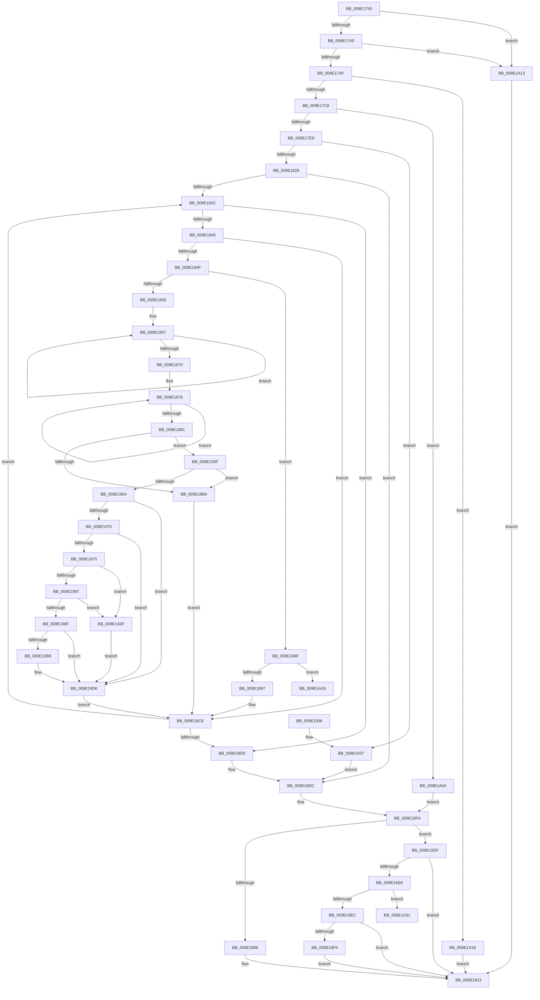

# WmipPrepareWnodeSI

- RVA: `0x009E1740`–`0x009E1A3F` (길이 `767` bytes)
- VA: `0x00000001409E1740`
- 실행 섹션: `PAGE`
- PDB 이름 있음: `예`; PDB Function 태그: `예`
- unwind 정보 RVA: `0x000A3D58`
- 디코드: `213`개 명령, `767/767` bytes 표시
- 미해석 바이트: `0` (있으면 어셈블리에 `.byte`로 보존)

> 이 문서는 커널 이미지의 기계어와 PDB 기호를 분석해 생성했습니다. 4번과 5번은 함수 원형과 자료형을 바이너리 사용 방식에서 추정한 C 해석이며 원본 소스 복구 결과는 아닙니다.

## 1. Dependencies

- 직접 호출 지점: **13**; 고유 호출 대상: **12**
- 직접 호출자로 확인된 함수: **1**
- RIP 상대 이미지 참조: **3**

### Outgoing calls
- `0x009E17D2` → [WmipCountedToSz](WmipCountedToSz_function_009E2318.md) (function, `0x009E2318`)
- `0x009E1818` → [KeWaitForSingleObject](../../text/20/KeWaitForSingleObject_function_0020E6B0.md) (function, `0x0020E6B0`)
- `0x009E189A` → [WmipReferenceEntry](WmipReferenceEntry_function_009E1BF8.md) (function, `0x009E1BF8`)
- `0x009E18B4` → [WmipAddProviderIdToPIList](WmipAddProviderIdToPIList_function_009E1C3C.md) (function, `0x009E1C3C`)
- `0x009E18E1` → [ExFreePoolWithTag](../../poolcode/B8/ExFreePoolWithTag_function_00B82870.md) (function, `0x00B82870`)
- `0x009E18EF` → [KeReleaseMutex](../../text/39/KeReleaseMutex_function_00396810.md) (function, `0x00396810`)
- `0x009E191D` → [_security_check_cookie](../../text/6A/_security_check_cookie_function_006AC640.md) (function, `0x006AC640`)
- `0x009E1945` → [wcsnicmp](../../text/50/wcsnicmp_function_005001C0.md) (function, `0x005001C0`)
- `0x009E195B` → [wtoi](../../text/50/wtoi_function_005003E0.md) (function, `0x005003E0`)
- `0x009E1965` → [WmipIsNumber](WmipIsNumber_function_009E2388.md) (function, `0x009E2388`)
- `0x009E19A2` → [RtlStringCbPrintfW](../../text/40/RtlStringCbPrintfW_function_0040FB40.md) (function, `0x0040FB40`)
- `0x009E19AE` → [wcsicmp](../../text/50/wcsicmp_function_00500080.md) (function, `0x00500080`)
- `0x009E19FA` → [ExFreePoolWithTag](../../poolcode/B8/ExFreePoolWithTag_function_00B82870.md) (function, `0x00B82870`)

### Direct callers
- [WmipQuerySetExecuteSI](WmipQuerySetExecuteSI_function_009E0574.md) at `0x009E0661`

### Static image references
- `0x009E1759` → RVA `0x00E0A740` (`.data`; read)
- `0x009E17FA` → RVA `0x00EFFA60` (`.data`; read)
- `0x009E1992` → RVA `0x00AFCAE0` (` ?? ::NNGAKEGL::`string'`; read)

## 2. Other-region calls and transfers

- 다른 실행 섹션으로 향하는 call: **9**
  - `0x009E1818` → [KeWaitForSingleObject](../../text/20/KeWaitForSingleObject_function_0020E6B0.md) (`PAGE` → `.text`)
  - `0x009E18E1` → [ExFreePoolWithTag](../../poolcode/B8/ExFreePoolWithTag_function_00B82870.md) (`PAGE` → `POOLCODE`)
  - `0x009E18EF` → [KeReleaseMutex](../../text/39/KeReleaseMutex_function_00396810.md) (`PAGE` → `.text`)
  - `0x009E191D` → [_security_check_cookie](../../text/6A/_security_check_cookie_function_006AC640.md) (`PAGE` → `.text`)
  - `0x009E1945` → [wcsnicmp](../../text/50/wcsnicmp_function_005001C0.md) (`PAGE` → `.text`)
  - `0x009E195B` → [wtoi](../../text/50/wtoi_function_005003E0.md) (`PAGE` → `.text`)
  - `0x009E19A2` → [RtlStringCbPrintfW](../../text/40/RtlStringCbPrintfW_function_0040FB40.md) (`PAGE` → `.text`)
  - `0x009E19AE` → [wcsicmp](../../text/50/wcsicmp_function_00500080.md) (`PAGE` → `.text`)
  - `0x009E19FA` → [ExFreePoolWithTag](../../poolcode/B8/ExFreePoolWithTag_function_00B82870.md) (`PAGE` → `POOLCODE`)
- call이 아닌 외부 분기/꼬리 이동: **2**
  - `0x009E1A2C` → [sub_00B3023C](../B3/Unknown_function_00B3023C.md) (`tail-transfer`)
  - `0x009E1A3A` → [sub_00B3023C + 0x40](../B3/Unknown_function_00B3023C.md) (`tail-transfer`)

## 3. Assembly (complete function range)

```asm
009E1740  40 55                           push rbp
009E1742  53                              push rbx
009E1743  56                              push rsi
009E1744  57                              push rdi
009E1745  41 54                           push r12
009E1747  41 55                           push r13
009E1749  41 56                           push r14
009E174B  41 57                           push r15
009E174D  48 8D 6C 24 F1                  lea rbp, [rsp - 0xf]
009E1752  48 81 EC 98 00 00 00            sub rsp, 0x98
009E1759  48 8B 05 E0 8F 42 00            mov rax, qword ptr [rip + 0x428fe0]
009E1760  48 33 C4                        xor rax, rsp
009E1763  48 89 45 FF                     mov qword ptr [rbp - 1], rax
009E1767  48 8B 45 77                     mov rax, qword ptr [rbp + 0x77]
009E176B  4C 8B FA                        mov r15, rdx
009E176E  48 8B 55 7F                     mov rdx, qword ptr [rbp + 0x7f]
009E1772  4C 89 45 D7                     mov qword ptr [rbp - 0x29], r8
009E1776  45 33 C0                        xor r8d, r8d
009E1779  4C 89 4D DF                     mov qword ptr [rbp - 0x21], r9
009E177D  41 8B D8                        mov ebx, r8d
009E1780  41 8B F8                        mov edi, r8d
009E1783  45 8B E8                        mov r13d, r8d
009E1786  48 89 45 CF                     mov qword ptr [rbp - 0x31], rax
009E178A  45 8D 48 01                     lea r9d, [r8 + 1]
009E178E  4C 89 45 B7                     mov qword ptr [rbp - 0x49], r8
009E1792  44 88 08                        mov byte ptr [rax], r9b
009E1795  48 8B 71 38                     mov rsi, qword ptr [rcx + 0x38]
009E1799  89 7D AF                        mov dword ptr [rbp - 0x51], edi
009E179C  48 85 F6                        test rsi, rsi
009E179F  0F 84 6E 02 00 00               je 0x1409e1a13
009E17A5  44 39 46 24                     cmp dword ptr [rsi + 0x24], r8d
009E17A9  0F 86 64 02 00 00               jbe 0x1409e1a13
009E17AF  0F 10 46 48                     movups xmm0, xmmword ptr [rsi + 0x48]
009E17B3  45 8B F0                        mov r14d, r8d
009E17B6  F3 41 0F 7F 47 18               movdqu xmmword ptr [r15 + 0x18], xmm0
009E17BC  8B 46 10                        mov eax, dword ptr [rsi + 0x10]
009E17BF  41 84 C1                        test r9b, al
009E17C2  0F 85 56 02 00 00               jne 0x1409e1a1e
009E17C8  44 88 02                        mov byte ptr [rdx], r8b
009E17CB  41 8B 4F 30                     mov ecx, dword ptr [r15 + 0x30]
009E17CF  49 03 CF                        add rcx, r15
009E17D2  E8 41 0B 00 00                  call 0x1409e2318
009E17D7  33 C9                           xor ecx, ecx
009E17D9  48 89 45 A7                     mov qword ptr [rbp - 0x59], rax
009E17DD  4C 8B E0                        mov r12, rax
009E17E0  48 85 C0                        test rax, rax
009E17E3  0F 84 1B 02 00 00               je 0x1409e1a04
009E17E9  48 8B 45 DF                     mov rax, qword ptr [rbp - 0x21]
009E17ED  45 33 C9                        xor r9d, r9d
009E17F0  48 89 4C 24 20                  mov qword ptr [rsp + 0x20], rcx
009E17F5  45 33 C0                        xor r8d, r8d
009E17F8  33 D2                           xor edx, edx
009E17FA  48 8D 0D 5F E2 51 00            lea rcx, [rip + 0x51e25f]
009E1801  48 8B 00                        mov rax, qword ptr [rax]
009E1804  48 89 45 B7                     mov qword ptr [rbp - 0x49], rax
009E1808  48 8B D8                        mov rbx, rax
009E180B  48 89 45 C7                     mov qword ptr [rbp - 0x39], rax
009E180F  48 8B 45 D7                     mov rax, qword ptr [rbp - 0x29]
009E1813  8B 00                           mov eax, dword ptr [rax]
009E1815  89 45 BF                        mov dword ptr [rbp - 0x41], eax
009E1818  E8 93 CE 82 FF                  call 0x14020e6b0
009E181D  33 C9                           xor ecx, ecx
009E181F  39 4E 24                        cmp dword ptr [rsi + 0x24], ecx
009E1822  0F 86 0F 01 00 00               jbe 0x1409e1937
009E1828  48 8D 46 38                     lea rax, [rsi + 0x38]
009E182C  48 8B 30                        mov rsi, qword ptr [rax]
009E182F  48 89 45 E7                     mov qword ptr [rbp - 0x19], rax
009E1833  48 3B F0                        cmp rsi, rax
009E1836  0F 84 A0 00 00 00               je 0x1409e18dc
009E183C  45 84 ED                        test r13b, r13b
009E183F  0F 85 90 00 00 00               jne 0x1409e18d5
009E1845  8B 46 10                        mov eax, dword ptr [rsi + 0x10]
009E1848  A9 00 90 08 00                  test eax, 0x89000
009E184D  75 79                           jne 0x1409e18c8
009E184F  BB 01 00 00 00                  mov ebx, 1
009E1854  84 C3                           test bl, al
009E1856  74 37                           je 0x1409e188f
009E1858  48 8B 46 58                     mov rax, qword ptr [rsi + 0x58]
009E185C  48 83 CB FF                     or rbx, 0xffffffffffffffff
009E1860  44 8B 20                        mov r12d, dword ptr [rax]
009E1863  48 8D 50 04                     lea rdx, [rax + 4]
009E1867  48 FF C3                        inc rbx
009E186A  66 39 0C 5A                     cmp word ptr [rdx + rbx*2], cx
009E186E  75 F7                           jne 0x1409e1867
009E1870  48 8B 7D A7                     mov rdi, qword ptr [rbp - 0x59]
009E1874  48 83 C8 FF                     or rax, 0xffffffffffffffff
009E1878  48 FF C0                        inc rax
009E187B  66 39 0C 47                     cmp word ptr [rdi + rax*2], cx
009E187F  75 F7                           jne 0x1409e1878
009E1881  48 3B C3                        cmp rax, rbx
009E1884  0F 87 B5 00 00 00               ja 0x1409e193f
009E188A  4C 8B E7                        mov r12, rdi
009E188D  EB 39                           jmp 0x1409e18c8
009E188F  A8 02                           test al, 2
009E1891  0F 85 8F 01 00 00               jne 0x1409e1a26
009E1897  48 8B CE                        mov rcx, rsi
009E189A  E8 59 03 00 00                  call 0x1409e1bf8
009E189F  4C 8B 4D B7                     mov r9, qword ptr [rbp - 0x49]
009E18A3  4C 8D 45 BF                     lea r8, [rbp - 0x41]
009E18A7  48 8D 55 AF                     lea rdx, [rbp - 0x51]
009E18AB  48 89 74 24 20                  mov qword ptr [rsp + 0x20], rsi
009E18B0  48 8D 4D C7                     lea rcx, [rbp - 0x39]
009E18B4  E8 83 03 00 00                  call 0x1409e1c3c
009E18B9  33 C9                           xor ecx, ecx
009E18BB  45 0F B6 ED                     movzx r13d, r13b
009E18BF  85 C0                           test eax, eax
009E18C1  44 8B F0                        mov r14d, eax
009E18C4  44 0F 48 EB                     cmovs r13d, ebx
009E18C8  48 8B 36                        mov rsi, qword ptr [rsi]
009E18CB  48 3B 75 E7                     cmp rsi, qword ptr [rbp - 0x19]
009E18CF  0F 85 67 FF FF FF               jne 0x1409e183c
009E18D5  48 8B 5D C7                     mov rbx, qword ptr [rbp - 0x39]
009E18D9  8B 7D AF                        mov edi, dword ptr [rbp - 0x51]
009E18DC  33 D2                           xor edx, edx
009E18DE  49 8B CC                        mov rcx, r12
009E18E1  E8 8A 0F 1A 00                  call 0x140b82870
009E18E6  33 D2                           xor edx, edx
009E18E8  48 8D 0D 71 E1 51 00            lea rcx, [rip + 0x51e171]
009E18EF  E8 1C 4F 9B FF                  call 0x140396810
009E18F4  4C 8B 6D B7                     mov r13, qword ptr [rbp - 0x49]
009E18F8  33 C9                           xor ecx, ecx
009E18FA  48 8B 45 CF                     mov rax, qword ptr [rbp - 0x31]
009E18FE  38 08                           cmp byte ptr [rax], cl
009E1900  0F 84 D9 00 00 00               je 0x1409e19df
009E1906  48 8B 45 D7                     mov rax, qword ptr [rbp - 0x29]
009E190A  89 38                           mov dword ptr [rax], edi
009E190C  48 8B 45 DF                     mov rax, qword ptr [rbp - 0x21]
009E1910  48 89 18                        mov qword ptr [rax], rbx
009E1913  41 8B C6                        mov eax, r14d
009E1916  48 8B 4D FF                     mov rcx, qword ptr [rbp - 1]
009E191A  48 33 CC                        xor rcx, rsp
009E191D  E8 1E AD CC FF                  call 0x1406ac640
009E1922  48 81 C4 98 00 00 00            add rsp, 0x98
009E1929  41 5F                           pop r15
009E192B  41 5E                           pop r14
009E192D  41 5D                           pop r13
009E192F  41 5C                           pop r12
009E1931  5F                              pop rdi
009E1932  5E                              pop rsi
009E1933  5B                              pop rbx
009E1934  5D                              pop rbp
009E1935  C3                              ret
009E1936  CC                              int3
009E1937  41 BE 01 03 00 C0               mov r14d, 0xc0000301
009E193D  EB 9D                           jmp 0x1409e18dc
009E193F  4C 8B C3                        mov r8, rbx
009E1942  48 8B CF                        mov rcx, rdi
009E1945  E8 76 E8 B1 FF                  call 0x1405001c0
009E194A  33 C9                           xor ecx, ecx
009E194C  85 C0                           test eax, eax
009E194E  0F 85 36 FF FF FF               jne 0x1409e188a
009E1954  48 8D 3C 5F                     lea rdi, [rdi + rbx*2]
009E1958  48 8B CF                        mov rcx, rdi
009E195B  E8 80 EA B1 FF                  call 0x1405003e0
009E1960  48 8B CF                        mov rcx, rdi
009E1963  8B D8                           mov ebx, eax
009E1965  E8 1E 0A 00 00                  call 0x1409e2388
009E196A  33 C9                           xor ecx, ecx
009E196C  84 C0                           test al, al
009E196E  74 66                           je 0x1409e19d6
009E1970  41 3B DC                        cmp ebx, r12d
009E1973  72 61                           jb 0x1409e19d6
009E1975  8B 4E 48                        mov ecx, dword ptr [rsi + 0x48]
009E1978  41 03 CC                        add ecx, r12d
009E197B  81 FB 3F 42 0F 00               cmp ebx, 0xf423f
009E1981  0F 83 88 00 00 00               jae 0x1409e1a0f
009E1987  3B D9                           cmp ebx, ecx
009E1989  0F 83 80 00 00 00               jae 0x1409e1a0f
009E198F  44 8B CB                        mov r9d, ebx
009E1992  4C 8D 05 47 B1 11 00            lea r8, [rip + 0x11b147]
009E1999  BA 0E 00 00 00                  mov edx, 0xe
009E199E  48 8D 4D EF                     lea rcx, [rbp - 0x11]
009E19A2  E8 99 E1 A2 FF                  call 0x14040fb40
009E19A7  48 8B D7                        mov rdx, rdi
009E19AA  48 8D 4D EF                     lea rcx, [rbp - 0x11]
009E19AE  E8 CD E6 B1 FF                  call 0x140500080
009E19B3  33 C9                           xor ecx, ecx
009E19B5  85 C0                           test eax, eax
009E19B7  75 1D                           jne 0x1409e19d6
009E19B9  41 0F BA 6F 2C 07               bts dword ptr [r15 + 0x2c], 7
009E19BF  41 B5 01                        mov r13b, 1
009E19C2  8B 46 50                        mov eax, dword ptr [rsi + 0x50]
009E19C5  41 2B DC                        sub ebx, r12d
009E19C8  41 89 47 04                     mov dword ptr [r15 + 4], eax
009E19CC  48 8B 45 CF                     mov rax, qword ptr [rbp - 0x31]
009E19D0  41 89 5F 34                     mov dword ptr [r15 + 0x34], ebx
009E19D4  88 08                           mov byte ptr [rax], cl
009E19D6  4C 8B 65 A7                     mov r12, qword ptr [rbp - 0x59]
009E19DA  E9 E9 FE FF FF                  jmp 0x1409e18c8
009E19DF  48 85 DB                        test rbx, rbx
009E19E2  0F 84 2B FF FF FF               je 0x1409e1913
009E19E8  85 FF                           test edi, edi
009E19EA  75 45                           jne 0x1409e1a31
009E19EC  49 3B DD                        cmp rbx, r13
009E19EF  0F 84 1E FF FF FF               je 0x1409e1913
009E19F5  33 D2                           xor edx, edx
009E19F7  48 8B CB                        mov rcx, rbx
009E19FA  E8 71 0E 1A 00                  call 0x140b82870
009E19FF  E9 0F FF FF FF                  jmp 0x1409e1913
009E1A04  41 BE 9A 00 00 C0               mov r14d, 0xc000009a
009E1A0A  E9 EB FE FF FF                  jmp 0x1409e18fa
009E1A0F  33 C9                           xor ecx, ecx
009E1A11  EB C3                           jmp 0x1409e19d6
009E1A13  41 BE 01 03 00 C0               mov r14d, 0xc0000301
009E1A19  E9 F5 FE FF FF                  jmp 0x1409e1913
009E1A1E  44 88 0A                        mov byte ptr [rdx], r9b
009E1A21  E9 ED FE FF FF                  jmp 0x1409e1913
009E1A26  48 8B 7E 58                     mov rdi, qword ptr [rsi + 0x58]
009E1A2A  8B D9                           mov ebx, ecx
009E1A2C  E9 0B E8 14 00                  jmp 0x140b3023c
009E1A31  48 8B F3                        mov rsi, rbx
009E1A34  41 BD 01 00 00 00               mov r13d, 1
009E1A3A  E9 3D E8 14 00                  jmp 0x140b3027c
```

## 4. C-style interpretation (structured pseudocode)

```c
__int64 __fastcall WmipPrepareWnodeSI(__int64 a1, __int64 a2, __int64 a3, __int64 a4, __int64 a5, __int64 a6)
{
    __int64 result;
    __int64 v_r13;
    __int64 v_rbx;
    __int64 v_rsp;
    unsigned __int64 v_stack_m4F;
    unsigned __int64 v_stack_m50;
    unsigned __int64 v_stack_m60;
    unsigned __int64 v_stack_m68;
    unsigned __int64 v_stack_m70;
    unsigned __int64 v_stack_m78;
    unsigned __int64 v_stack_m80;
    unsigned __int64 v_stack_m88;
    unsigned int v_stack_m90;
    unsigned __int64 v_stack_m98;
    unsigned int v_stack_mA0;
    unsigned __int64 v_stack_mA8;
    unsigned __int64 v_stack_mB8;

    v_rsp = (v_rsp) - (152);
    result = (*(unsigned __int64 *)(v_rip + 4362208)) ^ (v_rsp);
    v_stack_m50 = result;
    v_stack_m78 = a3;
    a3 = 0;
    v_stack_m70 = a4;
    v_stack_m80 = a5;
    v_stack_m98 = 0;
    *(unsigned __int8 *)(a5) = (unsigned __int8)(a3 + 1);
    v_stack_mA0 = 0;
    if (*(unsigned __int64 *)(a1 + 56) == 0) goto loc_009E1A13;
    if ((*(unsigned int *)(*(unsigned __int64 *)(a1 + 56) + 36)) <= 0) goto loc_009E1A13;
    *(unsigned __int64 *)(a2 + 24) = v_xmm0;
    if ((((unsigned __int8)(a3 + 1)) & ((unsigned __int8)((unsigned int)(*(unsigned int *)(*(unsigned __int64 *)(a1 + 56) + 16))))) != 0) goto loc_009E1A1E;
    *(unsigned __int8 *)(a6) = 0;
    a1 = ((unsigned int)(*(unsigned int *)(a2 + 48))) + (a2);
    result = WmipCountedToSz(a1, a6, a3, a3 + 1);
    a1 = 0;
    v_stack_mA8 = result;
    if (result == 0) goto loc_009E1A04;
    a4 = 0;
    v_stack_mB8 = 0;
    a3 = 0;
    a2 = 0;
    v_stack_m98 = *(unsigned __int64 *)(v_stack_m70);
    v_stack_m88 = *(unsigned __int64 *)(v_stack_m70);
    v_stack_m90 = (unsigned int)((unsigned int)(*(unsigned int *)(v_stack_m78)));
    result = KeWaitForSingleObject(v_rip + 5366367, a2, a3, a4);
    a1 = 0;
    if ((*(unsigned int *)(*(unsigned __int64 *)(a1 + 56) + 36)) <= 0) goto loc_009E1937;
    v_stack_m68 = *(unsigned __int64 *)(a1 + 56) + 56;
    if ((*(unsigned __int64 *)(*(unsigned __int64 *)(a1 + 56) + 56)) == (*(unsigned __int64 *)(a1 + 56) + 56)) goto loc_009E18DC;
loc_009E183C:
    if (0 != 0) goto loc_009E18D5;
    if ((((unsigned int)((unsigned int)(*(unsigned int *)(*(unsigned __int64 *)(*(unsigned __int64 *)(a1 + 56) + 56) + 16)))) & (0x89000ULL)) != 0) goto loc_009E18C8;
    if (((1) & ((unsigned __int8)((unsigned int)(*(unsigned int *)(*(unsigned __int64 *)(*(unsigned __int64 *)(a1 + 56) + 56) + 16))))) == 0) goto loc_009E188F;
    v_rbx = (1) | (-1);
loc_009E1867:
    v_rbx = (v_rbx) + 1;
    if ((*(unsigned __int16 *)(*(unsigned __int64 *)(*(unsigned __int64 *)(*(unsigned __int64 *)(a1 + 56) + 56) + 88) + 4 + v_rbx * 2)) != 0) goto loc_009E1867;
    result = (*(unsigned __int64 *)(*(unsigned __int64 *)(*(unsigned __int64 *)(a1 + 56) + 56) + 88)) | (-1);
loc_009E1878:
    result = (result) + 1;
    if ((*(unsigned __int16 *)(v_stack_mA8 + result * 2)) != 0) goto loc_009E1878;
    if (result > v_rbx) goto loc_009E193F;
loc_009E188A:
    goto loc_009E18C8;
loc_009E188F:
    if ((((unsigned __int8)(result)) & (2)) != 0) goto loc_009E1A26;
    result = WmipReferenceEntry(*(unsigned __int64 *)(*(unsigned __int64 *)(a1 + 56) + 56), *(unsigned __int64 *)(*(unsigned __int64 *)(*(unsigned __int64 *)(a1 + 56) + 56) + 88) + 4, a3, a4);
    v_stack_mB8 = *(unsigned __int64 *)(*(unsigned __int64 *)(a1 + 56) + 56);
    result = WmipAddProviderIdToPIList(v_stack_m88, v_stack_mA0, v_stack_m90, v_stack_m98);
    a1 = 0;
    v_r13 = 0;
    if (sign_flag) { v_r13 = (unsigned int)(v_rbx); }
loc_009E18C8:
    if ((*(unsigned __int64 *)(*(unsigned __int64 *)(*(unsigned __int64 *)(a1 + 56) + 56))) != v_stack_m68) goto loc_009E183C;
loc_009E18D5:
loc_009E18DC:
    a2 = 0;
    result = ExFreePoolWithTag(v_stack_mA8, a2, v_stack_m90, v_stack_m98);
    a2 = 0;
    result = KeReleaseMutex(v_rip + 5366129, a2, v_stack_m90, v_stack_m98);
    a1 = 0;
loc_009E18FA:
    if ((*(unsigned __int8 *)(v_stack_m80)) == 0) goto loc_009E19DF;
    *(unsigned int *)(v_stack_m78) = (unsigned int)((unsigned int)(v_stack_mA0));
    *(unsigned __int64 *)(v_stack_m70) = v_stack_m88;
loc_009E1913:
    a1 = (v_stack_m50) ^ (v_rsp);
    result = _security_check_cookie(a1, a2, v_stack_m90, v_stack_m98);
    v_rsp = (v_rsp) + (152);
    return result;
loc_009E1937:
    goto loc_009E18DC;
loc_009E193F:
    result = wcsnicmp((unsigned int)(v_stack_mA0), a2, v_stack_m88, v_stack_m98);
    a1 = 0;
    if ((unsigned int)(result) != 0) goto loc_009E188A;
    result = wtoi((unsigned int)(v_stack_mA0) + v_stack_m88 * 2, a2, v_stack_m88, v_stack_m98);
    result = WmipIsNumber((unsigned int)(v_stack_mA0) + v_stack_m88 * 2, a2, v_stack_m88, v_stack_m98);
    a1 = 0;
    if ((unsigned __int8)(result) == 0) goto loc_009E19D6;
    if (((unsigned int)((unsigned int)((unsigned int)(result)))) < ((unsigned int)(v_stack_mA8))) goto loc_009E19D6;
    a1 = (unsigned int)(((unsigned int)(*(unsigned int *)(*(unsigned __int64 *)(*(unsigned __int64 *)(*(unsigned __int64 *)(a1 + 56) + 56)) + 72))) + ((unsigned int)(v_stack_mA8)));
    if (((unsigned int)((unsigned int)((unsigned int)(result)))) >= 0xF423FULL) goto loc_009E1A0F;
    if (((unsigned int)((unsigned int)((unsigned int)(result)))) >= ((unsigned int)(a1))) goto loc_009E1A0F;
    result = RtlStringCbPrintfW(v_stack_m60, 14, v_rip + 1159495, (unsigned int)((unsigned int)((unsigned int)((unsigned int)(result)))));
    result = wcsicmp(v_stack_m60, (unsigned int)(v_stack_mA0) + v_stack_m88 * 2, v_rip + 1159495, (unsigned int)((unsigned int)((unsigned int)((unsigned int)(result)))));
    a1 = 0;
    v_rbx = (unsigned int)((unsigned int)(result));
    v_r13 = v_stack_m98;
    if ((unsigned int)(result) == 0) {
        v_r13 = 1;
        result = *(unsigned int *)(*(unsigned __int64 *)(*(unsigned __int64 *)(*(unsigned __int64 *)(a1 + 56) + 56)) + 80);
        v_rbx = (unsigned int)(((unsigned int)((unsigned int)(result))) - ((unsigned int)(v_stack_mA8)));
        *(unsigned int *)(a2 + 4) = (unsigned int)(result);
        result = v_stack_m80;
        *(unsigned int *)(a2 + 52) = (unsigned int)(v_rbx);
        *(unsigned __int8 *)(result) = 0;
    }
    goto loc_009E18C8;
loc_009E19DF:
    if (v_rbx == 0) goto loc_009E1913;
    if ((unsigned int)((unsigned int)(v_stack_mA0) + v_stack_m88 * 2) != 0) goto loc_009E1A31;
    if (v_rbx == v_r13) goto loc_009E1913;
    a2 = 0;
    result = ExFreePoolWithTag(v_rbx, a2, v_rip + 1159495, (unsigned int)((unsigned int)((unsigned int)((unsigned int)(result)))));
    goto loc_009E1913;
loc_009E1A04:
    goto loc_009E18FA;
loc_009E1A0F:
    a1 = 0;
    goto loc_009E19D6;
loc_009E1A13:
    goto loc_009E1913;
loc_009E1A1E:
    *(unsigned __int8 *)(a2) = (unsigned __int8)((unsigned int)((unsigned int)((unsigned int)((unsigned int)(result)))));
    goto loc_009E1913;
loc_009E1A26:
loc_009E1A31:
}
```

## 5. (Beta) C Style

```c
int64_t WmipPrepareWnodeSI(void *Arg1, void *Arg2, int64_t Arg3, int64_t Arg4, void *Arg5, void *Arg6)
{
    uint8_t *arg1 = (uint8_t *)Arg1;
    uint8_t *arg2 = (uint8_t *)Arg2;
    uint8_t *arg5 = (uint8_t *)Arg5;
    uint8_t *arg6 = (uint8_t *)Arg6;

    int64_t result;
    int64_t local_r13;
    int64_t local_rbx;
    int64_t local_rsp;
    uint64_t v_stack_m4F;
    uint64_t v_stack_m50;
    uint64_t v_stack_m60;
    uint64_t v_stack_m68;
    uint64_t v_stack_m70;
    uint64_t v_stack_m78;
    uint64_t v_stack_m80;
    uint64_t v_stack_m88;
    uint32_t v_stack_m90;
    uint64_t v_stack_m98;
    uint32_t v_stack_mA0;
    uint64_t v_stack_mA8;
    uint64_t v_stack_mB8;

    local_rsp = (local_rsp) - (152);
    result = (*(uint64_t *)(v_rip + 0x428FE0)) ^ (local_rsp);
    v_stack_m50 = result;
    v_stack_m78 = Arg3;
    Arg3 = 0;
    v_stack_m70 = Arg4;
    v_stack_m80 = Arg5;
    v_stack_m98 = 0;
    *(uint8_t *)(arg5) = (uint8_t)(Arg3 + 1);
    v_stack_mA0 = 0;
    if (*(uint64_t *)(arg1 + 0x38) == 0) goto loc_009E1A13;
    if ((*(uint32_t *)(*(uint64_t *)(arg1 + 0x38) + 0x24)) <= 0) goto loc_009E1A13;
    *(uint64_t *)(arg2 + 0x18) = v_xmm0;
    if ((((uint8_t)(Arg3 + 1)) & ((uint8_t)((uint32_t)(*(uint32_t *)(*(uint64_t *)(arg1 + 0x38) + 0x10))))) != 0) goto loc_009E1A1E;
    *(uint8_t *)(arg6) = 0;
    Arg1 = ((uint32_t)(*(uint32_t *)(arg2 + 0x30))) + (Arg2);
    result = WmipCountedToSz(Arg1, Arg6, Arg3, Arg3 + 1);
    Arg1 = 0;
    v_stack_mA8 = result;
    if (result == 0) goto loc_009E1A04;
    Arg4 = 0;
    v_stack_mB8 = 0;
    Arg3 = 0;
    Arg2 = 0;
    v_stack_m98 = *(uint64_t *)(v_stack_m70);
    v_stack_m88 = *(uint64_t *)(v_stack_m70);
    v_stack_m90 = (uint32_t)((uint32_t)(*(uint32_t *)(v_stack_m78)));
    result = KeWaitForSingleObject(v_rip + 5366367, Arg2, Arg3, Arg4);
    Arg1 = 0;
    if ((*(uint32_t *)(*(uint64_t *)(arg1 + 0x38) + 0x24)) <= 0) goto loc_009E1937;
    v_stack_m68 = *(uint64_t *)(arg1 + 0x38) + 56;
    if ((*(uint64_t *)(*(uint64_t *)(arg1 + 0x38) + 0x38)) == (*(uint64_t *)(arg1 + 0x38) + 56)) goto loc_009E18DC;
loc_009E183C:
    if (0 != 0) goto loc_009E18D5;
    if ((((uint32_t)((uint32_t)(*(uint32_t *)(*(uint64_t *)(*(uint64_t *)(arg1 + 0x38) + 0x38) + 0x10)))) & (0x89000ULL)) != 0) goto loc_009E18C8;
    if (((1) & ((uint8_t)((uint32_t)(*(uint32_t *)(*(uint64_t *)(*(uint64_t *)(arg1 + 0x38) + 0x38) + 0x10))))) == 0) goto loc_009E188F;
    local_rbx = (1) | (-1);
loc_009E1867:
    local_rbx = (local_rbx) + 1;
    if ((*(uint16_t *)(*(uint64_t *)(*(uint64_t *)(*(uint64_t *)(arg1 + 0x38) + 0x38) + 0x58) + 0x4 + local_rbx * 2)) != 0) goto loc_009E1867;
    result = (*(uint64_t *)(*(uint64_t *)(*(uint64_t *)(arg1 + 0x38) + 0x38) + 0x58)) | (-1);
loc_009E1878:
    result = (result) + 1;
    if ((*(uint16_t *)(v_stack_mA8 + result * 2)) != 0) goto loc_009E1878;
    if (result > local_rbx) goto loc_009E193F;
loc_009E188A:
    goto loc_009E18C8;
loc_009E188F:
    if ((((uint8_t)(result)) & (2)) != 0) goto loc_009E1A26;
    result = WmipReferenceEntry(*(uint64_t *)(*(uint64_t *)(arg1 + 0x38) + 0x38), *(uint64_t *)(*(uint64_t *)(*(uint64_t *)(arg1 + 0x38) + 0x38) + 0x58) + 4, Arg3, Arg4);
    v_stack_mB8 = *(uint64_t *)(*(uint64_t *)(arg1 + 0x38) + 0x38);
    result = WmipAddProviderIdToPIList(v_stack_m88, v_stack_mA0, v_stack_m90, v_stack_m98);
    Arg1 = 0;
    local_r13 = 0;
    if (sign_flag) { local_r13 = (uint32_t)(local_rbx); }
loc_009E18C8:
    if ((*(uint64_t *)(*(uint64_t *)(*(uint64_t *)(arg1 + 0x38) + 0x38))) != v_stack_m68) goto loc_009E183C;
loc_009E18D5:
loc_009E18DC:
    Arg2 = 0;
    result = ExFreePoolWithTag(v_stack_mA8, Arg2, v_stack_m90, v_stack_m98);
    Arg2 = 0;
    result = KeReleaseMutex(v_rip + 5366129, Arg2, v_stack_m90, v_stack_m98);
    Arg1 = 0;
loc_009E18FA:
    if ((*(uint8_t *)(v_stack_m80)) == 0) goto loc_009E19DF;
    *(uint32_t *)(v_stack_m78) = (uint32_t)((uint32_t)(v_stack_mA0));
    *(uint64_t *)(v_stack_m70) = v_stack_m88;
loc_009E1913:
    Arg1 = (v_stack_m50) ^ (local_rsp);
    result = _security_check_cookie(Arg1, Arg2, v_stack_m90, v_stack_m98);
    local_rsp = (local_rsp) + (152);
    return result;
loc_009E1937:
    goto loc_009E18DC;
loc_009E193F:
    result = wcsnicmp((uint32_t)(v_stack_mA0), Arg2, v_stack_m88, v_stack_m98);
    Arg1 = 0;
    if ((uint32_t)(result) != 0) goto loc_009E188A;
    result = wtoi((uint32_t)(v_stack_mA0) + v_stack_m88 * 2, Arg2, v_stack_m88, v_stack_m98);
    result = WmipIsNumber((uint32_t)(v_stack_mA0) + v_stack_m88 * 2, Arg2, v_stack_m88, v_stack_m98);
    Arg1 = 0;
    if ((uint8_t)(result) == 0) goto loc_009E19D6;
    if (((uint32_t)((uint32_t)((uint32_t)(result)))) < ((uint32_t)(v_stack_mA8))) goto loc_009E19D6;
    Arg1 = (uint32_t)(((uint32_t)(*(uint32_t *)(*(uint64_t *)(*(uint64_t *)(*(uint64_t *)(arg1 + 0x38) + 0x38)) + 0x48))) + ((uint32_t)(v_stack_mA8)));
    if (((uint32_t)((uint32_t)((uint32_t)(result)))) >= 0xF423FULL) goto loc_009E1A0F;
    if (((uint32_t)((uint32_t)((uint32_t)(result)))) >= ((uint32_t)(Arg1))) goto loc_009E1A0F;
    result = RtlStringCbPrintfW(v_stack_m60, 14, v_rip + 1159495, (uint32_t)((uint32_t)((uint32_t)((uint32_t)(result)))));
    result = wcsicmp(v_stack_m60, (uint32_t)(v_stack_mA0) + v_stack_m88 * 2, v_rip + 1159495, (uint32_t)((uint32_t)((uint32_t)((uint32_t)(result)))));
    Arg1 = 0;
    local_rbx = (uint32_t)((uint32_t)(result));
    local_r13 = v_stack_m98;
    if ((uint32_t)(result) == 0) {
        local_r13 = 1;
        result = *(uint32_t *)(*(uint64_t *)(*(uint64_t *)(*(uint64_t *)(arg1 + 0x38) + 0x38)) + 0x50);
        local_rbx = (uint32_t)(((uint32_t)((uint32_t)(result))) - ((uint32_t)(v_stack_mA8)));
        *(uint32_t *)(arg2 + 0x4) = (uint32_t)(result);
        result = v_stack_m80;
        *(uint32_t *)(arg2 + 0x34) = (uint32_t)(local_rbx);
        *(uint8_t *)(result) = 0;
    }
    goto loc_009E18C8;
loc_009E19DF:
    if (local_rbx == 0) goto loc_009E1913;
    if ((uint32_t)((uint32_t)(v_stack_mA0) + v_stack_m88 * 2) != 0) goto loc_009E1A31;
    if (local_rbx == local_r13) goto loc_009E1913;
    Arg2 = 0;
    result = ExFreePoolWithTag(local_rbx, Arg2, v_rip + 1159495, (uint32_t)((uint32_t)((uint32_t)((uint32_t)(result)))));
    goto loc_009E1913;
loc_009E1A04:
    goto loc_009E18FA;
loc_009E1A0F:
    Arg1 = 0;
    goto loc_009E19D6;
loc_009E1A13:
    goto loc_009E1913;
loc_009E1A1E:
    *(uint8_t *)(arg2) = (uint8_t)((uint32_t)((uint32_t)((uint32_t)((uint32_t)(result)))));
    goto loc_009E1913;
loc_009E1A26:
loc_009E1A31:
}
```

### 관측된 메모리 오프셋

구조체 형식이 확인되지 않은 접근은 인자 기준의 오프셋으로만 기록했습니다.

| 기준 인자 | 오프셋 표현 | 폭 (bit) | 접근 |
|---|---:|---:|---|
| `Arg1` | `+ 0x38` | `64` | `R` |
| `Arg2` | `+ 0x4` | `32` | `W` |
| `Arg2` | `+ 0x18` | `128` | `W` |
| `Arg2` | `+ 0x2C` | `32` | `R/W` |
| `Arg2` | `+ 0x30` | `32` | `R` |
| `Arg2` | `+ 0x34` | `32` | `W` |
| `Arg5` | `+ 0x0` | `8` | `W` |
| `Arg6` | `+ 0x0` | `8` | `W` |

## 6. Execution-region graph

[열기: 2D/3D 그래프와 함수 탐색 컨트롤 패널](../../../control-panel.html?section=page&rva=0x009E1740&view=graph)

- 2D 그래프는 위에서 아래로 흐르고, 3D 그래프는 빈 공간을 드래그해 회전합니다. Shift+드래그는 이동, 휠은 확대·축소, 함수 노드 선택은 대상 보고서 이동입니다.

### Static fallback


