# WmipQueryAllData

- RVA: `0x009E086C`–`0x009E0CC0` (길이 `1,108` bytes)
- VA: `0x00000001409E086C`
- 실행 섹션: `PAGE`
- PDB 이름 있음: `예`; PDB Function 태그: `아니요`
- unwind 정보 RVA: `0x000A3C6C`
- 디코드: `287`개 명령, `1,108/1,108` bytes 표시
- 미해석 바이트: `0` (있으면 어셈블리에 `.byte`로 보존)

> 이 문서는 커널 이미지의 기계어와 PDB 기호를 분석해 생성했습니다. 4번과 5번은 함수 원형과 자료형을 바이너리 사용 방식에서 추정한 C 해석이며 원본 소스 복구 결과는 아닙니다.

## 1. Dependencies

- 직접 호출 지점: **14**; 고유 호출 대상: **12**
- 직접 호출자로 확인된 함수: **3**
- RIP 상대 이미지 참조: **3**

### Outgoing calls
- `0x009E08CA` → [memset](../../text/6C/memset_function_006C6C40.md) (function, `0x006C6C40`)
- `0x009E08E0` → [memset](../../text/6C/memset_function_006C6C40.md) (function, `0x006C6C40`)
- `0x009E0921` → [ObReferenceObjectByHandle](../86/ObReferenceObjectByHandle_function_00868DB0.md) (function, `0x00868DB0`)
- `0x009E0967` → [WmipPrepareForWnodeAD](WmipPrepareForWnodeAD_function_009E1A48.md) (function, `0x009E1A48`)
- `0x009E09EB` → [memset](../../text/6C/memset_function_006C6C40.md) (function, `0x006C6C40`)
- `0x009E0A5B` → [WmipForwardWmiIrp](WmipForwardWmiIrp_function_009E0DB4.md) (function, `0x009E0DB4`)
- `0x009E0AA1` → [WmipInsertStaticNames](WmipInsertStaticNames_function_009E1064.md) (function, `0x009E1064`)
- `0x009E0AF5` → [WmipUnreferenceEntry](WmipUnreferenceEntry_function_009E0CC8.md) (function, `0x009E0CC8`)
- `0x009E0B51` → [ObfDereferenceObject](../../text/2F/ObfDereferenceObject_function_002F9350.md) (function, `0x002F9350`)
- `0x009E0B5F` → [_security_check_cookie](../../text/6A/_security_check_cookie_function_006AC640.md) (function, `0x006AC640`)
- `0x009E0BE3` → [WmipStaticInstanceNameSize](WmipStaticInstanceNameSize_function_009E1330.md) (function, `0x009E1330`)
- `0x009E0C70` → [ExFreePoolWithTag](../../poolcode/B8/ExFreePoolWithTag_function_00B82870.md) (function, `0x00B82870`)
- `0x009E0C8E` → [WmipSendWmiIrp](WmipSendWmiIrp_function_009E0484.md) (function, `0x009E0484`)
- `0x009E0C9B` → [ObReferenceObjectByPointer](../../text/43/ObReferenceObjectByPointer_function_00438D00.md) (function, `0x00438D00`)

### Direct callers
- [WmipIoControl](../9D/WmipIoControl_function_009DEBD0.md) at `0x009DF087`
- [WmipQueryAllDataMultiple](../9D/WmipQueryAllDataMultiple_function_009DF11C.md) at `0x009DF305`
- [IoWMIQueryAllData](../A8/IoWMIQueryAllData_function_00A8D480.md) at `0x00A8D503`

### Static image references
- `0x009E088E` → RVA `0x00E0A740` (`.data`; read)
- `0x009E08E5` → RVA `0x00FC6D70` (`ALMOSTRO`; read)
- `0x009E0AEE` → RVA `0x00E03608` (`.data`; read)

## 2. Other-region calls and transfers

- 다른 실행 섹션으로 향하는 call: **7**
  - `0x009E08CA` → [memset](../../text/6C/memset_function_006C6C40.md) (`PAGE` → `.text`)
  - `0x009E08E0` → [memset](../../text/6C/memset_function_006C6C40.md) (`PAGE` → `.text`)
  - `0x009E09EB` → [memset](../../text/6C/memset_function_006C6C40.md) (`PAGE` → `.text`)
  - `0x009E0B51` → [ObfDereferenceObject](../../text/2F/ObfDereferenceObject_function_002F9350.md) (`PAGE` → `.text`)
  - `0x009E0B5F` → [_security_check_cookie](../../text/6A/_security_check_cookie_function_006AC640.md) (`PAGE` → `.text`)
  - `0x009E0C70` → [ExFreePoolWithTag](../../poolcode/B8/ExFreePoolWithTag_function_00B82870.md) (`PAGE` → `POOLCODE`)
  - `0x009E0C9B` → [ObReferenceObjectByPointer](../../text/43/ObReferenceObjectByPointer_function_00438D00.md) (`PAGE` → `.text`)
- 별도 외부 분기/꼬리 이동을 확인하지 못했습니다.

## 3. Assembly (complete function range)

```asm
009E086C  48 8B C4                        mov rax, rsp
009E086F  48 89 58 18                     mov qword ptr [rax + 0x18], rbx
009E0873  55                              push rbp
009E0874  56                              push rsi
009E0875  57                              push rdi
009E0876  41 54                           push r12
009E0878  41 55                           push r13
009E087A  41 56                           push r14
009E087C  41 57                           push r15
009E087E  48 8D 6C 24 80                  lea rbp, [rsp - 0x80]
009E0883  48 81 EC 80 01 00 00            sub rsp, 0x180
009E088A  0F 29 70 B8                     movaps xmmword ptr [rax - 0x48], xmm6
009E088E  48 8B 05 AB 9E 42 00            mov rax, qword ptr [rip + 0x429eab]
009E0895  48 33 C4                        xor rax, rsp
009E0898  48 89 45 60                     mov qword ptr [rbp + 0x60], rax
009E089C  4C 8B B5 E8 00 00 00            mov r14, qword ptr [rbp + 0xe8]
009E08A3  41 8A D8                        mov bl, r8b
009E08A6  48 89 55 80                     mov qword ptr [rbp - 0x80], rdx
009E08AA  48 8B F9                        mov rdi, rcx
009E08AD  48 89 4C 24 50                  mov qword ptr [rsp + 0x50], rcx
009E08B2  33 D2                           xor edx, edx
009E08B4  41 B8 80 00 00 00               mov r8d, 0x80
009E08BA  4C 89 74 24 68                  mov qword ptr [rsp + 0x68], r14
009E08BF  48 8D 4D E0                     lea rcx, [rbp - 0x20]
009E08C3  4C 89 4D 88                     mov qword ptr [rbp - 0x78], r9
009E08C7  49 8B F1                        mov rsi, r9
009E08CA  E8 71 63 CE FF                  call 0x1406c6c40
009E08CF  45 33 FF                        xor r15d, r15d
009E08D2  48 8D 4D 94                     lea rcx, [rbp - 0x6c]
009E08D6  33 D2                           xor edx, edx
009E08D8  44 89 7D 90                     mov dword ptr [rbp - 0x70], r15d
009E08DC  45 8D 47 44                     lea r8d, [r15 + 0x44]
009E08E0  E8 5B 63 CE FF                  call 0x1406c6c40
009E08E5  4C 8B 05 84 64 5E 00            mov r8, qword ptr [rip + 0x5e6484]
009E08EC  0F 57 C0                        xorps xmm0, xmm0
009E08EF  44 88 7C 24 30                  mov byte ptr [rsp + 0x30], r15b
009E08F4  44 8A CB                        mov r9b, bl
009E08F7  41 8D 57 01                     lea edx, [r15 + 1]
009E08FB  0F 11 44 24 70                  movups xmmword ptr [rsp + 0x70], xmm0
009E0900  48 85 FF                        test rdi, rdi
009E0903  0F 85 8F 03 00 00               jne 0x1409e0c98
009E0909  48 8B 4E 10                     mov rcx, qword ptr [rsi + 0x10]
009E090D  48 8D 44 24 48                  lea rax, [rsp + 0x48]
009E0912  4C 89 7C 24 28                  mov qword ptr [rsp + 0x28], r15
009E0917  48 89 44 24 20                  mov qword ptr [rsp + 0x20], rax
009E091C  4C 89 7C 24 48                  mov qword ptr [rsp + 0x48], r15
009E0921  E8 8A 84 E8 FF                  call 0x140868db0
009E0926  48 8B 7C 24 48                  mov rdi, qword ptr [rsp + 0x48]
009E092B  48 89 7C 24 50                  mov qword ptr [rsp + 0x50], rdi
009E0930  8B D8                           mov ebx, eax
009E0932  85 C0                           test eax, eax
009E0934  0F 88 1C 02 00 00               js 0x1409e0b56
009E093A  48 8D 45 E0                     lea rax, [rbp - 0x20]
009E093E  C7 44 24 34 10 00 00 00         mov dword ptr [rsp + 0x34], 0x10
009E0946  48 89 44 24 48                  mov qword ptr [rsp + 0x48], rax
009E094B  4C 8D 4C 24 48                  lea r9, [rsp + 0x48]
009E0950  48 8D 44 24 30                  lea rax, [rsp + 0x30]
009E0955  48 8B CF                        mov rcx, rdi
009E0958  4C 8D 44 24 34                  lea r8, [rsp + 0x34]
009E095D  48 89 44 24 20                  mov qword ptr [rsp + 0x20], rax
009E0962  48 8D 54 24 70                  lea rdx, [rsp + 0x70]
009E0967  E8 DC 10 00 00                  call 0x1409e1a48
009E096C  8B D8                           mov ebx, eax
009E096E  85 C0                           test eax, eax
009E0970  0F 88 D8 01 00 00               js 0x1409e0b4e
009E0976  8B 46 2C                        mov eax, dword ptr [rsi + 0x2c]
009E0979  89 44 24 40                     mov dword ptr [rsp + 0x40], eax
009E097D  44 38 7C 24 30                  cmp byte ptr [rsp + 0x30], r15b
009E0982  0F 85 B7 02 00 00               jne 0x1409e0c3f
009E0988  8B 44 24 34                     mov eax, dword ptr [rsp + 0x34]
009E098C  45 32 F6                        xor r14b, r14b
009E098F  44 8B BD E0 00 00 00            mov r15d, dword ptr [rbp + 0xe0]
009E0996  33 DB                           xor ebx, ebx
009E0998  4C 8B 64 24 48                  mov r12, qword ptr [rsp + 0x48]
009E099D  45 33 ED                        xor r13d, r13d
009E09A0  48 89 74 24 38                  mov qword ptr [rsp + 0x38], rsi
009E09A5  48 8B FE                        mov rdi, rsi
009E09A8  85 C0                           test eax, eax
009E09AA  0F 84 5A 02 00 00               je 0x1409e0c0a
009E09B0  0F 10 74 24 70                  movups xmm6, xmmword ptr [rsp + 0x70]
009E09B5  49 8B CC                        mov rcx, r12
009E09B8  48 89 44 24 60                  mov qword ptr [rsp + 0x60], rax
009E09BD  44 8B 64 24 40                  mov r12d, dword ptr [rsp + 0x40]
009E09C2  8D 53 48                        lea edx, [rbx + 0x48]
009E09C5  48 89 4C 24 58                  mov qword ptr [rsp + 0x58], rcx
009E09CA  40 8A F3                        mov sil, bl
009E09CD  48 8B 01                        mov rax, qword ptr [rcx]
009E09D0  48 89 44 24 40                  mov qword ptr [rsp + 0x40], rax
009E09D5  45 84 F6                        test r14b, r14b
009E09D8  0F 84 A7 01 00 00               je 0x1409e0b85
009E09DE  4C 8B C2                        mov r8, rdx
009E09E1  48 8D 4D 90                     lea rcx, [rbp - 0x70]
009E09E5  33 D2                           xor edx, edx
009E09E7  48 8D 7D 90                     lea rdi, [rbp - 0x70]
009E09EB  E8 50 62 CE FF                  call 0x1406c6c40
009E09F0  48 8B 44 24 40                  mov rax, qword ptr [rsp + 0x40]
009E09F5  41 BF 48 00 00 00               mov r15d, 0x48
009E09FB  40 B6 01                        mov sil, 1
009E09FE  C7 07 30 00 00 00               mov dword ptr [rdi], 0x30
009E0A04  4C 8D 47 18                     lea r8, [rdi + 0x18]
009E0A08  8B 40 10                        mov eax, dword ptr [rax + 0x10]
009E0A0B  83 E0 03                        and eax, 3
009E0A0E  89 44 24 34                     mov dword ptr [rsp + 0x34], eax
009E0A12  F7 D8                           neg eax
009E0A14  48 8B 44 24 58                  mov rax, qword ptr [rsp + 0x58]
009E0A19  1B C9                           sbb ecx, ecx
009E0A1B  81 E1 80 00 00 00               and ecx, 0x80
009E0A21  41 0B CC                        or ecx, r12d
009E0A24  89 4F 2C                        mov dword ptr [rdi + 0x2c], ecx
009E0A27  F3 41 0F 7F 30                  movdqu xmmword ptr [r8], xmm6
009E0A2C  48 8B 00                        mov rax, qword ptr [rax]
009E0A2F  8B 50 50                        mov edx, dword ptr [rax + 0x50]
009E0A32  83 67 0C 00                     and dword ptr [rdi + 0xc], 0
009E0A36  48 8B 45 80                     mov rax, qword ptr [rbp - 0x80]
009E0A3A  89 57 04                        mov dword ptr [rdi + 4], edx
009E0A3D  48 85 C0                        test rax, rax
009E0A40  0F 84 34 02 00 00               je 0x1409e0c7a
009E0A46  4D 8B C8                        mov r9, r8
009E0A49  48 89 7C 24 28                  mov qword ptr [rsp + 0x28], rdi
009E0A4E  44 8B C2                        mov r8d, edx
009E0A51  44 89 7C 24 20                  mov dword ptr [rsp + 0x20], r15d
009E0A56  33 D2                           xor edx, edx
009E0A58  48 8B C8                        mov rcx, rax
009E0A5B  E8 54 03 00 00                  call 0x1409e0db4
009E0A60  33 D2                           xor edx, edx
009E0A62  8B C8                           mov ecx, eax
009E0A64  89 57 04                        mov dword ptr [rdi + 4], edx
009E0A67  85 C0                           test eax, eax
009E0A69  0F 89 2D 01 00 00               jns 0x1409e0b9c
009E0A6F  48 8B 7C 24 38                  mov rdi, qword ptr [rsp + 0x38]
009E0A74  EB 73                           jmp 0x1409e0ae9
009E0A76  40 84 F6                        test sil, sil
009E0A79  0F 85 32 02 00 00               jne 0x1409e0cb1
009E0A7F  4D 85 ED                        test r13, r13
009E0A82  74 09                           je 0x1409e0a8d
009E0A84  8B C7                           mov eax, edi
009E0A86  41 2B C5                        sub eax, r13d
009E0A89  41 89 45 0C                     mov dword ptr [r13 + 0xc], eax
009E0A8D  4C 8B EF                        mov r13, rdi
009E0A90  48 8B CF                        mov rcx, rdi
009E0A93  39 54 24 34                     cmp dword ptr [rsp + 0x34], edx
009E0A97  74 1B                           je 0x1409e0ab4
009E0A99  4C 8B 44 24 40                  mov r8, qword ptr [rsp + 0x40]
009E0A9E  41 8B D7                        mov edx, r15d
009E0AA1  E8 BE 05 00 00                  call 0x1409e1064
009E0AA6  8B 47 2C                        mov eax, dword ptr [rdi + 0x2c]
009E0AA9  A8 20                           test al, 0x20
009E0AAB  0F 85 F4 01 00 00               jne 0x1409e0ca5
009E0AB1  48 8B CF                        mov rcx, rdi
009E0AB4  8B 09                           mov ecx, dword ptr [rcx]
009E0AB6  8D 41 07                        lea eax, [rcx + 7]
009E0AB9  8B D0                           mov edx, eax
009E0ABB  83 E2 F8                        and edx, 0xfffffff8
009E0ABE  3B C1                           cmp eax, ecx
009E0AC0  0F 42 D1                        cmovb edx, ecx
009E0AC3  03 DA                           add ebx, edx
009E0AC5  45 84 F6                        test r14b, r14b
009E0AC8  0F 85 34 01 00 00               jne 0x1409e0c02
009E0ACE  44 3B FA                        cmp r15d, edx
009E0AD1  0F 82 2B 01 00 00               jb 0x1409e0c02
009E0AD7  48 8B 7C 24 38                  mov rdi, qword ptr [rsp + 0x38]
009E0ADC  44 2B FA                        sub r15d, edx
009E0ADF  8B C2                           mov eax, edx
009E0AE1  48 03 F8                        add rdi, rax
009E0AE4  48 89 7C 24 38                  mov qword ptr [rsp + 0x38], rdi
009E0AE9  48 8B 54 24 40                  mov rdx, qword ptr [rsp + 0x40]
009E0AEE  48 8D 0D 13 2B 42 00            lea rcx, [rip + 0x422b13]
009E0AF5  E8 CE 01 00 00                  call 0x1409e0cc8
009E0AFA  48 8B 4C 24 58                  mov rcx, qword ptr [rsp + 0x58]
009E0AFF  BA 48 00 00 00                  mov edx, 0x48
009E0B04  48 83 C1 08                     add rcx, 8
009E0B08  48 83 6C 24 60 01               sub qword ptr [rsp + 0x60], 1
009E0B0E  48 89 4C 24 58                  mov qword ptr [rsp + 0x58], rcx
009E0B13  0F 85 B4 FE FF FF               jne 0x1409e09cd
009E0B19  48 8B 75 88                     mov rsi, qword ptr [rbp - 0x78]
009E0B1D  4C 8B 64 24 48                  mov r12, qword ptr [rsp + 0x48]
009E0B22  85 DB                           test ebx, ebx
009E0B24  0F 84 E0 00 00 00               je 0x1409e0c0a
009E0B2A  45 84 F6                        test r14b, r14b
009E0B2D  0F 85 E1 00 00 00               jne 0x1409e0c14
009E0B33  48 8B 44 24 68                  mov rax, qword ptr [rsp + 0x68]
009E0B38  89 18                           mov dword ptr [rax], ebx
009E0B3A  33 DB                           xor ebx, ebx
009E0B3C  48 8D 45 E0                     lea rax, [rbp - 0x20]
009E0B40  4C 3B E0                        cmp r12, rax
009E0B43  0F 85 19 01 00 00               jne 0x1409e0c62
009E0B49  48 8B 7C 24 50                  mov rdi, qword ptr [rsp + 0x50]
009E0B4E  48 8B CF                        mov rcx, rdi
009E0B51  E8 FA 87 91 FF                  call 0x1402f9350
009E0B56  8B C3                           mov eax, ebx
009E0B58  48 8B 4D 60                     mov rcx, qword ptr [rbp + 0x60]
009E0B5C  48 33 CC                        xor rcx, rsp
009E0B5F  E8 DC BA CC FF                  call 0x1406ac640
009E0B64  4C 8D 9C 24 80 01 00 00         lea r11, [rsp + 0x180]
009E0B6C  49 8B 5B 50                     mov rbx, qword ptr [r11 + 0x50]
009E0B70  41 0F 28 73 F0                  movaps xmm6, xmmword ptr [r11 - 0x10]
009E0B75  49 8B E3                        mov rsp, r11
009E0B78  41 5F                           pop r15
009E0B7A  41 5E                           pop r14
009E0B7C  41 5D                           pop r13
009E0B7E  41 5C                           pop r12
009E0B80  5F                              pop rdi
009E0B81  5E                              pop rsi
009E0B82  5D                              pop rbp
009E0B83  C3                              ret
009E0B84  CC                              int3
009E0B85  40 84 F6                        test sil, sil
009E0B88  0F 85 50 FE FF FF               jne 0x1409e09de
009E0B8E  44 3B FA                        cmp r15d, edx
009E0B91  0F 83 67 FE FF FF               jae 0x1409e09fe
009E0B97  E9 42 FE FF FF                  jmp 0x1409e09de
009E0B9C  8B 47 2C                        mov eax, dword ptr [rdi + 0x2c]
009E0B9F  A8 20                           test al, 0x20
009E0BA1  75 0E                           jne 0x1409e0bb1
009E0BA3  39 57 34                        cmp dword ptr [rdi + 0x34], edx
009E0BA6  0F 84 C3 FE FF FF               je 0x1409e0a6f
009E0BAC  E9 C5 FE FF FF                  jmp 0x1409e0a76
009E0BB1  44 39 7F 30                     cmp dword ptr [rdi + 0x30], r15d
009E0BB5  B8 01 00 00 C0                  mov eax, 0xc0000001
009E0BBA  0F 46 C8                        cmovbe ecx, eax
009E0BBD  85 C9                           test ecx, ecx
009E0BBF  0F 88 AA FE FF FF               js 0x1409e0a6f
009E0BC5  8B 47 30                        mov eax, dword ptr [rdi + 0x30]
009E0BC8  B9 48 00 00 00                  mov ecx, 0x48
009E0BCD  3B C1                           cmp eax, ecx
009E0BCF  0F 42 C1                        cmovb eax, ecx
009E0BD2  8D 3C 03                        lea edi, [rbx + rax]
009E0BD5  39 54 24 34                     cmp dword ptr [rsp + 0x34], edx
009E0BD9  74 1A                           je 0x1409e0bf5
009E0BDB  48 8B 4C 24 40                  mov rcx, qword ptr [rsp + 0x40]
009E0BE0  8D 5F 03                        lea ebx, [rdi + 3]
009E0BE3  E8 48 07 00 00                  call 0x1409e1330
009E0BE8  8B CB                           mov ecx, ebx
009E0BEA  83 E1 FC                        and ecx, 0xfffffffc
009E0BED  3B DF                           cmp ebx, edi
009E0BEF  0F 42 CF                        cmovb ecx, edi
009E0BF2  8D 3C 01                        lea edi, [rcx + rax]
009E0BF5  8D 5F 07                        lea ebx, [rdi + 7]
009E0BF8  8B C3                           mov eax, ebx
009E0BFA  83 E3 F8                        and ebx, 0xfffffff8
009E0BFD  3B C7                           cmp eax, edi
009E0BFF  0F 42 DF                        cmovb ebx, edi
009E0C02  41 B6 01                        mov r14b, 1
009E0C05  E9 65 FE FF FF                  jmp 0x1409e0a6f
009E0C0A  BB 95 02 00 C0                  mov ebx, 0xc0000295
009E0C0F  E9 28 FF FF FF                  jmp 0x1409e0b3c
009E0C14  8B 85 E0 00 00 00               mov eax, dword ptr [rbp + 0xe0]
009E0C1A  3B D8                           cmp ebx, eax
009E0C1C  0F 86 96 00 00 00               jbe 0x1409e0cb8
009E0C22  48 8B 44 24 68                  mov rax, qword ptr [rsp + 0x68]
009E0C27  B9 38 00 00 00                  mov ecx, 0x38
009E0C2C  89 0E                           mov dword ptr [rsi], ecx
009E0C2E  C7 46 2C 20 00 00 00            mov dword ptr [rsi + 0x2c], 0x20
009E0C35  89 5E 30                        mov dword ptr [rsi + 0x30], ebx
009E0C38  89 08                           mov dword ptr [rax], ecx
009E0C3A  E9 FB FE FF FF                  jmp 0x1409e0b3a
009E0C3F  44 21 7E 0C                     and dword ptr [rsi + 0xc], r15d
009E0C43  0F BA E8 08                     bts eax, 8
009E0C47  0F 10 44 24 70                  movups xmm0, xmmword ptr [rsp + 0x70]
009E0C4C  89 46 2C                        mov dword ptr [rsi + 0x2c], eax
009E0C4F  33 DB                           xor ebx, ebx
009E0C51  F3 0F 7F 46 18                  movdqu xmmword ptr [rsi + 0x18], xmm0
009E0C56  41 C7 06 30 00 00 00            mov dword ptr [r14], 0x30
009E0C5D  E9 EC FE FF FF                  jmp 0x1409e0b4e
009E0C62  4D 85 E4                        test r12, r12
009E0C65  0F 84 DE FE FF FF               je 0x1409e0b49
009E0C6B  33 D2                           xor edx, edx
009E0C6D  49 8B CC                        mov rcx, r12
009E0C70  E8 FB 1B 1A 00                  call 0x140b82870
009E0C75  E9 CF FE FF FF                  jmp 0x1409e0b49
009E0C7A  48 8D 44 24 70                  lea rax, [rsp + 0x70]
009E0C7F  45 8B CF                        mov r9d, r15d
009E0C82  48 89 44 24 28                  mov qword ptr [rsp + 0x28], rax
009E0C87  33 C9                           xor ecx, ecx
009E0C89  48 89 7C 24 20                  mov qword ptr [rsp + 0x20], rdi
009E0C8E  E8 F1 F7 FF FF                  call 0x1409e0484
009E0C93  E9 C8 FD FF FF                  jmp 0x1409e0a60
009E0C98  48 8B CF                        mov rcx, rdi
009E0C9B  E8 60 80 A5 FF                  call 0x140438d00
009E0CA0  E9 8B FC FF FF                  jmp 0x1409e0930
009E0CA5  41 B6 01                        mov r14b, 1
009E0CA8  48 8D 4F 30                     lea rcx, [rdi + 0x30]
009E0CAC  E9 03 FE FF FF                  jmp 0x1409e0ab4
009E0CB1  8B 07                           mov eax, dword ptr [rdi]
009E0CB3  E9 10 FF FF FF                  jmp 0x1409e0bc8
009E0CB8  8D 58 40                        lea ebx, [rax + 0x40]
009E0CBB  E9 62 FF FF FF                  jmp 0x1409e0c22
```

## 4. C-style interpretation (structured pseudocode)

```c
__int64 __fastcall WmipQueryAllData(__int64 a1, __int64 a2, unsigned __int8 a3, __int64 a4, unsigned int a5, __int64 a6)
{
    __int64 result;
    __int64 v_r13;
    __int64 v_r14;
    __int64 v_r15;
    __int64 v_rbx;
    __int64 v_rdi;
    __int64 v_rsp;
    unsigned __int64 v_stack_m110;
    unsigned __int64 v_stack_m118;
    unsigned __int64 v_stack_m124;
    unsigned int v_stack_m128;
    unsigned __int64 v_stack_m130;
    unsigned __int64 v_stack_m138;
    unsigned __int64 v_stack_m140;
    unsigned __int64 v_stack_m148;
    unsigned int v_stack_m14C;
    unsigned __int64 v_stack_m150;
    unsigned __int64 v_stack_m158;
    unsigned __int64 v_stack_m160;
    unsigned __int64 v_stack_m168;
    unsigned __int64 v_stack_m170;
    unsigned int v_stack_m178;
    unsigned __int64 v_stack_m180;
    unsigned int v_stack_m184;
    unsigned __int8 v_stack_m188;
    unsigned __int64 v_stack_m190;
    unsigned __int64 v_stack_m198;
    unsigned __int64 v_stack_m38;
    unsigned __int64 v_stack_m58;
    unsigned __int64 v_stack_mB8;
    unsigned __int64 v_stack_mD8;

    *(unsigned __int64 *)(v_rsp + 24) = v_rbx;
    v_rsp = (v_rsp) - (384);
    *(unsigned __int64 *)(v_rsp - 72) = v_xmm6;
    result = (*(unsigned __int64 *)(v_rip + 4365995)) ^ (v_rsp);
    v_stack_m58 = result;
    v_stack_m138 = a2;
    v_stack_m168 = a1;
    a2 = 0;
    v_stack_m150 = a6;
    v_stack_m130 = a4;
    result = memset(v_stack_mD8, a2, 128, a4);
    v_r15 = 0;
    a2 = 0;
    v_stack_m128 = 0;
    result = memset(v_stack_m124, a2, v_r15 + 68, a4);
    v_stack_m188 = 0;
    v_stack_m148 = v_xmm0;
    if (a1 != 0) goto loc_009E0C98;
    v_stack_m190 = 0;
    v_stack_m198 = v_stack_m170;
    v_stack_m170 = 0;
    result = ObReferenceObjectByHandle(*(unsigned __int64 *)(a4 + 16), v_r15 + 1, *(unsigned __int64 *)(v_rip + 6186116), a3);
    v_stack_m168 = v_stack_m170;
loc_009E0930:
    if (sign_flag) goto loc_009E0B56;
    v_stack_m184 = 16;
    v_stack_m170 = v_stack_mD8;
    v_stack_m198 = v_stack_m188;
    result = WmipPrepareForWnodeAD(v_stack_m170, v_stack_m148, v_stack_m184, v_stack_m170);
    if (sign_flag) goto loc_009E0B4E;
    v_stack_m178 = (unsigned int)((unsigned int)(*(unsigned int *)(a4 + 44)));
    if (v_stack_m188 != 0) goto loc_009E0C3F;
    v_r14 = 0;
    v_rbx = 0;
    v_r13 = 0;
    v_stack_m180 = a4;
    if ((unsigned int)((unsigned int)(v_stack_m184)) == 0) goto loc_009E0C0A;
    v_stack_m158 = (unsigned int)(v_stack_m184);
    v_stack_m160 = v_stack_m170;
loc_009E09CD:
    v_stack_m178 = *(unsigned __int64 *)(v_stack_m170);
    if (0 == 0) goto loc_009E0B85;
loc_009E09DE:
    a2 = 0;
    result = memset(v_stack_m128, a2, v_rbx + 72, v_stack_m170);
loc_009E09FE:
    *(unsigned int *)(v_stack_m128) = 48;
    result = (unsigned int)(((unsigned int)(*(unsigned int *)(v_stack_m178 + 16))) & (3));
    v_stack_m184 = (unsigned int)(result);
    result = (unsigned int)(-(result));
    a1 = (unsigned int)((v_stack_m128) & (128));
    a1 = (unsigned int)((a1) | ((unsigned int)((unsigned int)(v_stack_m178))));
    *(unsigned int *)(v_stack_m128 + 44) = (unsigned int)(a1);
    *(unsigned __int64 *)(v_stack_m128 + 24) = v_xmm6;
    *(unsigned int *)(v_stack_m128 + 4) = (unsigned int)((unsigned int)(*(unsigned int *)(*(unsigned __int64 *)(v_stack_m160) + 80)));
    if (v_stack_m138 == 0) goto loc_009E0C7A;
    v_stack_m190 = v_stack_m128;
    v_stack_m198 = 72;
    a2 = 0;
    result = WmipForwardWmiIrp(v_stack_m138, a2, (unsigned int)((unsigned int)((unsigned int)(*(unsigned int *)(*(unsigned __int64 *)(v_stack_m160) + 80)))), v_stack_m128 + 24);
loc_009E0A60:
    a2 = 0;
    *(unsigned int *)(v_stack_m128 + 4) = 0;
    if (!sign_flag) goto loc_009E0B9C;
loc_009E0A6F:
    goto loc_009E0AE9;
loc_009E0A76:
    if (1 != 0) goto loc_009E0CB1;
    if (0 != 0) {
        result = (unsigned int)(v_stack_m180);
        result = (unsigned int)((result) - (0));
        *(unsigned int *)(v_r13 + 12) = (unsigned int)(result);
    }
    if (v_stack_m184 == 0) goto loc_009E0AB4;
    result = WmipInsertStaticNames(v_stack_m180, 72, v_stack_m178, v_stack_m128 + 24);
    if ((((unsigned __int8)((unsigned int)(*(unsigned int *)(v_stack_m180 + 44)))) & (32)) != 0) goto loc_009E0CA5;
loc_009E0AB4:
    a2 = (unsigned int)(((unsigned int)((unsigned int)((unsigned int)(*(unsigned int *)(v_stack_m180)) + 7))) & (0xFFFFFFF8ULL));
    if (((unsigned int)((unsigned int)(*(unsigned int *)(v_stack_m180)) + 7)) < ((unsigned int)((unsigned int)(*(unsigned int *)(v_stack_m180))))) { a2 = (unsigned int)((unsigned int)(*(unsigned int *)(v_stack_m180))); }
    v_rbx = (unsigned int)((v_rbx) + ((unsigned int)(a2)));
    if (0 != 0) goto loc_009E0C02;
    if (72 < ((unsigned int)(a2))) goto loc_009E0C02;
    v_r15 = (unsigned int)((72) - ((unsigned int)(a2)));
    v_rdi = (v_stack_m180) + ((unsigned int)((unsigned int)(a2)));
    v_stack_m180 = v_rdi;
loc_009E0AE9:
    result = WmipUnreferenceEntry(v_rip + 4336403, v_stack_m178, v_stack_m178, v_stack_m128 + 24);
    a1 = (v_stack_m160) + (8);
    v_stack_m160 = a1;
    if (condition_is_not_equal) goto loc_009E09CD;
    if ((unsigned int)(v_rbx) == 0) goto loc_009E0C0A;
    if (0 != 0) goto loc_009E0C14;
    *(unsigned int *)(v_stack_m150) = (unsigned int)(v_rbx);
loc_009E0B3A:
    v_rbx = 0;
loc_009E0B3C:
    if (v_stack_m170 != v_stack_mD8) goto loc_009E0C62;
loc_009E0B49:
loc_009E0B4E:
    result = ObfDereferenceObject(v_stack_m168, 72, v_stack_m178, v_stack_m128 + 24);
loc_009E0B56:
    a1 = (v_stack_m58) ^ (v_rsp);
    result = _security_check_cookie(a1, 72, v_stack_m178, v_stack_m128 + 24);
    return result;
loc_009E0B85:
    if ((unsigned __int8)(v_stack_m130) != 0) goto loc_009E09DE;
    if (((unsigned int)(v_r15)) >= 72) goto loc_009E09FE;
    goto loc_009E09DE;
loc_009E0B9C:
    if ((((unsigned __int8)((unsigned int)(*(unsigned int *)(v_stack_m168 + 44)))) & (32)) != 0) goto loc_009E0BB1;
    if ((*(unsigned int *)(v_stack_m168 + 52)) == 72) goto loc_009E0A6F;
    goto loc_009E0A76;
loc_009E0BB1:
    if ((*(unsigned int *)(v_stack_m168 + 48)) <= ((unsigned int)(v_r15))) { a1 = (unsigned int)((unsigned int)(0xC0000001ULL)); }
    if (sign_flag) goto loc_009E0A6F;
loc_009E0BC8:
    result = (unsigned int)(*(unsigned int *)(v_stack_m168 + 48));
    if (((unsigned int)((unsigned int)(*(unsigned int *)(v_stack_m168 + 48)))) < 72) { result = 72; }
    v_rbx = *(unsigned __int64 *)(v_stack_m38 + 80);
    v_rdi = *(unsigned __int64 *)(v_stack_m38 + 80) + result * 1;
    if (v_stack_m14C != 72) {
        a1 = v_stack_m140;
        v_rbx = *(unsigned __int64 *)(v_stack_m38 + 80) + result * 1 + 3;
        result = WmipStaticInstanceNameSize(a1, 72, v_stack_m178, v_stack_m128 + 24);
        a1 = (unsigned int)(v_rbx);
        a1 = (unsigned int)((a1) & (0xFFFFFFFCULL));
        if (((unsigned int)(v_rbx)) < ((unsigned int)(*(unsigned __int64 *)(v_stack_m38 + 80) + result * 1))) { a1 = (unsigned int)(*(unsigned __int64 *)(v_stack_m38 + 80) + result * 1); }
        v_rdi = a1 + result * 1;
    }
    v_rbx = (unsigned int)((v_rdi + 7) & (0xFFFFFFF8ULL));
    if (((unsigned int)((unsigned int)((unsigned int)(v_rdi + 7)))) < ((unsigned int)(v_rdi))) { v_rbx = (unsigned int)(v_rdi); }
loc_009E0C02:
    goto loc_009E0A6F;
loc_009E0C0A:
    goto loc_009E0B3C;
loc_009E0C14:
    if (((unsigned int)((unsigned int)(0xC0000295ULL))) <= ((unsigned int)((unsigned int)(a5)))) goto loc_009E0CB8;
loc_009E0C22:
    *(unsigned int *)(v_stack_m130) = 56;
    *(unsigned int *)(v_stack_m130 + 44) = 32;
    *(unsigned int *)(v_stack_m130 + 48) = (unsigned int)((unsigned int)(0xC0000295ULL));
    *(unsigned int *)(v_stack_m118) = 56;
    goto loc_009E0B3A;
loc_009E0C3F:
    *(unsigned int *)(v_stack_m130 + 44) = (unsigned int)(v_stack_m118);
    v_rbx = 0;
    *(unsigned __int64 *)(v_stack_m130 + 24) = v_xmm0;
    *(unsigned int *)(1) = 48;
    goto loc_009E0B4E;
loc_009E0C62:
    if (v_stack_m170 == 0) goto loc_009E0B49;
    a2 = 0;
    result = ExFreePoolWithTag(v_stack_m170, a2, v_stack_m178, v_stack_m128 + 24);
    goto loc_009E0B49;
loc_009E0C7A:
    v_stack_m158 = v_stack_m110;
    a1 = 0;
    v_stack_m160 = v_rdi;
    result = WmipSendWmiIrp(a1, a2, v_stack_m178, (unsigned int)((unsigned int)(v_r15)));
    goto loc_009E0A60;
loc_009E0C98:
    result = ObReferenceObjectByPointer(v_rdi, a2, v_stack_m178, (unsigned int)((unsigned int)(v_r15)));
    goto loc_009E0930;
loc_009E0CA5:
    goto loc_009E0AB4;
loc_009E0CB1:
    goto loc_009E0BC8;
loc_009E0CB8:
    goto loc_009E0C22;
}
```

## 5. (Beta) C Style

```c
int64_t WmipQueryAllData(int64_t Arg1, int64_t Arg2, uint8_t Arg3, void *Arg4, void *Arg5, void *Arg6)
{
    uint8_t *arg4 = (uint8_t *)Arg4;
    uint8_t *arg5 = (uint8_t *)Arg5;
    uint8_t *arg6 = (uint8_t *)Arg6;

    int64_t result;
    int64_t local_r13;
    int64_t local_r14;
    int64_t local_r15;
    int64_t local_rbx;
    int64_t local_rdi;
    int64_t local_rsp;
    uint64_t v_stack_m110;
    uint64_t v_stack_m118;
    uint64_t v_stack_m124;
    uint32_t v_stack_m128;
    uint64_t v_stack_m130;
    uint64_t v_stack_m138;
    uint64_t v_stack_m140;
    uint64_t v_stack_m148;
    uint32_t v_stack_m14C;
    uint64_t v_stack_m150;
    uint64_t v_stack_m158;
    uint64_t v_stack_m160;
    uint64_t v_stack_m168;
    uint64_t v_stack_m170;
    uint32_t v_stack_m178;
    uint64_t v_stack_m180;
    uint32_t v_stack_m184;
    uint8_t v_stack_m188;
    uint64_t v_stack_m190;
    uint64_t v_stack_m198;
    uint64_t v_stack_m38;
    uint64_t v_stack_m58;
    uint64_t v_stack_mB8;
    uint64_t v_stack_mD8;

    *(uint64_t *)(local_rsp + 0x18) = local_rbx;
    local_rsp = (local_rsp) - (384);
    *(uint64_t *)(local_rsp - 0x48) = v_xmm6;
    result = (*(uint64_t *)(v_rip + 0x429EAB)) ^ (local_rsp);
    v_stack_m58 = result;
    v_stack_m138 = Arg2;
    v_stack_m168 = Arg1;
    Arg2 = 0;
    v_stack_m150 = Arg6;
    v_stack_m130 = Arg4;
    result = memset(v_stack_mD8, Arg2, 128, Arg4);
    local_r15 = 0;
    Arg2 = 0;
    v_stack_m128 = 0;
    result = memset(v_stack_m124, Arg2, local_r15 + 68, Arg4);
    v_stack_m188 = 0;
    v_stack_m148 = v_xmm0;
    if (Arg1 != 0) goto loc_009E0C98;
    v_stack_m190 = 0;
    v_stack_m198 = v_stack_m170;
    v_stack_m170 = 0;
    result = ObReferenceObjectByHandle(*(uint64_t *)(arg4 + 0x10), local_r15 + 1, *(uint64_t *)(v_rip + 0x5E6484), Arg3);
    v_stack_m168 = v_stack_m170;
loc_009E0930:
    if (sign_flag) goto loc_009E0B56;
    v_stack_m184 = 16;
    v_stack_m170 = v_stack_mD8;
    v_stack_m198 = v_stack_m188;
    result = WmipPrepareForWnodeAD(v_stack_m170, v_stack_m148, v_stack_m184, v_stack_m170);
    if (sign_flag) goto loc_009E0B4E;
    v_stack_m178 = (uint32_t)((uint32_t)(*(uint32_t *)(arg4 + 0x2C)));
    if (v_stack_m188 != 0) goto loc_009E0C3F;
    local_r14 = 0;
    local_rbx = 0;
    local_r13 = 0;
    v_stack_m180 = Arg4;
    if ((uint32_t)((uint32_t)(v_stack_m184)) == 0) goto loc_009E0C0A;
    v_stack_m158 = (uint32_t)(v_stack_m184);
    v_stack_m160 = v_stack_m170;
loc_009E09CD:
    v_stack_m178 = *(uint64_t *)(v_stack_m170);
    if (0 == 0) goto loc_009E0B85;
loc_009E09DE:
    Arg2 = 0;
    result = memset(v_stack_m128, Arg2, local_rbx + 72, v_stack_m170);
loc_009E09FE:
    *(uint32_t *)(v_stack_m128) = 48;
    result = (uint32_t)(((uint32_t)(*(uint32_t *)(v_stack_m178 + 0x10))) & (3));
    v_stack_m184 = (uint32_t)(result);
    result = (uint32_t)(-(result));
    Arg1 = (uint32_t)((v_stack_m128) & (128));
    Arg1 = (uint32_t)((Arg1) | ((uint32_t)((uint32_t)(v_stack_m178))));
    *(uint32_t *)(v_stack_m128 + 0x2C) = (uint32_t)(Arg1);
    *(uint64_t *)(v_stack_m128 + 0x18) = v_xmm6;
    *(uint32_t *)(v_stack_m128 + 0x4) = (uint32_t)((uint32_t)(*(uint32_t *)(*(uint64_t *)(v_stack_m160) + 0x50)));
    if (v_stack_m138 == 0) goto loc_009E0C7A;
    v_stack_m190 = v_stack_m128;
    v_stack_m198 = 72;
    Arg2 = 0;
    result = WmipForwardWmiIrp(v_stack_m138, Arg2, (uint32_t)((uint32_t)((uint32_t)(*(uint32_t *)(*(uint64_t *)(v_stack_m160) + 0x50)))), v_stack_m128 + 24);
loc_009E0A60:
    Arg2 = 0;
    *(uint32_t *)(v_stack_m128 + 0x4) = 0;
    if (!sign_flag) goto loc_009E0B9C;
loc_009E0A6F:
    goto loc_009E0AE9;
loc_009E0A76:
    if (1 != 0) goto loc_009E0CB1;
    if (0 != 0) {
        result = (uint32_t)(v_stack_m180);
        result = (uint32_t)((result) - (0));
        *(uint32_t *)(local_r13 + 0xC) = (uint32_t)(result);
    }
    if (v_stack_m184 == 0) goto loc_009E0AB4;
    result = WmipInsertStaticNames(v_stack_m180, 72, v_stack_m178, v_stack_m128 + 24);
    if ((((uint8_t)((uint32_t)(*(uint32_t *)(v_stack_m180 + 0x2C)))) & (32)) != 0) goto loc_009E0CA5;
loc_009E0AB4:
    Arg2 = (uint32_t)(((uint32_t)((uint32_t)((uint32_t)(*(uint32_t *)(v_stack_m180)) + 7))) & (0xFFFFFFF8ULL));
    if (((uint32_t)((uint32_t)(*(uint32_t *)(v_stack_m180)) + 7)) < ((uint32_t)((uint32_t)(*(uint32_t *)(v_stack_m180))))) { Arg2 = (uint32_t)((uint32_t)(*(uint32_t *)(v_stack_m180))); }
    local_rbx = (uint32_t)((local_rbx) + ((uint32_t)(Arg2)));
    if (0 != 0) goto loc_009E0C02;
    if (72 < ((uint32_t)(Arg2))) goto loc_009E0C02;
    local_r15 = (uint32_t)((72) - ((uint32_t)(Arg2)));
    local_rdi = (v_stack_m180) + ((uint32_t)((uint32_t)(Arg2)));
    v_stack_m180 = local_rdi;
loc_009E0AE9:
    result = WmipUnreferenceEntry(v_rip + 4336403, v_stack_m178, v_stack_m178, v_stack_m128 + 24);
    Arg1 = (v_stack_m160) + (8);
    v_stack_m160 = Arg1;
    if (condition_is_not_equal) goto loc_009E09CD;
    if ((uint32_t)(local_rbx) == 0) goto loc_009E0C0A;
    if (0 != 0) goto loc_009E0C14;
    *(uint32_t *)(v_stack_m150) = (uint32_t)(local_rbx);
loc_009E0B3A:
    local_rbx = 0;
loc_009E0B3C:
    if (v_stack_m170 != v_stack_mD8) goto loc_009E0C62;
loc_009E0B49:
loc_009E0B4E:
    result = ObfDereferenceObject(v_stack_m168, 72, v_stack_m178, v_stack_m128 + 24);
loc_009E0B56:
    Arg1 = (v_stack_m58) ^ (local_rsp);
    result = _security_check_cookie(Arg1, 72, v_stack_m178, v_stack_m128 + 24);
    return result;
loc_009E0B85:
    if ((uint8_t)(v_stack_m130) != 0) goto loc_009E09DE;
    if (((uint32_t)(local_r15)) >= 72) goto loc_009E09FE;
    goto loc_009E09DE;
loc_009E0B9C:
    if ((((uint8_t)((uint32_t)(*(uint32_t *)(v_stack_m168 + 0x2C)))) & (32)) != 0) goto loc_009E0BB1;
    if ((*(uint32_t *)(v_stack_m168 + 0x34)) == 72) goto loc_009E0A6F;
    goto loc_009E0A76;
loc_009E0BB1:
    if ((*(uint32_t *)(v_stack_m168 + 0x30)) <= ((uint32_t)(local_r15))) { Arg1 = (uint32_t)((uint32_t)(0xC0000001ULL)); }
    if (sign_flag) goto loc_009E0A6F;
loc_009E0BC8:
    result = (uint32_t)(*(uint32_t *)(v_stack_m168 + 0x30));
    if (((uint32_t)((uint32_t)(*(uint32_t *)(v_stack_m168 + 0x30)))) < 72) { result = 72; }
    local_rbx = *(uint64_t *)(v_stack_m38 + 0x50);
    local_rdi = *(uint64_t *)(v_stack_m38 + 0x50) + result * 1;
    if (v_stack_m14C != 72) {
        Arg1 = v_stack_m140;
        local_rbx = *(uint64_t *)(v_stack_m38 + 0x50) + result * 1 + 3;
        result = WmipStaticInstanceNameSize(Arg1, 72, v_stack_m178, v_stack_m128 + 24);
        Arg1 = (uint32_t)(local_rbx);
        Arg1 = (uint32_t)((Arg1) & (0xFFFFFFFCULL));
        if (((uint32_t)(local_rbx)) < ((uint32_t)(*(uint64_t *)(v_stack_m38 + 0x50) + result * 1))) { Arg1 = (uint32_t)(*(uint64_t *)(v_stack_m38 + 0x50) + result * 1); }
        local_rdi = Arg1 + result * 1;
    }
    local_rbx = (uint32_t)((local_rdi + 7) & (0xFFFFFFF8ULL));
    if (((uint32_t)((uint32_t)((uint32_t)(local_rdi + 7)))) < ((uint32_t)(local_rdi))) { local_rbx = (uint32_t)(local_rdi); }
loc_009E0C02:
    goto loc_009E0A6F;
loc_009E0C0A:
    goto loc_009E0B3C;
loc_009E0C14:
    if (((uint32_t)((uint32_t)(0xC0000295ULL))) <= ((uint32_t)((uint32_t)(Arg5)))) goto loc_009E0CB8;
loc_009E0C22:
    *(uint32_t *)(v_stack_m130) = 56;
    *(uint32_t *)(v_stack_m130 + 0x2C) = 32;
    *(uint32_t *)(v_stack_m130 + 0x30) = (uint32_t)((uint32_t)(0xC0000295ULL));
    *(uint32_t *)(v_stack_m118) = 56;
    goto loc_009E0B3A;
loc_009E0C3F:
    *(uint32_t *)(v_stack_m130 + 0x2C) = (uint32_t)(v_stack_m118);
    local_rbx = 0;
    *(uint64_t *)(v_stack_m130 + 0x18) = v_xmm0;
    *(uint32_t *)(1) = 48;
    goto loc_009E0B4E;
loc_009E0C62:
    if (v_stack_m170 == 0) goto loc_009E0B49;
    Arg2 = 0;
    result = ExFreePoolWithTag(v_stack_m170, Arg2, v_stack_m178, v_stack_m128 + 24);
    goto loc_009E0B49;
loc_009E0C7A:
    v_stack_m158 = v_stack_m110;
    Arg1 = 0;
    v_stack_m160 = local_rdi;
    result = WmipSendWmiIrp(Arg1, Arg2, v_stack_m178, (uint32_t)((uint32_t)(local_r15)));
    goto loc_009E0A60;
loc_009E0C98:
    result = ObReferenceObjectByPointer(local_rdi, Arg2, v_stack_m178, (uint32_t)((uint32_t)(local_r15)));
    goto loc_009E0930;
loc_009E0CA5:
    goto loc_009E0AB4;
loc_009E0CB1:
    goto loc_009E0BC8;
loc_009E0CB8:
    goto loc_009E0C22;
}
```

### 관측된 메모리 오프셋

구조체 형식이 확인되지 않은 접근은 인자 기준의 오프셋으로만 기록했습니다.

| 기준 인자 | 오프셋 표현 | 폭 (bit) | 접근 |
|---|---:|---:|---|
| `Arg4` | `+ 0xC` | `32` | `R/W` |
| `Arg4` | `+ 0x10` | `64` | `R` |
| `Arg4` | `+ 0x18` | `128` | `W` |
| `Arg4` | `+ 0x2C` | `32` | `R` |
| `Arg4` | `+ 0x2C` | `32` | `W` |
| `Arg5` | `+ 0x40` | `32` | `R` |
| `Arg6` | `+ 0x0` | `32` | `W` |

## 6. Execution-region graph

[열기: 2D/3D 그래프와 함수 탐색 컨트롤 패널](../../../control-panel.html?section=page&rva=0x009E086C&view=graph)

- 2D 그래프는 위에서 아래로 흐르고, 3D 그래프는 빈 공간을 드래그해 회전합니다. Shift+드래그는 이동, 휠은 확대·축소, 함수 노드 선택은 대상 보고서 이동입니다.

### Static fallback

```mermaid
flowchart TD
  bb_009E086C[BB_009E086C]
  bb_009E0909[BB_009E0909]
  bb_009E0930[BB_009E0930]
  bb_009E093A[BB_009E093A]
  bb_009E0976[BB_009E0976]
  bb_009E0988[BB_009E0988]
  bb_009E09B0[BB_009E09B0]
  bb_009E09CD[BB_009E09CD]
  bb_009E09DE[BB_009E09DE]
  bb_009E09FE[BB_009E09FE]
  bb_009E0A46[BB_009E0A46]
  bb_009E0A60[BB_009E0A60]
  bb_009E0A6F[BB_009E0A6F]
  bb_009E0A76[BB_009E0A76]
  bb_009E0A7F[BB_009E0A7F]
  bb_009E0A84[BB_009E0A84]
  bb_009E0A8D[BB_009E0A8D]
  bb_009E0A99[BB_009E0A99]
  bb_009E0AB1[BB_009E0AB1]
  bb_009E0AB4[BB_009E0AB4]
  bb_009E0ACE[BB_009E0ACE]
  bb_009E0AD7[BB_009E0AD7]
  bb_009E0AE9[BB_009E0AE9]
  bb_009E0B19[BB_009E0B19]
  bb_009E0B2A[BB_009E0B2A]
  bb_009E0B33[BB_009E0B33]
  bb_009E0B3A[BB_009E0B3A]
  bb_009E0B3C[BB_009E0B3C]
  bb_009E0B49[BB_009E0B49]
  bb_009E0B4E[BB_009E0B4E]
  bb_009E0B56[BB_009E0B56]
  bb_009E0B84[BB_009E0B84]
  bb_009E0B85[BB_009E0B85]
  bb_009E0B8E[BB_009E0B8E]
  bb_009E0B97[BB_009E0B97]
  bb_009E0B9C[BB_009E0B9C]
  bb_009E0BA3[BB_009E0BA3]
  bb_009E0BAC[BB_009E0BAC]
  bb_009E0BB1[BB_009E0BB1]
  bb_009E0BC5[BB_009E0BC5]
  bb_009E0BC8[BB_009E0BC8]
  bb_009E0BDB[BB_009E0BDB]
  bb_009E0BF5[BB_009E0BF5]
  bb_009E0C02[BB_009E0C02]
  bb_009E0C0A[BB_009E0C0A]
  bb_009E0C14[BB_009E0C14]
  bb_009E0C22[BB_009E0C22]
  bb_009E0C3F[BB_009E0C3F]
  bb_009E0C62[BB_009E0C62]
  bb_009E0C6B[BB_009E0C6B]
  bb_009E0C7A[BB_009E0C7A]
  bb_009E0C98[BB_009E0C98]
  bb_009E0CA5[BB_009E0CA5]
  bb_009E0CB1[BB_009E0CB1]
  bb_009E0CB8[BB_009E0CB8]
  bb_009E086C -->|branch| bb_009E0C98
  bb_009E086C -->|fallthrough| bb_009E0909
  bb_009E0909 -->|flow| bb_009E0930
  bb_009E0930 -->|branch| bb_009E0B56
  bb_009E0930 -->|fallthrough| bb_009E093A
  bb_009E093A -->|branch| bb_009E0B4E
  bb_009E093A -->|fallthrough| bb_009E0976
  bb_009E0976 -->|branch| bb_009E0C3F
  bb_009E0976 -->|fallthrough| bb_009E0988
  bb_009E0988 -->|branch| bb_009E0C0A
  bb_009E0988 -->|fallthrough| bb_009E09B0
  bb_009E09B0 -->|flow| bb_009E09CD
  bb_009E09CD -->|branch| bb_009E0B85
  bb_009E09CD -->|fallthrough| bb_009E09DE
  bb_009E09DE -->|flow| bb_009E09FE
  bb_009E09FE -->|branch| bb_009E0C7A
  bb_009E09FE -->|fallthrough| bb_009E0A46
  bb_009E0A46 -->|flow| bb_009E0A60
  bb_009E0A60 -->|branch| bb_009E0B9C
  bb_009E0A60 -->|fallthrough| bb_009E0A6F
  bb_009E0A6F -->|branch| bb_009E0AE9
  bb_009E0A76 -->|branch| bb_009E0CB1
  bb_009E0A76 -->|fallthrough| bb_009E0A7F
  bb_009E0A7F -->|branch| bb_009E0A8D
  bb_009E0A7F -->|fallthrough| bb_009E0A84
  bb_009E0A84 -->|flow| bb_009E0A8D
  bb_009E0A8D -->|branch| bb_009E0AB4
  bb_009E0A8D -->|fallthrough| bb_009E0A99
  bb_009E0A99 -->|branch| bb_009E0CA5
  bb_009E0A99 -->|fallthrough| bb_009E0AB1
  bb_009E0AB1 -->|flow| bb_009E0AB4
  bb_009E0AB4 -->|branch| bb_009E0C02
  bb_009E0AB4 -->|fallthrough| bb_009E0ACE
  bb_009E0ACE -->|branch| bb_009E0C02
  bb_009E0ACE -->|fallthrough| bb_009E0AD7
  bb_009E0AD7 -->|flow| bb_009E0AE9
  bb_009E0AE9 -->|branch| bb_009E09CD
  bb_009E0AE9 -->|fallthrough| bb_009E0B19
  bb_009E0B19 -->|branch| bb_009E0C0A
  bb_009E0B19 -->|fallthrough| bb_009E0B2A
  bb_009E0B2A -->|branch| bb_009E0C14
  bb_009E0B2A -->|fallthrough| bb_009E0B33
  bb_009E0B33 -->|flow| bb_009E0B3A
  bb_009E0B3A -->|flow| bb_009E0B3C
  bb_009E0B3C -->|branch| bb_009E0C62
  bb_009E0B3C -->|fallthrough| bb_009E0B49
  bb_009E0B49 -->|flow| bb_009E0B4E
  bb_009E0B4E -->|flow| bb_009E0B56
  bb_009E0B84 -->|flow| bb_009E0B85
  bb_009E0B85 -->|branch| bb_009E09DE
  bb_009E0B85 -->|fallthrough| bb_009E0B8E
  bb_009E0B8E -->|branch| bb_009E09FE
  bb_009E0B8E -->|fallthrough| bb_009E0B97
  bb_009E0B97 -->|branch| bb_009E09DE
  bb_009E0B9C -->|branch| bb_009E0BB1
  bb_009E0B9C -->|fallthrough| bb_009E0BA3
  bb_009E0BA3 -->|branch| bb_009E0A6F
  bb_009E0BA3 -->|fallthrough| bb_009E0BAC
  bb_009E0BAC -->|branch| bb_009E0A76
  bb_009E0BB1 -->|branch| bb_009E0A6F
  bb_009E0BB1 -->|fallthrough| bb_009E0BC5
  bb_009E0BC5 -->|flow| bb_009E0BC8
  bb_009E0BC8 -->|branch| bb_009E0BF5
  bb_009E0BC8 -->|fallthrough| bb_009E0BDB
  bb_009E0BDB -->|flow| bb_009E0BF5
  bb_009E0BF5 -->|flow| bb_009E0C02
  bb_009E0C02 -->|branch| bb_009E0A6F
  bb_009E0C0A -->|branch| bb_009E0B3C
  bb_009E0C14 -->|branch| bb_009E0CB8
  bb_009E0C14 -->|fallthrough| bb_009E0C22
  bb_009E0C22 -->|branch| bb_009E0B3A
  bb_009E0C3F -->|branch| bb_009E0B4E
  bb_009E0C62 -->|branch| bb_009E0B49
  bb_009E0C62 -->|fallthrough| bb_009E0C6B
  bb_009E0C6B -->|branch| bb_009E0B49
  bb_009E0C7A -->|branch| bb_009E0A60
  bb_009E0C98 -->|branch| bb_009E0930
  bb_009E0CA5 -->|branch| bb_009E0AB4
  bb_009E0CB1 -->|branch| bb_009E0BC8
  bb_009E0CB8 -->|branch| bb_009E0C22
```


