# WmipQuerySetExecuteSI

- RVA: `0x009E0574`–`0x009E0866` (길이 `754` bytes)
- VA: `0x00000001409E0574`
- 실행 섹션: `PAGE`
- PDB 이름 있음: `예`; PDB Function 태그: `아니요`
- unwind 정보 RVA: `0x000A3C48`
- 디코드: `193`개 명령, `754/754` bytes 표시
- 미해석 바이트: `0` (있으면 어셈블리에 `.byte`로 보존)

> 이 문서는 커널 이미지의 기계어와 PDB 기호를 분석해 생성했습니다. 4번과 5번은 함수 원형과 자료형을 바이너리 사용 방식에서 추정한 C 해석이며 원본 소스 복구 결과는 아닙니다.

## 1. Dependencies

- 직접 호출 지점: **12**; 고유 호출 대상: **10**
- 직접 호출자로 확인된 함수: **7**
- RIP 상대 이미지 참조: **4**

### Outgoing calls
- `0x009E05C5` → [memset](../../text/6C/memset_function_006C6C40.md) (function, `0x006C6C40`)
- `0x009E0612` → [ObReferenceObjectByHandle](../86/ObReferenceObjectByHandle_function_00868DB0.md) (function, `0x00868DB0`)
- `0x009E0661` → [WmipPrepareWnodeSI](WmipPrepareWnodeSI_function_009E1740.md) (function, `0x009E1740`)
- `0x009E06D1` → [WmipSendWmiIrp](WmipSendWmiIrp_function_009E0484.md) (function, `0x009E0484`)
- `0x009E0709` → [WmipUnreferenceEntry](WmipUnreferenceEntry_function_009E0CC8.md) (function, `0x009E0CC8`)
- `0x009E074E` → [ObfDereferenceObject](../../text/2F/ObfDereferenceObject_function_002F9350.md) (function, `0x002F9350`)
- `0x009E075C` → [_security_check_cookie](../../text/6A/_security_check_cookie_function_006AC640.md) (function, `0x006AC640`)
- `0x009E0777` → [ObReferenceObjectByPointer](../../text/43/ObReferenceObjectByPointer_function_00438D00.md) (function, `0x00438D00`)
- `0x009E07B9` → [WmipForwardWmiIrp](WmipForwardWmiIrp_function_009E0DB4.md) (function, `0x009E0DB4`)
- `0x009E07EC` → [WmipSendWmiIrp](WmipSendWmiIrp_function_009E0484.md) (function, `0x009E0484`)
- `0x009E0812` → [WmipForwardWmiIrp](WmipForwardWmiIrp_function_009E0DB4.md) (function, `0x009E0DB4`)
- `0x009E0830` → [ExFreePoolWithTag](../../poolcode/B8/ExFreePoolWithTag_function_00B82870.md) (function, `0x00B82870`)

### Direct callers
- [IoWMISetSingleInstance](../7B/IoWMISetSingleInstance_function_007B22C0.md) at `0x007B23A9`
- [IoWMISetSingleItem](../7B/IoWMISetSingleItem_function_007B23F0.md) at `0x007B24DD`
- [WmipQuerySingleMultiple](../7B/WmipQuerySingleMultiple_function_007B36F0.md) at `0x007B3A62`
- [WmipIoControl](../9D/WmipIoControl_function_009DEBD0.md) at `0x009DEF75`
- [IoWMIQuerySingleInstance](../9D/IoWMIQuerySingleInstance_function_009DFD70.md) at `0x009DFE19`
- [IoWMIExecuteMethod](../AB/IoWMIExecuteMethod_function_00AB39D0.md) at `0x00AB3AD3`
- [sub_00B2FE0C](../B2/Unknown_function_00B2FE0C.md) at `0x00B2FEA5`

### Static image references
- `0x009E058B` → RVA `0x00E0A740` (`.data`; read)
- `0x009E05CA` → RVA `0x00FC6D70` (`ALMOSTRO`; read)
- `0x009E05D9` → RVA `0x00B4C7E8` (`DesiredAccessForFunction`; read)
- `0x009E0702` → RVA `0x00E03608` (`.data`; read)

## 2. Other-region calls and transfers

- 다른 실행 섹션으로 향하는 call: **5**
  - `0x009E05C5` → [memset](../../text/6C/memset_function_006C6C40.md) (`PAGE` → `.text`)
  - `0x009E074E` → [ObfDereferenceObject](../../text/2F/ObfDereferenceObject_function_002F9350.md) (`PAGE` → `.text`)
  - `0x009E075C` → [_security_check_cookie](../../text/6A/_security_check_cookie_function_006AC640.md) (`PAGE` → `.text`)
  - `0x009E0777` → [ObReferenceObjectByPointer](../../text/43/ObReferenceObjectByPointer_function_00438D00.md) (`PAGE` → `.text`)
  - `0x009E0830` → [ExFreePoolWithTag](../../poolcode/B8/ExFreePoolWithTag_function_00B82870.md) (`PAGE` → `POOLCODE`)
- 별도 외부 분기/꼬리 이동을 확인하지 못했습니다.

## 3. Assembly (complete function range)

```asm
009E0574  40 55                           push rbp
009E0576  53                              push rbx
009E0577  56                              push rsi
009E0578  57                              push rdi
009E0579  41 54                           push r12
009E057B  41 56                           push r14
009E057D  41 57                           push r15
009E057F  48 8D 6C 24 F1                  lea rbp, [rsp - 0xf]
009E0584  48 81 EC 00 01 00 00            sub rsp, 0x100
009E058B  48 8B 05 AE A1 42 00            mov rax, qword ptr [rip + 0x42a1ae]
009E0592  48 33 C4                        xor rax, rsp
009E0595  48 89 45 FF                     mov qword ptr [rbp - 1], rax
009E0599  4C 8B 75 7F                     mov r14, qword ptr [rbp + 0x7f]
009E059D  41 8A D8                        mov bl, r8b
009E05A0  48 8B 7D 6F                     mov rdi, qword ptr [rbp + 0x6f]
009E05A4  4C 8B FA                        mov r15, rdx
009E05A7  48 8B F1                        mov rsi, rcx
009E05AA  48 89 4C 24 50                  mov qword ptr [rsp + 0x50], rcx
009E05AF  33 D2                           xor edx, edx
009E05B1  4C 89 74 24 48                  mov qword ptr [rsp + 0x48], r14
009E05B6  41 B8 80 00 00 00               mov r8d, 0x80
009E05BC  45 0F B6 E1                     movzx r12d, r9b
009E05C0  48 8D 4C 24 70                  lea rcx, [rsp + 0x70]
009E05C5  E8 76 66 CE FF                  call 0x1406c6c40
009E05CA  4C 8B 05 9F 67 5E 00            mov r8, qword ptr [rip + 0x5e679f]
009E05D1  0F 57 C0                        xorps xmm0, xmm0
009E05D4  C6 44 24 31 00                  mov byte ptr [rsp + 0x31], 0
009E05D9  48 8D 15 08 C2 16 00            lea rdx, [rip + 0x16c208]
009E05E0  42 8B 14 A2                     mov edx, dword ptr [rdx + r12*4]
009E05E4  44 8A CB                        mov r9b, bl
009E05E7  C6 44 24 30 00                  mov byte ptr [rsp + 0x30], 0
009E05EC  0F 11 44 24 58                  movups xmmword ptr [rsp + 0x58], xmm0
009E05F1  48 85 F6                        test rsi, rsi
009E05F4  0F 85 7A 01 00 00               jne 0x1409e0774
009E05FA  48 21 74 24 28                  and qword ptr [rsp + 0x28], rsi
009E05FF  48 8D 44 24 38                  lea rax, [rsp + 0x38]
009E0604  48 8B 4F 10                     mov rcx, qword ptr [rdi + 0x10]
009E0608  48 21 74 24 38                  and qword ptr [rsp + 0x38], rsi
009E060D  48 89 44 24 20                  mov qword ptr [rsp + 0x20], rax
009E0612  E8 99 87 E8 FF                  call 0x140868db0
009E0617  48 8B 74 24 38                  mov rsi, qword ptr [rsp + 0x38]
009E061C  48 89 74 24 50                  mov qword ptr [rsp + 0x50], rsi
009E0621  8B D8                           mov ebx, eax
009E0623  85 C0                           test eax, eax
009E0625  0F 88 28 01 00 00               js 0x1409e0753
009E062B  48 8D 44 24 70                  lea rax, [rsp + 0x70]
009E0630  C7 44 24 38 10 00 00 00         mov dword ptr [rsp + 0x38], 0x10
009E0638  48 89 44 24 40                  mov qword ptr [rsp + 0x40], rax
009E063D  4C 8D 4C 24 40                  lea r9, [rsp + 0x40]
009E0642  48 8D 44 24 30                  lea rax, [rsp + 0x30]
009E0647  48 8B D7                        mov rdx, rdi
009E064A  48 89 44 24 28                  mov qword ptr [rsp + 0x28], rax
009E064F  4C 8D 44 24 38                  lea r8, [rsp + 0x38]
009E0654  48 8D 44 24 31                  lea rax, [rsp + 0x31]
009E0659  48 8B CE                        mov rcx, rsi
009E065C  48 89 44 24 20                  mov qword ptr [rsp + 0x20], rax
009E0661  E8 DA 10 00 00                  call 0x1409e1740
009E0666  8B D8                           mov ebx, eax
009E0668  85 C0                           test eax, eax
009E066A  0F 88 D6 00 00 00               js 0x1409e0746
009E0670  80 7C 24 30 00                  cmp byte ptr [rsp + 0x30], 0
009E0675  0F 85 BF 01 00 00               jne 0x1409e083a
009E067B  80 7C 24 31 00                  cmp byte ptr [rsp + 0x31], 0
009E0680  0F 84 0F 01 00 00               je 0x1409e0795
009E0686  41 80 FC 03                     cmp r12b, 3
009E068A  0F 85 F1 00 00 00               jne 0x1409e0781
009E0690  BB 97 02 00 C0                  mov ebx, 0xc0000297
009E0695  48 8B 74 24 40                  mov rsi, qword ptr [rsp + 0x40]
009E069A  45 33 F6                        xor r14d, r14d
009E069D  44 3B 74 24 38                  cmp r14d, dword ptr [rsp + 0x38]
009E06A2  73 4C                           jae 0x1409e06f0
009E06A4  4A 8B 0C F6                     mov rcx, qword ptr [rsi + r14*8]
009E06A8  4C 8D 47 18                     lea r8, [rdi + 0x18]
009E06AC  8B 51 50                        mov edx, dword ptr [rcx + 0x50]
009E06AF  89 57 04                        mov dword ptr [rdi + 4], edx
009E06B2  4D 85 FF                        test r15, r15
009E06B5  0F 85 3F 01 00 00               jne 0x1409e07fa
009E06BB  44 8B 4D 77                     mov r9d, dword ptr [rbp + 0x77]
009E06BF  48 8D 44 24 58                  lea rax, [rsp + 0x58]
009E06C4  48 89 44 24 28                  mov qword ptr [rsp + 0x28], rax
009E06C9  41 8A CC                        mov cl, r12b
009E06CC  48 89 7C 24 20                  mov qword ptr [rsp + 0x20], rdi
009E06D1  E8 AE FD FF FF                  call 0x1409e0484
009E06D6  8B C8                           mov ecx, eax
009E06D8  48 8D 44 24 60                  lea rax, [rsp + 0x60]
009E06DD  85 C9                           test ecx, ecx
009E06DF  0F 88 6A 01 00 00               js 0x1409e084f
009E06E5  48 8B 54 24 48                  mov rdx, qword ptr [rsp + 0x48]
009E06EA  8B 00                           mov eax, dword ptr [rax]
009E06EC  89 02                           mov dword ptr [rdx], eax
009E06EE  8B D9                           mov ebx, ecx
009E06F0  83 7C 24 38 00                  cmp dword ptr [rsp + 0x38], 0
009E06F5  76 21                           jbe 0x1409e0718
009E06F7  44 8B 7C 24 38                  mov r15d, dword ptr [rsp + 0x38]
009E06FC  4C 8B F6                        mov r14, rsi
009E06FF  49 8B 16                        mov rdx, qword ptr [r14]
009E0702  48 8D 0D FF 2E 42 00            lea rcx, [rip + 0x422eff]
009E0709  E8 BA 05 00 00                  call 0x1409e0cc8
009E070E  4D 8D 76 08                     lea r14, [r14 + 8]
009E0712  49 83 EF 01                     sub r15, 1
009E0716  75 E7                           jne 0x1409e06ff
009E0718  48 8D 44 24 70                  lea rax, [rsp + 0x70]
009E071D  48 3B F0                        cmp rsi, rax
009E0720  0F 85 FC 00 00 00               jne 0x1409e0822
009E0726  85 DB                           test ebx, ebx
009E0728  78 13                           js 0x1409e073d
009E072A  4C 8B 74 24 48                  mov r14, qword ptr [rsp + 0x48]
009E072F  8B 45 77                        mov eax, dword ptr [rbp + 0x77]
009E0732  B9 0D 00 00 C0                  mov ecx, 0xc000000d
009E0737  41 39 06                        cmp dword ptr [r14], eax
009E073A  0F 47 D9                        cmova ebx, ecx
009E073D  83 67 04 00                     and dword ptr [rdi + 4], 0
009E0741  48 8B 74 24 50                  mov rsi, qword ptr [rsp + 0x50]
009E0746  48 85 F6                        test rsi, rsi
009E0749  74 08                           je 0x1409e0753
009E074B  48 8B CE                        mov rcx, rsi
009E074E  E8 FD 8B 91 FF                  call 0x1402f9350
009E0753  8B C3                           mov eax, ebx
009E0755  48 8B 4D FF                     mov rcx, qword ptr [rbp - 1]
009E0759  48 33 CC                        xor rcx, rsp
009E075C  E8 DF BE CC FF                  call 0x1406ac640
009E0761  48 81 C4 00 01 00 00            add rsp, 0x100
009E0768  41 5F                           pop r15
009E076A  41 5E                           pop r14
009E076C  41 5C                           pop r12
009E076E  5F                              pop rdi
009E076F  5E                              pop rsi
009E0770  5B                              pop rbx
009E0771  5D                              pop rbp
009E0772  C3                              ret
009E0773  CC                              int3
009E0774  48 8B CE                        mov rcx, rsi
009E0777  E8 84 85 A5 FF                  call 0x140438d00
009E077C  E9 A0 FE FF FF                  jmp 0x1409e0621
009E0781  BB 96 02 00 C0                  mov ebx, 0xc0000296
009E0786  41 80 FC 09                     cmp r12b, 9
009E078A  0F 85 05 FF FF FF               jne 0x1409e0695
009E0790  E9 FB FE FF FF                  jmp 0x1409e0690
009E0795  8B 57 04                        mov edx, dword ptr [rdi + 4]
009E0798  4C 8D 47 18                     lea r8, [rdi + 0x18]
009E079C  4D 85 FF                        test r15, r15
009E079F  74 35                           je 0x1409e07d6
009E07A1  8B 45 77                        mov eax, dword ptr [rbp + 0x77]
009E07A4  4D 8B C8                        mov r9, r8
009E07A7  44 8B C2                        mov r8d, edx
009E07AA  48 89 7C 24 28                  mov qword ptr [rsp + 0x28], rdi
009E07AF  41 8A D4                        mov dl, r12b
009E07B2  89 44 24 20                     mov dword ptr [rsp + 0x20], eax
009E07B6  49 8B CF                        mov rcx, r15
009E07B9  E8 F6 05 00 00                  call 0x1409e0db4
009E07BE  8B D8                           mov ebx, eax
009E07C0  49 8D 47 38                     lea rax, [r15 + 0x38]
009E07C4  85 DB                           test ebx, ebx
009E07C6  0F 88 71 FF FF FF               js 0x1409e073d
009E07CC  8B 00                           mov eax, dword ptr [rax]
009E07CE  41 89 06                        mov dword ptr [r14], eax
009E07D1  E9 59 FF FF FF                  jmp 0x1409e072f
009E07D6  44 8B 4D 77                     mov r9d, dword ptr [rbp + 0x77]
009E07DA  48 8D 44 24 58                  lea rax, [rsp + 0x58]
009E07DF  48 89 44 24 28                  mov qword ptr [rsp + 0x28], rax
009E07E4  41 8A CC                        mov cl, r12b
009E07E7  48 89 7C 24 20                  mov qword ptr [rsp + 0x20], rdi
009E07EC  E8 93 FC FF FF                  call 0x1409e0484
009E07F1  8B D8                           mov ebx, eax
009E07F3  48 8D 44 24 60                  lea rax, [rsp + 0x60]
009E07F8  EB CA                           jmp 0x1409e07c4
009E07FA  8B 45 77                        mov eax, dword ptr [rbp + 0x77]
009E07FD  4D 8B C8                        mov r9, r8
009E0800  44 8B C2                        mov r8d, edx
009E0803  48 89 7C 24 28                  mov qword ptr [rsp + 0x28], rdi
009E0808  41 8A D4                        mov dl, r12b
009E080B  89 44 24 20                     mov dword ptr [rsp + 0x20], eax
009E080F  49 8B CF                        mov rcx, r15
009E0812  E8 9D 05 00 00                  call 0x1409e0db4
009E0817  8B C8                           mov ecx, eax
009E0819  49 8D 47 38                     lea rax, [r15 + 0x38]
009E081D  E9 BB FE FF FF                  jmp 0x1409e06dd
009E0822  48 85 F6                        test rsi, rsi
009E0825  0F 84 FB FE FF FF               je 0x1409e0726
009E082B  33 D2                           xor edx, edx
009E082D  48 8B CE                        mov rcx, rsi
009E0830  E8 3B 20 1A 00                  call 0x140b82870
009E0835  E9 EC FE FF FF                  jmp 0x1409e0726
009E083A  0F BA 6F 2C 08                  bts dword ptr [rdi + 0x2c], 8
009E083F  B8 30 00 00 00                  mov eax, 0x30
009E0844  89 07                           mov dword ptr [rdi], eax
009E0846  49 89 47 38                     mov qword ptr [r15 + 0x38], rax
009E084A  E9 E0 FE FF FF                  jmp 0x1409e072f
009E084F  8D 81 6B FD FF 3F               lea eax, [rcx + 0x3ffffd6b]
009E0855  83 F8 01                        cmp eax, 1
009E0858  0F 87 90 FE FF FF               ja 0x1409e06ee
009E085E  41 FF C6                        inc r14d
009E0861  E9 37 FE FF FF                  jmp 0x1409e069d
```

## 4. C-style interpretation (structured pseudocode)

```c
__int64 __fastcall WmipQuerySetExecuteSI(__int64 a1, __int64 a2, unsigned __int8 a3, unsigned __int8 a4, __int64 a5, unsigned int a6, __int64 a7)
{
    __int64 result;
    __int64 v_r14;
    __int64 v_r15;
    __int64 v_rbx;
    __int64 v_rsp;
    unsigned __int64 v_stack_m100;
    unsigned __int8 v_stack_m107;
    unsigned __int8 v_stack_m108;
    unsigned __int64 v_stack_m110;
    unsigned __int64 v_stack_m118;
    unsigned __int64 v_stack_m47;
    unsigned __int64 v_stack_m48;
    unsigned __int64 v_stack_mC8;
    unsigned __int64 v_stack_mD8;
    unsigned __int64 v_stack_mE0;
    unsigned __int64 v_stack_mE8;
    unsigned __int64 v_stack_mF0;
    unsigned __int64 v_stack_mF8;
    unsigned int v_stack_p20;
    unsigned __int64 v_stack_p28;
    unsigned __int64 v_stack_p58;
    unsigned __int64 v_stack_p60;

    v_rsp = (v_rsp) - (256);
    result = (*(unsigned __int64 *)(v_rip + 4366766)) ^ (v_rsp);
    v_stack_m48 = result;
    v_stack_mE8 = a1;
    a2 = 0;
    v_stack_mF0 = a7;
    result = memset(v_stack_mC8, a2, 128, a4);
    v_stack_m107 = 0;
    v_stack_m108 = 0;
    v_stack_mE0 = v_xmm0;
    if (a1 != 0) goto loc_009E0774;
    v_stack_m118 = v_stack_m100;
    result = ObReferenceObjectByHandle(*(unsigned __int64 *)(a5 + 16), (unsigned int)(*(unsigned int *)(v_rip + 1491464 + a4 * 4)), *(unsigned __int64 *)(v_rip + 6186911), a3);
    v_stack_mE8 = v_stack_m100;
loc_009E0621:
    if (sign_flag) goto loc_009E0753;
    v_stack_m100 = 16;
    v_stack_mF8 = v_stack_mC8;
    v_stack_m110 = v_stack_m108;
    v_stack_m118 = v_stack_m107;
    result = WmipPrepareWnodeSI(v_stack_m100, a5, v_stack_m100, v_stack_mF8);
    if (sign_flag) goto loc_009E0746;
    if (v_stack_m108 != 0) goto loc_009E083A;
    if (v_stack_m107 == 0) goto loc_009E0795;
    if (a4 != 3) goto loc_009E0781;
loc_009E0690:
loc_009E0695:
    v_r14 = 0;
loc_009E069D:
    if (0 >= v_stack_m100) goto loc_009E06F0;
    *(unsigned int *)(a5 + 4) = (unsigned int)((unsigned int)(*(unsigned int *)(*(unsigned __int64 *)(v_stack_mF8 + v_r14 * 8) + 80)));
    if (0 != 0) goto loc_009E07FA;
    v_stack_m110 = v_stack_mE0;
    v_stack_m118 = a5;
    result = WmipSendWmiIrp(a4, (unsigned int)(*(unsigned int *)(*(unsigned __int64 *)(v_stack_mF8 + v_r14 * 8) + 80)), a5 + 24, (unsigned int)(a6));
loc_009E06DD:
    if (sign_flag) goto loc_009E084F;
    *(unsigned int *)(v_stack_mF0) = (unsigned int)((unsigned int)(*(unsigned int *)(v_stack_mD8)));
loc_009E06EE:
loc_009E06F0:
    if (v_stack_m100 <= 0) goto loc_009E0718;
loc_009E06FF:
    result = WmipUnreferenceEntry(v_rip + 4337407, *(unsigned __int64 *)(v_stack_mF8), a5 + 24, (unsigned int)(a6));
    v_r15 = ((unsigned int)(v_stack_m100)) - (1);
    if (condition_is_not_equal) goto loc_009E06FF;
loc_009E0718:
    if (v_stack_mF8 != v_stack_mC8) goto loc_009E0822;
loc_009E0726:
    if (sign_flag) goto loc_009E073D;
loc_009E072F:
    v_rbx = (unsigned int)((unsigned int)((unsigned int)((unsigned int)(result))));
    if ((*(unsigned int *)(v_stack_mF0)) > ((unsigned int)((unsigned int)(a6)))) { v_rbx = (unsigned int)((unsigned int)(0xC000000DULL)); }
loc_009E073D:
loc_009E0746:
    result = (unsigned int)(a6);
    if (v_stack_mE8 != 0) {
        a1 = v_stack_mE8;
        result = ObfDereferenceObject(a1, *(unsigned __int64 *)(v_stack_mF8), a5 + 24, (unsigned int)(a6));
    }
    a1 = (v_stack_m48) ^ (v_rsp);
    result = _security_check_cookie(a1, *(unsigned __int64 *)(v_stack_mF8), a5 + 24, (unsigned int)(a6));
    v_rsp = (v_rsp) + (256);
    return result;
loc_009E0774:
    result = ObReferenceObjectByPointer(v_stack_mE8, *(unsigned __int64 *)(v_stack_mF8), a5 + 24, (unsigned int)(a6));
    goto loc_009E0621;
loc_009E0781:
    if (a4 != 9) goto loc_009E0695;
    goto loc_009E0690;
loc_009E0795:
    if (v_r15 == 0) goto loc_009E07D6;
    v_stack_p28 = a5;
    v_stack_p20 = (unsigned int)((unsigned int)(a6));
    result = WmipForwardWmiIrp(v_r15, a4, (unsigned int)((unsigned int)((unsigned int)(*(unsigned int *)(a5 + 4)))), a5 + 24);
loc_009E07C4:
    if (sign_flag) goto loc_009E073D;
    *(unsigned int *)(v_stack_mF0) = (unsigned int)((unsigned int)(*(unsigned int *)(v_r15 + 56)));
    goto loc_009E072F;
loc_009E07D6:
    v_stack_p28 = v_stack_p58;
    v_stack_p20 = a5;
    result = WmipSendWmiIrp(a4, a4, (unsigned int)((unsigned int)((unsigned int)(*(unsigned int *)(a5 + 4)))), (unsigned int)(a6));
    goto loc_009E07C4;
loc_009E07FA:
    v_stack_p28 = a5;
    v_stack_p20 = (unsigned int)((unsigned int)(a6));
    result = WmipForwardWmiIrp(v_r15, a4, (unsigned int)(a4), (unsigned int)((unsigned int)((unsigned int)(*(unsigned int *)(a5 + 4)))));
    goto loc_009E06DD;
loc_009E0822:
    if (v_stack_mE8 == 0) goto loc_009E0726;
    a2 = 0;
    result = ExFreePoolWithTag(v_stack_mE8, a2, (unsigned int)(a4), (unsigned int)((unsigned int)((unsigned int)(*(unsigned int *)(a5 + 4)))));
    goto loc_009E0726;
loc_009E083A:
    *(unsigned int *)(a5) = 48;
    *(unsigned __int64 *)(v_r15 + 56) = 48;
    goto loc_009E072F;
loc_009E084F:
    if (((unsigned int)(v_stack_mE8 + 1073741163)) > 1) goto loc_009E06EE;
    v_r14 = (unsigned int)((v_stack_mF0) + 1);
    goto loc_009E069D;
}
```

## 5. (Beta) C Style

```c
int64_t WmipQuerySetExecuteSI(int64_t Arg1, void *Arg2, uint8_t Arg3, uint8_t Arg4, void *Arg5, uint32_t Arg6, void *Arg7)
{
    uint8_t *arg2 = (uint8_t *)Arg2;
    uint8_t *arg5 = (uint8_t *)Arg5;
    uint8_t *arg7 = (uint8_t *)Arg7;

    int64_t result;
    int64_t local_r14;
    int64_t local_r15;
    int64_t local_rbx;
    int64_t local_rsp;
    uint64_t v_stack_m100;
    uint8_t v_stack_m107;
    uint8_t v_stack_m108;
    uint64_t v_stack_m110;
    uint64_t v_stack_m118;
    uint64_t v_stack_m47;
    uint64_t v_stack_m48;
    uint64_t v_stack_mC8;
    uint64_t v_stack_mD8;
    uint64_t v_stack_mE0;
    uint64_t v_stack_mE8;
    uint64_t v_stack_mF0;
    uint64_t v_stack_mF8;
    uint32_t v_stack_p20;
    uint64_t v_stack_p28;
    uint64_t v_stack_p58;
    uint64_t v_stack_p60;

    local_rsp = (local_rsp) - (256);
    result = (*(uint64_t *)(v_rip + 0x42A1AE)) ^ (local_rsp);
    v_stack_m48 = result;
    v_stack_mE8 = Arg1;
    Arg2 = 0;
    v_stack_mF0 = Arg7;
    result = memset(v_stack_mC8, Arg2, 128, Arg4);
    v_stack_m107 = 0;
    v_stack_m108 = 0;
    v_stack_mE0 = v_xmm0;
    if (Arg1 != 0) goto loc_009E0774;
    v_stack_m118 = v_stack_m100;
    result = ObReferenceObjectByHandle(*(uint64_t *)(arg5 + 0x10), (uint32_t)(*(uint32_t *)(v_rip + 0x16C208 + Arg4 * 4)), *(uint64_t *)(v_rip + 0x5E679F), Arg3);
    v_stack_mE8 = v_stack_m100;
loc_009E0621:
    if (sign_flag) goto loc_009E0753;
    v_stack_m100 = 16;
    v_stack_mF8 = v_stack_mC8;
    v_stack_m110 = v_stack_m108;
    v_stack_m118 = v_stack_m107;
    result = WmipPrepareWnodeSI(v_stack_m100, Arg5, v_stack_m100, v_stack_mF8);
    if (sign_flag) goto loc_009E0746;
    if (v_stack_m108 != 0) goto loc_009E083A;
    if (v_stack_m107 == 0) goto loc_009E0795;
    if (Arg4 != 3) goto loc_009E0781;
loc_009E0690:
loc_009E0695:
    local_r14 = 0;
loc_009E069D:
    if (0 >= v_stack_m100) goto loc_009E06F0;
    *(uint32_t *)(arg5 + 0x4) = (uint32_t)((uint32_t)(*(uint32_t *)(*(uint64_t *)(v_stack_mF8 + local_r14 * 8) + 0x50)));
    if (0 != 0) goto loc_009E07FA;
    v_stack_m110 = v_stack_mE0;
    v_stack_m118 = Arg5;
    result = WmipSendWmiIrp(Arg4, (uint32_t)(*(uint32_t *)(*(uint64_t *)(v_stack_mF8 + local_r14 * 8) + 0x50)), Arg5 + 24, (uint32_t)(Arg6));
loc_009E06DD:
    if (sign_flag) goto loc_009E084F;
    *(uint32_t *)(v_stack_mF0) = (uint32_t)((uint32_t)(*(uint32_t *)(v_stack_mD8)));
loc_009E06EE:
loc_009E06F0:
    if (v_stack_m100 <= 0) goto loc_009E0718;
loc_009E06FF:
    result = WmipUnreferenceEntry(v_rip + 4337407, *(uint64_t *)(v_stack_mF8), Arg5 + 24, (uint32_t)(Arg6));
    local_r15 = ((uint32_t)(v_stack_m100)) - (1);
    if (condition_is_not_equal) goto loc_009E06FF;
loc_009E0718:
    if (v_stack_mF8 != v_stack_mC8) goto loc_009E0822;
loc_009E0726:
    if (sign_flag) goto loc_009E073D;
loc_009E072F:
    local_rbx = (uint32_t)((uint32_t)((uint32_t)((uint32_t)(result))));
    if ((*(uint32_t *)(v_stack_mF0)) > ((uint32_t)((uint32_t)(Arg6)))) { local_rbx = (uint32_t)((uint32_t)(0xC000000DULL)); }
loc_009E073D:
loc_009E0746:
    result = (uint32_t)(Arg6);
    if (v_stack_mE8 != 0) {
        Arg1 = v_stack_mE8;
        result = ObfDereferenceObject(Arg1, *(uint64_t *)(v_stack_mF8), Arg5 + 24, (uint32_t)(Arg6));
    }
    Arg1 = (v_stack_m48) ^ (local_rsp);
    result = _security_check_cookie(Arg1, *(uint64_t *)(v_stack_mF8), Arg5 + 24, (uint32_t)(Arg6));
    local_rsp = (local_rsp) + (256);
    return result;
loc_009E0774:
    result = ObReferenceObjectByPointer(v_stack_mE8, *(uint64_t *)(v_stack_mF8), Arg5 + 24, (uint32_t)(Arg6));
    goto loc_009E0621;
loc_009E0781:
    if (Arg4 != 9) goto loc_009E0695;
    goto loc_009E0690;
loc_009E0795:
    if (local_r15 == 0) goto loc_009E07D6;
    v_stack_p28 = Arg5;
    v_stack_p20 = (uint32_t)((uint32_t)(Arg6));
    result = WmipForwardWmiIrp(local_r15, Arg4, (uint32_t)((uint32_t)((uint32_t)(*(uint32_t *)(arg5 + 0x4)))), Arg5 + 24);
loc_009E07C4:
    if (sign_flag) goto loc_009E073D;
    *(uint32_t *)(v_stack_mF0) = (uint32_t)((uint32_t)(*(uint32_t *)(local_r15 + 0x38)));
    goto loc_009E072F;
loc_009E07D6:
    v_stack_p28 = v_stack_p58;
    v_stack_p20 = Arg5;
    result = WmipSendWmiIrp(Arg4, Arg4, (uint32_t)((uint32_t)((uint32_t)(*(uint32_t *)(arg5 + 0x4)))), (uint32_t)(Arg6));
    goto loc_009E07C4;
loc_009E07FA:
    v_stack_p28 = Arg5;
    v_stack_p20 = (uint32_t)((uint32_t)(Arg6));
    result = WmipForwardWmiIrp(local_r15, Arg4, (uint32_t)(Arg4), (uint32_t)((uint32_t)((uint32_t)(*(uint32_t *)(arg5 + 0x4)))));
    goto loc_009E06DD;
loc_009E0822:
    if (v_stack_mE8 == 0) goto loc_009E0726;
    Arg2 = 0;
    result = ExFreePoolWithTag(v_stack_mE8, Arg2, (uint32_t)(Arg4), (uint32_t)((uint32_t)((uint32_t)(*(uint32_t *)(arg5 + 0x4)))));
    goto loc_009E0726;
loc_009E083A:
    *(uint32_t *)(arg5) = 48;
    *(uint64_t *)(local_r15 + 0x38) = 48;
    goto loc_009E072F;
loc_009E084F:
    if (((uint32_t)(v_stack_mE8 + 1073741163)) > 1) goto loc_009E06EE;
    local_r14 = (uint32_t)((v_stack_mF0) + 1);
    goto loc_009E069D;
}
```

### 관측된 메모리 오프셋

구조체 형식이 확인되지 않은 접근은 인자 기준의 오프셋으로만 기록했습니다.

| 기준 인자 | 오프셋 표현 | 폭 (bit) | 접근 |
|---|---:|---:|---|
| `Arg2` | `+ 0x38` | `64` | `W` |
| `Arg5` | `+ 0x0` | `32` | `W` |
| `Arg5` | `+ 0x4` | `32` | `R` |
| `Arg5` | `+ 0x4` | `32` | `R/W` |
| `Arg5` | `+ 0x4` | `32` | `W` |
| `Arg5` | `+ 0x10` | `64` | `R` |
| `Arg5` | `+ 0x18` | `64` | `R` |
| `Arg5` | `+ 0x2C` | `32` | `R/W` |
| `Arg7` | `+ 0x0` | `32` | `W` |

## 6. Execution-region graph

[열기: 2D/3D 그래프와 함수 탐색 컨트롤 패널](../../../control-panel.html?section=page&rva=0x009E0574&view=graph)

- 2D 그래프는 위에서 아래로 흐르고, 3D 그래프는 빈 공간을 드래그해 회전합니다. Shift+드래그는 이동, 휠은 확대·축소, 함수 노드 선택은 대상 보고서 이동입니다.

### Static fallback

```mermaid
flowchart TD
  bb_009E0574[BB_009E0574]
  bb_009E05FA[BB_009E05FA]
  bb_009E0621[BB_009E0621]
  bb_009E062B[BB_009E062B]
  bb_009E0670[BB_009E0670]
  bb_009E067B[BB_009E067B]
  bb_009E0686[BB_009E0686]
  bb_009E0690[BB_009E0690]
  bb_009E0695[BB_009E0695]
  bb_009E069D[BB_009E069D]
  bb_009E06A4[BB_009E06A4]
  bb_009E06BB[BB_009E06BB]
  bb_009E06DD[BB_009E06DD]
  bb_009E06E5[BB_009E06E5]
  bb_009E06EE[BB_009E06EE]
  bb_009E06F0[BB_009E06F0]
  bb_009E06F7[BB_009E06F7]
  bb_009E06FF[BB_009E06FF]
  bb_009E0718[BB_009E0718]
  bb_009E0726[BB_009E0726]
  bb_009E072A[BB_009E072A]
  bb_009E072F[BB_009E072F]
  bb_009E073D[BB_009E073D]
  bb_009E0746[BB_009E0746]
  bb_009E074B[BB_009E074B]
  bb_009E0753[BB_009E0753]
  bb_009E0773[BB_009E0773]
  bb_009E0774[BB_009E0774]
  bb_009E0781[BB_009E0781]
  bb_009E0790[BB_009E0790]
  bb_009E0795[BB_009E0795]
  bb_009E07A1[BB_009E07A1]
  bb_009E07C4[BB_009E07C4]
  bb_009E07CC[BB_009E07CC]
  bb_009E07D6[BB_009E07D6]
  bb_009E07FA[BB_009E07FA]
  bb_009E0822[BB_009E0822]
  bb_009E082B[BB_009E082B]
  bb_009E083A[BB_009E083A]
  bb_009E084F[BB_009E084F]
  bb_009E085E[BB_009E085E]
  bb_009E0574 -->|branch| bb_009E0774
  bb_009E0574 -->|fallthrough| bb_009E05FA
  bb_009E05FA -->|flow| bb_009E0621
  bb_009E0621 -->|branch| bb_009E0753
  bb_009E0621 -->|fallthrough| bb_009E062B
  bb_009E062B -->|branch| bb_009E0746
  bb_009E062B -->|fallthrough| bb_009E0670
  bb_009E0670 -->|branch| bb_009E083A
  bb_009E0670 -->|fallthrough| bb_009E067B
  bb_009E067B -->|branch| bb_009E0795
  bb_009E067B -->|fallthrough| bb_009E0686
  bb_009E0686 -->|branch| bb_009E0781
  bb_009E0686 -->|fallthrough| bb_009E0690
  bb_009E0690 -->|flow| bb_009E0695
  bb_009E0695 -->|flow| bb_009E069D
  bb_009E069D -->|branch| bb_009E06F0
  bb_009E069D -->|fallthrough| bb_009E06A4
  bb_009E06A4 -->|branch| bb_009E07FA
  bb_009E06A4 -->|fallthrough| bb_009E06BB
  bb_009E06BB -->|flow| bb_009E06DD
  bb_009E06DD -->|branch| bb_009E084F
  bb_009E06DD -->|fallthrough| bb_009E06E5
  bb_009E06E5 -->|flow| bb_009E06EE
  bb_009E06EE -->|flow| bb_009E06F0
  bb_009E06F0 -->|branch| bb_009E0718
  bb_009E06F0 -->|fallthrough| bb_009E06F7
  bb_009E06F7 -->|flow| bb_009E06FF
  bb_009E06FF -->|branch| bb_009E06FF
  bb_009E06FF -->|fallthrough| bb_009E0718
  bb_009E0718 -->|branch| bb_009E0822
  bb_009E0718 -->|fallthrough| bb_009E0726
  bb_009E0726 -->|branch| bb_009E073D
  bb_009E0726 -->|fallthrough| bb_009E072A
  bb_009E072A -->|flow| bb_009E072F
  bb_009E072F -->|flow| bb_009E073D
  bb_009E073D -->|flow| bb_009E0746
  bb_009E0746 -->|branch| bb_009E0753
  bb_009E0746 -->|fallthrough| bb_009E074B
  bb_009E074B -->|flow| bb_009E0753
  bb_009E0773 -->|flow| bb_009E0774
  bb_009E0774 -->|branch| bb_009E0621
  bb_009E0781 -->|branch| bb_009E0695
  bb_009E0781 -->|fallthrough| bb_009E0790
  bb_009E0790 -->|branch| bb_009E0690
  bb_009E0795 -->|branch| bb_009E07D6
  bb_009E0795 -->|fallthrough| bb_009E07A1
  bb_009E07A1 -->|flow| bb_009E07C4
  bb_009E07C4 -->|branch| bb_009E073D
  bb_009E07C4 -->|fallthrough| bb_009E07CC
  bb_009E07CC -->|branch| bb_009E072F
  bb_009E07D6 -->|branch| bb_009E07C4
  bb_009E07FA -->|branch| bb_009E06DD
  bb_009E0822 -->|branch| bb_009E0726
  bb_009E0822 -->|fallthrough| bb_009E082B
  bb_009E082B -->|branch| bb_009E0726
  bb_009E083A -->|branch| bb_009E072F
  bb_009E084F -->|branch| bb_009E06EE
  bb_009E084F -->|fallthrough| bb_009E085E
  bb_009E085E -->|branch| bb_009E069D
```


