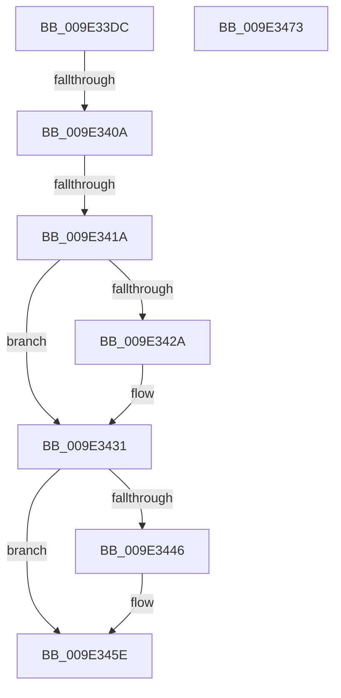

# WmipQueueLegacyEtwWork

- RVA: `0x009E33DC`–`0x009E3474` (길이 `152` bytes)
- VA: `0x00000001409E33DC`
- 실행 섹션: `PAGE`
- PDB 이름 있음: `예`; PDB Function 태그: `예`
- unwind 정보 RVA: `0x0005C954`
- 디코드: `41`개 명령, `152/152` bytes 표시
- 미해석 바이트: `0` (있으면 어셈블리에 `.byte`로 보존)

> 이 문서는 커널 이미지의 기계어와 PDB 기호를 분석해 생성했습니다. 4번과 5번은 함수 원형과 자료형을 바이너리 사용 방식에서 추정한 C 해석이며 원본 소스 복구 결과는 아닙니다.

## 1. Dependencies

- 직접 호출 지점: **2**; 고유 호출 대상: **2**
- 직접 호출자로 확인된 함수: **2**
- RIP 상대 이미지 참조: **0**

### Outgoing calls
- `0x009E33FC` → [WmipReferenceEntry](WmipReferenceEntry_function_009E1BF8.md) (function, `0x009E1BF8`)
- `0x009E3459` → [ExQueueWorkItem](../../text/2F/ExQueueWorkItem_function_002F9520.md) (function, `0x002F9520`)

### Direct callers
- [WmipRegisterEtwProvider](../7B/WmipRegisterEtwProvider_function_007B40AC.md) at `0x007B4166`
- [WmipUnregisterEtwProvider](WmipUnregisterEtwProvider_function_009E3A2C.md) at `0x009E3A7A`

### Static image references
- 디코드된 RIP-relative 메모리 참조가 없습니다.

## 2. Other-region calls and transfers

- 다른 실행 섹션으로 향하는 call: **1**
  - `0x009E3459` → [ExQueueWorkItem](../../text/2F/ExQueueWorkItem_function_002F9520.md) (`PAGE` → `.text`)
- call이 아닌 외부 분기/꼬리 이동: **2**
  - `0x009E3404` → [sub_00B30410](../B3/Unknown_function_00B30410.md) (`tail-transfer`)
  - `0x009E3414` → [sub_00B30410 + 0x6E](../B3/Unknown_function_00B30410.md) (`tail-transfer`)

## 3. Assembly (complete function range)

```asm
009E33DC  48 89 5C 24 08                  mov qword ptr [rsp + 8], rbx
009E33E1  48 89 6C 24 10                  mov qword ptr [rsp + 0x10], rbp
009E33E6  48 89 74 24 18                  mov qword ptr [rsp + 0x18], rsi
009E33EB  57                              push rdi
009E33EC  48 83 EC 20                     sub rsp, 0x20
009E33F0  48 8B F9                        mov rdi, rcx
009E33F3  49 8B F0                        mov rsi, r8
009E33F6  48 8B CA                        mov rcx, rdx
009E33F9  48 8B DA                        mov rbx, rdx
009E33FC  E8 F7 E7 FF FF                  call 0x1409e1bf8
009E3401  48 85 F6                        test rsi, rsi
009E3404  0F 85 06 D0 14 00               jne 0x140b30410
009E340A  48 8B AB 80 00 00 00            mov rbp, qword ptr [rbx + 0x80]
009E3411  48 85 ED                        test rbp, rbp
009E3414  0F 85 64 D0 14 00               jne 0x140b3047e
009E341A  48 8D 83 88 00 00 00            lea rax, [rbx + 0x88]
009E3421  48 8B 48 08                     mov rcx, qword ptr [rax + 8]
009E3425  48 39 01                        cmp qword ptr [rcx], rax
009E3428  74 07                           je 0x1409e3431
009E342A  B9 03 00 00 00                  mov ecx, 3
009E342F  CD 29                           int 0x29
009E3431  48 89 07                        mov qword ptr [rdi], rax
009E3434  48 89 4F 08                     mov qword ptr [rdi + 8], rcx
009E3438  48 89 39                        mov qword ptr [rcx], rdi
009E343B  48 89 78 08                     mov qword ptr [rax + 8], rdi
009E343F  8B 43 10                        mov eax, dword ptr [rbx + 0x10]
009E3442  A8 10                           test al, 0x10
009E3444  75 18                           jne 0x1409e345e
009E3446  48 8B 4B 60                     mov rcx, qword ptr [rbx + 0x60]
009E344A  83 C8 10                        or eax, 0x10
009E344D  48 83 C1 18                     add rcx, 0x18
009E3451  89 43 10                        mov dword ptr [rbx + 0x10], eax
009E3454  BA 01 00 00 00                  mov edx, 1
009E3459  E8 C2 60 91 FF                  call 0x1402f9520
009E345E  48 8B 5C 24 30                  mov rbx, qword ptr [rsp + 0x30]
009E3463  48 8B 6C 24 38                  mov rbp, qword ptr [rsp + 0x38]
009E3468  48 8B 74 24 40                  mov rsi, qword ptr [rsp + 0x40]
009E346D  48 83 C4 20                     add rsp, 0x20
009E3471  5F                              pop rdi
009E3472  C3                              ret
009E3473  CC                              int3
```

## 4. C-style interpretation (structured pseudocode)

```c
__int64 __fastcall WmipQueueLegacyEtwWork(__int64 a1, __int64 a2, __int64 a3)
{
    __int64 result;
    __int64 v_rsp;
    unsigned __int64 v_stack_p10;
    unsigned __int64 v_stack_p18;
    unsigned __int64 v_stack_p8;

    v_stack_p8 = v_rbx;
    v_stack_p10 = v_rbp;
    v_stack_p18 = v_rsi;
    v_rsp = (v_rsp) - (32);
    result = WmipReferenceEntry(a2, a2, a3, a4);
    if ((*(unsigned __int64 *)(*(unsigned __int64 *)(a2 + 136 + 8))) != (a2 + 136)) {
        a1 = 3;
    }
    *(unsigned __int64 *)(a1) = a2 + 136;
    *(unsigned __int64 *)(a1 + 8) = a1;
    *(unsigned __int64 *)(a1) = a1;
    *(unsigned __int64 *)(a2 + 136 + 8) = a1;
    result = (unsigned int)(*(unsigned int *)(a2 + 16));
    if ((((unsigned __int8)((unsigned int)(*(unsigned int *)(a2 + 16)))) & (16)) == 0) {
        a1 = *(unsigned __int64 *)(a2 + 96);
        result = (unsigned int)(((unsigned int)(*(unsigned int *)(a2 + 16))) | (16));
        a1 = (a1) + (24);
        *(unsigned int *)(a2 + 16) = (unsigned int)(result);
        a2 = 1;
        result = ExQueueWorkItem(a1, a2, a3, a4);
    }
    v_rsp = (v_rsp) + (32);
    return result;
}
```

## 5. (Beta) C Style

```c
int64_t WmipQueueLegacyEtwWork(void *Arg1, void *Arg2, int64_t Arg3)
{
    uint8_t *arg1 = (uint8_t *)Arg1;
    uint8_t *arg2 = (uint8_t *)Arg2;

    int64_t result;
    int64_t local_rsp;
    uint64_t v_stack_p10;
    uint64_t v_stack_p18;
    uint64_t v_stack_p8;

    v_stack_p8 = local_rbx;
    v_stack_p10 = local_rbp;
    v_stack_p18 = local_rsi;
    local_rsp = (local_rsp) - (32);
    result = WmipReferenceEntry(Arg2, Arg2, Arg3, a4);
    if ((*(uint64_t *)(*(uint64_t *)(arg2 + 0x88 + 0x8))) != (Arg2 + 136)) {
        Arg1 = 3;
    }
    *(void **)(arg1) = Arg2 + 136;
    *(void **)(arg1 + 0x8) = Arg1;
    *(void **)(arg1) = Arg1;
    *(void **)(arg2 + 0x88 + 0x8) = Arg1;
    result = (uint32_t)(*(uint32_t *)(arg2 + 0x10));
    if ((((uint8_t)((uint32_t)(*(uint32_t *)(arg2 + 0x10)))) & (16)) == 0) {
        Arg1 = *(uint64_t *)(arg2 + 0x60);
        result = (uint32_t)(((uint32_t)(*(uint32_t *)(arg2 + 0x10))) | (16));
        Arg1 = (Arg1) + (24);
        *(uint32_t *)(arg2 + 0x10) = (uint32_t)(result);
        Arg2 = 1;
        result = ExQueueWorkItem(Arg1, Arg2, Arg3, a4);
    }
    local_rsp = (local_rsp) + (32);
    return result;
}
```

### 관측된 메모리 오프셋

구조체 형식이 확인되지 않은 접근은 인자 기준의 오프셋으로만 기록했습니다.

| 기준 인자 | 오프셋 표현 | 폭 (bit) | 접근 |
|---|---:|---:|---|
| `Arg1` | `+ 0x0` | `64` | `W` |
| `Arg1` | `+ 0x8` | `64` | `W` |
| `Arg2` | `+ 0x8` | `64` | `R` |
| `Arg2` | `+ 0x8` | `64` | `W` |
| `Arg2` | `+ 0x10` | `32` | `R` |
| `Arg2` | `+ 0x10` | `32` | `W` |
| `Arg2` | `+ 0x60` | `64` | `R` |
| `Arg2` | `+ 0x80` | `64` | `R` |
| `Arg2` | `+ 0x88` | `64` | `R` |

## 6. Execution-region graph

[열기: 2D/3D 그래프와 함수 탐색 컨트롤 패널](../../../control-panel.html?section=page&rva=0x009E33DC&view=graph)

- 2D 그래프는 위에서 아래로 흐르고, 3D 그래프는 빈 공간을 드래그해 회전합니다. Shift+드래그는 이동, 휠은 확대·축소, 함수 노드 선택은 대상 보고서 이동입니다.

### Static fallback


