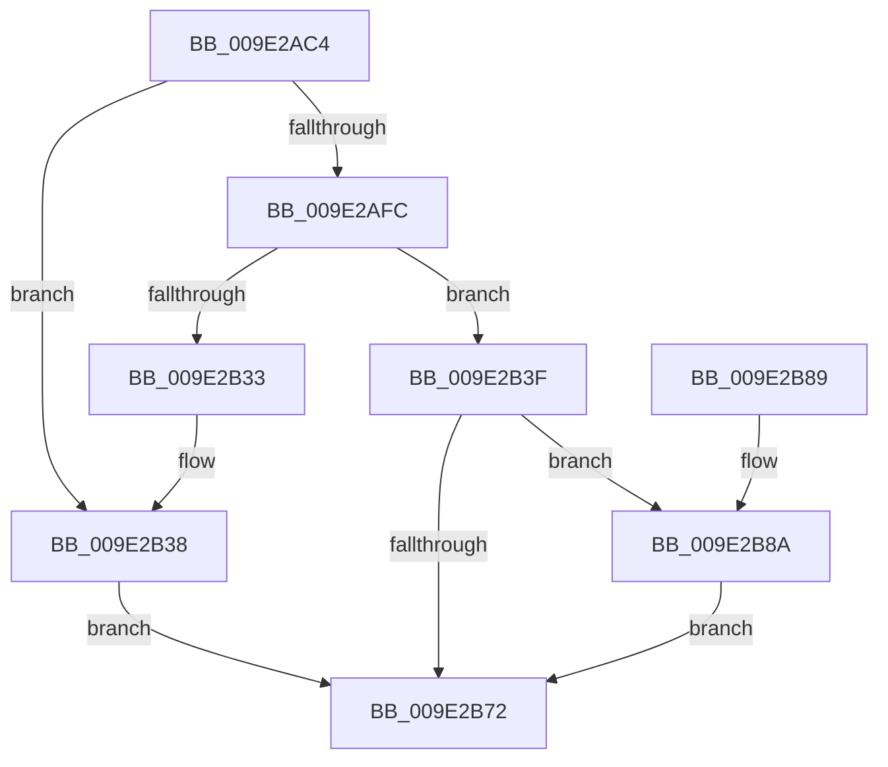

# WmipQueueRegWork

- RVA: `0x009E2AC4`–`0x009E2B9D` (길이 `217` bytes)
- VA: `0x00000001409E2AC4`
- 실행 섹션: `PAGE`
- PDB 이름 있음: `예`; PDB Function 태그: `아니요`
- unwind 정보 RVA: `0x0007AC30`
- 디코드: `56`개 명령, `217/217` bytes 표시
- 미해석 바이트: `0` (있으면 어셈블리에 `.byte`로 보존)

> 이 문서는 커널 이미지의 기계어와 PDB 기호를 분석해 생성했습니다. 4번과 5번은 함수 원형과 자료형을 바이너리 사용 방식에서 추정한 C 해석이며 원본 소스 복구 결과는 아닙니다.

## 1. Dependencies

- 직접 호출 지점: **4**; 고유 호출 대상: **4**
- 직접 호출자로 확인된 함수: **2**
- RIP 상대 이미지 참조: **6**

### Outgoing calls
- `0x009E2AED` → [ExAllocatePool2](../../poolcode/B8/ExAllocatePool2_function_00B820F0.md) (function, `0x00B820F0`)
- `0x009E2B1B` → [KeWaitForSingleObject](../../text/20/KeWaitForSingleObject_function_0020E6B0.md) (function, `0x0020E6B0`)
- `0x009E2B59` → [KeReleaseMutex](../../text/39/KeReleaseMutex_function_00396810.md) (function, `0x00396810`)
- `0x009E2B96` → [ExQueueWorkItem](../../text/2F/ExQueueWorkItem_function_002F9520.md) (function, `0x002F9520`)

### Direct callers
- [WmipRegisterDevice](WmipRegisterDevice_function_009E2808.md) at `0x009E28E4`
- [WmipUpdateRegistration](WmipUpdateRegistration_function_009E2BA4.md) at `0x009E2BC3`

### Static image references
- `0x009E2B14` → RVA `0x00EFFA60` (`.data`; read)
- `0x009E2B20` → RVA `0x00E09140` (`.data`; read)
- `0x009E2B27` → RVA `0x00E09138` (`.data`; read)
- `0x009E2B52` → RVA `0x00E09140` (`.data`; write)
- `0x009E2B63` → RVA `0x00E0EB0C` (`.data`; read/write)
- `0x009E2B8F` → RVA `0x00EFFC00` (`.data`; read)

## 2. Other-region calls and transfers

- 다른 실행 섹션으로 향하는 call: **4**
  - `0x009E2AED` → [ExAllocatePool2](../../poolcode/B8/ExAllocatePool2_function_00B820F0.md) (`PAGE` → `POOLCODE`)
  - `0x009E2B1B` → [KeWaitForSingleObject](../../text/20/KeWaitForSingleObject_function_0020E6B0.md) (`PAGE` → `.text`)
  - `0x009E2B59` → [KeReleaseMutex](../../text/39/KeReleaseMutex_function_00396810.md) (`PAGE` → `.text`)
  - `0x009E2B96` → [ExQueueWorkItem](../../text/2F/ExQueueWorkItem_function_002F9520.md) (`PAGE` → `.text`)
- 별도 외부 분기/꼬리 이동을 확인하지 못했습니다.

## 3. Assembly (complete function range)

```asm
009E2AC4  48 89 5C 24 08                  mov qword ptr [rsp + 8], rbx
009E2AC9  48 89 6C 24 10                  mov qword ptr [rsp + 0x10], rbp
009E2ACE  48 89 74 24 18                  mov qword ptr [rsp + 0x18], rsi
009E2AD3  57                              push rdi
009E2AD4  48 83 EC 30                     sub rsp, 0x30
009E2AD8  48 8B F2                        mov rsi, rdx
009E2ADB  8B E9                           mov ebp, ecx
009E2ADD  BA 20 00 00 00                  mov edx, 0x20
009E2AE2  B9 00 01 00 00                  mov ecx, 0x100
009E2AE7  41 B8 57 6D 69 70               mov r8d, 0x70696d57
009E2AED  E8 FE F5 19 00                  call 0x140b820f0
009E2AF2  33 FF                           xor edi, edi
009E2AF4  48 8B D8                        mov rbx, rax
009E2AF7  48 85 C0                        test rax, rax
009E2AFA  74 3C                           je 0x1409e2b38
009E2AFC  F0 FF 46 30                     lock inc dword ptr [rsi + 0x30]
009E2B00  45 33 C9                        xor r9d, r9d
009E2B03  89 68 10                        mov dword ptr [rax + 0x10], ebp
009E2B06  45 33 C0                        xor r8d, r8d
009E2B09  48 89 70 18                     mov qword ptr [rax + 0x18], rsi
009E2B0D  33 D2                           xor edx, edx
009E2B0F  48 89 7C 24 20                  mov qword ptr [rsp + 0x20], rdi
009E2B14  48 8D 0D 45 CF 51 00            lea rcx, [rip + 0x51cf45]
009E2B1B  E8 90 BB 82 FF                  call 0x14020e6b0
009E2B20  48 8B 05 19 66 42 00            mov rax, qword ptr [rip + 0x426619]
009E2B27  48 8D 0D 0A 66 42 00            lea rcx, [rip + 0x42660a]
009E2B2E  48 39 08                        cmp qword ptr [rax], rcx
009E2B31  74 0C                           je 0x1409e2b3f
009E2B33  8D 4F 03                        lea ecx, [rdi + 3]
009E2B36  CD 29                           int 0x29
009E2B38  BF 9A 00 00 C0                  mov edi, 0xc000009a
009E2B3D  EB 33                           jmp 0x1409e2b72
009E2B3F  48 89 0B                        mov qword ptr [rbx], rcx
009E2B42  33 D2                           xor edx, edx
009E2B44  48 89 43 08                     mov qword ptr [rbx + 8], rax
009E2B48  48 8D 0D 11 CF 51 00            lea rcx, [rip + 0x51cf11]
009E2B4F  48 89 18                        mov qword ptr [rax], rbx
009E2B52  48 89 1D E7 65 42 00            mov qword ptr [rip + 0x4265e7], rbx
009E2B59  E8 B2 3C 9B FF                  call 0x140396810
009E2B5E  B8 01 00 00 00                  mov eax, 1
009E2B63  F0 0F C1 05 A1 BF 42 00         lock xadd dword ptr [rip + 0x42bfa1], eax
009E2B6B  FF C0                           inc eax
009E2B6D  83 F8 01                        cmp eax, 1
009E2B70  74 18                           je 0x1409e2b8a
009E2B72  48 8B 5C 24 40                  mov rbx, qword ptr [rsp + 0x40]
009E2B77  8B C7                           mov eax, edi
009E2B79  48 8B 6C 24 48                  mov rbp, qword ptr [rsp + 0x48]
009E2B7E  48 8B 74 24 50                  mov rsi, qword ptr [rsp + 0x50]
009E2B83  48 83 C4 30                     add rsp, 0x30
009E2B87  5F                              pop rdi
009E2B88  C3                              ret
009E2B89  CC                              int3
009E2B8A  BA 01 00 00 00                  mov edx, 1
009E2B8F  48 8D 0D 6A D0 51 00            lea rcx, [rip + 0x51d06a]
009E2B96  E8 85 69 91 FF                  call 0x1402f9520
009E2B9B  EB D5                           jmp 0x1409e2b72
```

## 4. C-style interpretation (structured pseudocode)

```c
__int64 __fastcall WmipQueueRegWork(int a1, __int64 a2, __int64 a3, int a4)
{
    __int64 result;
    __int64 v_rdi;
    __int64 v_rsp;
    unsigned __int64 v_stack_m18;
    unsigned __int64 v_stack_p10;
    unsigned __int64 v_stack_p18;
    unsigned __int64 v_stack_p8;

    v_stack_p8 = v_rbx;
    v_stack_p10 = v_rbp;
    v_stack_p18 = v_rsi;
    v_rsp = (v_rsp) - (48);
    result = ExAllocatePool2(256, 32, (unsigned int)(0x70696D57ULL), a4);
    v_rdi = 0;
    if (result == 0) goto loc_009E2B38;
    a4 = 0;
    *(unsigned int *)(result + 16) = (unsigned int)((unsigned int)(a1));
    a3 = 0;
    *(unsigned __int64 *)(result + 24) = a2;
    a2 = 0;
    v_stack_m18 = 0;
    result = KeWaitForSingleObject(v_rip + 5361477, a2, a3, a4);
    if ((*(unsigned __int64 *)(*(unsigned __int64 *)(v_rip + 4351513))) == (v_rip + 4351498)) goto loc_009E2B3F;
loc_009E2B38:
    goto loc_009E2B72;
loc_009E2B3F:
    *(unsigned __int64 *)(result) = v_rdi + 3;
    a2 = 0;
    *(unsigned __int64 *)(result + 8) = *(unsigned __int64 *)(v_rip + 4351513);
    *(unsigned __int64 *)(*(unsigned __int64 *)(v_rip + 4351513)) = result;
    *(unsigned __int64 *)(v_rip + 4351463) = result;
    result = KeReleaseMutex(v_rip + 5361425, a2, a3, a4);
    result = (unsigned int)((1) + 1);
    if (((unsigned int)(result)) == 1) goto loc_009E2B8A;
loc_009E2B72:
    v_rsp = (v_rsp) + (48);
    return (unsigned int)((unsigned int)((unsigned int)(0xC000009AULL)));
loc_009E2B8A:
    result = ExQueueWorkItem(v_rip + 5361770, 1, a3, a4);
    goto loc_009E2B72;
}
```

## 5. (Beta) C Style

```c
int64_t WmipQueueRegWork(int32_t Arg1, void *Arg2, int64_t Arg3, int32_t Arg4)
{
    uint8_t *arg2 = (uint8_t *)Arg2;

    int64_t result;
    int64_t local_rdi;
    int64_t local_rsp;
    uint64_t v_stack_m18;
    uint64_t v_stack_p10;
    uint64_t v_stack_p18;
    uint64_t v_stack_p8;

    v_stack_p8 = local_rbx;
    v_stack_p10 = local_rbp;
    v_stack_p18 = local_rsi;
    local_rsp = (local_rsp) - (48);
    result = ExAllocatePool2(256, 32, (uint32_t)(0x70696D57ULL), Arg4);
    local_rdi = 0;
    if (result == 0) goto loc_009E2B38;
    Arg4 = 0;
    *(uint32_t *)(result + 0x10) = (uint32_t)((uint32_t)(Arg1));
    Arg3 = 0;
    *(void **)(result + 0x18) = Arg2;
    Arg2 = 0;
    v_stack_m18 = 0;
    result = KeWaitForSingleObject(v_rip + 5361477, Arg2, Arg3, Arg4);
    if ((*(uint64_t *)(*(uint64_t *)(v_rip + 0x426619))) == (v_rip + 4351498)) goto loc_009E2B3F;
loc_009E2B38:
    goto loc_009E2B72;
loc_009E2B3F:
    *(uint64_t *)(result) = local_rdi + 3;
    Arg2 = 0;
    *(uint64_t *)(result + 0x8) = *(uint64_t *)(v_rip + 0x426619);
    *(uint64_t *)(*(uint64_t *)(v_rip + 0x426619)) = result;
    *(uint64_t *)(v_rip + 0x4265E7) = result;
    result = KeReleaseMutex(v_rip + 5361425, Arg2, Arg3, Arg4);
    result = (uint32_t)((1) + 1);
    if (((uint32_t)(result)) == 1) goto loc_009E2B8A;
loc_009E2B72:
    local_rsp = (local_rsp) + (48);
    return (uint32_t)((uint32_t)((uint32_t)(0xC000009AULL)));
loc_009E2B8A:
    result = ExQueueWorkItem(v_rip + 5361770, 1, Arg3, Arg4);
    goto loc_009E2B72;
}
```

### 관측된 메모리 오프셋

구조체 형식이 확인되지 않은 접근은 인자 기준의 오프셋으로만 기록했습니다.

| 기준 인자 | 오프셋 표현 | 폭 (bit) | 접근 |
|---|---:|---:|---|
| `Arg2` | `+ 0x30` | `32` | `R/W` |

## 6. Execution-region graph

[열기: 2D/3D 그래프와 함수 탐색 컨트롤 패널](../../../control-panel.html?section=page&rva=0x009E2AC4&view=graph)

- 2D 그래프는 위에서 아래로 흐르고, 3D 그래프는 빈 공간을 드래그해 회전합니다. Shift+드래그는 이동, 휠은 확대·축소, 함수 노드 선택은 대상 보고서 이동입니다.

### Static fallback


