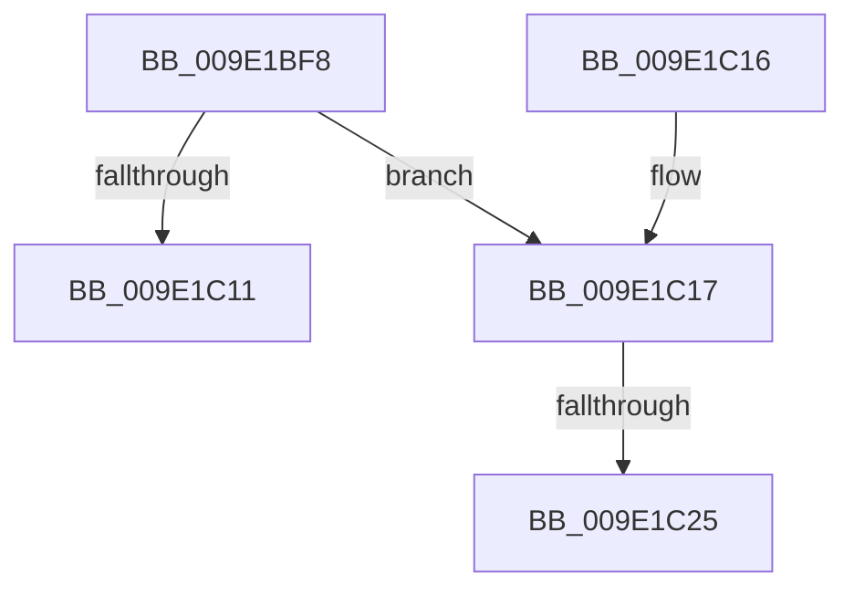

# WmipReferenceEntry

- RVA: `0x009E1BF8`–`0x009E1C36` (길이 `62` bytes)
- VA: `0x00000001409E1BF8`
- 실행 섹션: `PAGE`
- PDB 이름 있음: `예`; PDB Function 태그: `예`
- unwind 정보 RVA: `0x0007D698`
- 디코드: `18`개 명령, `62/62` bytes 표시
- 미해석 바이트: `0` (있으면 어셈블리에 `.byte`로 보존)

> 이 문서는 커널 이미지의 기계어와 PDB 기호를 분석해 생성했습니다. 4번과 5번은 함수 원형과 자료형을 바이너리 사용 방식에서 추정한 C 해석이며 원본 소스 복구 결과는 아닙니다.

## 1. Dependencies

- 직접 호출 지점: **1**; 고유 호출 대상: **1**
- 직접 호출자로 확인된 함수: **17**
- RIP 상대 이미지 참조: **0**

### Outgoing calls
- `0x009E1C30` → [KeBugCheckEx](../../text/4F/KeBugCheckEx_function_004FD660.md) (function, `0x004FD660`)

### Direct callers
- [WmipRegisterEtwProvider](../7B/WmipRegisterEtwProvider_function_007B40AC.md) at `0x007B412C`
- [WmipInsertMofResource](../7B/WmipInsertMofResource_function_007B44FC.md) at `0x007B4548`
- [WmipUpdateDataSource](../9D/WmipUpdateDataSource_function_009DD474.md) at `0x009DD4AF`
- [WmipGenerateRegistrationNotification](../9D/WmipGenerateRegistrationNotification_function_009DF60C.md) at `0x009DF62B`
- [WmipIncludeStaticNames](../9D/WmipIncludeStaticNames_function_009DF754.md) at `0x009DF7D9`
- [WmipFindGEByGuid](WmipFindGEByGuid_function_009E03A4.md) at `0x009E0400`
- [WmipPrepareWnodeSI](WmipPrepareWnodeSI_function_009E1740.md) at `0x009E189A`
- [WmipPrepareForWnodeAD](WmipPrepareForWnodeAD_function_009E1A48.md) at `0x009E1AEB`
- [WmipFindISinGEbyName](WmipFindISinGEbyName_function_009E2BF0.md) at `0x009E2CA9`
- [WmipLegacyEtwWorker](WmipLegacyEtwWorker_function_009E3290.md) at `0x009E32A2`
- [WmipQueueLegacyEtwWork](WmipQueueLegacyEtwWork_function_009E33DC.md) at `0x009E33FC`
- [WmipLegacyEtwCallback](WmipLegacyEtwCallback_function_009E3480.md) at `0x009E3537`
- [WmipLegacyEtwCallback](WmipLegacyEtwCallback_function_009E3480.md) at `0x009E3564`
- [WmipSendEnableRequest](WmipSendEnableRequest_function_009E367C.md) at `0x009E36F5`
- [WmipSendEnableDisableRequest](WmipSendEnableDisableRequest_function_009E3800.md) at `0x009E39B5`
- [WmipFindMRByNames](../AB/WmipFindMRByNames_function_00AB0054.md) at `0x00AB00E6`
- [WmipFindISInDSByGuid](../AC/WmipFindISInDSByGuid_function_00AC1A20.md) at `0x00AC1A60`
- [WmipDereferenceEvent](../AC/WmipDereferenceEvent_function_00ACE6E4.md) at `0x00ACE735`

### Static image references
- 디코드된 RIP-relative 메모리 참조가 없습니다.

## 2. Other-region calls and transfers

- 다른 실행 섹션으로 향하는 call: **1**
  - `0x009E1C30` → [KeBugCheckEx](../../text/4F/KeBugCheckEx_function_004FD660.md) (`PAGE` → `.text`)
- call이 아닌 외부 분기/꼬리 이동: **1**
  - `0x009E1C1F` → [sub_00B302D8](../B3/Unknown_function_00B302D8.md) (`tail-transfer`)

## 3. Assembly (complete function range)

```asm
009E1BF8  48 83 EC 38                     sub rsp, 0x38
009E1BFC  BA 01 00 00 00                  mov edx, 1
009E1C01  8B C2                           mov eax, edx
009E1C03  F0 48 0F C1 41 18               lock xadd qword ptr [rcx + 0x18], rax
009E1C09  48 03 C2                        add rax, rdx
009E1C0C  48 3B C2                        cmp rax, rdx
009E1C0F  7E 06                           jle 0x1409e1c17
009E1C11  48 83 C4 38                     add rsp, 0x38
009E1C15  C3                              ret
009E1C16  CC                              int3
009E1C17  4C 8B C1                        mov r8, rcx
009E1C1A  B9 4A 01 00 00                  mov ecx, 0x14a
009E1C1F  0F 85 B3 E6 14 00               jne 0x140b302d8
009E1C25  48 83 64 24 20 00               and qword ptr [rsp + 0x20], 0
009E1C2B  45 33 C9                        xor r9d, r9d
009E1C2E  33 D2                           xor edx, edx
009E1C30  E8 2B BA B1 FF                  call 0x1404fd660
009E1C35  CC                              int3
```

## 4. C-style interpretation (structured pseudocode)

```c
__int64 __fastcall WmipReferenceEntry(__int64 a1, __int64 a2, __int64 a3, int a4)
{
    __int64 result;
    __int64 v_rsp;
    unsigned __int64 v_stack_p20;

    v_rsp = (v_rsp) - (56);
    result = (1) + (1);
    if (result <= 1) goto loc_009E1C17;
    v_rsp = (v_rsp) + (56);
    return result;
loc_009E1C17:
    a4 = 0;
    a2 = 0;
    result = KeBugCheckEx(330, a2, a1, a4);
    return result;
}
```

## 5. (Beta) C Style

```c
int64_t WmipReferenceEntry(void *Arg1, int64_t Arg2, int64_t Arg3, int32_t Arg4)
{
    uint8_t *arg1 = (uint8_t *)Arg1;

    int64_t result;
    int64_t local_rsp;
    uint64_t v_stack_p20;

    local_rsp = (local_rsp) - (56);
    result = (1) + (1);
    if (result <= 1) goto loc_009E1C17;
    local_rsp = (local_rsp) + (56);
    return result;
loc_009E1C17:
    Arg4 = 0;
    Arg2 = 0;
    result = KeBugCheckEx(330, Arg2, Arg1, Arg4);
    return result;
}
```

### 관측된 메모리 오프셋

구조체 형식이 확인되지 않은 접근은 인자 기준의 오프셋으로만 기록했습니다.

| 기준 인자 | 오프셋 표현 | 폭 (bit) | 접근 |
|---|---:|---:|---|
| `Arg1` | `+ 0x18` | `64` | `R/W` |

## 6. Execution-region graph

[열기: 2D/3D 그래프와 함수 탐색 컨트롤 패널](../../../control-panel.html?section=page&rva=0x009E1BF8&view=graph)

- 2D 그래프는 위에서 아래로 흐르고, 3D 그래프는 빈 공간을 드래그해 회전합니다. Shift+드래그는 이동, 휠은 확대·축소, 함수 노드 선택은 대상 보고서 이동입니다.

### Static fallback


