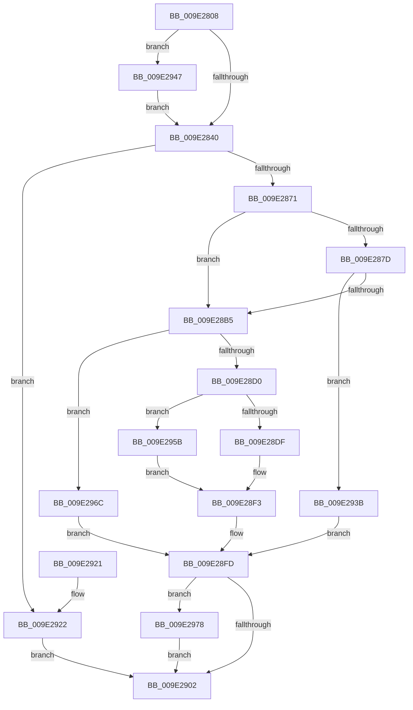

# WmipRegisterDevice

- RVA: `0x009E2808`–`0x009E2982` (길이 `378` bytes)
- VA: `0x00000001409E2808`
- 실행 섹션: `PAGE`
- PDB 이름 있음: `예`; PDB Function 태그: `아니요`
- unwind 정보 RVA: `0x000A3E78`
- 디코드: `112`개 명령, `378/378` bytes 표시
- 미해석 바이트: `0` (있으면 어셈블리에 `.byte`로 보존)

> 이 문서는 커널 이미지의 기계어와 PDB 기호를 분석해 생성했습니다. 4번과 5번은 함수 원형과 자료형을 바이너리 사용 방식에서 추정한 C 해석이며 원본 소스 복구 결과는 아닙니다.

## 1. Dependencies

- 직접 호출 지점: **16**; 고유 호출 대상: **12**
- 직접 호출자로 확인된 함수: **1**
- RIP 상대 이미지 참조: **1**

### Outgoing calls
- `0x009E2858` → [KeWaitForSingleObject](../../text/20/KeWaitForSingleObject_function_0020E6B0.md) (function, `0x0020E6B0`)
- `0x009E2860` → [WmipFindRegEntryByDevice](../../text/46/WmipFindRegEntryByDevice_function_0046C22C.md) (function, `0x0046C22C`)
- `0x009E2880` → [IoGetAttachedDeviceReference](../../text/41/IoGetAttachedDeviceReference_function_0041D940.md) (function, `0x0041D940`)
- `0x009E288E` → [WmipUpdateDeviceStackSize](WmipUpdateDeviceStackSize_function_009E23B0.md) (function, `0x009E23B0`)
- `0x009E2896` → [ObfDereferenceObject](../../text/2F/ObfDereferenceObject_function_002F9350.md) (function, `0x002F9350`)
- `0x009E28A6` → [ObReferenceObjectByPointer](../../text/43/ObReferenceObjectByPointer_function_00438D00.md) (function, `0x00438D00`)
- `0x009E28BA` → [WmipAllocRegEntry](../../text/4B/WmipAllocRegEntry_function_004B6D24.md) (function, `0x004B6D24`)
- `0x009E28D5` → [KeReleaseMutex](../../text/39/KeReleaseMutex_function_00396810.md) (function, `0x00396810`)
- `0x009E28E4` → [WmipQueueRegWork](WmipQueueRegWork_function_009E2AC4.md) (function, `0x009E2AC4`)
- `0x009E28F8` → [WmipUnreferenceRegEntry](../../text/47/WmipUnreferenceRegEntry_function_0047B6F0.md) (function, `0x0047B6F0`)
- `0x009E2927` → [KeReleaseMutex](../../text/39/KeReleaseMutex_function_00396810.md) (function, `0x00396810`)
- `0x009E2934` → [WmipUnreferenceRegEntry](../../text/47/WmipUnreferenceRegEntry_function_0047B6F0.md) (function, `0x0047B6F0`)
- `0x009E2940` → [KeReleaseMutex](../../text/39/KeReleaseMutex_function_00396810.md) (function, `0x00396810`)
- `0x009E2960` → [WmipRegisterOrUpdateDS](../9D/WmipRegisterOrUpdateDS_function_009DD9DC.md) (function, `0x009DD9DC`)
- `0x009E296C` → [KeReleaseMutex](../../text/39/KeReleaseMutex_function_00396810.md) (function, `0x00396810`)
- `0x009E297B` → [WmipDeregisterRegEntry](../../text/47/WmipDeregisterRegEntry_function_0047B568.md) (function, `0x0047B568`)

### Direct callers
- [IoWMIRegistrationControl](IoWMIRegistrationControl_function_009E2D60.md) at `0x009E2DF7`
- [IoWMIRegistrationControl](IoWMIRegistrationControl_function_009E2D60.md) at `0x009E2E8C`

### Static image references
- `0x009E2846` → RVA `0x00EFFA60` (`.data`; read)

## 2. Other-region calls and transfers

- 다른 실행 섹션으로 향하는 call: **13**
  - `0x009E2858` → [KeWaitForSingleObject](../../text/20/KeWaitForSingleObject_function_0020E6B0.md) (`PAGE` → `.text`)
  - `0x009E2860` → [WmipFindRegEntryByDevice](../../text/46/WmipFindRegEntryByDevice_function_0046C22C.md) (`PAGE` → `.text`)
  - `0x009E2880` → [IoGetAttachedDeviceReference](../../text/41/IoGetAttachedDeviceReference_function_0041D940.md) (`PAGE` → `.text`)
  - `0x009E2896` → [ObfDereferenceObject](../../text/2F/ObfDereferenceObject_function_002F9350.md) (`PAGE` → `.text`)
  - `0x009E28A6` → [ObReferenceObjectByPointer](../../text/43/ObReferenceObjectByPointer_function_00438D00.md) (`PAGE` → `.text`)
  - `0x009E28BA` → [WmipAllocRegEntry](../../text/4B/WmipAllocRegEntry_function_004B6D24.md) (`PAGE` → `.text`)
  - `0x009E28D5` → [KeReleaseMutex](../../text/39/KeReleaseMutex_function_00396810.md) (`PAGE` → `.text`)
  - `0x009E28F8` → [WmipUnreferenceRegEntry](../../text/47/WmipUnreferenceRegEntry_function_0047B6F0.md) (`PAGE` → `.text`)
  - `0x009E2927` → [KeReleaseMutex](../../text/39/KeReleaseMutex_function_00396810.md) (`PAGE` → `.text`)
  - `0x009E2934` → [WmipUnreferenceRegEntry](../../text/47/WmipUnreferenceRegEntry_function_0047B6F0.md) (`PAGE` → `.text`)
  - `0x009E2940` → [KeReleaseMutex](../../text/39/KeReleaseMutex_function_00396810.md) (`PAGE` → `.text`)
  - `0x009E296C` → [KeReleaseMutex](../../text/39/KeReleaseMutex_function_00396810.md) (`PAGE` → `.text`)
  - `0x009E297B` → [WmipDeregisterRegEntry](../../text/47/WmipDeregisterRegEntry_function_0047B568.md) (`PAGE` → `.text`)
- 별도 외부 분기/꼬리 이동을 확인하지 못했습니다.

## 3. Assembly (complete function range)

```asm
009E2808  48 89 5C 24 08                  mov qword ptr [rsp + 8], rbx
009E280D  48 89 6C 24 10                  mov qword ptr [rsp + 0x10], rbp
009E2812  48 89 74 24 18                  mov qword ptr [rsp + 0x18], rsi
009E2817  57                              push rdi
009E2818  41 54                           push r12
009E281A  41 55                           push r13
009E281C  41 56                           push r14
009E281E  41 57                           push r15
009E2820  48 83 EC 30                     sub rsp, 0x30
009E2824  33 DB                           xor ebx, ebx
009E2826  40 32 ED                        xor bpl, bpl
009E2829  85 D2                           test edx, edx
009E282B  BF 00 00 00 10                  mov edi, 0x10000000
009E2830  4C 8B F9                        mov r15, rcx
009E2833  0F 48 DF                        cmovs ebx, edi
009E2836  0F BA E2 10                     bt edx, 0x10
009E283A  0F 82 07 01 00 00               jb 0x1409e2947
009E2840  48 83 64 24 20 00               and qword ptr [rsp + 0x20], 0
009E2846  4C 8D 25 13 D2 51 00            lea r12, [rip + 0x51d213]
009E284D  49 8B CC                        mov rcx, r12
009E2850  45 33 C9                        xor r9d, r9d
009E2853  45 33 C0                        xor r8d, r8d
009E2856  33 D2                           xor edx, edx
009E2858  E8 53 BE 82 FF                  call 0x14020e6b0
009E285D  49 8B CF                        mov rcx, r15
009E2860  E8 C7 99 A8 FF                  call 0x14046c22c
009E2865  48 8B F0                        mov rsi, rax
009E2868  48 85 C0                        test rax, rax
009E286B  0F 85 B1 00 00 00               jne 0x1409e2922
009E2871  44 8B F3                        mov r14d, ebx
009E2874  44 8D 68 01                     lea r13d, [rax + 1]
009E2878  44 23 F7                        and r14d, edi
009E287B  75 38                           jne 0x1409e28b5
009E287D  49 8B CF                        mov rcx, r15
009E2880  E8 BB B0 A3 FF                  call 0x14041d940
009E2885  48 8B F8                        mov rdi, rax
009E2888  8A 48 4C                        mov cl, byte ptr [rax + 0x4c]
009E288B  41 02 CD                        add cl, r13b
009E288E  E8 1D FB FF FF                  call 0x1409e23b0
009E2893  48 8B CF                        mov rcx, rdi
009E2896  E8 B5 6A 91 FF                  call 0x1402f9350
009E289B  45 33 C9                        xor r9d, r9d
009E289E  45 33 C0                        xor r8d, r8d
009E28A1  33 D2                           xor edx, edx
009E28A3  49 8B CF                        mov rcx, r15
009E28A6  E8 55 64 A5 FF                  call 0x140438d00
009E28AB  8B F8                           mov edi, eax
009E28AD  85 C0                           test eax, eax
009E28AF  0F 88 86 00 00 00               js 0x1409e293b
009E28B5  8B D3                           mov edx, ebx
009E28B7  49 8B CF                        mov rcx, r15
009E28BA  E8 65 44 AD FF                  call 0x1404b6d24
009E28BF  33 D2                           xor edx, edx
009E28C1  48 8B F0                        mov rsi, rax
009E28C4  49 8B CC                        mov rcx, r12
009E28C7  48 85 C0                        test rax, rax
009E28CA  0F 84 9C 00 00 00               je 0x1409e296c
009E28D0  F0 44 01 68 30                  lock add dword ptr [rax + 0x30], r13d
009E28D5  E8 36 3F 9B FF                  call 0x140396810
009E28DA  45 85 F6                        test r14d, r14d
009E28DD  75 7C                           jne 0x1409e295b
009E28DF  48 8B D6                        mov rdx, rsi
009E28E2  33 C9                           xor ecx, ecx
009E28E4  E8 DB 01 00 00                  call 0x1409e2ac4
009E28E9  85 C0                           test eax, eax
009E28EB  40 0F B6 ED                     movzx ebp, bpl
009E28EF  41 0F 48 ED                     cmovs ebp, r13d
009E28F3  48 8B CE                        mov rcx, rsi
009E28F6  8B F8                           mov edi, eax
009E28F8  E8 F3 8D A9 FF                  call 0x14047b6f0
009E28FD  40 84 ED                        test bpl, bpl
009E2900  75 76                           jne 0x1409e2978
009E2902  48 8B 5C 24 60                  mov rbx, qword ptr [rsp + 0x60]
009E2907  8B C7                           mov eax, edi
009E2909  48 8B 6C 24 68                  mov rbp, qword ptr [rsp + 0x68]
009E290E  48 8B 74 24 70                  mov rsi, qword ptr [rsp + 0x70]
009E2913  48 83 C4 30                     add rsp, 0x30
009E2917  41 5F                           pop r15
009E2919  41 5E                           pop r14
009E291B  41 5D                           pop r13
009E291D  41 5C                           pop r12
009E291F  5F                              pop rdi
009E2920  C3                              ret
009E2921  CC                              int3
009E2922  33 D2                           xor edx, edx
009E2924  49 8B CC                        mov rcx, r12
009E2927  E8 E4 3E 9B FF                  call 0x140396810
009E292C  48 8B CE                        mov rcx, rsi
009E292F  BF 00 00 00 40                  mov edi, 0x40000000
009E2934  E8 B7 8D A9 FF                  call 0x14047b6f0
009E2939  EB C7                           jmp 0x1409e2902
009E293B  33 D2                           xor edx, edx
009E293D  49 8B CC                        mov rcx, r12
009E2940  E8 CB 3E 9B FF                  call 0x140396810
009E2945  EB B6                           jmp 0x1409e28fd
009E2947  81 E2 00 00 F0 00               and edx, 0xf00000
009E294D  0F BA EA 1A                     bts edx, 0x1a
009E2951  C1 E2 04                        shl edx, 4
009E2954  0B DA                           or ebx, edx
009E2956  E9 E5 FE FF FF                  jmp 0x1409e2840
009E295B  33 D2                           xor edx, edx
009E295D  48 8B CE                        mov rcx, rsi
009E2960  E8 77 B0 FF FF                  call 0x1409dd9dc
009E2965  8B E8                           mov ebp, eax
009E2967  C1 ED 1F                        shr ebp, 0x1f
009E296A  EB 87                           jmp 0x1409e28f3
009E296C  E8 9F 3E 9B FF                  call 0x140396810
009E2971  BF 9A 00 00 C0                  mov edi, 0xc000009a
009E2976  EB 85                           jmp 0x1409e28fd
009E2978  48 8B CE                        mov rcx, rsi
009E297B  E8 E8 8B A9 FF                  call 0x14047b568
009E2980  EB 80                           jmp 0x1409e2902
```

## 4. C-style interpretation (structured pseudocode)

```c
__int64 __fastcall WmipRegisterDevice(__int64 a1, int a2, int a3, int a4)
{
    __int64 result;
    __int64 v_r14;
    __int64 v_rbp;
    __int64 v_rbx;
    __int64 v_rsp;
    unsigned __int64 v_stack_m38;
    unsigned __int64 v_stack_p10;
    unsigned __int64 v_stack_p18;
    unsigned __int64 v_stack_p8;

    v_stack_p8 = v_rbx;
    v_stack_p10 = v_rbp;
    v_stack_p18 = v_rsi;
    v_rsp = (v_rsp) - (48);
    v_rbx = 0;
    v_rbp = 0;
    if (sign_flag) { v_rbx = (unsigned int)((unsigned int)(0x10000000ULL)); }
    if (condition_is_below) goto loc_009E2947;
loc_009E2840:
    a4 = 0;
    a3 = 0;
    a2 = 0;
    result = KeWaitForSingleObject(v_rip + 5362195, a2, a3, a4);
    result = WmipFindRegEntryByDevice(a1, a2, a3, a4);
    if (result != 0) goto loc_009E2922;
    v_r14 = (unsigned int)(((unsigned int)((unsigned int)(v_rbx))) & ((unsigned int)((unsigned int)(0x10000000ULL))));
    if (condition_is_not_equal) goto loc_009E28B5;
    result = IoGetAttachedDeviceReference(a1, a2, a3, a4);
    a1 = (unsigned __int8)((*(unsigned __int8 *)(result + 76)) + ((unsigned __int8)(result + 1)));
    result = WmipUpdateDeviceStackSize(a1, a2, a3, a4);
    result = ObfDereferenceObject(result, a2, a3, a4);
    a4 = 0;
    a3 = 0;
    a2 = 0;
    result = ObReferenceObjectByPointer(a1, a2, a3, a4);
    if (sign_flag) goto loc_009E293B;
loc_009E28B5:
    result = WmipAllocRegEntry(a1, (unsigned int)((unsigned int)(v_rbx)), a3, a4);
    a2 = 0;
    if (result == 0) goto loc_009E296C;
    result = KeReleaseMutex(v_rip + 5362195, a2, a3, a4);
    if ((unsigned int)(v_r14) != 0) goto loc_009E295B;
    a1 = 0;
    result = WmipQueueRegWork(a1, result, a3, a4);
    v_rbp = 0;
    if (sign_flag) { v_rbp = (unsigned int)(result + 1); }
loc_009E28F3:
    result = WmipUnreferenceRegEntry(result, result, a3, a4);
loc_009E28FD:
    if ((unsigned __int8)(v_rbp) != 0) goto loc_009E2978;
loc_009E2902:
    v_rsp = (v_rsp) + (48);
    return (unsigned int)((unsigned int)((unsigned int)((unsigned int)(result))));
loc_009E2922:
    a2 = 0;
    result = KeReleaseMutex(v_rip + 5362195, a2, a3, a4);
    result = WmipUnreferenceRegEntry(v_stack_p18, a2, a3, a4);
    goto loc_009E2902;
loc_009E293B:
    a2 = 0;
    result = KeReleaseMutex(v_rip + 5362195, a2, a3, a4);
    goto loc_009E28FD;
loc_009E2947:
    a2 = (unsigned int)((a2) & (0xF00000ULL));
    a2 = (unsigned int)((a2) << (4));
    v_rbx = (unsigned int)((v_stack_p8) | (a2));
    goto loc_009E2840;
loc_009E295B:
    a2 = 0;
    result = WmipRegisterOrUpdateDS(v_stack_p18, a2, a3, a4);
    v_rbp = (unsigned int)(((unsigned int)((unsigned int)(result))) >> (31));
    goto loc_009E28F3;
loc_009E296C:
    result = KeReleaseMutex(v_stack_p18, a2, a3, a4);
    goto loc_009E28FD;
loc_009E2978:
    result = WmipDeregisterRegEntry(v_stack_p18, a2, a3, a4);
    goto loc_009E2902;
}
```

## 5. (Beta) C Style

```c
int64_t WmipRegisterDevice(int64_t Arg1, int32_t Arg2, int32_t Arg3, int32_t Arg4)
{
    int64_t result;
    int64_t local_r14;
    int64_t local_rbp;
    int64_t local_rbx;
    int64_t local_rsp;
    uint64_t v_stack_m38;
    uint64_t v_stack_p10;
    uint64_t v_stack_p18;
    uint64_t v_stack_p8;

    v_stack_p8 = local_rbx;
    v_stack_p10 = local_rbp;
    v_stack_p18 = local_rsi;
    local_rsp = (local_rsp) - (48);
    local_rbx = 0;
    local_rbp = 0;
    if (sign_flag) { local_rbx = (uint32_t)((uint32_t)(0x10000000ULL)); }
    if (condition_is_below) goto loc_009E2947;
loc_009E2840:
    Arg4 = 0;
    Arg3 = 0;
    Arg2 = 0;
    result = KeWaitForSingleObject(v_rip + 5362195, Arg2, Arg3, Arg4);
    result = WmipFindRegEntryByDevice(Arg1, Arg2, Arg3, Arg4);
    if (result != 0) goto loc_009E2922;
    local_r14 = (uint32_t)(((uint32_t)((uint32_t)(local_rbx))) & ((uint32_t)((uint32_t)(0x10000000ULL))));
    if (condition_is_not_equal) goto loc_009E28B5;
    result = IoGetAttachedDeviceReference(Arg1, Arg2, Arg3, Arg4);
    Arg1 = (uint8_t)((*(uint8_t *)(result + 0x4C)) + ((uint8_t)(result + 1)));
    result = WmipUpdateDeviceStackSize(Arg1, Arg2, Arg3, Arg4);
    result = ObfDereferenceObject(result, Arg2, Arg3, Arg4);
    Arg4 = 0;
    Arg3 = 0;
    Arg2 = 0;
    result = ObReferenceObjectByPointer(Arg1, Arg2, Arg3, Arg4);
    if (sign_flag) goto loc_009E293B;
loc_009E28B5:
    result = WmipAllocRegEntry(Arg1, (uint32_t)((uint32_t)(local_rbx)), Arg3, Arg4);
    Arg2 = 0;
    if (result == 0) goto loc_009E296C;
    result = KeReleaseMutex(v_rip + 5362195, Arg2, Arg3, Arg4);
    if ((uint32_t)(local_r14) != 0) goto loc_009E295B;
    Arg1 = 0;
    result = WmipQueueRegWork(Arg1, result, Arg3, Arg4);
    local_rbp = 0;
    if (sign_flag) { local_rbp = (uint32_t)(result + 1); }
loc_009E28F3:
    result = WmipUnreferenceRegEntry(result, result, Arg3, Arg4);
loc_009E28FD:
    if ((uint8_t)(local_rbp) != 0) goto loc_009E2978;
loc_009E2902:
    local_rsp = (local_rsp) + (48);
    return (uint32_t)((uint32_t)((uint32_t)((uint32_t)(result))));
loc_009E2922:
    Arg2 = 0;
    result = KeReleaseMutex(v_rip + 5362195, Arg2, Arg3, Arg4);
    result = WmipUnreferenceRegEntry(v_stack_p18, Arg2, Arg3, Arg4);
    goto loc_009E2902;
loc_009E293B:
    Arg2 = 0;
    result = KeReleaseMutex(v_rip + 5362195, Arg2, Arg3, Arg4);
    goto loc_009E28FD;
loc_009E2947:
    Arg2 = (uint32_t)((Arg2) & (0xF00000ULL));
    Arg2 = (uint32_t)((Arg2) << (4));
    local_rbx = (uint32_t)((v_stack_p8) | (Arg2));
    goto loc_009E2840;
loc_009E295B:
    Arg2 = 0;
    result = WmipRegisterOrUpdateDS(v_stack_p18, Arg2, Arg3, Arg4);
    local_rbp = (uint32_t)(((uint32_t)((uint32_t)(result))) >> (31));
    goto loc_009E28F3;
loc_009E296C:
    result = KeReleaseMutex(v_stack_p18, Arg2, Arg3, Arg4);
    goto loc_009E28FD;
loc_009E2978:
    result = WmipDeregisterRegEntry(v_stack_p18, Arg2, Arg3, Arg4);
    goto loc_009E2902;
}
```

## 6. Execution-region graph

[열기: 2D/3D 그래프와 함수 탐색 컨트롤 패널](../../../control-panel.html?section=page&rva=0x009E2808&view=graph)

- 2D 그래프는 위에서 아래로 흐르고, 3D 그래프는 빈 공간을 드래그해 회전합니다. Shift+드래그는 이동, 휠은 확대·축소, 함수 노드 선택은 대상 보고서 이동입니다.

### Static fallback


