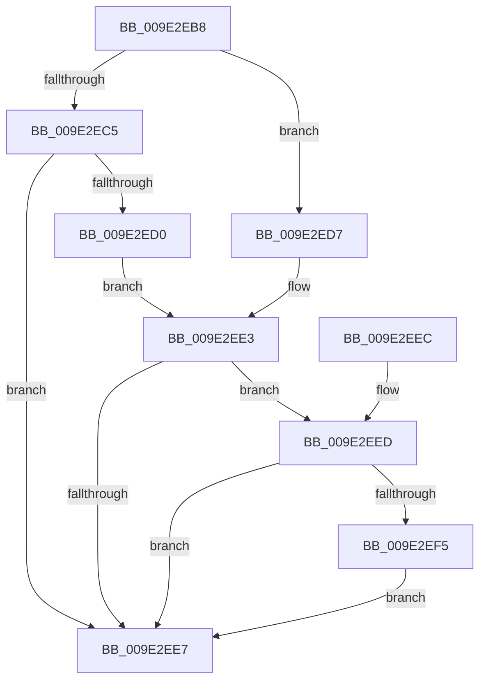

# WmipSendDisableRequest

- RVA: `0x009E2EB8`–`0x009E2F05` (길이 `77` bytes)
- VA: `0x00000001409E2EB8`
- 실행 섹션: `PAGE`
- PDB 이름 있음: `예`; PDB Function 태그: `아니요`
- unwind 정보 RVA: `0x00065F4C`
- 디코드: `28`개 명령, `77/77` bytes 표시
- 미해석 바이트: `0` (있으면 어셈블리에 `.byte`로 보존)

> 이 문서는 커널 이미지의 기계어와 PDB 기호를 분석해 생성했습니다. 4번과 5번은 함수 원형과 자료형을 바이너리 사용 방식에서 추정한 C 해석이며 원본 소스 복구 결과는 아닙니다.

## 1. Dependencies

- 직접 호출 지점: **1**; 고유 호출 대상: **1**
- 직접 호출자로 확인된 함수: **1**
- RIP 상대 이미지 참조: **0**

### Outgoing calls
- `0x009E2EFE` → [WmipDoDisableRequest](WmipDoDisableRequest_function_009E3730.md) (function, `0x009E3730`)

### Direct callers
- [WmipDisableCollectOrEvent](WmipDisableCollectOrEvent_function_009E26D0.md) at `0x009E270F`

### Static image references
- 디코드된 RIP-relative 메모리 참조가 없습니다.

## 2. Other-region calls and transfers

- 다른 실행 섹션으로 향하는 call: **0**
- 별도 외부 분기/꼬리 이동을 확인하지 못했습니다.

## 3. Assembly (complete function range)

```asm
009E2EB8  48 83 EC 28                     sub rsp, 0x28
009E2EBC  33 C0                           xor eax, eax
009E2EBE  44 8A CA                        mov r9b, dl
009E2EC1  84 D2                           test dl, dl
009E2EC3  74 12                           je 0x1409e2ed7
009E2EC5  8B 51 58                        mov edx, dword ptr [rcx + 0x58]
009E2EC8  44 8D 40 02                     lea r8d, [rax + 2]
009E2ECC  85 D2                           test edx, edx
009E2ECE  74 17                           je 0x1409e2ee7
009E2ED0  FF CA                           dec edx
009E2ED2  89 51 58                        mov dword ptr [rcx + 0x58], edx
009E2ED5  EB 0C                           jmp 0x1409e2ee3
009E2ED7  FF 49 5C                        dec dword ptr [rcx + 0x5c]
009E2EDA  41 B8 04 00 00 00               mov r8d, 4
009E2EE0  8B 51 5C                        mov edx, dword ptr [rcx + 0x5c]
009E2EE3  85 D2                           test edx, edx
009E2EE5  74 06                           je 0x1409e2eed
009E2EE7  48 83 C4 28                     add rsp, 0x28
009E2EEB  C3                              ret
009E2EEC  CC                              int3
009E2EED  8B 51 10                        mov edx, dword ptr [rcx + 0x10]
009E2EF0  41 85 D0                        test r8d, edx
009E2EF3  75 F2                           jne 0x1409e2ee7
009E2EF5  41 0B D0                        or edx, r8d
009E2EF8  89 51 10                        mov dword ptr [rcx + 0x10], edx
009E2EFB  41 8A D1                        mov dl, r9b
009E2EFE  E8 2D 08 00 00                  call 0x1409e3730
009E2F03  EB E2                           jmp 0x1409e2ee7
```

## 4. C-style interpretation (structured pseudocode)

```c
__int64 __fastcall WmipSendDisableRequest(__int64 a1, unsigned __int8 a2)
{
    __int64 result;
    __int64 v_rsp;

    v_rsp = (v_rsp) - (40);
    result = 0;
    if (a2 == 0) goto loc_009E2ED7;
    if ((unsigned int)((unsigned int)(*(unsigned int *)(a1 + 88))) == 0) goto loc_009E2EE7;
    a2 = (unsigned int)(((unsigned int)(*(unsigned int *)(a1 + 88))) - 1);
    *(unsigned int *)(a1 + 88) = a2;
    goto loc_009E2EE3;
loc_009E2ED7:
loc_009E2EE3:
    if ((unsigned int)((unsigned int)(*(unsigned int *)(a1 + 92))) == 0) goto loc_009E2EED;
loc_009E2EE7:
    v_rsp = (v_rsp) + (40);
    return result;
loc_009E2EED:
    if (((4) & ((unsigned int)((unsigned int)(*(unsigned int *)(a1 + 16))))) != 0) goto loc_009E2EE7;
    a2 = (unsigned int)(((unsigned int)(*(unsigned int *)(a1 + 16))) | (4));
    *(unsigned int *)(a1 + 16) = a2;
    result = WmipDoDisableRequest(a1, a2, 4, a2);
    goto loc_009E2EE7;
}
```

## 5. (Beta) C Style

```c
int64_t WmipSendDisableRequest(void *Arg1, uint8_t Arg2)
{
    uint8_t *arg1 = (uint8_t *)Arg1;

    int64_t result;
    int64_t local_rsp;

    local_rsp = (local_rsp) - (40);
    result = 0;
    if (Arg2 == 0) goto loc_009E2ED7;
    if ((uint32_t)((uint32_t)(*(uint32_t *)(arg1 + 0x58))) == 0) goto loc_009E2EE7;
    Arg2 = (uint32_t)(((uint32_t)(*(uint32_t *)(arg1 + 0x58))) - 1);
    *(uint32_t *)(arg1 + 0x58) = Arg2;
    goto loc_009E2EE3;
loc_009E2ED7:
loc_009E2EE3:
    if ((uint32_t)((uint32_t)(*(uint32_t *)(arg1 + 0x5C))) == 0) goto loc_009E2EED;
loc_009E2EE7:
    local_rsp = (local_rsp) + (40);
    return result;
loc_009E2EED:
    if (((4) & ((uint32_t)((uint32_t)(*(uint32_t *)(arg1 + 0x10))))) != 0) goto loc_009E2EE7;
    Arg2 = (uint32_t)(((uint32_t)(*(uint32_t *)(arg1 + 0x10))) | (4));
    *(uint32_t *)(arg1 + 0x10) = Arg2;
    result = WmipDoDisableRequest(Arg1, Arg2, 4, Arg2);
    goto loc_009E2EE7;
}
```

### 관측된 메모리 오프셋

구조체 형식이 확인되지 않은 접근은 인자 기준의 오프셋으로만 기록했습니다.

| 기준 인자 | 오프셋 표현 | 폭 (bit) | 접근 |
|---|---:|---:|---|
| `Arg1` | `+ 0x10` | `32` | `R` |
| `Arg1` | `+ 0x10` | `32` | `W` |
| `Arg1` | `+ 0x58` | `32` | `R` |
| `Arg1` | `+ 0x58` | `32` | `W` |
| `Arg1` | `+ 0x5C` | `32` | `R` |
| `Arg1` | `+ 0x5C` | `32` | `R/W` |

## 6. Execution-region graph

[열기: 2D/3D 그래프와 함수 탐색 컨트롤 패널](../../../control-panel.html?section=page&rva=0x009E2EB8&view=graph)

- 2D 그래프는 위에서 아래로 흐르고, 3D 그래프는 빈 공간을 드래그해 회전합니다. Shift+드래그는 이동, 휠은 확대·축소, 함수 노드 선택은 대상 보고서 이동입니다.

### Static fallback


