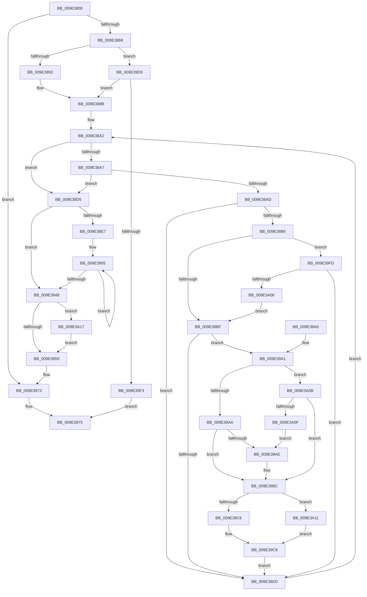

# WmipSendEnableDisableRequest

- RVA: `0x009E3800`–`0x009E3A26` (길이 `550` bytes)
- VA: `0x00000001409E3800`
- 실행 섹션: `PAGE`
- PDB 이름 있음: `예`; PDB Function 태그: `아니요`
- unwind 정보 RVA: `0x000A3FC0`
- 디코드: `147`개 명령, `550/550` bytes 표시
- 미해석 바이트: `0` (있으면 어셈블리에 `.byte`로 보존)

> 이 문서는 커널 이미지의 기계어와 PDB 기호를 분석해 생성했습니다. 4번과 5번은 함수 원형과 자료형을 바이너리 사용 방식에서 추정한 C 해석이며 원본 소스 복구 결과는 아닙니다.

## 1. Dependencies

- 직접 호출 지점: **9**; 고유 호출 대상: **9**
- 직접 호출자로 확인된 함수: **4**
- RIP 상대 이미지 참조: **3**

### Outgoing calls
- `0x009E3845` → [memset](../../text/6C/memset_function_006C6C40.md) (function, `0x006C6C40`)
- `0x009E38DE` → [KeReleaseMutex](../../text/39/KeReleaseMutex_function_00396810.md) (function, `0x00396810`)
- `0x009E392A` → [WmipSendWmiIrp](WmipSendWmiIrp_function_009E0484.md) (function, `0x009E0484`)
- `0x009E3939` → [WmipUnreferenceEntry](WmipUnreferenceEntry_function_009E0CC8.md) (function, `0x009E0CC8`)
- `0x009E396E` → [KeWaitForSingleObject](../../text/20/KeWaitForSingleObject_function_0020E6B0.md) (function, `0x0020E6B0`)
- `0x009E3980` → [_security_check_cookie](../../text/6A/_security_check_cookie_function_006AC640.md) (function, `0x006AC640`)
- `0x009E39B5` → [WmipReferenceEntry](WmipReferenceEntry_function_009E1BF8.md) (function, `0x009E1BF8`)
- `0x009E39E2` → [ExAllocatePool2](../../poolcode/B8/ExAllocatePool2_function_00B820F0.md) (function, `0x00B820F0`)
- `0x009E3A1C` → [ExFreePoolWithTag](../../poolcode/B8/ExFreePoolWithTag_function_00B82870.md) (function, `0x00B82870`)

### Direct callers
- [WmipDisableCollectionForRemovedGuid](../9D/WmipDisableCollectionForRemovedGuid_function_009DE88C.md) at `0x009DE9C4`
- [WmipDisableCollectionForRemovedGuid](../9D/WmipDisableCollectionForRemovedGuid_function_009DE88C.md) at `0x009DE9F2`
- [WmipEnableCollectionForNewGuid](../9D/WmipEnableCollectionForNewGuid_function_009DFC0C.md) at `0x009DFD46`
- [WmipEnableCollectionForNewGuid](../9D/WmipEnableCollectionForNewGuid_function_009DFC0C.md) at `0x009DFD59`
- [WmipDoDisableRequest](WmipDoDisableRequest_function_009E3730.md) at `0x009E376E`
- [WmipDoDisableRequest](WmipDoDisableRequest_function_009E3730.md) at `0x009E37D2`
- [sub_00B3052E](../B3/Unknown_function_00B3052E.md) at `0x00B30537`
- [sub_00B3052E](../B3/Unknown_function_00B3052E.md) at `0x00B30573`

### Static image references
- `0x009E3817` → RVA `0x00E0A740` (`.data`; read)
- `0x009E38D7` → RVA `0x00EFFA60` (`.data`; read)
- `0x009E3932` → RVA `0x00E03648` (`.data`; read)

## 2. Other-region calls and transfers

- 다른 실행 섹션으로 향하는 call: **6**
  - `0x009E3845` → [memset](../../text/6C/memset_function_006C6C40.md) (`PAGE` → `.text`)
  - `0x009E38DE` → [KeReleaseMutex](../../text/39/KeReleaseMutex_function_00396810.md) (`PAGE` → `.text`)
  - `0x009E396E` → [KeWaitForSingleObject](../../text/20/KeWaitForSingleObject_function_0020E6B0.md) (`PAGE` → `.text`)
  - `0x009E3980` → [_security_check_cookie](../../text/6A/_security_check_cookie_function_006AC640.md) (`PAGE` → `.text`)
  - `0x009E39E2` → [ExAllocatePool2](../../poolcode/B8/ExAllocatePool2_function_00B820F0.md) (`PAGE` → `POOLCODE`)
  - `0x009E3A1C` → [ExFreePoolWithTag](../../poolcode/B8/ExFreePoolWithTag_function_00B82870.md) (`PAGE` → `POOLCODE`)
- 별도 외부 분기/꼬리 이동을 확인하지 못했습니다.

## 3. Assembly (complete function range)

```asm
009E3800  48 89 5C 24 18                  mov qword ptr [rsp + 0x18], rbx
009E3805  55                              push rbp
009E3806  56                              push rsi
009E3807  57                              push rdi
009E3808  41 54                           push r12
009E380A  41 55                           push r13
009E380C  41 56                           push r14
009E380E  41 57                           push r15
009E3810  48 81 EC 90 02 00 00            sub rsp, 0x290
009E3817  48 8B 05 22 6F 42 00            mov rax, qword ptr [rip + 0x426f22]
009E381E  48 33 C4                        xor rax, rsp
009E3821  48 89 84 24 80 02 00 00         mov qword ptr [rsp + 0x280], rax
009E3829  45 8A E0                        mov r12b, r8b
009E382C  88 4C 24 30                     mov byte ptr [rsp + 0x30], cl
009E3830  4C 8B F2                        mov r14, rdx
009E3833  8A D9                           mov bl, cl
009E3835  33 D2                           xor edx, edx
009E3837  48 8D 8C 24 80 00 00 00         lea rcx, [rsp + 0x80]
009E383F  41 B8 00 02 00 00               mov r8d, 0x200
009E3845  E8 F6 33 CE FF                  call 0x1406c6c40
009E384A  41 8B 46 10                     mov eax, dword ptr [r14 + 0x10]
009E384E  0F 57 C0                        xorps xmm0, xmm0
009E3851  0F 11 44 24 48                  movups xmmword ptr [rsp + 0x48], xmm0
009E3856  0F 11 44 24 58                  movups xmmword ptr [rsp + 0x58], xmm0
009E385B  0F 11 44 24 68                  movups xmmword ptr [rsp + 0x68], xmm0
009E3860  A8 01                           test al, 1
009E3862  0F 85 0B 01 00 00               jne 0x1409e3973
009E3868  8D 43 FC                        lea eax, [rbx - 4]
009E386B  A8 FD                           test al, 0xfd
009E386D  41 8A C4                        mov al, r12b
009E3870  41 0F 94 C5                     sete r13b
009E3874  F6 D8                           neg al
009E3876  41 8B 46 24                     mov eax, dword ptr [r14 + 0x24]
009E387A  1B F6                           sbb esi, esi
009E387C  33 ED                           xor ebp, ebp
009E387E  81 E6 00 E0 FF FF               and esi, 0xffffe000
009E3884  81 C6 00 40 00 00               add esi, 0x4000
009E388A  83 F8 40                        cmp eax, 0x40
009E388D  0F 87 3D 01 00 00               ja 0x1409e39d0
009E3893  48 8D BC 24 80 00 00 00         lea rdi, [rsp + 0x80]
009E389B  4D 8D 7E 38                     lea r15, [r14 + 0x38]
009E389F  49 8B 1F                        mov rbx, qword ptr [r15]
009E38A2  49 3B DF                        cmp rbx, r15
009E38A5  74 2E                           je 0x1409e38d5
009E38A7  41 3B 6E 24                     cmp ebp, dword ptr [r14 + 0x24]
009E38AB  73 28                           jae 0x1409e38d5
009E38AD  8B 4B 10                        mov ecx, dword ptr [rbx + 0x10]
009E38B0  0F BA E1 0C                     bt ecx, 0xc
009E38B4  72 1A                           jb 0x1409e38d0
009E38B6  45 84 E4                        test r12b, r12b
009E38B9  0F 84 3E 01 00 00               je 0x1409e39fd
009E38BF  48 8B 53 40                     mov rdx, qword ptr [rbx + 0x40]
009E38C3  F7 42 10 00 00 00 20            test dword ptr [rdx + 0x10], 0x20000000
009E38CA  0F 84 D1 00 00 00               je 0x1409e39a1
009E38D0  48 8B 1B                        mov rbx, qword ptr [rbx]
009E38D3  EB CD                           jmp 0x1409e38a2
009E38D5  33 D2                           xor edx, edx
009E38D7  48 8D 0D 82 C1 51 00            lea rcx, [rip + 0x51c182]
009E38DE  E8 2D 2F 9B FF                  call 0x140396810
009E38E3  85 ED                           test ebp, ebp
009E38E5  74 61                           je 0x1409e3948
009E38E7  41 0F 10 46 48                  movups xmm0, xmmword ptr [r14 + 0x48]
009E38EC  44 8A 74 24 30                  mov r14b, byte ptr [rsp + 0x30]
009E38F1  41 BF 30 00 00 00               mov r15d, 0x30
009E38F7  44 89 7C 24 48                  mov dword ptr [rsp + 0x48], r15d
009E38FC  48 8B F7                        mov rsi, rdi
009E38FF  F3 0F 7F 44 24 60               movdqu xmmword ptr [rsp + 0x60], xmm0
009E3905  48 8B 1E                        mov rbx, qword ptr [rsi]
009E3908  48 8D 44 24 38                  lea rax, [rsp + 0x38]
009E390D  48 89 44 24 28                  mov qword ptr [rsp + 0x28], rax
009E3912  4C 8D 44 24 60                  lea r8, [rsp + 0x60]
009E3917  48 8D 44 24 48                  lea rax, [rsp + 0x48]
009E391C  45 8B CF                        mov r9d, r15d
009E391F  41 8A CE                        mov cl, r14b
009E3922  48 89 44 24 20                  mov qword ptr [rsp + 0x20], rax
009E3927  8B 53 38                        mov edx, dword ptr [rbx + 0x38]
009E392A  E8 55 CB FF FF                  call 0x1409e0484
009E392F  48 8B D3                        mov rdx, rbx
009E3932  48 8D 0D 0F FD 41 00            lea rcx, [rip + 0x41fd0f]
009E3939  E8 8A D3 FF FF                  call 0x1409e0cc8
009E393E  48 8D 76 08                     lea rsi, [rsi + 8]
009E3942  48 83 ED 01                     sub rbp, 1
009E3946  75 BD                           jne 0x1409e3905
009E3948  48 8D 84 24 80 00 00 00         lea rax, [rsp + 0x80]
009E3950  48 3B F8                        cmp rdi, rax
009E3953  0F 85 BE 00 00 00               jne 0x1409e3a17
009E3959  48 83 64 24 20 00               and qword ptr [rsp + 0x20], 0
009E395F  48 8D 0D FA C0 51 00            lea rcx, [rip + 0x51c0fa]
009E3966  45 33 C9                        xor r9d, r9d
009E3969  45 33 C0                        xor r8d, r8d
009E396C  33 D2                           xor edx, edx
009E396E  E8 3D AD 82 FF                  call 0x14020e6b0
009E3973  33 C0                           xor eax, eax
009E3975  48 8B 8C 24 80 02 00 00         mov rcx, qword ptr [rsp + 0x280]
009E397D  48 33 CC                        xor rcx, rsp
009E3980  E8 BB 8C CC FF                  call 0x1406ac640
009E3985  48 8B 9C 24 E0 02 00 00         mov rbx, qword ptr [rsp + 0x2e0]
009E398D  48 81 C4 90 02 00 00            add rsp, 0x290
009E3994  41 5F                           pop r15
009E3996  41 5E                           pop r14
009E3998  41 5D                           pop r13
009E399A  41 5C                           pop r12
009E399C  5F                              pop rdi
009E399D  5E                              pop rsi
009E399E  5D                              pop rbp
009E399F  C3                              ret
009E39A0  CC                              int3
009E39A1  8B C6                           mov eax, esi
009E39A3  23 C1                           and eax, ecx
009E39A5  45 84 ED                        test r13b, r13b
009E39A8  75 61                           jne 0x1409e3a0b
009E39AA  85 C0                           test eax, eax
009E39AC  74 0E                           je 0x1409e39bc
009E39AE  48 8B CA                        mov rcx, rdx
009E39B1  48 89 14 EF                     mov qword ptr [rdi + rbp*8], rdx
009E39B5  E8 3E E2 FF FF                  call 0x1409e1bf8
009E39BA  FF C5                           inc ebp
009E39BC  8B 4B 10                        mov ecx, dword ptr [rbx + 0x10]
009E39BF  8B C6                           mov eax, esi
009E39C1  45 84 ED                        test r13b, r13b
009E39C4  74 4B                           je 0x1409e3a11
009E39C6  0B C1                           or eax, ecx
009E39C8  89 43 10                        mov dword ptr [rbx + 0x10], eax
009E39CB  E9 00 FF FF FF                  jmp 0x1409e38d0
009E39D0  48 8B D0                        mov rdx, rax
009E39D3  B9 00 01 00 00                  mov ecx, 0x100
009E39D8  48 C1 E2 03                     shl rdx, 3
009E39DC  41 B8 57 6D 69 70               mov r8d, 0x70696d57
009E39E2  E8 09 E7 19 00                  call 0x140b820f0
009E39E7  48 8B F8                        mov rdi, rax
009E39EA  48 85 C0                        test rax, rax
009E39ED  0F 85 A8 FE FF FF               jne 0x1409e389b
009E39F3  B8 9A 00 00 C0                  mov eax, 0xc000009a
009E39F8  E9 78 FF FF FF                  jmp 0x1409e3975
009E39FD  F6 C1 04                        test cl, 4
009E3A00  0F 84 CA FE FF FF               je 0x1409e38d0
009E3A06  E9 B4 FE FF FF                  jmp 0x1409e38bf
009E3A0B  85 C0                           test eax, eax
009E3A0D  75 AD                           jne 0x1409e39bc
009E3A0F  EB 9D                           jmp 0x1409e39ae
009E3A11  F7 D0                           not eax
009E3A13  23 C1                           and eax, ecx
009E3A15  EB B1                           jmp 0x1409e39c8
009E3A17  33 D2                           xor edx, edx
009E3A19  48 8B CF                        mov rcx, rdi
009E3A1C  E8 4F EE 19 00                  call 0x140b82870
009E3A21  E9 33 FF FF FF                  jmp 0x1409e3959
```

## 4. C-style interpretation (structured pseudocode)

```c
__int64 __fastcall WmipSendEnableDisableRequest(unsigned __int8 a1, __int64 a2, unsigned __int8 a3)
{
    __int64 result;
    __int64 v_r13;
    __int64 v_rbp;
    __int64 v_rsi;
    __int64 v_rsp;
    unsigned __int64 v_stack_m248;
    unsigned __int64 v_stack_m260;
    unsigned __int64 v_stack_m268;
    unsigned __int64 v_stack_m270;
    unsigned __int64 v_stack_m280;
    unsigned __int64 v_stack_m290;
    unsigned __int8 v_stack_m298;
    unsigned __int64 v_stack_m2A0;
    unsigned __int64 v_stack_m2A8;
    unsigned __int64 v_stack_m48;
    unsigned __int64 v_stack_p18;

    v_stack_p18 = v_rbx;
    v_rsp = (v_rsp) - (656);
    result = (*(unsigned __int64 *)(v_rip + 4353826)) ^ (v_rsp);
    v_stack_m48 = result;
    v_stack_m298 = a1;
    a2 = 0;
    result = memset(v_stack_m248, a2, 512, a4);
    v_stack_m280 = v_xmm0;
    v_stack_m270 = v_xmm0;
    v_stack_m260 = v_xmm0;
    if ((((unsigned __int8)((unsigned int)(*(unsigned int *)(a2 + 16)))) & (1)) != 0) goto loc_009E3973;
    v_r13 = ((((unsigned __int8)(a1 - 4)) & (253)) == 0) ? 1 : 0;
    result = (unsigned __int8)(-(a3));
    v_rbp = 0;
    v_rsi = (unsigned int)((v_rsi) & (0xFFFFE000ULL));
    v_rsi = (unsigned int)((v_rsi) + (0x4000ULL));
    if (((unsigned int)((unsigned int)(*(unsigned int *)(a2 + 36)))) > 64) goto loc_009E39D0;
loc_009E389B:
loc_009E38A2:
    if ((*(unsigned __int64 *)(a2 + 56)) == (a2 + 56)) goto loc_009E38D5;
    if (0 >= (*(unsigned int *)(a2 + 36))) goto loc_009E38D5;
    if (0 < (*(unsigned int *)(a2 + 36))) goto loc_009E38D0;
    if (a3 == 0) goto loc_009E39FD;
loc_009E38BF:
    if (((*(unsigned int *)(*(unsigned __int64 *)(*(unsigned __int64 *)(a2 + 56) + 64) + 16)) & (0x20000000ULL)) == 0) goto loc_009E39A1;
loc_009E38D0:
    goto loc_009E38A2;
loc_009E38D5:
    a2 = 0;
    result = KeReleaseMutex(v_rip + 5357954, a2, 512, a4);
    if (0 == 0) goto loc_009E3948;
    v_stack_m280 = 48;
    v_stack_m268 = v_xmm0;
loc_009E3905:
    v_stack_m2A0 = v_stack_m290;
    v_stack_m2A8 = v_stack_m280;
    result = WmipSendWmiIrp((unsigned __int8)(v_stack_m298), (unsigned int)(*(unsigned int *)(*(unsigned __int64 *)(v_stack_m248) + 56)), v_stack_m268, 48);
    result = WmipUnreferenceEntry(v_rip + 4324623, *(unsigned __int64 *)(v_stack_m248), v_stack_m268, 48);
    v_rbp = (v_rbp) - (1);
    if (condition_is_not_equal) goto loc_009E3905;
loc_009E3948:
    if (v_stack_m248 != v_stack_m248) goto loc_009E3A17;
loc_009E3959:
    a4 = 0;
    a3 = 0;
    a2 = 0;
    result = KeWaitForSingleObject(v_rip + 5357818, a2, a3, a4);
loc_009E3973:
    result = 0;
loc_009E3975:
    a1 = (v_stack_m48) ^ (v_rsp);
    result = _security_check_cookie(a1, a2, a3, a4);
    v_rsp = (v_rsp) + (656);
    return result;
loc_009E39A1:
    result = (unsigned int)(((unsigned int)((unsigned int)(v_stack_m248 + 8))) & (a1));
    if ((unsigned __int8)(v_r13) != 0) goto loc_009E3A0B;
    if ((unsigned int)(result) != 0) {
        a1 = 0;
        *(unsigned __int64 *)(v_stack_m248 + v_rbp * 8) = 0;
        result = WmipReferenceEntry(a1, a2, a3, a4);
        v_rbp = (unsigned int)((v_rbp) + 1);
    }
    if ((unsigned __int8)(v_r13) == 0) goto loc_009E3A11;
    result = (unsigned int)(((unsigned int)((unsigned int)(v_stack_m248 + 8))) | ((unsigned int)((unsigned int)(*(unsigned int *)(v_stack_p18 + 16)))));
loc_009E39C8:
    *(unsigned int *)(v_stack_p18 + 16) = (unsigned int)(result);
    goto loc_009E38D0;
loc_009E39D0:
    a2 = (result) << (3);
    result = ExAllocatePool2(256, a2, (unsigned int)(0x70696D57ULL), a4);
    if (result != 0) goto loc_009E389B;
    goto loc_009E3975;
loc_009E39FD:
    if (((256) & (4)) == 0) goto loc_009E38D0;
    goto loc_009E38BF;
loc_009E3A0B:
    if ((unsigned int)((unsigned int)(0xC000009AULL)) != 0) goto loc_009E39BC;
    goto loc_009E39AE;
loc_009E3A11:
    result = (unsigned int)(~((unsigned int)(0xC000009AULL)));
    result = (unsigned int)((result) & (256));
    goto loc_009E39C8;
loc_009E3A17:
    a2 = 0;
    result = ExFreePoolWithTag(result, a2, (unsigned int)(0x70696D57ULL), a4);
    goto loc_009E3959;
}
```

## 5. (Beta) C Style

```c
int64_t WmipSendEnableDisableRequest(void *Arg1, void *Arg2, uint8_t Arg3)
{
    uint8_t *arg1 = (uint8_t *)Arg1;
    uint8_t *arg2 = (uint8_t *)Arg2;

    int64_t result;
    int64_t local_r13;
    int64_t local_rbp;
    int64_t local_rsi;
    int64_t local_rsp;
    uint64_t v_stack_m248;
    uint64_t v_stack_m260;
    uint64_t v_stack_m268;
    uint64_t v_stack_m270;
    uint64_t v_stack_m280;
    uint64_t v_stack_m290;
    uint8_t v_stack_m298;
    uint64_t v_stack_m2A0;
    uint64_t v_stack_m2A8;
    uint64_t v_stack_m48;
    uint64_t v_stack_p18;

    v_stack_p18 = local_rbx;
    local_rsp = (local_rsp) - (656);
    result = (*(uint64_t *)(v_rip + 0x426F22)) ^ (local_rsp);
    v_stack_m48 = result;
    v_stack_m298 = Arg1;
    Arg2 = 0;
    result = memset(v_stack_m248, Arg2, 512, a4);
    v_stack_m280 = v_xmm0;
    v_stack_m270 = v_xmm0;
    v_stack_m260 = v_xmm0;
    if ((((uint8_t)((uint32_t)(*(uint32_t *)(arg2 + 0x10)))) & (1)) != 0) goto loc_009E3973;
    local_r13 = ((((uint8_t)(Arg1 - 4)) & (253)) == 0) ? 1 : 0;
    result = (uint8_t)(-(Arg3));
    local_rbp = 0;
    local_rsi = (uint32_t)((local_rsi) & (0xFFFFE000ULL));
    local_rsi = (uint32_t)((local_rsi) + (0x4000ULL));
    if (((uint32_t)((uint32_t)(*(uint32_t *)(arg2 + 0x24)))) > 64) goto loc_009E39D0;
loc_009E389B:
loc_009E38A2:
    if ((*(uint64_t *)(arg2 + 0x38)) == (Arg2 + 56)) goto loc_009E38D5;
    if (0 >= (*(uint32_t *)(arg2 + 0x24))) goto loc_009E38D5;
    if (0 < (*(uint32_t *)(arg2 + 0x24))) goto loc_009E38D0;
    if (Arg3 == 0) goto loc_009E39FD;
loc_009E38BF:
    if (((*(uint32_t *)(*(uint64_t *)(*(uint64_t *)(arg2 + 0x38) + 0x40) + 0x10)) & (0x20000000ULL)) == 0) goto loc_009E39A1;
loc_009E38D0:
    goto loc_009E38A2;
loc_009E38D5:
    Arg2 = 0;
    result = KeReleaseMutex(v_rip + 5357954, Arg2, 512, a4);
    if (0 == 0) goto loc_009E3948;
    v_stack_m280 = 48;
    v_stack_m268 = v_xmm0;
loc_009E3905:
    v_stack_m2A0 = v_stack_m290;
    v_stack_m2A8 = v_stack_m280;
    result = WmipSendWmiIrp((uint8_t)(v_stack_m298), (uint32_t)(*(uint32_t *)(*(uint64_t *)(v_stack_m248) + 0x38)), v_stack_m268, 48);
    result = WmipUnreferenceEntry(v_rip + 4324623, *(uint64_t *)(v_stack_m248), v_stack_m268, 48);
    local_rbp = (local_rbp) - (1);
    if (condition_is_not_equal) goto loc_009E3905;
loc_009E3948:
    if (v_stack_m248 != v_stack_m248) goto loc_009E3A17;
loc_009E3959:
    a4 = 0;
    Arg3 = 0;
    Arg2 = 0;
    result = KeWaitForSingleObject(v_rip + 5357818, Arg2, Arg3, a4);
loc_009E3973:
    result = 0;
loc_009E3975:
    Arg1 = (v_stack_m48) ^ (local_rsp);
    result = _security_check_cookie(Arg1, Arg2, Arg3, a4);
    local_rsp = (local_rsp) + (656);
    return result;
loc_009E39A1:
    result = (uint32_t)(((uint32_t)((uint32_t)(v_stack_m248 + 8))) & (Arg1));
    if ((uint8_t)(local_r13) != 0) goto loc_009E3A0B;
    if ((uint32_t)(result) != 0) {
        Arg1 = 0;
        *(uint64_t *)(v_stack_m248 + local_rbp * 8) = 0;
        result = WmipReferenceEntry(Arg1, Arg2, Arg3, a4);
        local_rbp = (uint32_t)((local_rbp) + 1);
    }
    if ((uint8_t)(local_r13) == 0) goto loc_009E3A11;
    result = (uint32_t)(((uint32_t)((uint32_t)(v_stack_m248 + 8))) | ((uint32_t)((uint32_t)(*(uint32_t *)(v_stack_p18 + 0x10)))));
loc_009E39C8:
    *(uint32_t *)(v_stack_p18 + 0x10) = (uint32_t)(result);
    goto loc_009E38D0;
loc_009E39D0:
    Arg2 = (result) << (3);
    result = ExAllocatePool2(256, Arg2, (uint32_t)(0x70696D57ULL), a4);
    if (result != 0) goto loc_009E389B;
    goto loc_009E3975;
loc_009E39FD:
    if (((256) & (4)) == 0) goto loc_009E38D0;
    goto loc_009E38BF;
loc_009E3A0B:
    if ((uint32_t)((uint32_t)(0xC000009AULL)) != 0) goto loc_009E39BC;
    goto loc_009E39AE;
loc_009E3A11:
    result = (uint32_t)(~((uint32_t)(0xC000009AULL)));
    result = (uint32_t)((result) & (256));
    goto loc_009E39C8;
loc_009E3A17:
    Arg2 = 0;
    result = ExFreePoolWithTag(result, Arg2, (uint32_t)(0x70696D57ULL), a4);
    goto loc_009E3959;
}
```

### 관측된 메모리 오프셋

구조체 형식이 확인되지 않은 접근은 인자 기준의 오프셋으로만 기록했습니다.

| 기준 인자 | 오프셋 표현 | 폭 (bit) | 접근 |
|---|---:|---:|---|
| `Arg1` | `- 0x4` | `32` | `R` |
| `Arg2` | `+ 0x0` | `64` | `R` |
| `Arg2` | `+ 0x10` | `32` | `R` |
| `Arg2` | `+ 0x24` | `32` | `R` |
| `Arg2` | `+ 0x38` | `64` | `R` |
| `Arg2` | `+ 0x48` | `128` | `R` |

## 6. Execution-region graph

[열기: 2D/3D 그래프와 함수 탐색 컨트롤 패널](../../../control-panel.html?section=page&rva=0x009E3800&view=graph)

- 2D 그래프는 위에서 아래로 흐르고, 3D 그래프는 빈 공간을 드래그해 회전합니다. Shift+드래그는 이동, 휠은 확대·축소, 함수 노드 선택은 대상 보고서 이동입니다.

### Static fallback


