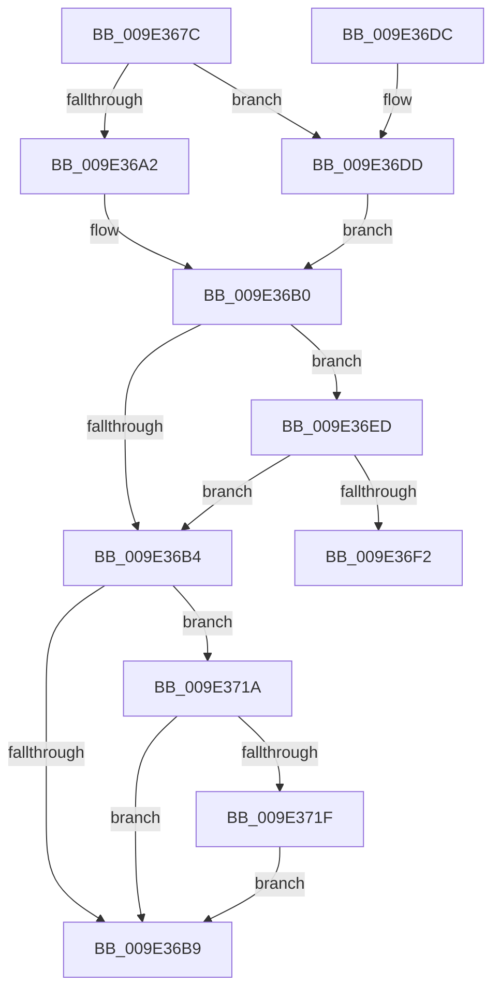

# WmipSendEnableRequest

- RVA: `0x009E367C`–`0x009E3729` (길이 `173` bytes)
- VA: `0x00000001409E367C`
- 실행 섹션: `PAGE`
- PDB 이름 있음: `예`; PDB Function 태그: `예`
- unwind 정보 RVA: `0x000A3F70`
- 디코드: `57`개 명령, `173/173` bytes 표시
- 미해석 바이트: `0` (있으면 어셈블리에 `.byte`로 보존)

> 이 문서는 커널 이미지의 기계어와 PDB 기호를 분석해 생성했습니다. 4번과 5번은 함수 원형과 자료형을 바이너리 사용 방식에서 추정한 C 해석이며 원본 소스 복구 결과는 아닙니다.

## 1. Dependencies

- 직접 호출 지점: **2**; 고유 호출 대상: **2**
- 직접 호출자로 확인된 함수: **1**
- RIP 상대 이미지 참조: **0**

### Outgoing calls
- `0x009E36F5` → [WmipReferenceEntry](WmipReferenceEntry_function_009E1BF8.md) (function, `0x009E1BF8`)
- `0x009E3722` → [WmipWaitForCollectionEnabled](../7B/WmipWaitForCollectionEnabled_function_007B49C0.md) (function, `0x007B49C0`)

### Direct callers
- [WmipEnableCollectOrEvent](WmipEnableCollectOrEvent_function_009E221C.md) at `0x009E22E2`

### Static image references
- 디코드된 RIP-relative 메모리 참조가 없습니다.

## 2. Other-region calls and transfers

- 다른 실행 섹션으로 향하는 call: **0**
- call이 아닌 외부 분기/꼬리 이동: **1**
  - `0x009E3715` → [sub_00B3052E](../B3/Unknown_function_00B3052E.md) (`tail-transfer`)

## 3. Assembly (complete function range)

```asm
009E367C  48 89 5C 24 08                  mov qword ptr [rsp + 8], rbx
009E3681  48 89 6C 24 10                  mov qword ptr [rsp + 0x10], rbp
009E3686  48 89 74 24 20                  mov qword ptr [rsp + 0x20], rsi
009E368B  57                              push rdi
009E368C  41 54                           push r12
009E368E  41 55                           push r13
009E3690  41 56                           push r14
009E3692  41 57                           push r15
009E3694  48 83 EC 20                     sub rsp, 0x20
009E3698  40 8A F2                        mov sil, dl
009E369B  48 8B D9                        mov rbx, rcx
009E369E  84 D2                           test dl, dl
009E36A0  74 3B                           je 0x1409e36dd
009E36A2  8B 49 58                        mov ecx, dword ptr [rcx + 0x58]
009E36A5  BF 02 00 00 00                  mov edi, 2
009E36AA  8D 41 01                        lea eax, [rcx + 1]
009E36AD  89 43 58                        mov dword ptr [rbx + 0x58], eax
009E36B0  85 C9                           test ecx, ecx
009E36B2  74 39                           je 0x1409e36ed
009E36B4  40 84 F6                        test sil, sil
009E36B7  74 61                           je 0x1409e371a
009E36B9  45 33 E4                        xor r12d, r12d
009E36BC  48 8B 5C 24 50                  mov rbx, qword ptr [rsp + 0x50]
009E36C1  41 8B C4                        mov eax, r12d
009E36C4  48 8B 6C 24 58                  mov rbp, qword ptr [rsp + 0x58]
009E36C9  48 8B 74 24 68                  mov rsi, qword ptr [rsp + 0x68]
009E36CE  48 83 C4 20                     add rsp, 0x20
009E36D2  41 5F                           pop r15
009E36D4  41 5E                           pop r14
009E36D6  41 5D                           pop r13
009E36D8  41 5C                           pop r12
009E36DA  5F                              pop rdi
009E36DB  C3                              ret
009E36DC  CC                              int3
009E36DD  8B 49 5C                        mov ecx, dword ptr [rcx + 0x5c]
009E36E0  BF 04 00 00 00                  mov edi, 4
009E36E5  8D 41 01                        lea eax, [rcx + 1]
009E36E8  89 43 5C                        mov dword ptr [rbx + 0x5c], eax
009E36EB  EB C3                           jmp 0x1409e36b0
009E36ED  85 7B 10                        test dword ptr [rbx + 0x10], edi
009E36F0  75 C2                           jne 0x1409e36b4
009E36F2  48 8B CB                        mov rcx, rbx
009E36F5  E8 FE E4 FF FF                  call 0x1409e1bf8
009E36FA  09 7B 10                        or dword ptr [rbx + 0x10], edi
009E36FD  4C 8D 73 58                     lea r14, [rbx + 0x58]
009E3701  40 8A C6                        mov al, sil
009E3704  4C 8D 7B 5C                     lea r15, [rbx + 0x5c]
009E3708  F6 D8                           neg al
009E370A  40 1A ED                        sbb bpl, bpl
009E370D  40 80 E5 FE                     and bpl, 0xfe
009E3711  40 80 C5 06                     add bpl, 6
009E3715  E9 14 CE 14 00                  jmp 0x140b3052e
009E371A  85 7B 10                        test dword ptr [rbx + 0x10], edi
009E371D  74 9A                           je 0x1409e36b9
009E371F  48 8B CB                        mov rcx, rbx
009E3722  E8 99 12 DD FF                  call 0x1407b49c0
009E3727  EB 90                           jmp 0x1409e36b9
```

## 4. C-style interpretation (structured pseudocode)

```c
__int64 __fastcall WmipSendEnableRequest(__int64 a1, unsigned __int8 a2)
{
    __int64 result;
    __int64 v_r12;
    __int64 v_rbp;
    __int64 v_rsp;
    unsigned __int64 v_stack_p10;
    unsigned __int64 v_stack_p20;
    unsigned __int64 v_stack_p8;

    v_stack_p8 = v_rbx;
    v_stack_p10 = v_rbp;
    v_stack_p20 = v_rsi;
    v_rsp = (v_rsp) - (32);
    if (a2 == 0) goto loc_009E36DD;
    *(unsigned int *)(a1 + 88) = (unsigned int)((unsigned int)(*(unsigned int *)(a1 + 88)) + 1);
loc_009E36B0:
    if ((unsigned int)((unsigned int)(*(unsigned int *)(a1 + 88))) == 0) goto loc_009E36ED;
loc_009E36B4:
    if (a2 == 0) goto loc_009E371A;
loc_009E36B9:
    v_r12 = 0;
    v_rsp = (v_rsp) + (32);
    return 0;
loc_009E36DD:
    *(unsigned int *)(v_stack_p8 + 92) = (unsigned int)((unsigned int)(*(unsigned int *)((unsigned int)(*(unsigned int *)(a1 + 88)) + 92)) + 1);
    goto loc_009E36B0;
loc_009E36ED:
    if (((*(unsigned int *)(v_stack_p8 + 16)) & (4)) != 0) goto loc_009E36B4;
    result = WmipReferenceEntry(v_stack_p8, a2, a3, a4);
    result = (unsigned __int8)(-((unsigned __int8)(v_stack_p20)));
    v_rbp = (unsigned __int8)((v_stack_p10) & (254));
    v_rbp = (unsigned __int8)((v_rbp) + (6));
loc_009E371A:
    if (((*(unsigned int *)(v_stack_p8 + 16)) & (4)) == 0) goto loc_009E36B9;
    result = WmipWaitForCollectionEnabled(v_stack_p8, a2, a3, a4);
    goto loc_009E36B9;
}
```

## 5. (Beta) C Style

```c
int64_t WmipSendEnableRequest(void *Arg1, uint8_t Arg2)
{
    uint8_t *arg1 = (uint8_t *)Arg1;

    int64_t result;
    int64_t local_r12;
    int64_t local_rbp;
    int64_t local_rsp;
    uint64_t v_stack_p10;
    uint64_t v_stack_p20;
    uint64_t v_stack_p8;

    v_stack_p8 = local_rbx;
    v_stack_p10 = local_rbp;
    v_stack_p20 = local_rsi;
    local_rsp = (local_rsp) - (32);
    if (Arg2 == 0) goto loc_009E36DD;
    *(uint32_t *)(arg1 + 0x58) = (uint32_t)((uint32_t)(*(uint32_t *)(arg1 + 0x58)) + 1);
loc_009E36B0:
    if ((uint32_t)((uint32_t)(*(uint32_t *)(arg1 + 0x58))) == 0) goto loc_009E36ED;
loc_009E36B4:
    if (Arg2 == 0) goto loc_009E371A;
loc_009E36B9:
    local_r12 = 0;
    local_rsp = (local_rsp) + (32);
    return 0;
loc_009E36DD:
    *(uint32_t *)(v_stack_p8 + 0x5C) = (uint32_t)((uint32_t)(*(uint32_t *)((uint32_t)(*(uint32_t *)(arg1 + 0x58)) + 0x5C)) + 1);
    goto loc_009E36B0;
loc_009E36ED:
    if (((*(uint32_t *)(v_stack_p8 + 0x10)) & (4)) != 0) goto loc_009E36B4;
    result = WmipReferenceEntry(v_stack_p8, Arg2, a3, a4);
    result = (uint8_t)(-((uint8_t)(v_stack_p20)));
    local_rbp = (uint8_t)((v_stack_p10) & (254));
    local_rbp = (uint8_t)((local_rbp) + (6));
loc_009E371A:
    if (((*(uint32_t *)(v_stack_p8 + 0x10)) & (4)) == 0) goto loc_009E36B9;
    result = WmipWaitForCollectionEnabled(v_stack_p8, Arg2, a3, a4);
    goto loc_009E36B9;
}
```

### 관측된 메모리 오프셋

구조체 형식이 확인되지 않은 접근은 인자 기준의 오프셋으로만 기록했습니다.

| 기준 인자 | 오프셋 표현 | 폭 (bit) | 접근 |
|---|---:|---:|---|
| `Arg1` | `+ 0x10` | `32` | `R` |
| `Arg1` | `+ 0x10` | `32` | `R/W` |
| `Arg1` | `+ 0x58` | `32` | `R` |
| `Arg1` | `+ 0x58` | `32` | `W` |
| `Arg1` | `+ 0x58` | `64` | `R` |
| `Arg1` | `+ 0x5C` | `32` | `R` |
| `Arg1` | `+ 0x5C` | `32` | `W` |
| `Arg1` | `+ 0x5C` | `64` | `R` |

## 6. Execution-region graph

[열기: 2D/3D 그래프와 함수 탐색 컨트롤 패널](../../../control-panel.html?section=page&rva=0x009E367C&view=graph)

- 2D 그래프는 위에서 아래로 흐르고, 3D 그래프는 빈 공간을 드래그해 회전합니다. Shift+드래그는 이동, 휠은 확대·축소, 함수 노드 선택은 대상 보고서 이동입니다.

### Static fallback


