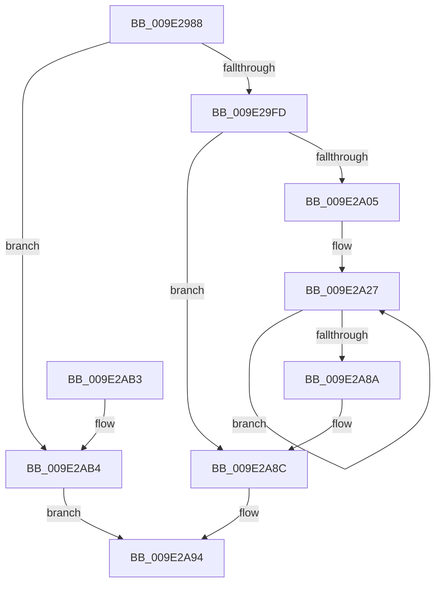

# WmipSendWmiIrpToTraceDeviceList

- RVA: `0x009E2988`–`0x009E2ABB` (길이 `307` bytes)
- VA: `0x00000001409E2988`
- 실행 섹션: `PAGE`
- PDB 이름 있음: `예`; PDB Function 태그: `아니요`
- unwind 정보 RVA: `0x000A3E98`
- 디코드: `82`개 명령, `307/307` bytes 표시
- 미해석 바이트: `0` (있으면 어셈블리에 `.byte`로 보존)

> 이 문서는 커널 이미지의 기계어와 PDB 기호를 분석해 생성했습니다. 4번과 5번은 함수 원형과 자료형을 바이너리 사용 방식에서 추정한 C 해석이며 원본 소스 복구 결과는 아닙니다.

## 1. Dependencies

- 직접 호출 지점: **6**; 고유 호출 대상: **6**
- 직접 호출자로 확인된 함수: **2**
- RIP 상대 이미지 참조: **2**

### Outgoing calls
- `0x009E29C5` → [KeWaitForSingleObject](../../text/20/KeWaitForSingleObject_function_0020E6B0.md) (function, `0x0020E6B0`)
- `0x009E29E2` → [KeReleaseMutex](../../text/39/KeReleaseMutex_function_00396810.md) (function, `0x00396810`)
- `0x009E29EC` → [IoAllocateIrp](../../text/20/IoAllocateIrp_function_002065D0.md) (function, `0x002065D0`)
- `0x009E2A30` → [IoInitializeIrp](../../text/44/IoInitializeIrp_function_00445050.md) (function, `0x00445050`)
- `0x009E2A7B` → [WmipForwardWmiIrp](WmipForwardWmiIrp_function_009E0DB4.md) (function, `0x009E0DB4`)
- `0x009E2A8F` → [IoFreeIrp](../../text/24/IoFreeIrp_function_0024DF70.md) (function, `0x0024DF70`)

### Direct callers
- [WmiSetNetworkNotify](../7B/WmiSetNetworkNotify_function_007B3EE4.md) at `0x007B3F2F`
- [WmiTraceRundownNotify](WmiTraceRundownNotify_function_009E46E0.md) at `0x009E476C`

### Static image references
- `0x009E29BB` → RVA `0x00EFFA60` (`.data`; read)
- `0x009E29CA` → RVA `0x00EFFA98` (`.data`; read)

## 2. Other-region calls and transfers

- 다른 실행 섹션으로 향하는 call: **5**
  - `0x009E29C5` → [KeWaitForSingleObject](../../text/20/KeWaitForSingleObject_function_0020E6B0.md) (`PAGE` → `.text`)
  - `0x009E29E2` → [KeReleaseMutex](../../text/39/KeReleaseMutex_function_00396810.md) (`PAGE` → `.text`)
  - `0x009E29EC` → [IoAllocateIrp](../../text/20/IoAllocateIrp_function_002065D0.md) (`PAGE` → `.text`)
  - `0x009E2A30` → [IoInitializeIrp](../../text/44/IoInitializeIrp_function_00445050.md) (`PAGE` → `.text`)
  - `0x009E2A8F` → [IoFreeIrp](../../text/24/IoFreeIrp_function_0024DF70.md) (`PAGE` → `.text`)
- 별도 외부 분기/꼬리 이동을 확인하지 못했습니다.

## 3. Assembly (complete function range)

```asm
009E2988  48 8B C4                        mov rax, rsp
009E298B  48 89 58 08                     mov qword ptr [rax + 8], rbx
009E298F  48 89 68 10                     mov qword ptr [rax + 0x10], rbp
009E2993  48 89 70 20                     mov qword ptr [rax + 0x20], rsi
009E2997  44 88 40 18                     mov byte ptr [rax + 0x18], r8b
009E299B  57                              push rdi
009E299C  41 54                           push r12
009E299E  41 55                           push r13
009E29A0  41 56                           push r14
009E29A2  41 57                           push r15
009E29A4  48 83 EC 30                     sub rsp, 0x30
009E29A8  45 8B E9                        mov r13d, r9d
009E29AB  8B EA                           mov ebp, edx
009E29AD  4C 8B F9                        mov r15, rcx
009E29B0  33 DB                           xor ebx, ebx
009E29B2  45 33 C9                        xor r9d, r9d
009E29B5  48 89 58 C8                     mov qword ptr [rax - 0x38], rbx
009E29B9  33 D2                           xor edx, edx
009E29BB  48 8D 0D 9E D0 51 00            lea rcx, [rip + 0x51d09e]
009E29C2  45 33 C0                        xor r8d, r8d
009E29C5  E8 E6 BC 82 FF                  call 0x14020e6b0
009E29CA  48 8B 05 C7 D0 51 00            mov rax, qword ptr [rip + 0x51d0c7]
009E29D1  48 8D 0D 88 D0 51 00            lea rcx, [rip + 0x51d088]
009E29D8  33 D2                           xor edx, edx
009E29DA  0F BE 78 4C                     movsx edi, byte ptr [rax + 0x4c]
009E29DE  44 8D 77 01                     lea r14d, [rdi + 1]
009E29E2  E8 29 3E 9B FF                  call 0x140396810
009E29E7  33 D2                           xor edx, edx
009E29E9  41 8A CE                        mov cl, r14b
009E29EC  E8 DF 3B 82 FF                  call 0x1402065d0
009E29F1  48 8B F0                        mov rsi, rax
009E29F4  48 85 C0                        test rax, rax
009E29F7  0F 84 B7 00 00 00               je 0x1409e2ab4
009E29FD  85 ED                           test ebp, ebp
009E29FF  0F 84 87 00 00 00               je 0x1409e2a8c
009E2A05  4C 8B A4 24 80 00 00 00         mov r12, qword ptr [rsp + 0x80]
009E2A0D  0F B7 C7                        movzx eax, di
009E2A10  8A 5C 24 70                     mov bl, byte ptr [rsp + 0x70]
009E2A14  66 C1 E0 03                     shl ax, 3
009E2A18  66 03 F8                        add di, ax
009E2A1B  B8 18 01 00 00                  mov eax, 0x118
009E2A20  66 C1 E7 03                     shl di, 3
009E2A24  66 03 F8                        add di, ax
009E2A27  45 8A C6                        mov r8b, r14b
009E2A2A  0F B7 D7                        movzx edx, di
009E2A2D  48 8B CE                        mov rcx, rsi
009E2A30  E8 1B 26 A6 FF                  call 0x140445050
009E2A35  48 83 86 B8 00 00 00 B8         add qword ptr [rsi + 0xb8], -0x48
009E2A3D  45 33 C9                        xor r9d, r9d
009E2A40  FE 4E 43                        dec byte ptr [rsi + 0x43]
009E2A43  8A D3                           mov dl, bl
009E2A45  48 8B 05 4C D0 51 00            mov rax, qword ptr [rip + 0x51d04c]
009E2A4C  48 8B 8E B8 00 00 00            mov rcx, qword ptr [rsi + 0xb8]
009E2A53  4C 89 64 24 28                  mov qword ptr [rsp + 0x28], r12
009E2A58  44 89 6C 24 20                  mov dword ptr [rsp + 0x20], r13d
009E2A5D  48 89 41 28                     mov qword ptr [rcx + 0x28], rax
009E2A61  48 8B CE                        mov rcx, rsi
009E2A64  65 48 8B 04 25 88 01 00 00      mov rax, qword ptr gs:[0x188]
009E2A6D  48 89 86 98 00 00 00            mov qword ptr [rsi + 0x98], rax
009E2A74  4D 8B 07                        mov r8, qword ptr [r15]
009E2A77  45 8B 40 38                     mov r8d, dword ptr [r8 + 0x38]
009E2A7B  E8 34 E3 FF FF                  call 0x1409e0db4
009E2A80  4D 8D 7F 10                     lea r15, [r15 + 0x10]
009E2A84  48 83 ED 01                     sub rbp, 1
009E2A88  75 9D                           jne 0x1409e2a27
009E2A8A  33 DB                           xor ebx, ebx
009E2A8C  48 8B CE                        mov rcx, rsi
009E2A8F  E8 DC B4 86 FF                  call 0x14024df70
009E2A94  48 8B 6C 24 68                  mov rbp, qword ptr [rsp + 0x68]
009E2A99  8B C3                           mov eax, ebx
009E2A9B  48 8B 5C 24 60                  mov rbx, qword ptr [rsp + 0x60]
009E2AA0  48 8B 74 24 78                  mov rsi, qword ptr [rsp + 0x78]
009E2AA5  48 83 C4 30                     add rsp, 0x30
009E2AA9  41 5F                           pop r15
009E2AAB  41 5E                           pop r14
009E2AAD  41 5D                           pop r13
009E2AAF  41 5C                           pop r12
009E2AB1  5F                              pop rdi
009E2AB2  C3                              ret
009E2AB3  CC                              int3
009E2AB4  BB 9A 00 00 C0                  mov ebx, 0xc000009a
009E2AB9  EB D9                           jmp 0x1409e2a94
```

## 4. C-style interpretation (structured pseudocode)

```c
__int64 __fastcall WmipSendWmiIrpToTraceDeviceList(__int64 a1, int a2, int a3, int a4, __int64 a5)
{
    __int64 result;
    __int64 v_rbp;
    __int64 v_rbx;
    __int64 v_rdi;
    __int64 v_rsp;
    unsigned __int64 v_stack_m30;
    unsigned int v_stack_m38;
    unsigned __int64 v_stack_p10;
    unsigned __int8 v_stack_p18;
    unsigned __int64 v_stack_p20;
    unsigned __int64 v_stack_p8;

    *(unsigned __int64 *)(v_rsp + 8) = v_rbx;
    *(unsigned __int64 *)(v_rsp + 16) = v_rbp;
    *(unsigned __int64 *)(v_rsp + 32) = v_rsi;
    *(unsigned __int8 *)(v_rsp + 24) = (unsigned __int8)(a3);
    v_rsp = (v_rsp) - (48);
    v_rbx = 0;
    a4 = 0;
    *(unsigned __int64 *)(v_rsp - 56) = 0;
    a2 = 0;
    a3 = 0;
    result = KeWaitForSingleObject(v_rip + 5361822, a2, a3, a4);
    a2 = 0;
    result = KeReleaseMutex(v_rip + 5361800, a2, a3, a4);
    a2 = 0;
    result = IoAllocateIrp((unsigned __int8)((__int8)(*(unsigned __int8 *)(*(unsigned __int64 *)(v_rip + 5361863) + 76)) + 1), a2, a3, a4);
    if (result == 0) goto loc_009E2AB4;
    if ((unsigned int)((unsigned int)(a2)) == 0) goto loc_009E2A8C;
    result = (unsigned __int16)(((unsigned __int16)((__int8)(*(unsigned __int8 *)(*(unsigned __int64 *)(v_rip + 5361863) + 76)))) << (3));
    v_rdi = (unsigned __int16)(((__int8)(*(unsigned __int8 *)(*(unsigned __int64 *)(v_rip + 5361863) + 76))) + ((unsigned __int16)(result)));
    v_rdi = (unsigned __int16)((v_rdi) << (3));
    v_rdi = (unsigned __int16)((v_rdi) + (280));
loc_009E2A27:
    result = IoInitializeIrp(result, (unsigned __int16)(v_rdi), (unsigned __int8)((__int8)(*(unsigned __int8 *)(*(unsigned __int64 *)(v_rip + 5361863) + 76)) + 1), a4);
    a4 = 0;
    v_stack_m30 = a5;
    v_stack_m38 = (unsigned int)((unsigned int)(a4));
    *(unsigned __int64 *)(*(unsigned __int64 *)(result + 184) + 40) = *(unsigned __int64 *)(v_rip + 5361740);
    *(unsigned __int64 *)(result + 152) = *(unsigned __int64 *)(gs_base + (0 + 392));
    result = WmipForwardWmiIrp(result, (unsigned __int8)(v_stack_p18), (unsigned int)(*(unsigned int *)(*(unsigned __int64 *)(a1) + 56)), a4);
    v_rbp = ((unsigned int)(a2)) - (1);
    if (condition_is_not_equal) goto loc_009E2A27;
    v_rbx = 0;
loc_009E2A8C:
    result = IoFreeIrp(result, (unsigned __int8)(v_stack_p18), (unsigned int)(*(unsigned int *)(*(unsigned __int64 *)(a1) + 56)), a4);
loc_009E2A94:
    v_rsp = (v_rsp) + (48);
    return 0;
loc_009E2AB4:
    goto loc_009E2A94;
}
```

## 5. (Beta) C Style

```c
int64_t WmipSendWmiIrpToTraceDeviceList(void *Arg1, int32_t Arg2, int32_t Arg3, int32_t Arg4, int64_t Arg5)
{
    uint8_t *arg1 = (uint8_t *)Arg1;

    int64_t result;
    int64_t local_rbp;
    int64_t local_rbx;
    int64_t local_rdi;
    int64_t local_rsp;
    uint64_t v_stack_m30;
    uint32_t v_stack_m38;
    uint64_t v_stack_p10;
    uint8_t v_stack_p18;
    uint64_t v_stack_p20;
    uint64_t v_stack_p8;

    *(uint64_t *)(local_rsp + 0x8) = local_rbx;
    *(uint64_t *)(local_rsp + 0x10) = local_rbp;
    *(uint64_t *)(local_rsp + 0x20) = local_rsi;
    *(uint8_t *)(local_rsp + 0x18) = (uint8_t)(Arg3);
    local_rsp = (local_rsp) - (48);
    local_rbx = 0;
    Arg4 = 0;
    *(uint64_t *)(local_rsp - 0x38) = 0;
    Arg2 = 0;
    Arg3 = 0;
    result = KeWaitForSingleObject(v_rip + 5361822, Arg2, Arg3, Arg4);
    Arg2 = 0;
    result = KeReleaseMutex(v_rip + 5361800, Arg2, Arg3, Arg4);
    Arg2 = 0;
    result = IoAllocateIrp((uint8_t)((int8_t)(*(uint8_t *)(*(uint64_t *)(v_rip + 0x51D0C7) + 0x4C)) + 1), Arg2, Arg3, Arg4);
    if (result == 0) goto loc_009E2AB4;
    if ((uint32_t)((uint32_t)(Arg2)) == 0) goto loc_009E2A8C;
    result = (uint16_t)(((uint16_t)((int8_t)(*(uint8_t *)(*(uint64_t *)(v_rip + 0x51D0C7) + 0x4C)))) << (3));
    local_rdi = (uint16_t)(((int8_t)(*(uint8_t *)(*(uint64_t *)(v_rip + 0x51D0C7) + 0x4C))) + ((uint16_t)(result)));
    local_rdi = (uint16_t)((local_rdi) << (3));
    local_rdi = (uint16_t)((local_rdi) + (280));
loc_009E2A27:
    result = IoInitializeIrp(result, (uint16_t)(local_rdi), (uint8_t)((int8_t)(*(uint8_t *)(*(uint64_t *)(v_rip + 0x51D0C7) + 0x4C)) + 1), Arg4);
    Arg4 = 0;
    v_stack_m30 = Arg5;
    v_stack_m38 = (uint32_t)((uint32_t)(Arg4));
    *(uint64_t *)(*(uint64_t *)(result + 0xB8) + 0x28) = *(uint64_t *)(v_rip + 0x51D04C);
    *(uint64_t *)(result + 0x98) = *(uint64_t *)(gs_base + (0 + 0x188));
    result = WmipForwardWmiIrp(result, (uint8_t)(v_stack_p18), (uint32_t)(*(uint32_t *)(*(uint64_t *)(arg1) + 0x38)), Arg4);
    local_rbp = ((uint32_t)(Arg2)) - (1);
    if (condition_is_not_equal) goto loc_009E2A27;
    local_rbx = 0;
loc_009E2A8C:
    result = IoFreeIrp(result, (uint8_t)(v_stack_p18), (uint32_t)(*(uint32_t *)(*(uint64_t *)(arg1) + 0x38)), Arg4);
loc_009E2A94:
    local_rsp = (local_rsp) + (48);
    return 0;
loc_009E2AB4:
    goto loc_009E2A94;
}
```

### 관측된 메모리 오프셋

구조체 형식이 확인되지 않은 접근은 인자 기준의 오프셋으로만 기록했습니다.

| 기준 인자 | 오프셋 표현 | 폭 (bit) | 접근 |
|---|---:|---:|---|
| `Arg1` | `+ 0x0` | `64` | `R` |
| `Arg1` | `+ 0x10` | `64` | `R` |

## 6. Execution-region graph

[열기: 2D/3D 그래프와 함수 탐색 컨트롤 패널](../../../control-panel.html?section=page&rva=0x009E2988&view=graph)

- 2D 그래프는 위에서 아래로 흐르고, 3D 그래프는 빈 공간을 드래그해 회전합니다. Shift+드래그는 이동, 휠은 확대·축소, 함수 노드 선택은 대상 보고서 이동입니다.

### Static fallback


