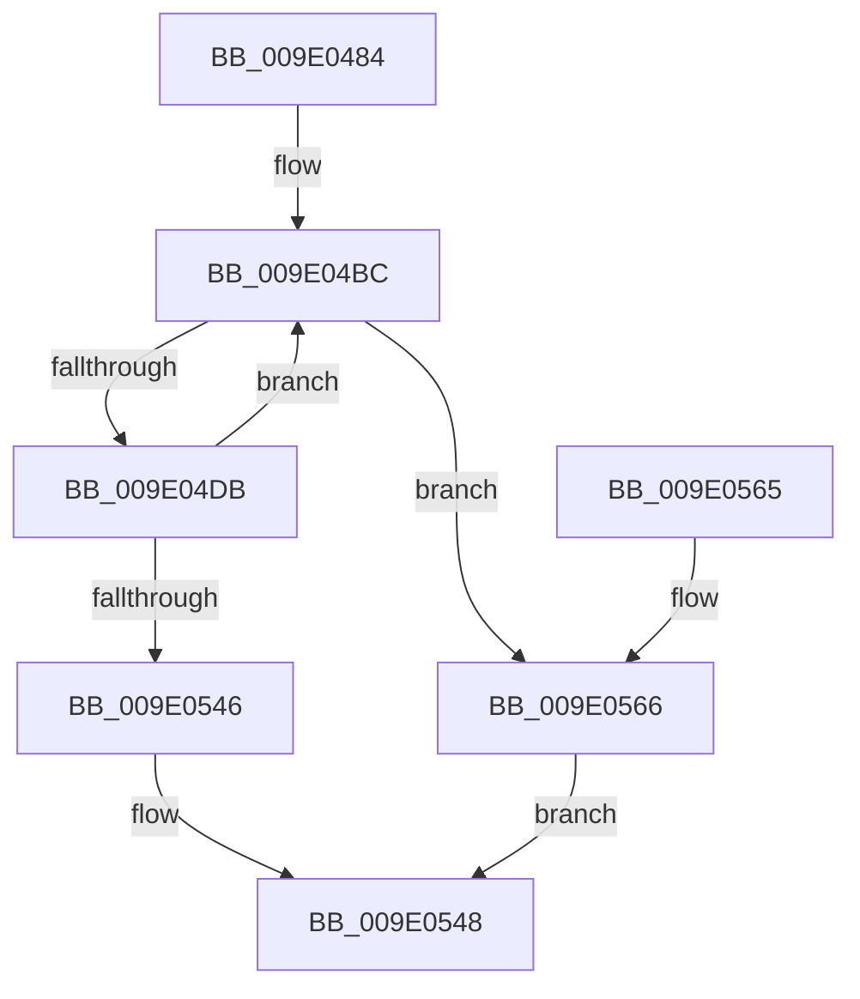

# WmipSendWmiIrp

- RVA: `0x009E0484`–`0x009E056D` (길이 `233` bytes)
- VA: `0x00000001409E0484`
- 실행 섹션: `PAGE`
- PDB 이름 있음: `예`; PDB Function 태그: `아니요`
- unwind 정보 RVA: `0x000A3C28`
- 디코드: `59`개 명령, `233/233` bytes 표시
- 미해석 바이트: `0` (있으면 어셈블리에 `.byte`로 보존)

> 이 문서는 커널 이미지의 기계어와 PDB 기호를 분석해 생성했습니다. 4번과 5번은 함수 원형과 자료형을 바이너리 사용 방식에서 추정한 C 해석이며 원본 소스 복구 결과는 아닙니다.

## 1. Dependencies

- 직접 호출 지점: **3**; 고유 호출 대상: **3**
- 직접 호출자로 확인된 함수: **8**
- RIP 상대 이미지 참조: **1**

### Outgoing calls
- `0x009E04CA` → [IoAllocateIrp](../../text/20/IoAllocateIrp_function_002065D0.md) (function, `0x002065D0`)
- `0x009E0521` → [WmipForwardWmiIrp](WmipForwardWmiIrp_function_009E0DB4.md) (function, `0x009E0DB4`)
- `0x009E0535` → [IoFreeIrp](../../text/24/IoFreeIrp_function_0024DF70.md) (function, `0x0024DF70`)

### Direct callers
- [WmipRegisterOrUpdateDS](../9D/WmipRegisterOrUpdateDS_function_009DD9DC.md) at `0x009DDA52`
- [WmipRegisterOrUpdateDS](../9D/WmipRegisterOrUpdateDS_function_009DD9DC.md) at `0x009DDAE9`
- [WmipDisableCollectionForRemovedGuid](../9D/WmipDisableCollectionForRemovedGuid_function_009DE88C.md) at `0x009DE99B`
- [WmipEnableCollectionForNewGuid](../9D/WmipEnableCollectionForNewGuid_function_009DFC0C.md) at `0x009DFD14`
- [WmipQuerySetExecuteSI](WmipQuerySetExecuteSI_function_009E0574.md) at `0x009E06D1`
- [WmipQuerySetExecuteSI](WmipQuerySetExecuteSI_function_009E0574.md) at `0x009E07EC`
- [WmipQueryAllData](WmipQueryAllData_function_009E086C.md) at `0x009E0C8E`
- [WmipSendEnableDisableRequest](WmipSendEnableDisableRequest_function_009E3800.md) at `0x009E392A`
- [WmipProcessLegacyEtwCallback](../AA/WmipProcessLegacyEtwCallback_function_00AA59E8.md) at `0x00AA5A8B`
- [WmipDeliverWnodeToDS](../AA/WmipDeliverWnodeToDS_function_00AAE460.md) at `0x00AAE47D`

### Static image references
- `0x009E04BC` → RVA `0x00EFFA98` (`.data`; read)

## 2. Other-region calls and transfers

- 다른 실행 섹션으로 향하는 call: **2**
  - `0x009E04CA` → [IoAllocateIrp](../../text/20/IoAllocateIrp_function_002065D0.md) (`PAGE` → `.text`)
  - `0x009E0535` → [IoFreeIrp](../../text/24/IoFreeIrp_function_0024DF70.md) (`PAGE` → `.text`)
- 별도 외부 분기/꼬리 이동을 확인하지 못했습니다.

## 3. Assembly (complete function range)

```asm
009E0484  48 89 5C 24 08                  mov qword ptr [rsp + 8], rbx
009E0489  48 89 6C 24 10                  mov qword ptr [rsp + 0x10], rbp
009E048E  48 89 74 24 18                  mov qword ptr [rsp + 0x18], rsi
009E0493  57                              push rdi
009E0494  41 54                           push r12
009E0496  41 55                           push r13
009E0498  41 56                           push r14
009E049A  41 57                           push r15
009E049C  48 83 EC 30                     sub rsp, 0x30
009E04A0  4C 8B AC 24 88 00 00 00         mov r13, qword ptr [rsp + 0x88]
009E04A8  41 8B E9                        mov ebp, r9d
009E04AB  48 8B B4 24 80 00 00 00         mov rsi, qword ptr [rsp + 0x80]
009E04B3  4D 8B F0                        mov r14, r8
009E04B6  44 8B FA                        mov r15d, edx
009E04B9  44 8A E1                        mov r12b, cl
009E04BC  48 8B 05 D5 F5 51 00            mov rax, qword ptr [rip + 0x51f5d5]
009E04C3  33 D2                           xor edx, edx
009E04C5  8A 48 4C                        mov cl, byte ptr [rax + 0x4c]
009E04C8  FE C1                           inc cl
009E04CA  E8 01 61 82 FF                  call 0x1402065d0
009E04CF  48 8B D8                        mov rbx, rax
009E04D2  48 85 C0                        test rax, rax
009E04D5  0F 84 8B 00 00 00               je 0x1409e0566
009E04DB  48 83 80 B8 00 00 00 B8         add qword ptr [rax + 0xb8], -0x48
009E04E3  4D 8B CE                        mov r9, r14
009E04E6  FE 48 43                        dec byte ptr [rax + 0x43]
009E04E9  45 8B C7                        mov r8d, r15d
009E04EC  48 8B 0D A5 F5 51 00            mov rcx, qword ptr [rip + 0x51f5a5]
009E04F3  48 8B 90 B8 00 00 00            mov rdx, qword ptr [rax + 0xb8]
009E04FA  48 89 74 24 28                  mov qword ptr [rsp + 0x28], rsi
009E04FF  89 6C 24 20                     mov dword ptr [rsp + 0x20], ebp
009E0503  48 89 4A 28                     mov qword ptr [rdx + 0x28], rcx
009E0507  41 8A D4                        mov dl, r12b
009E050A  65 48 8B 0C 25 88 01 00 00      mov rcx, qword ptr gs:[0x188]
009E0513  48 89 88 98 00 00 00            mov qword ptr [rax + 0x98], rcx
009E051A  48 8B C8                        mov rcx, rax
009E051D  48 89 70 18                     mov qword ptr [rax + 0x18], rsi
009E0521  E8 8E 08 00 00                  call 0x1409e0db4
009E0526  0F 10 43 30                     movups xmm0, xmmword ptr [rbx + 0x30]
009E052A  48 8B CB                        mov rcx, rbx
009E052D  8B F8                           mov edi, eax
009E052F  F3 41 0F 7F 45 00               movdqu xmmword ptr [r13], xmm0
009E0535  E8 36 DA 86 FF                  call 0x14024df70
009E053A  81 FF 98 02 00 C0               cmp edi, 0xc0000298
009E0540  0F 84 76 FF FF FF               je 0x1409e04bc
009E0546  8B C7                           mov eax, edi
009E0548  48 8B 5C 24 60                  mov rbx, qword ptr [rsp + 0x60]
009E054D  48 8B 6C 24 68                  mov rbp, qword ptr [rsp + 0x68]
009E0552  48 8B 74 24 70                  mov rsi, qword ptr [rsp + 0x70]
009E0557  48 83 C4 30                     add rsp, 0x30
009E055B  41 5F                           pop r15
009E055D  41 5E                           pop r14
009E055F  41 5D                           pop r13
009E0561  41 5C                           pop r12
009E0563  5F                              pop rdi
009E0564  C3                              ret
009E0565  CC                              int3
009E0566  B8 9A 00 00 C0                  mov eax, 0xc000009a
009E056B  EB DB                           jmp 0x1409e0548
```

## 4. C-style interpretation (structured pseudocode)

```c
__int64 __fastcall WmipSendWmiIrp(unsigned __int8 a1, int a2, __int64 a3, int a4, __int64 a5, __int64 a6)
{
    __int64 result;
    __int64 v_rsp;
    unsigned __int64 v_stack_m30;
    unsigned int v_stack_m38;
    unsigned __int64 v_stack_p10;
    unsigned __int64 v_stack_p18;
    unsigned __int64 v_stack_p8;

    v_stack_p8 = v_rbx;
    v_stack_p10 = v_rbp;
    v_stack_p18 = v_rsi;
    v_rsp = (v_rsp) - (48);
loc_009E04BC:
    a2 = 0;
    a1 = (unsigned __int8)((*(unsigned __int8 *)(*(unsigned __int64 *)(v_rip + 5371349) + 76)) + 1);
    result = IoAllocateIrp(a1, a2, a3, a4);
    if (result == 0) goto loc_009E0566;
    v_stack_m30 = a5;
    v_stack_m38 = (unsigned int)((unsigned int)(a4));
    *(unsigned __int64 *)(*(unsigned __int64 *)(result + 184) + 40) = *(unsigned __int64 *)(v_rip + 5371301);
    *(unsigned __int64 *)(result + 152) = *(unsigned __int64 *)(gs_base + (0 + 392));
    *(unsigned __int64 *)(result + 24) = a5;
    result = WmipForwardWmiIrp(result, a1, (unsigned int)((unsigned int)((unsigned int)(a2))), a3);
    *(unsigned __int64 *)(a6) = v_xmm0;
    result = IoFreeIrp(result, a1, (unsigned int)((unsigned int)((unsigned int)(a2))), a3);
    if (((unsigned int)((unsigned int)((unsigned int)(result)))) == 0xC0000298ULL) goto loc_009E04BC;
loc_009E0548:
    v_rsp = (v_rsp) + (48);
    return (unsigned int)((unsigned int)((unsigned int)((unsigned int)(result))));
loc_009E0566:
    goto loc_009E0548;
}
```

## 5. (Beta) C Style

```c
int64_t WmipSendWmiIrp(uint8_t Arg1, int32_t Arg2, int64_t Arg3, int32_t Arg4, int64_t Arg5, void *Arg6)
{
    uint8_t *arg6 = (uint8_t *)Arg6;

    int64_t result;
    int64_t local_rsp;
    uint64_t v_stack_m30;
    uint32_t v_stack_m38;
    uint64_t v_stack_p10;
    uint64_t v_stack_p18;
    uint64_t v_stack_p8;

    v_stack_p8 = local_rbx;
    v_stack_p10 = local_rbp;
    v_stack_p18 = local_rsi;
    local_rsp = (local_rsp) - (48);
loc_009E04BC:
    Arg2 = 0;
    Arg1 = (uint8_t)((*(uint8_t *)(*(uint64_t *)(v_rip + 0x51F5D5) + 0x4C)) + 1);
    result = IoAllocateIrp(Arg1, Arg2, Arg3, Arg4);
    if (result == 0) goto loc_009E0566;
    v_stack_m30 = Arg5;
    v_stack_m38 = (uint32_t)((uint32_t)(Arg4));
    *(uint64_t *)(*(uint64_t *)(result + 0xB8) + 0x28) = *(uint64_t *)(v_rip + 0x51F5A5);
    *(uint64_t *)(result + 0x98) = *(uint64_t *)(gs_base + (0 + 0x188));
    *(uint64_t *)(result + 0x18) = Arg5;
    result = WmipForwardWmiIrp(result, Arg1, (uint32_t)((uint32_t)((uint32_t)(Arg2))), Arg3);
    *(uint64_t *)(arg6) = v_xmm0;
    result = IoFreeIrp(result, Arg1, (uint32_t)((uint32_t)((uint32_t)(Arg2))), Arg3);
    if (((uint32_t)((uint32_t)((uint32_t)(result)))) == 0xC0000298ULL) goto loc_009E04BC;
loc_009E0548:
    local_rsp = (local_rsp) + (48);
    return (uint32_t)((uint32_t)((uint32_t)((uint32_t)(result))));
loc_009E0566:
    goto loc_009E0548;
}
```

### 관측된 메모리 오프셋

구조체 형식이 확인되지 않은 접근은 인자 기준의 오프셋으로만 기록했습니다.

| 기준 인자 | 오프셋 표현 | 폭 (bit) | 접근 |
|---|---:|---:|---|
| `Arg6` | `+ 0x0` | `128` | `W` |

## 6. Execution-region graph

[열기: 2D/3D 그래프와 함수 탐색 컨트롤 패널](../../../control-panel.html?section=page&rva=0x009E0484&view=graph)

- 2D 그래프는 위에서 아래로 흐르고, 3D 그래프는 빈 공간을 드래그해 회전합니다. Shift+드래그는 이동, 휠은 확대·축소, 함수 노드 선택은 대상 보고서 이동입니다.

### Static fallback


