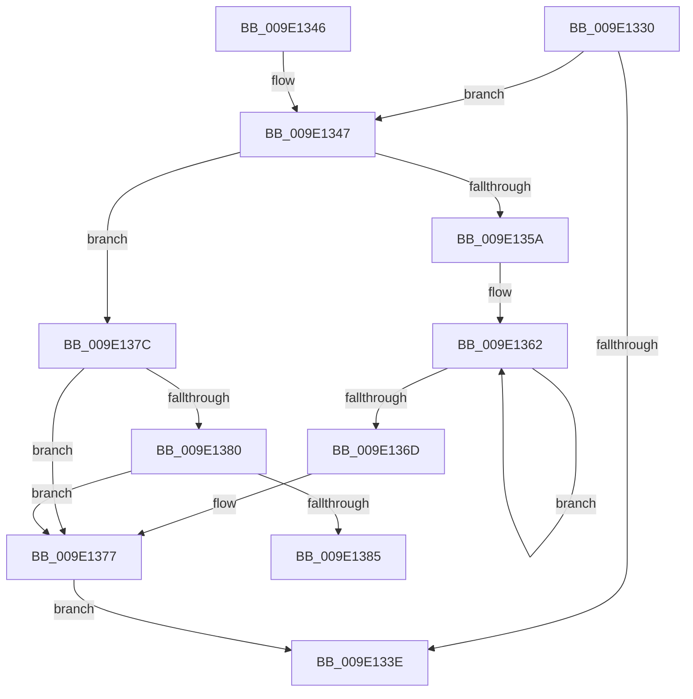

# WmipStaticInstanceNameSize

- RVA: `0x009E1330`–`0x009E1395` (길이 `101` bytes)
- VA: `0x00000001409E1330`
- 실행 섹션: `PAGE`
- PDB 이름 있음: `예`; PDB Function 태그: `예`
- unwind 정보 RVA: `0x000A3CF0`
- 디코드: `32`개 명령, `101/101` bytes 표시
- 미해석 바이트: `0` (있으면 어셈블리에 `.byte`로 보존)

> 이 문서는 커널 이미지의 기계어와 PDB 기호를 분석해 생성했습니다. 4번과 5번은 함수 원형과 자료형을 바이너리 사용 방식에서 추정한 C 해석이며 원본 소스 복구 결과는 아닙니다.

## 1. Dependencies

- 직접 호출 지점: **0**; 고유 호출 대상: **0**
- 직접 호출자로 확인된 함수: **3**
- RIP 상대 이미지 참조: **0**

### Outgoing calls
- 직접 디코드된 call 명령이 없습니다.

### Direct callers
- [WmipQueryAllData](WmipQueryAllData_function_009E086C.md) at `0x009E0BE3`
- [WmipInsertStaticNames](WmipInsertStaticNames_function_009E1064.md) at `0x009E10B5`
- [sub_00B2FEB2](../B2/Unknown_function_00B2FEB2.md) at `0x00B2FED1`

### Static image references
- 디코드된 RIP-relative 메모리 참조가 없습니다.

## 2. Other-region calls and transfers

- 다른 실행 섹션으로 향하는 call: **0**
- call이 아닌 외부 분기/꼬리 이동: **1**
  - `0x009E1390` → [sub_00B2FFDC](../B2/Unknown_function_00B2FFDC.md) (`tail-transfer`)

## 3. Assembly (complete function range)

```asm
009E1330  48 89 5C 24 08                  mov qword ptr [rsp + 8], rbx
009E1335  8B 51 4C                        mov edx, dword ptr [rcx + 0x4c]
009E1338  33 DB                           xor ebx, ebx
009E133A  85 D2                           test edx, edx
009E133C  74 09                           je 0x1409e1347
009E133E  48 8B 5C 24 08                  mov rbx, qword ptr [rsp + 8]
009E1343  8B C2                           mov eax, edx
009E1345  C3                              ret
009E1346  CC                              int3
009E1347  44 8B 41 48                     mov r8d, dword ptr [rcx + 0x48]
009E134B  8B 41 10                        mov eax, dword ptr [rcx + 0x10]
009E134E  42 8D 14 85 00 00 00 00         lea edx, [r8*4]
009E1356  A8 01                           test al, 1
009E1358  74 22                           je 0x1409e137c
009E135A  4C 8B 49 58                     mov r9, qword ptr [rcx + 0x58]
009E135E  48 83 C8 FF                     or rax, 0xffffffffffffffff
009E1362  48 FF C0                        inc rax
009E1365  66 41 39 5C 41 04               cmp word ptr [r9 + rax*2 + 4], bx
009E136B  75 F5                           jne 0x1409e1362
009E136D  83 C0 08                        add eax, 8
009E1370  41 0F AF C0                     imul eax, r8d
009E1374  8D 14 42                        lea edx, [rdx + rax*2]
009E1377  89 51 4C                        mov dword ptr [rcx + 0x4c], edx
009E137A  EB C2                           jmp 0x1409e133e
009E137C  A8 02                           test al, 2
009E137E  74 F7                           je 0x1409e1377
009E1380  45 85 C0                        test r8d, r8d
009E1383  74 F2                           je 0x1409e1377
009E1385  4C 8B 49 58                     mov r9, qword ptr [rcx + 0x58]
009E1389  4D 8B D0                        mov r10, r8
009E138C  48 83 C8 FF                     or rax, 0xffffffffffffffff
009E1390  E9 47 EC 14 00                  jmp 0x140b2ffdc
```

## 4. C-style interpretation (structured pseudocode)

```c
__int64 __fastcall WmipStaticInstanceNameSize(__int64 a1)
{
    __int64 result;
    __int64 v_rbx;
    unsigned __int64 v_stack_p8;

    v_stack_p8 = v_rbx;
    v_rbx = 0;
    if ((unsigned int)((unsigned int)(*(unsigned int *)(a1 + 76))) == 0) goto loc_009E1347;
loc_009E133E:
    return (unsigned int)((unsigned int)((unsigned int)(*(unsigned int *)(a1 + 76))));
loc_009E1347:
    if ((((unsigned __int8)((unsigned int)(*(unsigned int *)(a1 + 16)))) & (1)) == 0) goto loc_009E137C;
    result = ((unsigned int)(*(unsigned int *)(a1 + 16))) | (-1);
loc_009E1362:
    result = (result) + 1;
    if ((*(unsigned __int16 *)(*(unsigned __int64 *)(a1 + 88) + result * 2 + 4)) != ((unsigned __int16)(v_stack_p8))) goto loc_009E1362;
    result = (unsigned int)((result) + (8));
    result = (unsigned int)((result) * ((unsigned int)((unsigned int)(*(unsigned int *)(a1 + 72)))));
loc_009E1377:
    *(unsigned int *)(a1 + 76) = (unsigned int)((unsigned int)(*(unsigned int *)(a1 + 72)) * 4 + result * 2);
    goto loc_009E133E;
loc_009E137C:
    if ((((unsigned __int8)(result)) & (2)) == 0) goto loc_009E1377;
    if ((unsigned int)((unsigned int)(*(unsigned int *)(a1 + 72))) == 0) goto loc_009E1377;
    result = (result) | (-1);
}
```

## 5. (Beta) C Style

```c
int64_t WmipStaticInstanceNameSize(void *Arg1)
{
    uint8_t *arg1 = (uint8_t *)Arg1;

    int64_t result;
    int64_t local_rbx;
    uint64_t v_stack_p8;

    v_stack_p8 = local_rbx;
    local_rbx = 0;
    if ((uint32_t)((uint32_t)(*(uint32_t *)(arg1 + 0x4C))) == 0) goto loc_009E1347;
loc_009E133E:
    return (uint32_t)((uint32_t)((uint32_t)(*(uint32_t *)(arg1 + 0x4C))));
loc_009E1347:
    if ((((uint8_t)((uint32_t)(*(uint32_t *)(arg1 + 0x10)))) & (1)) == 0) goto loc_009E137C;
    result = ((uint32_t)(*(uint32_t *)(arg1 + 0x10))) | (-1);
loc_009E1362:
    result = (result) + 1;
    if ((*(uint16_t *)(*(uint64_t *)(arg1 + 0x58) + result * 2 + 0x4)) != ((uint16_t)(v_stack_p8))) goto loc_009E1362;
    result = (uint32_t)((result) + (8));
    result = (uint32_t)((result) * ((uint32_t)((uint32_t)(*(uint32_t *)(arg1 + 0x48)))));
loc_009E1377:
    *(uint32_t *)(arg1 + 0x4C) = (uint32_t)((uint32_t)(*(uint32_t *)(arg1 + 0x48)) * 4 + result * 2);
    goto loc_009E133E;
loc_009E137C:
    if ((((uint8_t)(result)) & (2)) == 0) goto loc_009E1377;
    if ((uint32_t)((uint32_t)(*(uint32_t *)(arg1 + 0x48))) == 0) goto loc_009E1377;
    result = (result) | (-1);
}
```

### 관측된 메모리 오프셋

구조체 형식이 확인되지 않은 접근은 인자 기준의 오프셋으로만 기록했습니다.

| 기준 인자 | 오프셋 표현 | 폭 (bit) | 접근 |
|---|---:|---:|---|
| `Arg1` | `+ 0x10` | `32` | `R` |
| `Arg1` | `+ 0x48` | `32` | `R` |
| `Arg1` | `+ 0x4C` | `32` | `R` |
| `Arg1` | `+ 0x4C` | `32` | `W` |
| `Arg1` | `+ 0x58` | `64` | `R` |

## 6. Execution-region graph

[열기: 2D/3D 그래프와 함수 탐색 컨트롤 패널](../../../control-panel.html?section=page&rva=0x009E1330&view=graph)

- 2D 그래프는 위에서 아래로 흐르고, 3D 그래프는 빈 공간을 드래그해 회전합니다. Shift+드래그는 이동, 휠은 확대·축소, 함수 노드 선택은 대상 보고서 이동입니다.

### Static fallback


