# WmipTranslatePDOInstanceNames

- RVA: `0x009E2F0C`–`0x009E3283` (길이 `887` bytes)
- VA: `0x00000001409E2F0C`
- 실행 섹션: `PAGE`
- PDB 이름 있음: `예`; PDB Function 태그: `예`
- unwind 정보 RVA: `0x000A3F04`
- 디코드: `230`개 명령, `887/887` bytes 표시
- 미해석 바이트: `0` (있으면 어셈블리에 `.byte`로 보존)

> 이 문서는 커널 이미지의 기계어와 PDB 기호를 분석해 생성했습니다. 4번과 5번은 함수 원형과 자료형을 바이너리 사용 방식에서 추정한 C 해석이며 원본 소스 복구 결과는 아닙니다.

## 1. Dependencies

- 직접 호출 지점: **10**; 고유 호출 대상: **5**
- 직접 호출자로 확인된 함수: **1**
- RIP 상대 이미지 참조: **4**

### Outgoing calls
- `0x009E3073` → [IoGetDeviceInstanceName](../../text/4A/IoGetDeviceInstanceName_function_004AADA4.md) (function, `0x004AADA4`)
- `0x009E3098` → [ObfReferenceObject](../../text/20/ObfReferenceObject_function_0020FA20.md) (function, `0x0020FA20`)
- `0x009E30EB` → [memcpy](../../text/6C/memcpy_function_006C6840.md) (function, `0x006C6840`)
- `0x009E310E` → [ExFreePool](../../poolcode/B8/ExFreePool_function_00B82850.md) (function, `0x00B82850`)
- `0x009E3128` → [ObfDereferenceObject](../../text/2F/ObfDereferenceObject_function_002F9350.md) (function, `0x002F9350`)
- `0x009E31A4` → [IoGetDeviceInstanceName](../../text/4A/IoGetDeviceInstanceName_function_004AADA4.md) (function, `0x004AADA4`)
- `0x009E31B0` → [ObfDereferenceObject](../../text/2F/ObfDereferenceObject_function_002F9350.md) (function, `0x002F9350`)
- `0x009E31CB` → [ObfDereferenceObject](../../text/2F/ObfDereferenceObject_function_002F9350.md) (function, `0x002F9350`)
- `0x009E3223` → [ExFreePool](../../poolcode/B8/ExFreePool_function_00B82850.md) (function, `0x00B82850`)
- `0x009E323E` → [ObfDereferenceObject](../../text/2F/ObfDereferenceObject_function_002F9350.md) (function, `0x002F9350`)

### Direct callers
- [WmipForwardWmiIrp](WmipForwardWmiIrp_function_009E0DB4.md) at `0x009E100E`

### Static image references
- `0x009E2F42` → RVA `0x000145E0` (`.rdata`; read)
- `0x009E2F4C` → RVA `0x000145D8` (`.rdata`; read)
- `0x009E2F56` → RVA `0x000145D0` (`.rdata`; read)
- `0x009E2F60` → RVA `0x000145C8` (`.rdata`; read)

## 2. Other-region calls and transfers

- 다른 실행 섹션으로 향하는 call: **10**
  - `0x009E3073` → [IoGetDeviceInstanceName](../../text/4A/IoGetDeviceInstanceName_function_004AADA4.md) (`PAGE` → `.text`)
  - `0x009E3098` → [ObfReferenceObject](../../text/20/ObfReferenceObject_function_0020FA20.md) (`PAGE` → `.text`)
  - `0x009E30EB` → [memcpy](../../text/6C/memcpy_function_006C6840.md) (`PAGE` → `.text`)
  - `0x009E310E` → [ExFreePool](../../poolcode/B8/ExFreePool_function_00B82850.md) (`PAGE` → `POOLCODE`)
  - `0x009E3128` → [ObfDereferenceObject](../../text/2F/ObfDereferenceObject_function_002F9350.md) (`PAGE` → `.text`)
  - `0x009E31A4` → [IoGetDeviceInstanceName](../../text/4A/IoGetDeviceInstanceName_function_004AADA4.md) (`PAGE` → `.text`)
  - `0x009E31B0` → [ObfDereferenceObject](../../text/2F/ObfDereferenceObject_function_002F9350.md) (`PAGE` → `.text`)
  - `0x009E31CB` → [ObfDereferenceObject](../../text/2F/ObfDereferenceObject_function_002F9350.md) (`PAGE` → `.text`)
  - `0x009E3223` → [ExFreePool](../../poolcode/B8/ExFreePool_function_00B82850.md) (`PAGE` → `POOLCODE`)
  - `0x009E323E` → [ObfDereferenceObject](../../text/2F/ObfDereferenceObject_function_002F9350.md) (`PAGE` → `.text`)
- call이 아닌 외부 분기/꼬리 이동: **1**
  - `0x009E3210` → [sub_00B3032C](../B3/Unknown_function_00B3032C.md) (`tail-transfer`)

## 3. Assembly (complete function range)

```asm
009E2F0C  48 8B C4                        mov rax, rsp
009E2F0F  4C 89 48 20                     mov qword ptr [rax + 0x20], r9
009E2F13  44 89 40 18                     mov dword ptr [rax + 0x18], r8d
009E2F17  88 50 10                        mov byte ptr [rax + 0x10], dl
009E2F1A  48 89 48 08                     mov qword ptr [rax + 8], rcx
009E2F1E  53                              push rbx
009E2F1F  55                              push rbp
009E2F20  56                              push rsi
009E2F21  57                              push rdi
009E2F22  41 54                           push r12
009E2F24  41 55                           push r13
009E2F26  41 56                           push r14
009E2F28  41 57                           push r15
009E2F2A  48 83 EC 58                     sub rsp, 0x58
009E2F2E  4C 8B 59 18                     mov r11, qword ptr [rcx + 0x18]
009E2F32  33 ED                           xor ebp, ebp
009E2F34  44 8B 79 38                     mov r15d, dword ptr [rcx + 0x38]
009E2F38  45 33 ED                        xor r13d, r13d
009E2F3B  21 6C 24 28                     and dword ptr [rsp + 0x28], ebp
009E2F3F  41 FF C7                        inc r15d
009E2F42  48 8B 0D 97 16 63 FF            mov rcx, qword ptr [rip - 0x9ce969]
009E2F49  0F 57 C0                        xorps xmm0, xmm0
009E2F4C  4C 8B 15 85 16 63 FF            mov r10, qword ptr [rip - 0x9ce97b]
009E2F53  45 33 E4                        xor r12d, r12d
009E2F56  4C 8B 05 73 16 63 FF            mov r8, qword ptr [rip - 0x9ce98d]
009E2F5D  41 B6 01                        mov r14b, 1
009E2F60  4C 8B 0D 61 16 63 FF            mov r9, qword ptr [rip - 0x9ce99f]
009E2F67  33 FF                           xor edi, edi
009E2F69  0F 11 40 A8                     movups xmmword ptr [rax - 0x58], xmm0
009E2F6D  B8 FE FF FF FF                  mov eax, 0xfffffffe
009E2F72  44 88 6C 24 20                  mov byte ptr [rsp + 0x20], r13b
009E2F77  44 23 F8                        and r15d, eax
009E2F7A  4C 89 5C 24 30                  mov qword ptr [rsp + 0x30], r11
009E2F7F  21 7C 24 24                     and dword ptr [rsp + 0x24], edi
009E2F83  49 8B F3                        mov rsi, r11
009E2F86  44 88 74 24 21                  mov byte ptr [rsp + 0x21], r14b
009E2F8B  33 C0                           xor eax, eax
009E2F8D  89 44 24 2C                     mov dword ptr [rsp + 0x2c], eax
009E2F91  39 46 10                        cmp dword ptr [rsi + 0x10], eax
009E2F94  76 63                           jbe 0x1409e2ff9
009E2F96  48 21 44 24 38                  and qword ptr [rsp + 0x38], rax
009E2F9B  8B D8                           mov ebx, eax
009E2F9D  48 C1 E3 05                     shl rbx, 5
009E2FA1  48 8B 44 33 18                  mov rax, qword ptr [rbx + rsi + 0x18]
009E2FA6  49 2B C2                        sub rax, r10
009E2FA9  75 08                           jne 0x1409e2fb3
009E2FAB  48 8B 44 33 20                  mov rax, qword ptr [rbx + rsi + 0x20]
009E2FB0  48 2B C1                        sub rax, rcx
009E2FB3  48 85 C0                        test rax, rax
009E2FB6  0F 84 6E 02 00 00               je 0x1409e322a
009E2FBC  48 8B 44 33 18                  mov rax, qword ptr [rbx + rsi + 0x18]
009E2FC1  49 2B C1                        sub rax, r9
009E2FC4  75 08                           jne 0x1409e2fce
009E2FC6  48 8B 44 33 20                  mov rax, qword ptr [rbx + rsi + 0x20]
009E2FCB  49 2B C0                        sub rax, r8
009E2FCE  48 85 C0                        test rax, rax
009E2FD1  0F 84 53 02 00 00               je 0x1409e322a
009E2FD7  8B 54 33 28                     mov edx, dword ptr [rbx + rsi + 0x28]
009E2FDB  F6 C2 20                        test dl, 0x20
009E2FDE  75 61                           jne 0x1409e3041
009E2FE0  8B 44 24 2C                     mov eax, dword ptr [rsp + 0x2c]
009E2FE4  4C 8B 5C 24 30                  mov r11, qword ptr [rsp + 0x30]
009E2FE9  FF C0                           inc eax
009E2FEB  44 8A 74 24 21                  mov r14b, byte ptr [rsp + 0x21]
009E2FF0  89 44 24 2C                     mov dword ptr [rsp + 0x2c], eax
009E2FF4  3B 46 10                        cmp eax, dword ptr [rsi + 0x10]
009E2FF7  72 A2                           jb 0x1409e2f9b
009E2FF9  8B 56 04                        mov edx, dword ptr [rsi + 4]
009E2FFC  48 03 F2                        add rsi, rdx
009E2FFF  85 D2                           test edx, edx
009E3001  75 88                           jne 0x1409e2f8b
009E3003  45 84 F6                        test r14b, r14b
009E3006  0F 85 87 01 00 00               jne 0x1409e3193
009E300C  80 7C 24 20 00                  cmp byte ptr [rsp + 0x20], 0
009E3011  48 8B 44 24 30                  mov rax, qword ptr [rsp + 0x30]
009E3016  44 89 38                        mov dword ptr [rax], r15d
009E3019  B8 04 00 00 00                  mov eax, 4
009E301E  75 03                           jne 0x1409e3023
009E3020  41 8B C7                        mov eax, r15d
009E3023  48 8B 8C 24 A0 00 00 00         mov rcx, qword ptr [rsp + 0xa0]
009E302B  48 89 41 38                     mov qword ptr [rcx + 0x38], rax
009E302F  48 83 C4 58                     add rsp, 0x58
009E3033  41 5F                           pop r15
009E3035  41 5E                           pop r14
009E3037  41 5D                           pop r13
009E3039  41 5C                           pop r12
009E303B  5F                              pop rdi
009E303C  5E                              pop rsi
009E303D  5D                              pop rbp
009E303E  5B                              pop rbx
009E303F  C3                              ret
009E3040  CC                              int3
009E3041  48 85 FF                        test rdi, rdi
009E3044  0F 84 1D 01 00 00               je 0x1409e3167
009E304A  8B 44 33 2C                     mov eax, dword ptr [rbx + rsi + 0x2c]
009E304E  39 44 24 24                     cmp dword ptr [rsp + 0x24], eax
009E3052  4C 8B 64 33 30                  mov r12, qword ptr [rbx + rsi + 0x30]
009E3057  0F 43 44 24 24                  cmovae eax, dword ptr [rsp + 0x24]
009E305C  89 44 24 24                     mov dword ptr [rsp + 0x24], eax
009E3060  4C 3B 64 24 38                  cmp r12, qword ptr [rsp + 0x38]
009E3065  0F 84 EB 00 00 00               je 0x1409e3156
009E306B  48 8D 54 24 40                  lea rdx, [rsp + 0x40]
009E3070  49 8B CC                        mov rcx, r12
009E3073  E8 2C 7D AC FF                  call 0x1404aada4
009E3078  85 C0                           test eax, eax
009E307A  0F 88 9B 00 00 00               js 0x1409e311b
009E3080  45 84 F6                        test r14b, r14b
009E3083  0F 84 31 01 00 00               je 0x1409e31ba
009E3089  48 85 ED                        test rbp, rbp
009E308C  0F 85 D9 01 00 00               jne 0x1409e326b
009E3092  49 8B CC                        mov rcx, r12
009E3095  49 8B EC                        mov rbp, r12
009E3098  E8 83 C9 82 FF                  call 0x14020fa20
009E309D  0F B7 4C 24 40                  movzx ecx, word ptr [rsp + 0x40]
009E30A2  44 8D 71 04                     lea r14d, [rcx + 4]
009E30A6  45 03 FE                        add r15d, r14d
009E30A9  80 7C 24 20 00                  cmp byte ptr [rsp + 0x20], 0
009E30AE  0F 85 C5 01 00 00               jne 0x1409e3279
009E30B4  45 3B F5                        cmp r14d, r13d
009E30B7  0F 87 BC 01 00 00               ja 0x1409e3279
009E30BD  83 4C 33 28 08                  or dword ptr [rbx + rsi + 0x28], 8
009E30C2  8B C7                           mov eax, edi
009E30C4  48 8B 54 24 48                  mov rdx, qword ptr [rsp + 0x48]
009E30C9  2B C6                           sub eax, esi
009E30CB  89 44 33 30                     mov dword ptr [rbx + rsi + 0x30], eax
009E30CF  44 8B C1                        mov r8d, ecx
009E30D2  89 44 24 28                     mov dword ptr [rsp + 0x28], eax
009E30D6  8B D9                           mov ebx, ecx
009E30D8  B8 02 00 00 00                  mov eax, 2
009E30DD  4C 89 64 24 38                  mov qword ptr [rsp + 0x38], r12
009E30E2  03 C1                           add eax, ecx
009E30E4  48 8D 4F 02                     lea rcx, [rdi + 2]
009E30E8  66 89 07                        mov word ptr [rdi], ax
009E30EB  E8 50 37 CE FF                  call 0x1406c6840
009E30F0  66 C7 44 3B 02 5F 00            mov word ptr [rbx + rdi + 2], 0x5f
009E30F7  48 83 C7 04                     add rdi, 4
009E30FB  48 03 FB                        add rdi, rbx
009E30FE  45 2B EE                        sub r13d, r14d
009E3101  48 83 7C 24 48 00               cmp qword ptr [rsp + 0x48], 0
009E3107  74 12                           je 0x1409e311b
009E3109  48 8B 4C 24 48                  mov rcx, qword ptr [rsp + 0x48]
009E310E  E8 3D F7 19 00                  call 0x140b82850
009E3113  0F 57 C0                        xorps xmm0, xmm0
009E3116  0F 11 44 24 40                  movups xmmword ptr [rsp + 0x40], xmm0
009E311B  80 BC 24 A8 00 00 00 0B         cmp byte ptr [rsp + 0xa8], 0xb
009E3123  75 10                           jne 0x1409e3135
009E3125  49 8B CC                        mov rcx, r12
009E3128  E8 23 62 91 FF                  call 0x1402f9350
009E312D  8B 54 24 24                     mov edx, dword ptr [rsp + 0x24]
009E3131  89 54 24 24                     mov dword ptr [rsp + 0x24], edx
009E3135  4C 8B 0D 8C 14 63 FF            mov r9, qword ptr [rip - 0x9ceb74]
009E313C  4C 8B 05 8D 14 63 FF            mov r8, qword ptr [rip - 0x9ceb73]
009E3143  4C 8B 15 8E 14 63 FF            mov r10, qword ptr [rip - 0x9ceb72]
009E314A  48 8B 0D 8F 14 63 FF            mov rcx, qword ptr [rip - 0x9ceb71]
009E3151  E9 8A FE FF FF                  jmp 0x1409e2fe0
009E3156  8B 44 24 28                     mov eax, dword ptr [rsp + 0x28]
009E315A  83 CA 08                        or edx, 8
009E315D  89 54 33 28                     mov dword ptr [rbx + rsi + 0x28], edx
009E3161  89 44 33 30                     mov dword ptr [rbx + rsi + 0x30], eax
009E3165  EB B4                           jmp 0x1409e311b
009E3167  41 83 7B 04 00                  cmp dword ptr [r11 + 4], 0
009E316C  49 8B CB                        mov rcx, r11
009E316F  75 66                           jne 0x1409e31d7
009E3171  8B 39                           mov edi, dword ptr [rcx]
009E3173  B8 FE FF FF FF                  mov eax, 0xfffffffe
009E3178  FF C7                           inc edi
009E317A  45 8B EB                        mov r13d, r11d
009E317D  48 23 F8                        and rdi, rax
009E3180  48 03 F9                        add rdi, rcx
009E3183  44 2B EF                        sub r13d, edi
009E3186  44 03 AC 24 B0 00 00 00         add r13d, dword ptr [rsp + 0xb0]
009E318E  E9 B7 FE FF FF                  jmp 0x1409e304a
009E3193  48 85 ED                        test rbp, rbp
009E3196  0F 84 70 FE FF FF               je 0x1409e300c
009E319C  48 8D 54 24 40                  lea rdx, [rsp + 0x40]
009E31A1  49 8B CC                        mov rcx, r12
009E31A4  E8 FB 7B AC FF                  call 0x1404aada4
009E31A9  85 C0                           test eax, eax
009E31AB  79 3A                           jns 0x1409e31e7
009E31AD  48 8B CD                        mov rcx, rbp
009E31B0  E8 9B 61 91 FF                  call 0x1402f9350
009E31B5  E9 52 FE FF FF                  jmp 0x1409e300c
009E31BA  C6 44 24 21 00                  mov byte ptr [rsp + 0x21], 0
009E31BF  48 85 ED                        test rbp, rbp
009E31C2  0F 84 D5 FE FF FF               je 0x1409e309d
009E31C8  48 8B CD                        mov rcx, rbp
009E31CB  E8 80 61 91 FF                  call 0x1402f9350
009E31D0  33 ED                           xor ebp, ebp
009E31D2  E9 C6 FE FF FF                  jmp 0x1409e309d
009E31D7  41 8B 43 04                     mov eax, dword ptr [r11 + 4]
009E31DB  48 03 C8                        add rcx, rax
009E31DE  8B 41 04                        mov eax, dword ptr [rcx + 4]
009E31E1  85 C0                           test eax, eax
009E31E3  74 8C                           je 0x1409e3171
009E31E5  EB F4                           jmp 0x1409e31db
009E31E7  4C 8B 64 24 48                  mov r12, qword ptr [rsp + 0x48]
009E31EC  4C 8D 77 07                     lea r14, [rdi + 7]
009E31F0  49 83 E6 F8                     and r14, 0xfffffffffffffff8
009E31F4  41 8B CE                        mov ecx, r14d
009E31F7  2B CF                           sub ecx, edi
009E31F9  0F B7 7C 24 40                  movzx edi, word ptr [rsp + 0x40]
009E31FE  8D 1C 7D 60 00 00 00            lea ebx, [rdi*2 + 0x60]
009E3205  8D 04 19                        lea eax, [rcx + rbx]
009E3208  44 03 F8                        add r15d, eax
009E320B  80 7C 24 20 00                  cmp byte ptr [rsp + 0x20], 0
009E3210  0F 84 16 D1 14 00               je 0x140b3032c
009E3216  C6 44 24 20 01                  mov byte ptr [rsp + 0x20], 1
009E321B  4D 85 E4                        test r12, r12
009E321E  74 8D                           je 0x1409e31ad
009E3220  49 8B CC                        mov rcx, r12
009E3223  E8 28 F6 19 00                  call 0x140b82850
009E3228  EB 83                           jmp 0x1409e31ad
009E322A  45 32 F6                        xor r14b, r14b
009E322D  44 88 74 24 21                  mov byte ptr [rsp + 0x21], r14b
009E3232  48 85 ED                        test rbp, rbp
009E3235  0F 84 9C FD FF FF               je 0x1409e2fd7
009E323B  48 8B CD                        mov rcx, rbp
009E323E  E8 0D 61 91 FF                  call 0x1402f9350
009E3243  48 8B 0D 96 13 63 FF            mov rcx, qword ptr [rip - 0x9cec6a]
009E324A  33 ED                           xor ebp, ebp
009E324C  4C 8B 15 85 13 63 FF            mov r10, qword ptr [rip - 0x9cec7b]
009E3253  4C 8B 05 76 13 63 FF            mov r8, qword ptr [rip - 0x9cec8a]
009E325A  4C 8B 0D 67 13 63 FF            mov r9, qword ptr [rip - 0x9cec99]
009E3261  4C 8B 5C 24 30                  mov r11, qword ptr [rsp + 0x30]
009E3266  E9 6C FD FF FF                  jmp 0x1409e2fd7
009E326B  49 3B EC                        cmp rbp, r12
009E326E  0F 85 46 FF FF FF               jne 0x1409e31ba
009E3274  E9 24 FE FF FF                  jmp 0x1409e309d
009E3279  C6 44 24 20 01                  mov byte ptr [rsp + 0x20], 1
009E327E  E9 7E FE FF FF                  jmp 0x1409e3101
```

## 4. C-style interpretation (structured pseudocode)

```c
__int64 __fastcall WmipTranslatePDOInstanceNames(__int64 a1, unsigned __int8 a2, int a3, __int64 a4)
{
    __int64 result;
    __int64 v_r12;
    __int64 v_r13;
    __int64 v_r14;
    __int64 v_r15;
    __int64 v_rbp;
    __int64 v_rbx;
    __int64 v_rdi;
    __int64 v_rsi;
    __int64 v_rsp;
    unsigned __int64 v_stack_m60;
    unsigned __int64 v_stack_m68;
    unsigned int v_stack_m6C;
    unsigned int v_stack_m70;
    unsigned int v_stack_m74;
    unsigned __int8 v_stack_m77;
    unsigned __int8 v_stack_m78;
    unsigned __int8 v_stack_p20;
    unsigned __int8 v_stack_p21;
    unsigned int v_stack_p24;
    unsigned int v_stack_p28;
    unsigned __int64 v_stack_p30;
    unsigned __int64 v_stack_p38;
    unsigned __int64 v_stack_p40;
    unsigned __int64 v_stack_p48;
    unsigned __int64 v_stack_p8;
    unsigned __int8 v_stack_pA8;
    unsigned int v_stack_pB0;

    *(unsigned __int64 *)(v_rsp + 32) = a4;
    *(unsigned int *)(v_rsp + 24) = a3;
    *(unsigned __int8 *)(v_rsp + 16) = a2;
    *(unsigned __int64 *)(v_rsp + 8) = a1;
    v_rsp = (v_rsp) - (88);
    v_rbp = 0;
    v_r13 = 0;
    v_r15 = (unsigned int)(((unsigned int)(*(unsigned int *)(a1 + 56))) + 1);
    v_r12 = 0;
    v_rdi = 0;
    *(unsigned __int64 *)(v_rsp - 88) = v_xmm0;
    v_stack_m78 = 0;
    v_r15 = (unsigned int)((v_r15) & ((unsigned int)((unsigned int)(0xFFFFFFFEULL))));
    v_stack_m68 = *(unsigned __int64 *)(a1 + 24);
    v_stack_m77 = 1;
loc_009E2F8B:
    result = 0;
    v_stack_m6C = 0;
    if ((*(unsigned int *)(*(unsigned __int64 *)(a1 + 24) + 16)) <= 0) goto loc_009E2FF9;
loc_009E2F9B:
    v_rbx = (0) << (5);
    result = (*(unsigned __int64 *)(v_rbx + *(unsigned __int64 *)(a1 + 24) * 1 + 24)) - (*(unsigned __int64 *)(v_rip - 10283387));
    if (!(condition_is_not_equal)) {
        result = *(unsigned __int64 *)(v_rbx + *(unsigned __int64 *)(a1 + 24) * 1 + 32);
        result = (result) - (*(unsigned __int64 *)(v_rip - 10283369));
    }
    if (result == 0) goto loc_009E322A;
    result = (*(unsigned __int64 *)(v_rbx + *(unsigned __int64 *)(a1 + 24) * 1 + 24)) - (*(unsigned __int64 *)(v_rip - 10283423));
    if (!(condition_is_not_equal)) {
        result = *(unsigned __int64 *)(v_rbx + *(unsigned __int64 *)(a1 + 24) * 1 + 32);
        result = (result) - (*(unsigned __int64 *)(v_rip - 10283405));
    }
    if (result == 0) goto loc_009E322A;
loc_009E2FD7:
    if ((((unsigned __int8)((unsigned int)(*(unsigned int *)(v_rbx + *(unsigned __int64 *)(a1 + 24) * 1 + 40)))) & (32)) != 0) goto loc_009E3041;
loc_009E2FE0:
    result = (unsigned int)(((unsigned int)(v_stack_m6C)) + 1);
    v_stack_m6C = (unsigned int)(result);
    if (((unsigned int)(result)) < (*(unsigned int *)(*(unsigned __int64 *)(a1 + 24) + 16))) goto loc_009E2F9B;
loc_009E2FF9:
    v_rsi = (*(unsigned __int64 *)(a1 + 24)) + ((unsigned int)(*(unsigned int *)(*(unsigned __int64 *)(a1 + 24) + 4)));
    if ((unsigned int)((unsigned int)(*(unsigned int *)(*(unsigned __int64 *)(a1 + 24) + 4))) != 0) goto loc_009E2F8B;
    if ((unsigned __int8)(v_stack_m77) != 0) goto loc_009E3193;
loc_009E300C:
    *(unsigned int *)(v_stack_m68) = (unsigned int)(v_r15);
    result = 4;
    if (v_stack_m78 == 0) {
        result = (unsigned int)(v_r15);
    }
    *(unsigned __int64 *)(v_stack_p8 + 56) = result;
    v_rsp = (v_rsp) + (88);
    return result;
loc_009E3041:
    if (0 == 0) goto loc_009E3167;
loc_009E304A:
    result = (unsigned int)(*(unsigned int *)(v_rbx + v_rsi * 1 + 44));
    if (v_stack_p24 >= ((unsigned int)((unsigned int)(*(unsigned int *)(v_rbx + v_rsi * 1 + 44))))) { result = v_stack_p24; }
    v_stack_p24 = (unsigned int)(result);
    if ((*(unsigned __int64 *)(v_rbx + v_rsi * 1 + 48)) == v_stack_p38) goto loc_009E3156;
    result = IoGetDeviceInstanceName(*(unsigned __int64 *)(v_rbx + v_rsi * 1 + 48), v_stack_p40, *(unsigned __int64 *)(v_rip - 10283405), *(unsigned __int64 *)(v_rip - 10283423));
    if (sign_flag) goto loc_009E311B;
    if ((unsigned __int8)(v_stack_m77) == 0) goto loc_009E31BA;
    if (0 != 0) goto loc_009E326B;
    result = ObfReferenceObject(*(unsigned __int64 *)(v_rbx + v_rsi * 1 + 48), v_stack_p40, *(unsigned __int64 *)(v_rip - 10283405), *(unsigned __int64 *)(v_rip - 10283423));
loc_009E309D:
    v_r15 = (unsigned int)((v_r15) + ((unsigned int)(v_stack_p40 + 4)));
    if (v_stack_p20 != 0) goto loc_009E3279;
    if (((unsigned int)(v_stack_p40 + 4)) > 0) goto loc_009E3279;
    result = (unsigned int)((0) - ((unsigned int)(v_rsi)));
    *(unsigned int *)(v_rbx + v_rsi * 1 + 48) = (unsigned int)(result);
    v_stack_p28 = (unsigned int)(result);
    v_stack_p38 = *(unsigned __int64 *)(v_rbx + v_rsi * 1 + 48);
    result = (unsigned int)((2) + ((unsigned int)(v_stack_p40)));
    *(unsigned __int16 *)(v_rdi) = (unsigned __int16)(result);
    result = memcpy(v_rdi + 2, v_stack_p48, (unsigned int)((unsigned int)(v_stack_p40)), *(unsigned __int64 *)(v_rip - 10283423));
    *(unsigned __int16 *)((unsigned int)((unsigned int)(v_stack_p40)) + v_rdi * 1 + 2) = 95;
    v_rdi = (v_rdi) + (4);
    v_rdi = (v_rdi) + ((unsigned int)((unsigned int)(v_stack_p40)));
    v_r13 = (unsigned int)((v_r13) - ((unsigned int)(v_stack_p40 + 4)));
loc_009E3101:
    if (v_stack_p48 != 0) {
        a1 = v_stack_p48;
        result = ExFreePool(a1, v_stack_p48, (unsigned int)((unsigned int)(v_stack_p40)), *(unsigned __int64 *)(v_rip - 10283423));
        v_stack_p40 = v_xmm0;
    }
    if (v_stack_pA8 == 11) {
        a1 = *(unsigned __int64 *)(v_rbx + v_rsi * 1 + 48);
        result = ObfDereferenceObject(a1, v_stack_p48, (unsigned int)((unsigned int)(v_stack_p40)), *(unsigned __int64 *)(v_rip - 10283423));
        a2 = v_stack_p24;
        v_stack_p24 = a2;
    }
    goto loc_009E2FE0;
loc_009E3156:
    a2 = (unsigned int)((a2) | (8));
    *(unsigned int *)((unsigned int)((unsigned int)(v_stack_p40)) + v_rsi * 1 + 40) = a2;
    *(unsigned int *)((unsigned int)((unsigned int)(v_stack_p40)) + v_rsi * 1 + 48) = (unsigned int)((unsigned int)(v_stack_p28));
    goto loc_009E311B;
loc_009E3167:
    if ((*(unsigned int *)(v_stack_m68 + 4)) != 0) goto loc_009E31D7;
loc_009E3171:
    v_rdi = (unsigned int)(((unsigned int)(*(unsigned int *)(v_stack_m68))) + 1);
    v_rdi = (v_rdi) & ((unsigned int)(0xFFFFFFFEULL));
    v_rdi = (v_rdi) + (v_stack_m68);
    v_r13 = (unsigned int)(((unsigned int)((unsigned int)(v_stack_m68))) - ((unsigned int)(v_rdi)));
    v_r13 = (unsigned int)((v_r13) + (v_stack_pB0));
    goto loc_009E304A;
loc_009E3193:
    if (*(unsigned __int64 *)(v_rbx + v_rsi * 1 + 48) == 0) goto loc_009E300C;
    result = IoGetDeviceInstanceName(*(unsigned __int64 *)(v_rbx + v_rsi * 1 + 48), v_stack_p40, *(unsigned __int64 *)(v_rip - 10283891), *(unsigned __int64 *)(v_rip - 10283892));
    if (!sign_flag) goto loc_009E31E7;
loc_009E31AD:
    result = ObfDereferenceObject(*(unsigned __int64 *)(v_rbx + v_rsi * 1 + 48), v_stack_p40, *(unsigned __int64 *)(v_rip - 10283891), *(unsigned __int64 *)(v_rip - 10283892));
    goto loc_009E300C;
loc_009E31BA:
    v_stack_p21 = 0;
    if (*(unsigned __int64 *)(v_rbx + v_rsi * 1 + 48) == 0) goto loc_009E309D;
    result = ObfDereferenceObject(*(unsigned __int64 *)(v_rbx + v_rsi * 1 + 48), v_stack_p40, *(unsigned __int64 *)(v_rip - 10283891), *(unsigned __int64 *)(v_rip - 10283892));
    v_rbp = 0;
    goto loc_009E309D;
loc_009E31D7:
loc_009E31DB:
    a1 = (*(unsigned __int64 *)(v_rbx + v_rsi * 1 + 48)) + ((unsigned int)(*(unsigned int *)(v_stack_m68 + 4)));
    if ((unsigned int)((unsigned int)(*(unsigned int *)(a1 + 4))) == 0) goto loc_009E3171;
    goto loc_009E31DB;
loc_009E31E7:
    v_r14 = (v_rdi + 7) & (-8);
    a1 = (unsigned int)(((unsigned int)((unsigned int)(v_r14))) - ((unsigned int)(v_rdi)));
    v_r15 = (unsigned int)((v_r15) + ((unsigned int)(a1 + v_stack_p40 * 2 + 96 * 1)));
    v_stack_p20 = 1;
    if (v_stack_p48 == 0) goto loc_009E31AD;
    result = ExFreePool(v_stack_p48, v_stack_p40, *(unsigned __int64 *)(v_rip - 10283891), *(unsigned __int64 *)(v_rip - 10283892));
    goto loc_009E31AD;
loc_009E322A:
    v_r14 = 0;
    v_stack_p21 = 0;
    if (0 == 0) goto loc_009E2FD7;
    result = ObfDereferenceObject(0, v_stack_p40, *(unsigned __int64 *)(v_rip - 10283891), *(unsigned __int64 *)(v_rip - 10283892));
    v_rbp = 0;
    goto loc_009E2FD7;
loc_009E326B:
    if (0 != v_stack_p48) goto loc_009E31BA;
    goto loc_009E309D;
loc_009E3279:
    v_stack_p20 = 1;
    goto loc_009E3101;
}
```

## 5. (Beta) C Style

```c
int64_t WmipTranslatePDOInstanceNames(void *Arg1, uint8_t Arg2, int32_t Arg3, int64_t Arg4)
{
    uint8_t *arg1 = (uint8_t *)Arg1;

    int64_t result;
    int64_t local_r12;
    int64_t local_r13;
    int64_t local_r14;
    int64_t local_r15;
    int64_t local_rbp;
    int64_t local_rbx;
    int64_t local_rdi;
    int64_t local_rsi;
    int64_t local_rsp;
    uint64_t v_stack_m60;
    uint64_t v_stack_m68;
    uint32_t v_stack_m6C;
    uint32_t v_stack_m70;
    uint32_t v_stack_m74;
    uint8_t v_stack_m77;
    uint8_t v_stack_m78;
    uint8_t v_stack_p20;
    uint8_t v_stack_p21;
    uint32_t v_stack_p24;
    uint32_t v_stack_p28;
    uint64_t v_stack_p30;
    uint64_t v_stack_p38;
    uint64_t v_stack_p40;
    uint64_t v_stack_p48;
    uint64_t v_stack_p8;
    uint8_t v_stack_pA8;
    uint32_t v_stack_pB0;

    *(uint64_t *)(local_rsp + 0x20) = Arg4;
    *(uint32_t *)(local_rsp + 0x18) = Arg3;
    *(uint8_t *)(local_rsp + 0x10) = Arg2;
    *(void **)(local_rsp + 0x8) = Arg1;
    local_rsp = (local_rsp) - (88);
    local_rbp = 0;
    local_r13 = 0;
    local_r15 = (uint32_t)(((uint32_t)(*(uint32_t *)(arg1 + 0x38))) + 1);
    local_r12 = 0;
    local_rdi = 0;
    *(uint64_t *)(local_rsp - 0x58) = v_xmm0;
    v_stack_m78 = 0;
    local_r15 = (uint32_t)((local_r15) & ((uint32_t)((uint32_t)(0xFFFFFFFEULL))));
    v_stack_m68 = *(uint64_t *)(arg1 + 0x18);
    v_stack_m77 = 1;
loc_009E2F8B:
    result = 0;
    v_stack_m6C = 0;
    if ((*(uint32_t *)(*(uint64_t *)(arg1 + 0x18) + 0x10)) <= 0) goto loc_009E2FF9;
loc_009E2F9B:
    local_rbx = (0) << (5);
    result = (*(uint64_t *)(local_rbx + *(uint64_t *)(arg1 + 0x18) * 1 + 0x18)) - (*(uint64_t *)(v_rip - 0x9CE97B));
    if (!(condition_is_not_equal)) {
        result = *(uint64_t *)(local_rbx + *(uint64_t *)(arg1 + 0x18) * 1 + 0x20);
        result = (result) - (*(uint64_t *)(v_rip - 0x9CE969));
    }
    if (result == 0) goto loc_009E322A;
    result = (*(uint64_t *)(local_rbx + *(uint64_t *)(arg1 + 0x18) * 1 + 0x18)) - (*(uint64_t *)(v_rip - 0x9CE99F));
    if (!(condition_is_not_equal)) {
        result = *(uint64_t *)(local_rbx + *(uint64_t *)(arg1 + 0x18) * 1 + 0x20);
        result = (result) - (*(uint64_t *)(v_rip - 0x9CE98D));
    }
    if (result == 0) goto loc_009E322A;
loc_009E2FD7:
    if ((((uint8_t)((uint32_t)(*(uint32_t *)(local_rbx + *(uint64_t *)(arg1 + 0x18) * 1 + 0x28)))) & (32)) != 0) goto loc_009E3041;
loc_009E2FE0:
    result = (uint32_t)(((uint32_t)(v_stack_m6C)) + 1);
    v_stack_m6C = (uint32_t)(result);
    if (((uint32_t)(result)) < (*(uint32_t *)(*(uint64_t *)(arg1 + 0x18) + 0x10))) goto loc_009E2F9B;
loc_009E2FF9:
    local_rsi = (*(uint64_t *)(arg1 + 0x18)) + ((uint32_t)(*(uint32_t *)(*(uint64_t *)(arg1 + 0x18) + 0x4)));
    if ((uint32_t)((uint32_t)(*(uint32_t *)(*(uint64_t *)(arg1 + 0x18) + 0x4))) != 0) goto loc_009E2F8B;
    if ((uint8_t)(v_stack_m77) != 0) goto loc_009E3193;
loc_009E300C:
    *(uint32_t *)(v_stack_m68) = (uint32_t)(local_r15);
    result = 4;
    if (v_stack_m78 == 0) {
        result = (uint32_t)(local_r15);
    }
    *(uint64_t *)(v_stack_p8 + 0x38) = result;
    local_rsp = (local_rsp) + (88);
    return result;
loc_009E3041:
    if (0 == 0) goto loc_009E3167;
loc_009E304A:
    result = (uint32_t)(*(uint32_t *)(local_rbx + local_rsi * 1 + 0x2C));
    if (v_stack_p24 >= ((uint32_t)((uint32_t)(*(uint32_t *)(local_rbx + local_rsi * 1 + 0x2C))))) { result = v_stack_p24; }
    v_stack_p24 = (uint32_t)(result);
    if ((*(uint64_t *)(local_rbx + local_rsi * 1 + 0x30)) == v_stack_p38) goto loc_009E3156;
    result = IoGetDeviceInstanceName(*(uint64_t *)(local_rbx + local_rsi * 1 + 0x30), v_stack_p40, *(uint64_t *)(v_rip - 0x9CE98D), *(uint64_t *)(v_rip - 0x9CE99F));
    if (sign_flag) goto loc_009E311B;
    if ((uint8_t)(v_stack_m77) == 0) goto loc_009E31BA;
    if (0 != 0) goto loc_009E326B;
    result = ObfReferenceObject(*(uint64_t *)(local_rbx + local_rsi * 1 + 0x30), v_stack_p40, *(uint64_t *)(v_rip - 0x9CE98D), *(uint64_t *)(v_rip - 0x9CE99F));
loc_009E309D:
    local_r15 = (uint32_t)((local_r15) + ((uint32_t)(v_stack_p40 + 4)));
    if (v_stack_p20 != 0) goto loc_009E3279;
    if (((uint32_t)(v_stack_p40 + 4)) > 0) goto loc_009E3279;
    result = (uint32_t)((0) - ((uint32_t)(local_rsi)));
    *(uint32_t *)(local_rbx + local_rsi * 1 + 0x30) = (uint32_t)(result);
    v_stack_p28 = (uint32_t)(result);
    v_stack_p38 = *(uint64_t *)(local_rbx + local_rsi * 1 + 0x30);
    result = (uint32_t)((2) + ((uint32_t)(v_stack_p40)));
    *(uint16_t *)(local_rdi) = (uint16_t)(result);
    result = memcpy(local_rdi + 2, v_stack_p48, (uint32_t)((uint32_t)(v_stack_p40)), *(uint64_t *)(v_rip - 0x9CE99F));
    *(uint16_t *)((uint32_t)((uint32_t)(v_stack_p40)) + local_rdi * 1 + 0x2) = 95;
    local_rdi = (local_rdi) + (4);
    local_rdi = (local_rdi) + ((uint32_t)((uint32_t)(v_stack_p40)));
    local_r13 = (uint32_t)((local_r13) - ((uint32_t)(v_stack_p40 + 4)));
loc_009E3101:
    if (v_stack_p48 != 0) {
        Arg1 = v_stack_p48;
        result = ExFreePool(Arg1, v_stack_p48, (uint32_t)((uint32_t)(v_stack_p40)), *(uint64_t *)(v_rip - 0x9CE99F));
        v_stack_p40 = v_xmm0;
    }
    if (v_stack_pA8 == 11) {
        Arg1 = *(uint64_t *)(local_rbx + local_rsi * 1 + 0x30);
        result = ObfDereferenceObject(Arg1, v_stack_p48, (uint32_t)((uint32_t)(v_stack_p40)), *(uint64_t *)(v_rip - 0x9CE99F));
        Arg2 = v_stack_p24;
        v_stack_p24 = Arg2;
    }
    goto loc_009E2FE0;
loc_009E3156:
    Arg2 = (uint32_t)((Arg2) | (8));
    *(uint32_t *)((uint32_t)((uint32_t)(v_stack_p40)) + local_rsi * 1 + 0x28) = Arg2;
    *(uint32_t *)((uint32_t)((uint32_t)(v_stack_p40)) + local_rsi * 1 + 0x30) = (uint32_t)((uint32_t)(v_stack_p28));
    goto loc_009E311B;
loc_009E3167:
    if ((*(uint32_t *)(v_stack_m68 + 0x4)) != 0) goto loc_009E31D7;
loc_009E3171:
    local_rdi = (uint32_t)(((uint32_t)(*(uint32_t *)(v_stack_m68))) + 1);
    local_rdi = (local_rdi) & ((uint32_t)(0xFFFFFFFEULL));
    local_rdi = (local_rdi) + (v_stack_m68);
    local_r13 = (uint32_t)(((uint32_t)((uint32_t)(v_stack_m68))) - ((uint32_t)(local_rdi)));
    local_r13 = (uint32_t)((local_r13) + (v_stack_pB0));
    goto loc_009E304A;
loc_009E3193:
    if (*(uint64_t *)(local_rbx + local_rsi * 1 + 0x30) == 0) goto loc_009E300C;
    result = IoGetDeviceInstanceName(*(uint64_t *)(local_rbx + local_rsi * 1 + 0x30), v_stack_p40, *(uint64_t *)(v_rip - 0x9CEB73), *(uint64_t *)(v_rip - 0x9CEB74));
    if (!sign_flag) goto loc_009E31E7;
loc_009E31AD:
    result = ObfDereferenceObject(*(uint64_t *)(local_rbx + local_rsi * 1 + 0x30), v_stack_p40, *(uint64_t *)(v_rip - 0x9CEB73), *(uint64_t *)(v_rip - 0x9CEB74));
    goto loc_009E300C;
loc_009E31BA:
    v_stack_p21 = 0;
    if (*(uint64_t *)(local_rbx + local_rsi * 1 + 0x30) == 0) goto loc_009E309D;
    result = ObfDereferenceObject(*(uint64_t *)(local_rbx + local_rsi * 1 + 0x30), v_stack_p40, *(uint64_t *)(v_rip - 0x9CEB73), *(uint64_t *)(v_rip - 0x9CEB74));
    local_rbp = 0;
    goto loc_009E309D;
loc_009E31D7:
loc_009E31DB:
    Arg1 = (*(uint64_t *)(local_rbx + local_rsi * 1 + 0x30)) + ((uint32_t)(*(uint32_t *)(v_stack_m68 + 0x4)));
    if ((uint32_t)((uint32_t)(*(uint32_t *)(arg1 + 0x4))) == 0) goto loc_009E3171;
    goto loc_009E31DB;
loc_009E31E7:
    local_r14 = (local_rdi + 7) & (-8);
    Arg1 = (uint32_t)(((uint32_t)((uint32_t)(local_r14))) - ((uint32_t)(local_rdi)));
    local_r15 = (uint32_t)((local_r15) + ((uint32_t)(Arg1 + v_stack_p40 * 2 + 96 * 1)));
    v_stack_p20 = 1;
    if (v_stack_p48 == 0) goto loc_009E31AD;
    result = ExFreePool(v_stack_p48, v_stack_p40, *(uint64_t *)(v_rip - 0x9CEB73), *(uint64_t *)(v_rip - 0x9CEB74));
    goto loc_009E31AD;
loc_009E322A:
    local_r14 = 0;
    v_stack_p21 = 0;
    if (0 == 0) goto loc_009E2FD7;
    result = ObfDereferenceObject(0, v_stack_p40, *(uint64_t *)(v_rip - 0x9CEB73), *(uint64_t *)(v_rip - 0x9CEB74));
    local_rbp = 0;
    goto loc_009E2FD7;
loc_009E326B:
    if (0 != v_stack_p48) goto loc_009E31BA;
    goto loc_009E309D;
loc_009E3279:
    v_stack_p20 = 1;
    goto loc_009E3101;
}
```

### 관측된 메모리 오프셋

구조체 형식이 확인되지 않은 접근은 인자 기준의 오프셋으로만 기록했습니다.

| 기준 인자 | 오프셋 표현 | 폭 (bit) | 접근 |
|---|---:|---:|---|
| `Arg1` | `+ 0x18` | `64` | `R` |
| `Arg1` | `+ 0x38` | `32` | `R` |

## 6. Execution-region graph

[열기: 2D/3D 그래프와 함수 탐색 컨트롤 패널](../../../control-panel.html?section=page&rva=0x009E2F0C&view=graph)

- 2D 그래프는 위에서 아래로 흐르고, 3D 그래프는 빈 공간을 드래그해 회전합니다. Shift+드래그는 이동, 휠은 확대·축소, 함수 노드 선택은 대상 보고서 이동입니다.

### Static fallback

```mermaid
flowchart TD
  bb_009E2F0C[BB_009E2F0C]
  bb_009E2F8B[BB_009E2F8B]
  bb_009E2F96[BB_009E2F96]
  bb_009E2F9B[BB_009E2F9B]
  bb_009E2FAB[BB_009E2FAB]
  bb_009E2FB3[BB_009E2FB3]
  bb_009E2FBC[BB_009E2FBC]
  bb_009E2FC6[BB_009E2FC6]
  bb_009E2FCE[BB_009E2FCE]
  bb_009E2FD7[BB_009E2FD7]
  bb_009E2FE0[BB_009E2FE0]
  bb_009E2FF9[BB_009E2FF9]
  bb_009E3003[BB_009E3003]
  bb_009E300C[BB_009E300C]
  bb_009E3020[BB_009E3020]
  bb_009E3023[BB_009E3023]
  bb_009E3040[BB_009E3040]
  bb_009E3041[BB_009E3041]
  bb_009E304A[BB_009E304A]
  bb_009E306B[BB_009E306B]
  bb_009E3080[BB_009E3080]
  bb_009E3089[BB_009E3089]
  bb_009E3092[BB_009E3092]
  bb_009E309D[BB_009E309D]
  bb_009E30B4[BB_009E30B4]
  bb_009E30BD[BB_009E30BD]
  bb_009E3101[BB_009E3101]
  bb_009E3109[BB_009E3109]
  bb_009E311B[BB_009E311B]
  bb_009E3125[BB_009E3125]
  bb_009E3135[BB_009E3135]
  bb_009E3156[BB_009E3156]
  bb_009E3167[BB_009E3167]
  bb_009E3171[BB_009E3171]
  bb_009E3193[BB_009E3193]
  bb_009E319C[BB_009E319C]
  bb_009E31AD[BB_009E31AD]
  bb_009E31BA[BB_009E31BA]
  bb_009E31C8[BB_009E31C8]
  bb_009E31D7[BB_009E31D7]
  bb_009E31DB[BB_009E31DB]
  bb_009E31E5[BB_009E31E5]
  bb_009E31E7[BB_009E31E7]
  bb_009E3216[BB_009E3216]
  bb_009E3220[BB_009E3220]
  bb_009E322A[BB_009E322A]
  bb_009E323B[BB_009E323B]
  bb_009E326B[BB_009E326B]
  bb_009E3274[BB_009E3274]
  bb_009E3279[BB_009E3279]
  bb_009E2F0C -->|flow| bb_009E2F8B
  bb_009E2F8B -->|branch| bb_009E2FF9
  bb_009E2F8B -->|fallthrough| bb_009E2F96
  bb_009E2F96 -->|flow| bb_009E2F9B
  bb_009E2F9B -->|branch| bb_009E2FB3
  bb_009E2F9B -->|fallthrough| bb_009E2FAB
  bb_009E2FAB -->|flow| bb_009E2FB3
  bb_009E2FB3 -->|branch| bb_009E322A
  bb_009E2FB3 -->|fallthrough| bb_009E2FBC
  bb_009E2FBC -->|branch| bb_009E2FCE
  bb_009E2FBC -->|fallthrough| bb_009E2FC6
  bb_009E2FC6 -->|flow| bb_009E2FCE
  bb_009E2FCE -->|branch| bb_009E322A
  bb_009E2FCE -->|fallthrough| bb_009E2FD7
  bb_009E2FD7 -->|branch| bb_009E3041
  bb_009E2FD7 -->|fallthrough| bb_009E2FE0
  bb_009E2FE0 -->|branch| bb_009E2F9B
  bb_009E2FE0 -->|fallthrough| bb_009E2FF9
  bb_009E2FF9 -->|branch| bb_009E2F8B
  bb_009E2FF9 -->|fallthrough| bb_009E3003
  bb_009E3003 -->|branch| bb_009E3193
  bb_009E3003 -->|fallthrough| bb_009E300C
  bb_009E300C -->|branch| bb_009E3023
  bb_009E300C -->|fallthrough| bb_009E3020
  bb_009E3020 -->|flow| bb_009E3023
  bb_009E3040 -->|flow| bb_009E3041
  bb_009E3041 -->|branch| bb_009E3167
  bb_009E3041 -->|fallthrough| bb_009E304A
  bb_009E304A -->|branch| bb_009E3156
  bb_009E304A -->|fallthrough| bb_009E306B
  bb_009E306B -->|branch| bb_009E311B
  bb_009E306B -->|fallthrough| bb_009E3080
  bb_009E3080 -->|branch| bb_009E31BA
  bb_009E3080 -->|fallthrough| bb_009E3089
  bb_009E3089 -->|branch| bb_009E326B
  bb_009E3089 -->|fallthrough| bb_009E3092
  bb_009E3092 -->|flow| bb_009E309D
  bb_009E309D -->|branch| bb_009E3279
  bb_009E309D -->|fallthrough| bb_009E30B4
  bb_009E30B4 -->|branch| bb_009E3279
  bb_009E30B4 -->|fallthrough| bb_009E30BD
  bb_009E30BD -->|flow| bb_009E3101
  bb_009E3101 -->|branch| bb_009E311B
  bb_009E3101 -->|fallthrough| bb_009E3109
  bb_009E3109 -->|flow| bb_009E311B
  bb_009E311B -->|branch| bb_009E3135
  bb_009E311B -->|fallthrough| bb_009E3125
  bb_009E3125 -->|flow| bb_009E3135
  bb_009E3135 -->|branch| bb_009E2FE0
  bb_009E3156 -->|branch| bb_009E311B
  bb_009E3167 -->|branch| bb_009E31D7
  bb_009E3167 -->|fallthrough| bb_009E3171
  bb_009E3171 -->|branch| bb_009E304A
  bb_009E3193 -->|branch| bb_009E300C
  bb_009E3193 -->|fallthrough| bb_009E319C
  bb_009E319C -->|branch| bb_009E31E7
  bb_009E319C -->|fallthrough| bb_009E31AD
  bb_009E31AD -->|branch| bb_009E300C
  bb_009E31BA -->|branch| bb_009E309D
  bb_009E31BA -->|fallthrough| bb_009E31C8
  bb_009E31C8 -->|branch| bb_009E309D
  bb_009E31D7 -->|flow| bb_009E31DB
  bb_009E31DB -->|branch| bb_009E3171
  bb_009E31DB -->|fallthrough| bb_009E31E5
  bb_009E31E5 -->|branch| bb_009E31DB
  bb_009E31E7 -->|fallthrough| bb_009E3216
  bb_009E3216 -->|branch| bb_009E31AD
  bb_009E3216 -->|fallthrough| bb_009E3220
  bb_009E3220 -->|branch| bb_009E31AD
  bb_009E322A -->|branch| bb_009E2FD7
  bb_009E322A -->|fallthrough| bb_009E323B
  bb_009E323B -->|branch| bb_009E2FD7
  bb_009E326B -->|branch| bb_009E31BA
  bb_009E326B -->|fallthrough| bb_009E3274
  bb_009E3274 -->|branch| bb_009E309D
  bb_009E3279 -->|branch| bb_009E3101
```


