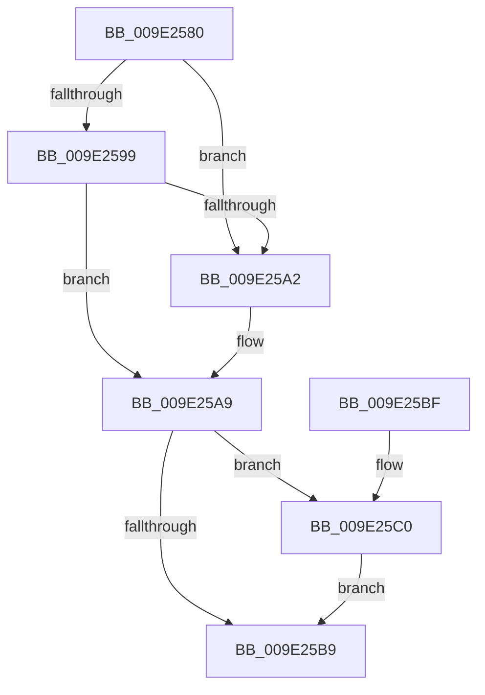

# WmipUnlinkInstanceSetFromGuidEntry

- RVA: `0x009E2580`–`0x009E25D1` (길이 `81` bytes)
- VA: `0x00000001409E2580`
- 실행 섹션: `PAGE`
- PDB 이름 있음: `예`; PDB Function 태그: `아니요`
- unwind 정보 RVA: `0x0008B9A4`
- 디코드: `25`개 명령, `81/81` bytes 표시
- 미해석 바이트: `0` (있으면 어셈블리에 `.byte`로 보존)

> 이 문서는 커널 이미지의 기계어와 PDB 기호를 분석해 생성했습니다. 4번과 5번은 함수 원형과 자료형을 바이너리 사용 방식에서 추정한 C 해석이며 원본 소스 복구 결과는 아닙니다.

## 1. Dependencies

- 직접 호출 지점: **1**; 고유 호출 대상: **1**
- 직접 호출자로 확인된 함수: **2**
- RIP 상대 이미지 참조: **0**

### Outgoing calls
- `0x009E25C3` → [WmipUnregisterEtwProvider](WmipUnregisterEtwProvider_function_009E3A2C.md) (function, `0x009E3A2C`)

### Direct callers
- [WmipUpdateDataSource](../9D/WmipUpdateDataSource_function_009DD474.md) at `0x009DD65A`
- [WmipDSCleanup](WmipDSCleanup_function_009E2400.md) at `0x009E2455`

### Static image references
- 디코드된 RIP-relative 메모리 참조가 없습니다.

## 2. Other-region calls and transfers

- 다른 실행 섹션으로 향하는 call: **0**
- 별도 외부 분기/꼬리 이동을 확인하지 못했습니다.

## 3. Assembly (complete function range)

```asm
009E2580  40 53                           push rbx
009E2582  48 83 EC 20                     sub rsp, 0x20
009E2586  48 8B 41 38                     mov rax, qword ptr [rcx + 0x38]
009E258A  48 8B D9                        mov rbx, rcx
009E258D  FF 48 24                        dec dword ptr [rax + 0x24]
009E2590  48 8B 09                        mov rcx, qword ptr [rcx]
009E2593  48 39 59 08                     cmp qword ptr [rcx + 8], rbx
009E2597  75 09                           jne 0x1409e25a2
009E2599  48 8B 43 08                     mov rax, qword ptr [rbx + 8]
009E259D  48 39 18                        cmp qword ptr [rax], rbx
009E25A0  74 07                           je 0x1409e25a9
009E25A2  B9 03 00 00 00                  mov ecx, 3
009E25A7  CD 29                           int 0x29
009E25A9  48 89 08                        mov qword ptr [rax], rcx
009E25AC  48 89 41 08                     mov qword ptr [rcx + 8], rax
009E25B0  F7 43 10 00 00 08 00            test dword ptr [rbx + 0x10], 0x80000
009E25B7  75 07                           jne 0x1409e25c0
009E25B9  48 83 C4 20                     add rsp, 0x20
009E25BD  5B                              pop rbx
009E25BE  C3                              ret
009E25BF  CC                              int3
009E25C0  48 8B CB                        mov rcx, rbx
009E25C3  E8 64 14 00 00                  call 0x1409e3a2c
009E25C8  81 63 10 FF FF CF FF            and dword ptr [rbx + 0x10], 0xffcfffff
009E25CF  EB E8                           jmp 0x1409e25b9
```

## 4. C-style interpretation (structured pseudocode)

```c
__int64 __fastcall WmipUnlinkInstanceSetFromGuidEntry(__int64 a1)
{
    __int64 result;
    __int64 v_rsp;

    v_rsp = (v_rsp) - (32);
    if ((*(unsigned __int64 *)(*(unsigned __int64 *)(a1) + 8)) != a1) goto loc_009E25A2;
    if ((*(unsigned __int64 *)(*(unsigned __int64 *)(a1 + 8))) != a1) {
        a1 = 3;
    }
    *(unsigned __int64 *)(*(unsigned __int64 *)(a1 + 8)) = a1;
    *(unsigned __int64 *)(a1 + 8) = *(unsigned __int64 *)(a1 + 8);
    if (((*(unsigned int *)(a1 + 16)) & (0x80000ULL)) != 0) goto loc_009E25C0;
loc_009E25B9:
    v_rsp = (v_rsp) + (32);
    return *(unsigned __int64 *)(a1 + 8);
loc_009E25C0:
    result = WmipUnregisterEtwProvider(a1, a2, a3, a4);
    goto loc_009E25B9;
}
```

## 5. (Beta) C Style

```c
int64_t WmipUnlinkInstanceSetFromGuidEntry(void *Arg1)
{
    uint8_t *arg1 = (uint8_t *)Arg1;

    int64_t result;
    int64_t local_rsp;

    local_rsp = (local_rsp) - (32);
    if ((*(uint64_t *)(*(uint64_t *)(arg1) + 0x8)) != Arg1) goto loc_009E25A2;
    if ((*(uint64_t *)(*(uint64_t *)(arg1 + 0x8))) != Arg1) {
        Arg1 = 3;
    }
    *(void **)(*(uint64_t *)(arg1 + 0x8)) = Arg1;
    *(uint64_t *)(arg1 + 0x8) = *(uint64_t *)(arg1 + 0x8);
    if (((*(uint32_t *)(arg1 + 0x10)) & (0x80000ULL)) != 0) goto loc_009E25C0;
loc_009E25B9:
    local_rsp = (local_rsp) + (32);
    return *(uint64_t *)(arg1 + 0x8);
loc_009E25C0:
    result = WmipUnregisterEtwProvider(Arg1, a2, a3, a4);
    goto loc_009E25B9;
}
```

### 관측된 메모리 오프셋

구조체 형식이 확인되지 않은 접근은 인자 기준의 오프셋으로만 기록했습니다.

| 기준 인자 | 오프셋 표현 | 폭 (bit) | 접근 |
|---|---:|---:|---|
| `Arg1` | `+ 0x0` | `64` | `R` |
| `Arg1` | `+ 0x8` | `64` | `R` |
| `Arg1` | `+ 0x10` | `32` | `R` |
| `Arg1` | `+ 0x10` | `32` | `R/W` |
| `Arg1` | `+ 0x38` | `64` | `R` |

## 6. Execution-region graph

[열기: 2D/3D 그래프와 함수 탐색 컨트롤 패널](../../../control-panel.html?section=page&rva=0x009E2580&view=graph)

- 2D 그래프는 위에서 아래로 흐르고, 3D 그래프는 빈 공간을 드래그해 회전합니다. Shift+드래그는 이동, 휠은 확대·축소, 함수 노드 선택은 대상 보고서 이동입니다.

### Static fallback


