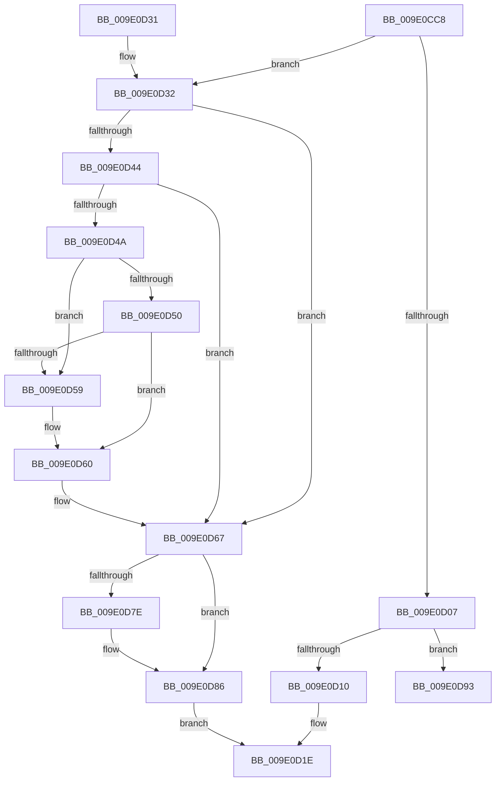

# WmipUnreferenceEntry

- RVA: `0x009E0CC8`–`0x009E0DAE` (길이 `230` bytes)
- VA: `0x00000001409E0CC8`
- 실행 섹션: `PAGE`
- PDB 이름 있음: `예`; PDB Function 태그: `아니요`
- unwind 정보 RVA: `0x000A3C98`
- 디코드: `64`개 명령, `230/230` bytes 표시
- 미해석 바이트: `0` (있으면 어셈블리에 `.byte`로 보존)

> 이 문서는 커널 이미지의 기계어와 PDB 기호를 분석해 생성했습니다. 4번과 5번은 함수 원형과 자료형을 바이너리 사용 방식에서 추정한 C 해석이며 원본 소스 복구 결과는 아닙니다.

## 1. Dependencies

- 직접 호출 지점: **6**; 고유 호출 대상: **5**
- 직접 호출자로 확인된 함수: **25**
- RIP 상대 이미지 참조: **1**

### Outgoing calls
- `0x009E0CF2` → [KeWaitForSingleObject](../../text/20/KeWaitForSingleObject_function_0020E6B0.md) (function, `0x0020E6B0`)
- `0x009E0D19` → [KeReleaseMutex](../../text/39/KeReleaseMutex_function_00396810.md) (function, `0x00396810`)
- `0x009E0D70` → [KeReleaseMutex](../../text/39/KeReleaseMutex_function_00396810.md) (function, `0x00396810`)
- `0x009E0D81` → [guard_dispatch_icall](../../text/6B/guard_dispatch_icall_function_006BAAD0.md) (function, `0x006BAAD0`)
- `0x009E0D8C` → [ExFreeToPagedLookasideList](../../text/38/ExFreeToPagedLookasideList_function_00387D30.md) (function, `0x00387D30`)
- `0x009E0DA8` → [KeBugCheckEx](../../text/4F/KeBugCheckEx_function_004FD660.md) (function, `0x004FD660`)

### Direct callers
- [WmipAddMofResource](../7B/WmipAddMofResource_function_007B4188.md) at `0x007B431B`
- [WmipUpdateAddGuid](../7B/WmipUpdateAddGuid_function_007B46C0.md) at `0x007B4755`
- [WmipUpdateModifyGuid](../7B/WmipUpdateModifyGuid_function_007B4798.md) at `0x007B4973`
- [WmipUpdateModifyGuid](../7B/WmipUpdateModifyGuid_function_007B4798.md) at `0x007B4987`
- [WmipUpdateDataSource](../9D/WmipUpdateDataSource_function_009DD474.md) at `0x009DD538`
- [WmipUpdateDataSource](../9D/WmipUpdateDataSource_function_009DD474.md) at `0x009DD5CF`
- [WmipUpdateDataSource](../9D/WmipUpdateDataSource_function_009DD474.md) at `0x009DD671`
- [WmipUpdateDataSource](../9D/WmipUpdateDataSource_function_009DD474.md) at `0x009DD6A1`
- [WmipRemoveDS](../9D/WmipRemoveDS_function_009DD7D8.md) at `0x009DD802`
- [WmipAddDataSource](../9D/WmipAddDataSource_function_009DDC30.md) at `0x009DDF5D`
- [WmipMangleInstanceName](../9D/WmipMangleInstanceName_function_009DE2DC.md) at `0x009DE3C1`
- [WmipMangleInstanceName](../9D/WmipMangleInstanceName_function_009DE2DC.md) at `0x009DE3E1`
- [WmipDisableCollectionForRemovedGuid](../9D/WmipDisableCollectionForRemovedGuid_function_009DE88C.md) at `0x009DE90D`
- [WmipGenerateRegistrationNotification](../9D/WmipGenerateRegistrationNotification_function_009DF60C.md) at `0x009DF6BF`
- [WmipIncludeStaticNames](../9D/WmipIncludeStaticNames_function_009DF754.md) at `0x009DF7F6`
- [WmipIncludeStaticNames](../9D/WmipIncludeStaticNames_function_009DF754.md) at `0x009DF931`
- [WmipProcessEvent](../9D/WmipProcessEvent_function_009DFA40.md) at `0x009DFB58`
- [WmipEnableCollectionForNewGuid](../9D/WmipEnableCollectionForNewGuid_function_009DFC0C.md) at `0x009DFC8D`
- [WmipQuerySetExecuteSI](WmipQuerySetExecuteSI_function_009E0574.md) at `0x009E0709`
- [WmipQueryAllData](WmipQueryAllData_function_009E086C.md) at `0x009E0AF5`
- [WmipDSCleanup](WmipDSCleanup_function_009E2400.md) at `0x009E249B`
- [WmipDSCleanup](WmipDSCleanup_function_009E2400.md) at `0x009E24B2`
- [WmipDSCleanup](WmipDSCleanup_function_009E2400.md) at `0x009E255E`
- [WmipDeleteMethod](WmipDeleteMethod_function_009E25E0.md) at `0x009E265A`
- [WmipDetermineInstanceBaseIndex](WmipDetermineInstanceBaseIndex_function_009E2740.md) at `0x009E27CE`
- [WmipLegacyEtwWorker](WmipLegacyEtwWorker_function_009E3290.md) at `0x009E3335`
- [WmipLegacyEtwWorker](WmipLegacyEtwWorker_function_009E3290.md) at `0x009E338A`
- [WmipSendEnableDisableRequest](WmipSendEnableDisableRequest_function_009E3800.md) at `0x009E3939`
- [WmipProcessLegacyEtwCallback](../AA/WmipProcessLegacyEtwCallback_function_00AA59E8.md) at `0x00AA5A9A`
- [WmipDereferenceEvent](../AC/WmipDereferenceEvent_function_00ACE6E4.md) at `0x00ACE916`
- [sub_00B3023C](../B3/Unknown_function_00B3023C.md) at `0x00B30286`
- [sub_00B3029E](../B3/Unknown_function_00B3029E.md) at `0x00B302A8`
- [sub_00B3029E](../B3/Unknown_function_00B3029E.md) at `0x00B302C1`
- [sub_00B302EC](../B3/Unknown_function_00B302EC.md) at `0x00B302F6`
- [sub_00B302EC](../B3/Unknown_function_00B302EC.md) at `0x00B3030F`
- [sub_00B3052E](../B3/Unknown_function_00B3052E.md) at `0x00B305B6`

### Static image references
- `0x009E0CE5` → RVA `0x00EFFA60` (`.data`; read)

## 2. Other-region calls and transfers

- 다른 실행 섹션으로 향하는 call: **6**
  - `0x009E0CF2` → [KeWaitForSingleObject](../../text/20/KeWaitForSingleObject_function_0020E6B0.md) (`PAGE` → `.text`)
  - `0x009E0D19` → [KeReleaseMutex](../../text/39/KeReleaseMutex_function_00396810.md) (`PAGE` → `.text`)
  - `0x009E0D70` → [KeReleaseMutex](../../text/39/KeReleaseMutex_function_00396810.md) (`PAGE` → `.text`)
  - `0x009E0D81` → [guard_dispatch_icall](../../text/6B/guard_dispatch_icall_function_006BAAD0.md) (`PAGE` → `.text`)
  - `0x009E0D8C` → [ExFreeToPagedLookasideList](../../text/38/ExFreeToPagedLookasideList_function_00387D30.md) (`PAGE` → `.text`)
  - `0x009E0DA8` → [KeBugCheckEx](../../text/4F/KeBugCheckEx_function_004FD660.md) (`PAGE` → `.text`)
- 별도 외부 분기/꼬리 이동을 확인하지 못했습니다.

## 3. Assembly (complete function range)

```asm
009E0CC8  48 89 5C 24 08                  mov qword ptr [rsp + 8], rbx
009E0CCD  48 89 74 24 10                  mov qword ptr [rsp + 0x10], rsi
009E0CD2  57                              push rdi
009E0CD3  48 83 EC 30                     sub rsp, 0x30
009E0CD7  48 83 64 24 20 00               and qword ptr [rsp + 0x20], 0
009E0CDD  48 8B DA                        mov rbx, rdx
009E0CE0  48 8B F1                        mov rsi, rcx
009E0CE3  33 D2                           xor edx, edx
009E0CE5  48 8D 0D 74 ED 51 00            lea rcx, [rip + 0x51ed74]
009E0CEC  45 33 C9                        xor r9d, r9d
009E0CEF  45 33 C0                        xor r8d, r8d
009E0CF2  E8 B9 D9 82 FF                  call 0x14020e6b0
009E0CF7  48 83 CF FF                     or rdi, 0xffffffffffffffff
009E0CFB  F0 48 0F C1 7B 18               lock xadd qword ptr [rbx + 0x18], rdi
009E0D01  48 83 EF 01                     sub rdi, 1
009E0D05  74 2B                           je 0x1409e0d32
009E0D07  48 85 FF                        test rdi, rdi
009E0D0A  0F 88 83 00 00 00               js 0x1409e0d93
009E0D10  33 D2                           xor edx, edx
009E0D12  48 8D 0D 47 ED 51 00            lea rcx, [rip + 0x51ed47]
009E0D19  E8 F2 5A 9B FF                  call 0x140396810
009E0D1E  48 8B 5C 24 40                  mov rbx, qword ptr [rsp + 0x40]
009E0D23  48 8B C7                        mov rax, rdi
009E0D26  48 8B 74 24 48                  mov rsi, qword ptr [rsp + 0x48]
009E0D2B  48 83 C4 30                     add rsp, 0x30
009E0D2F  5F                              pop rdi
009E0D30  C3                              ret
009E0D31  CC                              int3
009E0D32  8B 4B 10                        mov ecx, dword ptr [rbx + 0x10]
009E0D35  48 8B 03                        mov rax, qword ptr [rbx]
009E0D38  0F BA E9 1D                     bts ecx, 0x1d
009E0D3C  89 4B 10                        mov dword ptr [rbx + 0x10], ecx
009E0D3F  48 85 C0                        test rax, rax
009E0D42  74 23                           je 0x1409e0d67
009E0D44  0F BA E1 1C                     bt ecx, 0x1c
009E0D48  73 1D                           jae 0x1409e0d67
009E0D4A  48 39 58 08                     cmp qword ptr [rax + 8], rbx
009E0D4E  75 09                           jne 0x1409e0d59
009E0D50  48 8B 4B 08                     mov rcx, qword ptr [rbx + 8]
009E0D54  48 39 19                        cmp qword ptr [rcx], rbx
009E0D57  74 07                           je 0x1409e0d60
009E0D59  B9 03 00 00 00                  mov ecx, 3
009E0D5E  CD 29                           int 0x29
009E0D60  48 89 01                        mov qword ptr [rcx], rax
009E0D63  48 89 48 08                     mov qword ptr [rax + 8], rcx
009E0D67  33 D2                           xor edx, edx
009E0D69  48 8D 0D F0 EC 51 00            lea rcx, [rip + 0x51ecf0]
009E0D70  E8 9B 5A 9B FF                  call 0x140396810
009E0D75  48 8B 46 10                     mov rax, qword ptr [rsi + 0x10]
009E0D79  48 85 C0                        test rax, rax
009E0D7C  74 08                           je 0x1409e0d86
009E0D7E  48 8B CB                        mov rcx, rbx
009E0D81  E8 4A 9D CD FF                  call 0x1406baad0
009E0D86  48 8B 0E                        mov rcx, qword ptr [rsi]
009E0D89  48 8B D3                        mov rdx, rbx
009E0D8C  E8 9F 6F 9A FF                  call 0x140387d30
009E0D91  EB 8B                           jmp 0x1409e0d1e
009E0D93  48 83 64 24 20 00               and qword ptr [rsp + 0x20], 0
009E0D99  45 33 C9                        xor r9d, r9d
009E0D9C  4C 8B C3                        mov r8, rbx
009E0D9F  B9 4A 01 00 00                  mov ecx, 0x14a
009E0DA4  41 8D 51 02                     lea edx, [r9 + 2]
009E0DA8  E8 B3 C8 B1 FF                  call 0x1404fd660
009E0DAD  CC                              int3
```

## 4. C-style interpretation (structured pseudocode)

```c
__int64 __fastcall WmipUnreferenceEntry(__int64 a1, __int64 a2, int a3, int a4)
{
    __int64 result;
    __int64 v_rdi;
    __int64 v_rsp;
    unsigned __int64 v_stack_m18;
    unsigned __int64 v_stack_p10;
    unsigned __int64 v_stack_p20;
    unsigned __int64 v_stack_p8;

    v_stack_p8 = v_rbx;
    v_stack_p10 = v_rsi;
    v_rsp = (v_rsp) - (48);
    a2 = 0;
    a4 = 0;
    a3 = 0;
    result = KeWaitForSingleObject(v_rip + 5369204, a2, a3, a4);
    v_rdi = (v_rdi) | (-1);
    v_rdi = (v_rdi) - (1);
    if (condition_is_equal) goto loc_009E0D32;
    if (sign_flag) goto loc_009E0D93;
    a2 = 0;
    result = KeReleaseMutex(v_rip + 5369159, a2, a3, a4);
loc_009E0D1E:
    v_rsp = (v_rsp) + (48);
    return v_rdi;
loc_009E0D32:
    *(unsigned int *)(v_stack_p8 + 16) = (unsigned int)((unsigned int)(*(unsigned int *)(v_stack_p8 + 16)));
    if (*(unsigned __int64 *)(v_stack_p8) == 0) goto loc_009E0D67;
    if (condition_is_above_or_equal) goto loc_009E0D67;
    if ((*(unsigned __int64 *)(*(unsigned __int64 *)(v_stack_p8) + 8)) != v_stack_p8) goto loc_009E0D59;
    if ((*(unsigned __int64 *)(*(unsigned __int64 *)(v_stack_p8 + 8))) != v_stack_p8) {
        a1 = 3;
    }
    *(unsigned __int64 *)(a1) = *(unsigned __int64 *)(v_stack_p8);
    *(unsigned __int64 *)(*(unsigned __int64 *)(v_stack_p8) + 8) = a1;
loc_009E0D67:
    a2 = 0;
    result = KeReleaseMutex(v_rip + 5369072, a2, a3, a4);
    result = *(unsigned __int64 *)(v_stack_p10 + 16);
    if (*(unsigned __int64 *)(v_stack_p10 + 16) != 0) {
        a1 = v_stack_p8;
        result = guard_dispatch_icall(a1, a2, a3, a4);
    }
    result = ExFreeToPagedLookasideList(*(unsigned __int64 *)(v_stack_p10), v_stack_p8, a3, a4);
    goto loc_009E0D1E;
loc_009E0D93:
    a4 = 0;
    result = KeBugCheckEx(330, a4 + 2, v_stack_p8, a4);
    return result;
}
```

## 5. (Beta) C Style

```c
int64_t WmipUnreferenceEntry(void *Arg1, void *Arg2, int32_t Arg3, int32_t Arg4)
{
    uint8_t *arg1 = (uint8_t *)Arg1;
    uint8_t *arg2 = (uint8_t *)Arg2;

    int64_t result;
    int64_t local_rdi;
    int64_t local_rsp;
    uint64_t v_stack_m18;
    uint64_t v_stack_p10;
    uint64_t v_stack_p20;
    uint64_t v_stack_p8;

    v_stack_p8 = local_rbx;
    v_stack_p10 = local_rsi;
    local_rsp = (local_rsp) - (48);
    Arg2 = 0;
    Arg4 = 0;
    Arg3 = 0;
    result = KeWaitForSingleObject(v_rip + 5369204, Arg2, Arg3, Arg4);
    local_rdi = (local_rdi) | (-1);
    local_rdi = (local_rdi) - (1);
    if (condition_is_equal) goto loc_009E0D32;
    if (sign_flag) goto loc_009E0D93;
    Arg2 = 0;
    result = KeReleaseMutex(v_rip + 5369159, Arg2, Arg3, Arg4);
loc_009E0D1E:
    local_rsp = (local_rsp) + (48);
    return local_rdi;
loc_009E0D32:
    *(uint32_t *)(v_stack_p8 + 0x10) = (uint32_t)((uint32_t)(*(uint32_t *)(v_stack_p8 + 0x10)));
    if (*(uint64_t *)(v_stack_p8) == 0) goto loc_009E0D67;
    if (condition_is_above_or_equal) goto loc_009E0D67;
    if ((*(uint64_t *)(*(uint64_t *)(v_stack_p8) + 0x8)) != v_stack_p8) goto loc_009E0D59;
    if ((*(uint64_t *)(*(uint64_t *)(v_stack_p8 + 0x8))) != v_stack_p8) {
        Arg1 = 3;
    }
    *(uint64_t *)(arg1) = *(uint64_t *)(v_stack_p8);
    *(void **)(*(uint64_t *)(v_stack_p8) + 0x8) = Arg1;
loc_009E0D67:
    Arg2 = 0;
    result = KeReleaseMutex(v_rip + 5369072, Arg2, Arg3, Arg4);
    result = *(uint64_t *)(v_stack_p10 + 0x10);
    if (*(uint64_t *)(v_stack_p10 + 0x10) != 0) {
        Arg1 = v_stack_p8;
        result = guard_dispatch_icall(Arg1, Arg2, Arg3, Arg4);
    }
    result = ExFreeToPagedLookasideList(*(uint64_t *)(v_stack_p10), v_stack_p8, Arg3, Arg4);
    goto loc_009E0D1E;
loc_009E0D93:
    Arg4 = 0;
    result = KeBugCheckEx(330, Arg4 + 2, v_stack_p8, Arg4);
    return result;
}
```

### 관측된 메모리 오프셋

구조체 형식이 확인되지 않은 접근은 인자 기준의 오프셋으로만 기록했습니다.

| 기준 인자 | 오프셋 표현 | 폭 (bit) | 접근 |
|---|---:|---:|---|
| `Arg1` | `+ 0x0` | `64` | `R` |
| `Arg1` | `+ 0x10` | `64` | `R` |
| `Arg2` | `+ 0x0` | `64` | `R` |
| `Arg2` | `+ 0x8` | `64` | `R` |
| `Arg2` | `+ 0x10` | `32` | `R` |
| `Arg2` | `+ 0x10` | `32` | `W` |
| `Arg2` | `+ 0x18` | `64` | `R/W` |

## 6. Execution-region graph

[열기: 2D/3D 그래프와 함수 탐색 컨트롤 패널](../../../control-panel.html?section=page&rva=0x009E0CC8&view=graph)

- 2D 그래프는 위에서 아래로 흐르고, 3D 그래프는 빈 공간을 드래그해 회전합니다. Shift+드래그는 이동, 휠은 확대·축소, 함수 노드 선택은 대상 보고서 이동입니다.

### Static fallback


