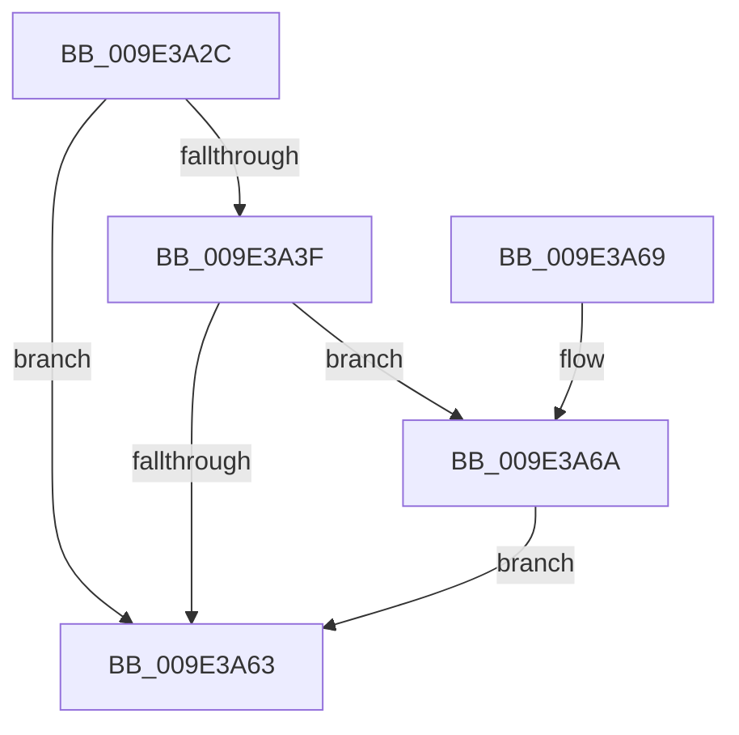

# WmipUnregisterEtwProvider

- RVA: `0x009E3A2C`–`0x009E3A81` (길이 `85` bytes)
- VA: `0x00000001409E3A2C`
- 실행 섹션: `PAGE`
- PDB 이름 있음: `예`; PDB Function 태그: `아니요`
- unwind 정보 RVA: `0x0009D0AC`
- 디코드: `23`개 명령, `85/85` bytes 표시
- 미해석 바이트: `0` (있으면 어셈블리에 `.byte`로 보존)

> 이 문서는 커널 이미지의 기계어와 PDB 기호를 분석해 생성했습니다. 4번과 5번은 함수 원형과 자료형을 바이너리 사용 방식에서 추정한 C 해석이며 원본 소스 복구 결과는 아닙니다.

## 1. Dependencies

- 직접 호출 지점: **2**; 고유 호출 대상: **2**
- 직접 호출자로 확인된 함수: **1**
- RIP 상대 이미지 참조: **0**

### Outgoing calls
- `0x009E3A59` → [ExAllocatePool2](../../poolcode/B8/ExAllocatePool2_function_00B820F0.md) (function, `0x00B820F0`)
- `0x009E3A7A` → [WmipQueueLegacyEtwWork](WmipQueueLegacyEtwWork_function_009E33DC.md) (function, `0x009E33DC`)

### Direct callers
- [WmipUnlinkInstanceSetFromGuidEntry](WmipUnlinkInstanceSetFromGuidEntry_function_009E2580.md) at `0x009E25C3`

### Static image references
- 디코드된 RIP-relative 메모리 참조가 없습니다.

## 2. Other-region calls and transfers

- 다른 실행 섹션으로 향하는 call: **1**
  - `0x009E3A59` → [ExAllocatePool2](../../poolcode/B8/ExAllocatePool2_function_00B820F0.md) (`PAGE` → `POOLCODE`)
- 별도 외부 분기/꼬리 이동을 확인하지 못했습니다.

## 3. Assembly (complete function range)

```asm
009E3A2C  40 53                           push rbx
009E3A2E  48 83 EC 20                     sub rsp, 0x20
009E3A32  48 8B 59 38                     mov rbx, qword ptr [rcx + 0x38]
009E3A36  83 83 98 00 00 00 FF            add dword ptr [rbx + 0x98], -1
009E3A3D  75 24                           jne 0x1409e3a63
009E3A3F  48 83 63 70 00                  and qword ptr [rbx + 0x70], 0
009E3A44  BA 18 00 00 00                  mov edx, 0x18
009E3A49  48 83 63 78 00                  and qword ptr [rbx + 0x78], 0
009E3A4E  B9 00 01 00 00                  mov ecx, 0x100
009E3A53  41 B8 57 6D 69 70               mov r8d, 0x70696d57
009E3A59  E8 92 E6 19 00                  call 0x140b820f0
009E3A5E  48 85 C0                        test rax, rax
009E3A61  75 07                           jne 0x1409e3a6a
009E3A63  48 83 C4 20                     add rsp, 0x20
009E3A67  5B                              pop rbx
009E3A68  C3                              ret
009E3A69  CC                              int3
009E3A6A  45 33 C0                        xor r8d, r8d
009E3A6D  C7 40 10 01 00 00 00            mov dword ptr [rax + 0x10], 1
009E3A74  48 8B D3                        mov rdx, rbx
009E3A77  48 8B C8                        mov rcx, rax
009E3A7A  E8 5D F9 FF FF                  call 0x1409e33dc
009E3A7F  EB E2                           jmp 0x1409e3a63
```

## 4. C-style interpretation (structured pseudocode)

```c
__int64 __fastcall WmipUnregisterEtwProvider(__int64 a1)
{
    __int64 result;
    __int64 v_rsp;

    v_rsp = (v_rsp) - (32);
    if (condition_is_not_equal) goto loc_009E3A63;
    result = ExAllocatePool2(256, 24, (unsigned int)(0x70696D57ULL), a4);
    if (result != 0) goto loc_009E3A6A;
loc_009E3A63:
    v_rsp = (v_rsp) + (32);
    return result;
loc_009E3A6A:
    a3 = 0;
    *(unsigned int *)(result + 16) = 1;
    result = WmipQueueLegacyEtwWork(result, *(unsigned __int64 *)(a1 + 56), a3, a4);
    goto loc_009E3A63;
}
```

## 5. (Beta) C Style

```c
int64_t WmipUnregisterEtwProvider(void *Arg1)
{
    uint8_t *arg1 = (uint8_t *)Arg1;

    int64_t result;
    int64_t local_rsp;

    local_rsp = (local_rsp) - (32);
    if (condition_is_not_equal) goto loc_009E3A63;
    result = ExAllocatePool2(256, 24, (uint32_t)(0x70696D57ULL), a4);
    if (result != 0) goto loc_009E3A6A;
loc_009E3A63:
    local_rsp = (local_rsp) + (32);
    return result;
loc_009E3A6A:
    a3 = 0;
    *(uint32_t *)(result + 0x10) = 1;
    result = WmipQueueLegacyEtwWork(result, *(uint64_t *)(arg1 + 0x38), a3, a4);
    goto loc_009E3A63;
}
```

### 관측된 메모리 오프셋

구조체 형식이 확인되지 않은 접근은 인자 기준의 오프셋으로만 기록했습니다.

| 기준 인자 | 오프셋 표현 | 폭 (bit) | 접근 |
|---|---:|---:|---|
| `Arg1` | `+ 0x38` | `64` | `R` |

## 6. Execution-region graph

[열기: 2D/3D 그래프와 함수 탐색 컨트롤 패널](../../../control-panel.html?section=page&rva=0x009E3A2C&view=graph)

- 2D 그래프는 위에서 아래로 흐르고, 3D 그래프는 빈 공간을 드래그해 회전합니다. Shift+드래그는 이동, 휠은 확대·축소, 함수 노드 선택은 대상 보고서 이동입니다.

### Static fallback


