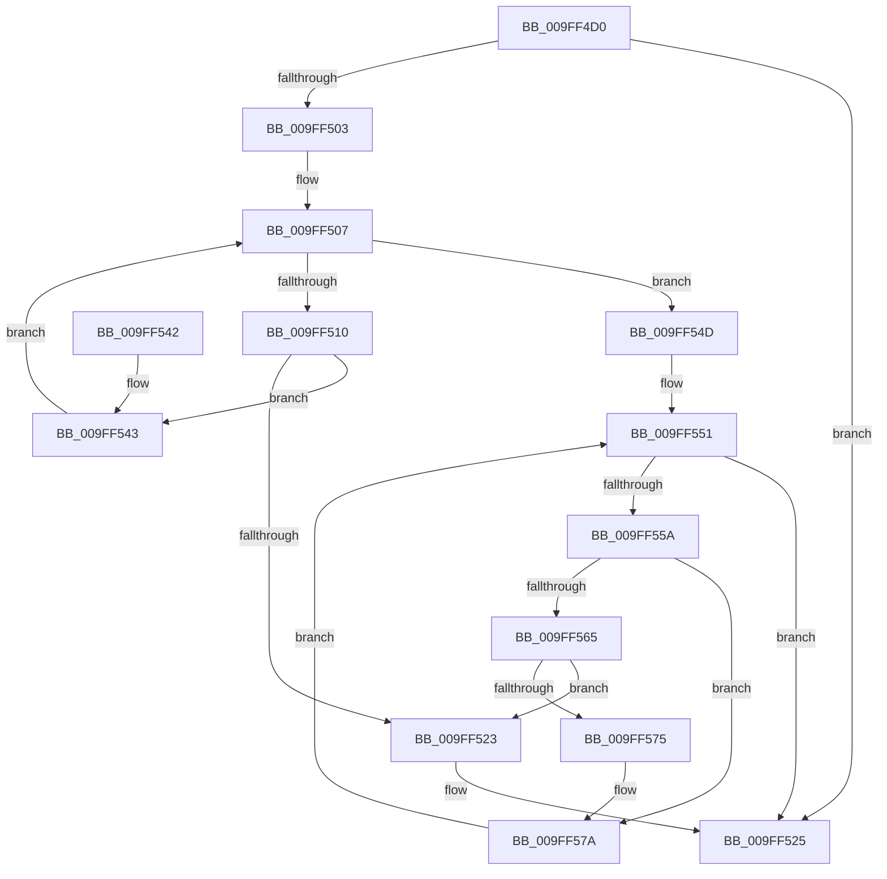

# AuthzBasepFindSystemSecurityAttribute

- RVA: `0x009FF4D0`–`0x009FF57F` (길이 `175` bytes)
- VA: `0x00000001409FF4D0`
- 실행 섹션: `PAGE`
- PDB 이름 있음: `예`; PDB Function 태그: `아니요`
- unwind 정보 RVA: `0x000A78A4`
- 디코드: `55`개 명령, `175/175` bytes 표시
- 미해석 바이트: `0` (있으면 어셈블리에 `.byte`로 보존)

> 이 문서는 커널 이미지의 기계어와 PDB 기호를 분석해 생성했습니다. 4번과 5번은 함수 원형과 자료형을 바이너리 사용 방식에서 추정한 C 해석이며 원본 소스 복구 결과는 아닙니다.

## 1. Dependencies

- 직접 호출 지점: **2**; 고유 호출 대상: **1**
- 직접 호출자로 확인된 함수: **1**
- RIP 상대 이미지 참조: **1**

### Outgoing calls
- `0x009FF51A` → [AuthzBasepEqualUnicodeString](../../text/3A/AuthzBasepEqualUnicodeString_function_003A8A80.md) (function, `0x003A8A80`)
- `0x009FF56C` → [AuthzBasepEqualUnicodeString](../../text/3A/AuthzBasepEqualUnicodeString_function_003A8A80.md) (function, `0x003A8A80`)

### Direct callers
- [AuthzBasepQuerySystemSecurityAttributeAndValues](AuthzBasepQuerySystemSecurityAttributeAndValues_function_009FF44C.md) at `0x009FF468`

### Static image references
- `0x009FF4E4` → RVA `0x00EEFE50` (`.data`; read)

## 2. Other-region calls and transfers

- 다른 실행 섹션으로 향하는 call: **2**
  - `0x009FF51A` → [AuthzBasepEqualUnicodeString](../../text/3A/AuthzBasepEqualUnicodeString_function_003A8A80.md) (`PAGE` → `.text`)
  - `0x009FF56C` → [AuthzBasepEqualUnicodeString](../../text/3A/AuthzBasepEqualUnicodeString_function_003A8A80.md) (`PAGE` → `.text`)
- 별도 외부 분기/꼬리 이동을 확인하지 못했습니다.

## 3. Assembly (complete function range)

```asm
009FF4D0  4C 8B DC                        mov r11, rsp
009FF4D3  49 89 5B 08                     mov qword ptr [r11 + 8], rbx
009FF4D7  49 89 6B 18                     mov qword ptr [r11 + 0x18], rbp
009FF4DB  49 89 73 20                     mov qword ptr [r11 + 0x20], rsi
009FF4DF  57                              push rdi
009FF4E0  48 83 EC 20                     sub rsp, 0x20
009FF4E4  48 8B 05 65 09 4F 00            mov rax, qword ptr [rip + 0x4f0965]
009FF4EB  33 DB                           xor ebx, ebx
009FF4ED  49 89 5B 10                     mov qword ptr [r11 + 0x10], rbx
009FF4F1  48 8B E9                        mov rbp, rcx
009FF4F4  49 87 43 10                     xchg qword ptr [r11 + 0x10], rax
009FF4F8  49 8B 53 10                     mov rdx, qword ptr [r11 + 0x10]
009FF4FC  8B F3                           mov esi, ebx
009FF4FE  48 85 D2                        test rdx, rdx
009FF501  74 22                           je 0x1409ff525
009FF503  48 8B 7A 08                     mov rdi, qword ptr [rdx + 8]
009FF507  48 8D 42 08                     lea rax, [rdx + 8]
009FF50B  48 3B F8                        cmp rdi, rax
009FF50E  74 3D                           je 0x1409ff54d
009FF510  48 8D 4F 20                     lea rcx, [rdi + 0x20]
009FF514  48 8B D5                        mov rdx, rbp
009FF517  48 8B F7                        mov rsi, rdi
009FF51A  E8 61 95 9A FF                  call 0x1403a8a80
009FF51F  84 C0                           test al, al
009FF521  74 20                           je 0x1409ff543
009FF523  B3 01                           mov bl, 1
009FF525  48 8B 6C 24 40                  mov rbp, qword ptr [rsp + 0x40]
009FF52A  F6 DB                           neg bl
009FF52C  48 8B 5C 24 30                  mov rbx, qword ptr [rsp + 0x30]
009FF531  48 1B C0                        sbb rax, rax
009FF534  48 23 C6                        and rax, rsi
009FF537  48 8B 74 24 48                  mov rsi, qword ptr [rsp + 0x48]
009FF53C  48 83 C4 20                     add rsp, 0x20
009FF540  5F                              pop rdi
009FF541  C3                              ret
009FF542  CC                              int3
009FF543  48 8B 3F                        mov rdi, qword ptr [rdi]
009FF546  48 8B 54 24 38                  mov rdx, qword ptr [rsp + 0x38]
009FF54B  EB BA                           jmp 0x1409ff507
009FF54D  48 8B 7A 20                     mov rdi, qword ptr [rdx + 0x20]
009FF551  48 8D 42 20                     lea rax, [rdx + 0x20]
009FF555  48 3B F8                        cmp rdi, rax
009FF558  74 CB                           je 0x1409ff525
009FF55A  48 8D 77 F0                     lea rsi, [rdi - 0x10]
009FF55E  8B 46 38                        mov eax, dword ptr [rsi + 0x38]
009FF561  A8 01                           test al, 1
009FF563  75 15                           jne 0x1409ff57a
009FF565  48 8D 4E 20                     lea rcx, [rsi + 0x20]
009FF569  48 8B D5                        mov rdx, rbp
009FF56C  E8 0F 95 9A FF                  call 0x1403a8a80
009FF571  84 C0                           test al, al
009FF573  75 AE                           jne 0x1409ff523
009FF575  48 8B 54 24 38                  mov rdx, qword ptr [rsp + 0x38]
009FF57A  48 8B 3F                        mov rdi, qword ptr [rdi]
009FF57D  EB D2                           jmp 0x1409ff551
```

## 4. C-style interpretation (structured pseudocode)

```c
__int64 __fastcall AuthzBasepFindSystemSecurityAttribute(__int64 a1)
{
    __int64 result;
    __int64 v_rbx;
    __int64 v_rsp;
    unsigned __int64 v_stack_p18;
    unsigned __int64 v_stack_p20;
    unsigned __int64 v_stack_p38;
    unsigned __int64 v_stack_p8;

    *(unsigned __int64 *)(v_rsp + 8) = v_rbx;
    *(unsigned __int64 *)(v_rsp + 24) = v_rbp;
    *(unsigned __int64 *)(v_rsp + 32) = v_rsi;
    v_rsp = (v_rsp) - (32);
    v_rbx = 0;
    *(unsigned __int64 *)(v_rsp + 16) = 0;
    if (*(unsigned __int64 *)(v_rsp + 16) == 0) goto loc_009FF525;
loc_009FF507:
    if ((*(unsigned __int64 *)(*(unsigned __int64 *)(v_rsp + 16) + 8)) == (*(unsigned __int64 *)(v_rsp + 16) + 8)) goto loc_009FF54D;
    result = AuthzBasepEqualUnicodeString(*(unsigned __int64 *)(*(unsigned __int64 *)(v_rsp + 16) + 8) + 32, a1, a3, a4);
    if ((unsigned __int8)(result) == 0) goto loc_009FF543;
loc_009FF523:
loc_009FF525:
    v_rbx = (unsigned __int8)(-(1));
    result = (result) & (*(unsigned __int64 *)(*(unsigned __int64 *)(v_rsp + 16) + 8));
    v_rsp = (v_rsp) + (32);
    return result;
loc_009FF543:
    goto loc_009FF507;
loc_009FF54D:
loc_009FF551:
    if ((*(unsigned __int64 *)(v_stack_p38 + 32)) == (v_stack_p38 + 32)) goto loc_009FF525;
    if ((((unsigned __int8)((unsigned int)(*(unsigned int *)(*(unsigned __int64 *)(v_stack_p38 + 32) - 16 + 56)))) & (1)) != 0) goto loc_009FF57A;
    result = AuthzBasepEqualUnicodeString(*(unsigned __int64 *)(v_stack_p38 + 32) - 16 + 32, v_stack_p18, a3, a4);
    if ((unsigned __int8)(result) != 0) goto loc_009FF523;
loc_009FF57A:
    goto loc_009FF551;
}
```

## 5. (Beta) C Style

```c
int64_t AuthzBasepFindSystemSecurityAttribute(int64_t Arg1)
{
    int64_t result;
    int64_t local_rbx;
    int64_t local_rsp;
    uint64_t v_stack_p18;
    uint64_t v_stack_p20;
    uint64_t v_stack_p38;
    uint64_t v_stack_p8;

    *(uint64_t *)(local_rsp + 0x8) = local_rbx;
    *(uint64_t *)(local_rsp + 0x18) = local_rbp;
    *(uint64_t *)(local_rsp + 0x20) = local_rsi;
    local_rsp = (local_rsp) - (32);
    local_rbx = 0;
    *(uint64_t *)(local_rsp + 0x10) = 0;
    if (*(uint64_t *)(local_rsp + 0x10) == 0) goto loc_009FF525;
loc_009FF507:
    if ((*(uint64_t *)(*(uint64_t *)(local_rsp + 0x10) + 0x8)) == (*(uint64_t *)(local_rsp + 0x10) + 8)) goto loc_009FF54D;
    result = AuthzBasepEqualUnicodeString(*(uint64_t *)(*(uint64_t *)(local_rsp + 0x10) + 0x8) + 32, Arg1, a3, a4);
    if ((uint8_t)(result) == 0) goto loc_009FF543;
loc_009FF523:
loc_009FF525:
    local_rbx = (uint8_t)(-(1));
    result = (result) & (*(uint64_t *)(*(uint64_t *)(local_rsp + 0x10) + 0x8));
    local_rsp = (local_rsp) + (32);
    return result;
loc_009FF543:
    goto loc_009FF507;
loc_009FF54D:
loc_009FF551:
    if ((*(uint64_t *)(v_stack_p38 + 0x20)) == (v_stack_p38 + 32)) goto loc_009FF525;
    if ((((uint8_t)((uint32_t)(*(uint32_t *)(*(uint64_t *)(v_stack_p38 + 0x20) - 0x10 + 0x38)))) & (1)) != 0) goto loc_009FF57A;
    result = AuthzBasepEqualUnicodeString(*(uint64_t *)(v_stack_p38 + 0x20) - 16 + 32, v_stack_p18, a3, a4);
    if ((uint8_t)(result) != 0) goto loc_009FF523;
loc_009FF57A:
    goto loc_009FF551;
}
```

## 6. Execution-region graph

[열기: 2D/3D 그래프와 함수 탐색 컨트롤 패널](../../../control-panel.html?section=page&rva=0x009FF4D0&view=graph)

- 2D 그래프는 위에서 아래로 흐르고, 3D 그래프는 빈 공간을 드래그해 회전합니다. Shift+드래그는 이동, 휠은 확대·축소, 함수 노드 선택은 대상 보고서 이동입니다.

### Static fallback


