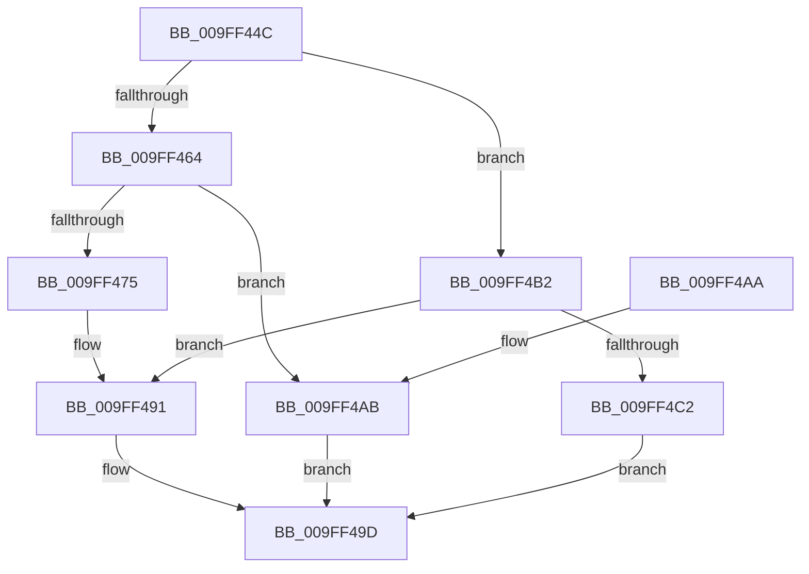

# AuthzBasepQuerySystemSecurityAttributeAndValues

- RVA: `0x009FF44C`–`0x009FF4C9` (길이 `125` bytes)
- VA: `0x00000001409FF44C`
- 실행 섹션: `PAGE`
- PDB 이름 있음: `예`; PDB Function 태그: `아니요`
- unwind 정보 RVA: `0x00065944`
- 디코드: `39`개 명령, `125/125` bytes 표시
- 미해석 바이트: `0` (있으면 어셈블리에 `.byte`로 보존)

> 이 문서는 커널 이미지의 기계어와 PDB 기호를 분석해 생성했습니다. 4번과 5번은 함수 원형과 자료형을 바이너리 사용 방식에서 추정한 C 해석이며 원본 소스 복구 결과는 아닙니다.

## 1. Dependencies

- 직접 호출 지점: **1**; 고유 호출 대상: **1**
- 직접 호출자로 확인된 함수: **1**
- RIP 상대 이미지 참조: **0**

### Outgoing calls
- `0x009FF468` → [AuthzBasepFindSystemSecurityAttribute](AuthzBasepFindSystemSecurityAttribute_function_009FF4D0.md) (function, `0x009FF4D0`)

### Direct callers
- [sub_003001AE](../../text/30/Unknown_function_003001AE.md) at `0x003001AE`

### Static image references
- 디코드된 RIP-relative 메모리 참조가 없습니다.

## 2. Other-region calls and transfers

- 다른 실행 섹션으로 향하는 call: **0**
- 별도 외부 분기/꼬리 이동을 확인하지 못했습니다.

## 3. Assembly (complete function range)

```asm
009FF44C  48 89 5C 24 08                  mov qword ptr [rsp + 8], rbx
009FF451  57                              push rdi
009FF452  48 83 EC 20                     sub rsp, 0x20
009FF456  48 8B D9                        mov rbx, rcx
009FF459  33 FF                           xor edi, edi
009FF45B  48 8B 49 38                     mov rcx, qword ptr [rcx + 0x38]
009FF45F  48 85 C9                        test rcx, rcx
009FF462  75 4E                           jne 0x1409ff4b2
009FF464  48 8D 4B 10                     lea rcx, [rbx + 0x10]
009FF468  E8 63 00 00 00                  call 0x1409ff4d0
009FF46D  48 8B C8                        mov rcx, rax
009FF470  48 85 C0                        test rax, rax
009FF473  74 36                           je 0x1409ff4ab
009FF475  48 8B 50 48                     mov rdx, qword ptr [rax + 0x48]
009FF479  8B 40 3C                        mov eax, dword ptr [rax + 0x3c]
009FF47C  89 43 28                        mov dword ptr [rbx + 0x28], eax
009FF47F  0F B7 41 30                     movzx eax, word ptr [rcx + 0x30]
009FF483  66 89 43 20                     mov word ptr [rbx + 0x20], ax
009FF487  8B 41 34                        mov eax, dword ptr [rcx + 0x34]
009FF48A  89 43 24                        mov dword ptr [rbx + 0x24], eax
009FF48D  48 89 4B 38                     mov qword ptr [rbx + 0x38], rcx
009FF491  48 8D 42 28                     lea rax, [rdx + 0x28]
009FF495  48 89 53 40                     mov qword ptr [rbx + 0x40], rdx
009FF499  48 89 43 30                     mov qword ptr [rbx + 0x30], rax
009FF49D  48 8B 5C 24 30                  mov rbx, qword ptr [rsp + 0x30]
009FF4A2  8B C7                           mov eax, edi
009FF4A4  48 83 C4 20                     add rsp, 0x20
009FF4A8  5F                              pop rdi
009FF4A9  C3                              ret
009FF4AA  CC                              int3
009FF4AB  BF 25 02 00 C0                  mov edi, 0xc0000225
009FF4B0  EB EB                           jmp 0x1409ff49d
009FF4B2  48 8B 43 40                     mov rax, qword ptr [rbx + 0x40]
009FF4B6  48 8B 10                        mov rdx, qword ptr [rax]
009FF4B9  48 8D 41 48                     lea rax, [rcx + 0x48]
009FF4BD  48 3B D0                        cmp rdx, rax
009FF4C0  75 CF                           jne 0x1409ff491
009FF4C2  BF 1A 00 00 80                  mov edi, 0x8000001a
009FF4C7  EB D4                           jmp 0x1409ff49d
```

## 4. C-style interpretation (structured pseudocode)

```c
__int64 __fastcall AuthzBasepQuerySystemSecurityAttributeAndValues(__int64 a1)
{
    __int64 result;
    __int64 v_rdi;
    __int64 v_rsp;
    unsigned __int64 v_stack_p8;

    v_stack_p8 = v_rbx;
    v_rsp = (v_rsp) - (32);
    v_rdi = 0;
    if (*(unsigned __int64 *)(a1 + 56) != 0) goto loc_009FF4B2;
    result = AuthzBasepFindSystemSecurityAttribute(a1 + 16, a2, a3, a4);
    if (result == 0) goto loc_009FF4AB;
    *(unsigned int *)(a1 + 40) = (unsigned int)((unsigned int)(*(unsigned int *)(result + 60)));
    *(unsigned __int16 *)(a1 + 32) = (unsigned __int16)(*(unsigned __int16 *)(result + 48));
    *(unsigned int *)(a1 + 36) = (unsigned int)((unsigned int)(*(unsigned int *)(result + 52)));
    *(unsigned __int64 *)(a1 + 56) = result;
loc_009FF491:
    *(unsigned __int64 *)(a1 + 64) = *(unsigned __int64 *)(result + 72);
    *(unsigned __int64 *)(a1 + 48) = *(unsigned __int64 *)(result + 72) + 40;
loc_009FF49D:
    v_rsp = (v_rsp) + (32);
    return 0;
loc_009FF4AB:
    goto loc_009FF49D;
loc_009FF4B2:
    if ((*(unsigned __int64 *)(*(unsigned __int64 *)(v_stack_p8 + 64))) != (result + 72)) goto loc_009FF491;
    goto loc_009FF49D;
}
```

## 5. (Beta) C Style

```c
int64_t AuthzBasepQuerySystemSecurityAttributeAndValues(void *Arg1)
{
    uint8_t *arg1 = (uint8_t *)Arg1;

    int64_t result;
    int64_t local_rdi;
    int64_t local_rsp;
    uint64_t v_stack_p8;

    v_stack_p8 = local_rbx;
    local_rsp = (local_rsp) - (32);
    local_rdi = 0;
    if (*(uint64_t *)(arg1 + 0x38) != 0) goto loc_009FF4B2;
    result = AuthzBasepFindSystemSecurityAttribute(Arg1 + 16, a2, a3, a4);
    if (result == 0) goto loc_009FF4AB;
    *(uint32_t *)(arg1 + 0x28) = (uint32_t)((uint32_t)(*(uint32_t *)(result + 0x3C)));
    *(uint16_t *)(arg1 + 0x20) = (uint16_t)(*(uint16_t *)(result + 0x30));
    *(uint32_t *)(arg1 + 0x24) = (uint32_t)((uint32_t)(*(uint32_t *)(result + 0x34)));
    *(uint64_t *)(arg1 + 0x38) = result;
loc_009FF491:
    *(uint64_t *)(arg1 + 0x40) = *(uint64_t *)(result + 0x48);
    *(uint64_t *)(arg1 + 0x30) = *(uint64_t *)(result + 0x48) + 40;
loc_009FF49D:
    local_rsp = (local_rsp) + (32);
    return 0;
loc_009FF4AB:
    goto loc_009FF49D;
loc_009FF4B2:
    if ((*(uint64_t *)(*(uint64_t *)(v_stack_p8 + 0x40))) != (result + 72)) goto loc_009FF491;
    goto loc_009FF49D;
}
```

### 관측된 메모리 오프셋

구조체 형식이 확인되지 않은 접근은 인자 기준의 오프셋으로만 기록했습니다.

| 기준 인자 | 오프셋 표현 | 폭 (bit) | 접근 |
|---|---:|---:|---|
| `Arg1` | `+ 0x10` | `64` | `R` |
| `Arg1` | `+ 0x20` | `16` | `W` |
| `Arg1` | `+ 0x24` | `32` | `W` |
| `Arg1` | `+ 0x28` | `32` | `W` |
| `Arg1` | `+ 0x30` | `64` | `W` |
| `Arg1` | `+ 0x38` | `64` | `R` |
| `Arg1` | `+ 0x38` | `64` | `W` |
| `Arg1` | `+ 0x40` | `64` | `R` |
| `Arg1` | `+ 0x40` | `64` | `W` |

## 6. Execution-region graph

[열기: 2D/3D 그래프와 함수 탐색 컨트롤 패널](../../../control-panel.html?section=page&rva=0x009FF44C&view=graph)

- 2D 그래프는 위에서 아래로 흐르고, 3D 그래프는 빈 공간을 드래그해 회전합니다. Shift+드래그는 이동, 휠은 확대·축소, 함수 노드 선택은 대상 보고서 이동입니다.

### Static fallback


