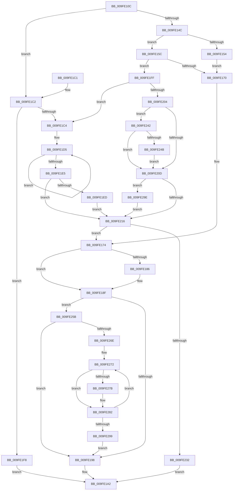

# CcCreateVacbArray

- RVA: `0x009FE10C`–`0x009FE2AC` (길이 `416` bytes)
- VA: `0x00000001409FE10C`
- 실행 섹션: `PAGE`
- PDB 이름 있음: `예`; PDB Function 태그: `아니요`
- unwind 정보 RVA: `0x000A7458`
- 디코드: `119`개 명령, `416/416` bytes 표시
- 미해석 바이트: `0` (있으면 어셈블리에 `.byte`로 보존)

> 이 문서는 커널 이미지의 기계어와 PDB 기호를 분석해 생성했습니다. 4번과 5번은 함수 원형과 자료형을 바이너리 사용 방식에서 추정한 C 해석이며 원본 소스 복구 결과는 아닙니다.

## 1. Dependencies

- 직접 호출 지점: **2**; 고유 호출 대상: **2**
- 직접 호출자로 확인된 함수: **1**
- RIP 상대 이미지 참조: **2**

### Outgoing calls
- `0x009FE17C` → [memset](../../text/6C/memset_function_006C6C40.md) (function, `0x006C6C40`)
- `0x009FE221` → [ExAllocatePoolWithTag](../../poolcode/B8/ExAllocatePoolWithTag_function_00B82010.md) (function, `0x00B82010`)

### Direct callers
- [CcInitializeCacheMapInternal](../../text/3C/CcInitializeCacheMapInternal_function_003CC720.md) at `0x003CCDFA`

### Static image references
- `0x009FE1E5` → RVA `0x00E0A894` (`.data`; read)
- `0x009FE1F0` → RVA `0x00E0A894` (`.data`; write)

## 2. Other-region calls and transfers

- 다른 실행 섹션으로 향하는 call: **2**
  - `0x009FE17C` → [memset](../../text/6C/memset_function_006C6C40.md) (`PAGE` → `.text`)
  - `0x009FE221` → [ExAllocatePoolWithTag](../../poolcode/B8/ExAllocatePoolWithTag_function_00B82010.md) (`PAGE` → `POOLCODE`)
- 별도 외부 분기/꼬리 이동을 확인하지 못했습니다.

## 3. Assembly (complete function range)

```asm
009FE10C  48 8B C4                        mov rax, rsp
009FE10F  48 89 58 08                     mov qword ptr [rax + 8], rbx
009FE113  48 89 68 10                     mov qword ptr [rax + 0x10], rbp
009FE117  48 89 70 18                     mov qword ptr [rax + 0x18], rsi
009FE11B  48 89 78 20                     mov qword ptr [rax + 0x20], rdi
009FE11F  41 54                           push r12
009FE121  41 56                           push r14
009FE123  41 57                           push r15
009FE125  48 83 EC 20                     sub rsp, 0x20
009FE129  48 8B C2                        mov rax, rdx
009FE12C  45 33 E4                        xor r12d, r12d
009FE12F  48 C1 E8 20                     shr rax, 0x20
009FE133  45 33 FF                        xor r15d, r15d
009FE136  48 8B DA                        mov rbx, rdx
009FE139  48 8B E9                        mov rbp, rcx
009FE13C  41 B9 00 02 00 00               mov r9d, 0x200
009FE142  41 B8 00 04 00 00               mov r8d, 0x400
009FE148  85 C0                           test eax, eax
009FE14A  75 76                           jne 0x1409fe1c2
009FE14C  81 FB 00 00 10 00               cmp ebx, 0x100000
009FE152  77 08                           ja 0x1409fe15c
009FE154  8D 78 20                        lea edi, [rax + 0x20]
009FE157  44 8B F7                        mov r14d, edi
009FE15A  EB 14                           jmp 0x1409fe170
009FE15C  8B FB                           mov edi, ebx
009FE15E  C1 EF 12                        shr edi, 0x12
009FE161  C1 E7 03                        shl edi, 3
009FE164  44 8B F7                        mov r14d, edi
009FE167  83 FF 20                        cmp edi, 0x20
009FE16A  0F 85 8F 00 00 00               jne 0x1409fe1ff
009FE170  48 8D 71 38                     lea rsi, [rcx + 0x38]
009FE174  4D 8B C6                        mov r8, r14
009FE177  33 D2                           xor edx, edx
009FE179  48 8B CE                        mov rcx, rsi
009FE17C  E8 BF 8A CC FF                  call 0x1406c6c40
009FE181  45 85 FF                        test r15d, r15d
009FE184  74 09                           je 0x1409fe18f
009FE186  83 C7 F8                        add edi, -8
009FE189  33 C9                           xor ecx, ecx
009FE18B  48 89 0C 37                     mov qword ptr [rdi + rsi], rcx
009FE18F  45 85 E4                        test r12d, r12d
009FE192  0F 85 C3 00 00 00               jne 0x1409fe25b
009FE198  48 89 75 58                     mov qword ptr [rbp + 0x58], rsi
009FE19C  33 C0                           xor eax, eax
009FE19E  48 89 5D 20                     mov qword ptr [rbp + 0x20], rbx
009FE1A2  48 8B 5C 24 40                  mov rbx, qword ptr [rsp + 0x40]
009FE1A7  48 8B 6C 24 48                  mov rbp, qword ptr [rsp + 0x48]
009FE1AC  48 8B 74 24 50                  mov rsi, qword ptr [rsp + 0x50]
009FE1B1  48 8B 7C 24 58                  mov rdi, qword ptr [rsp + 0x58]
009FE1B6  48 83 C4 20                     add rsp, 0x20
009FE1BA  41 5F                           pop r15
009FE1BC  41 5E                           pop r14
009FE1BE  41 5C                           pop r12
009FE1C0  C3                              ret
009FE1C1  CC                              int3
009FE1C2  78 34                           js 0x1409fe1f8
009FE1C4  33 D2                           xor edx, edx
009FE1C6  45 8B F0                        mov r14d, r8d
009FE1C9  BF 08 04 00 00                  mov edi, 0x408
009FE1CE  8D 4A 19                        lea ecx, [rdx + 0x19]
009FE1D1  44 8D 7A 01                     lea r15d, [rdx + 1]
009FE1D5  83 C1 07                        add ecx, 7
009FE1D8  49 8B C7                        mov rax, r15
009FE1DB  48 D3 E0                        shl rax, cl
009FE1DE  FF C2                           inc edx
009FE1E0  48 3B D8                        cmp rbx, rax
009FE1E3  7F F0                           jg 0x1409fe1d5
009FE1E5  3B 15 A9 C6 40 00               cmp edx, dword ptr [rip + 0x40c6a9]
009FE1EB  72 29                           jb 0x1409fe216
009FE1ED  8D 42 01                        lea eax, [rdx + 1]
009FE1F0  89 05 9E C6 40 00               mov dword ptr [rip + 0x40c69e], eax
009FE1F6  EB 1E                           jmp 0x1409fe216
009FE1F8  B8 40 00 00 C0                  mov eax, 0xc0000040
009FE1FD  EB A3                           jmp 0x1409fe1a2
009FE1FF  41 3B F8                        cmp edi, r8d
009FE202  77 C0                           ja 0x1409fe1c4
009FE204  44 85 89 98 00 00 00            test dword ptr [rcx + 0x98], r9d
009FE20B  75 35                           jne 0x1409fe242
009FE20D  45 3B F0                        cmp r14d, r8d
009FE210  0F 84 88 00 00 00               je 0x1409fe29e
009FE216  8B D7                           mov edx, edi
009FE218  41 B8 43 63 56 70               mov r8d, 0x70566343
009FE21E  41 8B C9                        mov ecx, r9d
009FE221  E8 EA 3D 18 00                  call 0x140b82010
009FE226  48 8B F0                        mov rsi, rax
009FE229  48 85 C0                        test rax, rax
009FE22C  0F 85 42 FF FF FF               jne 0x1409fe174
009FE232  B8 9A 00 00 C0                  mov eax, 0xc000009a
009FE237  89 85 A0 00 00 00               mov dword ptr [rbp + 0xa0], eax
009FE23D  E9 60 FF FF FF                  jmp 0x1409fe1a2
009FE242  48 81 FB 00 00 20 00            cmp rbx, 0x200000
009FE249  7E C2                           jle 0x1409fe20d
009FE24B  8D 47 0F                        lea eax, [rdi + 0xf]
009FE24E  41 BC 01 00 00 00               mov r12d, 1
009FE254  83 E0 F0                        and eax, 0xfffffff0
009FE257  03 F8                           add edi, eax
009FE259  EB B2                           jmp 0x1409fe20d
009FE25B  44 8B C7                        mov r8d, edi
009FE25E  49 8D 0C 36                     lea rcx, [r14 + rsi]
009FE262  4C 03 C6                        add r8, rsi
009FE265  49 3B C8                        cmp rcx, r8
009FE268  0F 83 2A FF FF FF               jae 0x1409fe198
009FE26E  48 8D 45 10                     lea rax, [rbp + 0x10]
009FE272  48 8B 10                        mov rdx, qword ptr [rax]
009FE275  48 39 42 08                     cmp qword ptr [rdx + 8], rax
009FE279  74 07                           je 0x1409fe282
009FE27B  B9 03 00 00 00                  mov ecx, 3
009FE280  CD 29                           int 0x29
009FE282  48 89 11                        mov qword ptr [rcx], rdx
009FE285  48 89 41 08                     mov qword ptr [rcx + 8], rax
009FE289  48 89 4A 08                     mov qword ptr [rdx + 8], rcx
009FE28D  48 89 08                        mov qword ptr [rax], rcx
009FE290  48 83 C1 10                     add rcx, 0x10
009FE294  49 3B C8                        cmp rcx, r8
009FE297  72 D9                           jb 0x1409fe272
009FE299  E9 FA FE FF FF                  jmp 0x1409fe198
009FE29E  83 C7 08                        add edi, 8
009FE2A1  41 BF 01 00 00 00               mov r15d, 1
009FE2A7  E9 6A FF FF FF                  jmp 0x1409fe216
```

## 4. C-style interpretation (structured pseudocode)

```c
__int64 __fastcall CcCreateVacbArray(__int64 a1, __int64 a2)
{
    __int64 result;
    __int64 v_r12;
    __int64 v_r15;
    __int64 v_rdi;
    __int64 v_rsp;
    unsigned __int64 v_stack_p10;
    unsigned __int64 v_stack_p18;
    unsigned __int64 v_stack_p20;
    unsigned __int64 v_stack_p8;

    *(unsigned __int64 *)(v_rsp + 8) = v_rbx;
    *(unsigned __int64 *)(v_rsp + 16) = v_rbp;
    *(unsigned __int64 *)(v_rsp + 24) = v_rsi;
    *(unsigned __int64 *)(v_rsp + 32) = v_rdi;
    v_rsp = (v_rsp) - (32);
    v_r12 = 0;
    result = (a2) >> (32);
    v_r15 = 0;
    if ((unsigned int)(result) != 0) goto loc_009FE1C2;
    if (((unsigned int)(a2)) > 0x100000ULL) goto loc_009FE15C;
    goto loc_009FE170;
loc_009FE15C:
    v_rdi = (unsigned int)(((unsigned int)((unsigned int)(a2))) >> (18));
    v_rdi = (unsigned int)((v_rdi) << (3));
    if (((unsigned int)(v_rdi)) != 32) goto loc_009FE1FF;
loc_009FE170:
loc_009FE174:
    a2 = 0;
    result = memset(a1 + 56, a2, (unsigned int)((unsigned int)(v_rdi)), 512);
    if (0 != 0) {
        v_rdi = (unsigned int)((v_rdi) + (-8));
        a1 = 0;
        *(unsigned __int64 *)(v_rdi + a1 + 56 * 1) = 0;
    }
    if (0 != 0) goto loc_009FE25B;
loc_009FE198:
    *(unsigned __int64 *)(a1 + 88) = a1 + 56;
    result = 0;
    *(unsigned __int64 *)(a1 + 32) = 0;
loc_009FE1A2:
    v_rsp = (v_rsp) + (32);
    return result;
loc_009FE1C2:
    if (sign_flag) goto loc_009FE1F8;
loc_009FE1C4:
    a2 = 0;
loc_009FE1D5:
    a1 = (unsigned int)((a2 + 25) + (7));
    result = (a2 + 1) << ((unsigned __int8)(a1));
    a2 = (unsigned int)((a2) + 1);
    if (v_stack_p8 > result) goto loc_009FE1D5;
    if (((unsigned int)(a2)) < (*(unsigned int *)(v_rip + 4245161))) goto loc_009FE216;
    *(unsigned int *)(v_rip + 4245150) = (unsigned int)(a2 + 1);
    goto loc_009FE216;
loc_009FE1F8:
    goto loc_009FE1A2;
loc_009FE1FF:
    if (((unsigned int)((unsigned int)(0x408ULL))) > ((unsigned int)((unsigned int)((unsigned int)(v_rdi))))) goto loc_009FE1C4;
    if (((*(unsigned int *)(a1 + 152)) & (512)) != 0) goto loc_009FE242;
loc_009FE20D:
    if (((unsigned int)((unsigned int)((unsigned int)((unsigned int)((unsigned int)(v_rdi)))))) == ((unsigned int)((unsigned int)((unsigned int)(v_rdi))))) goto loc_009FE29E;
loc_009FE216:
    result = ExAllocatePoolWithTag(512, (unsigned int)((unsigned int)((unsigned int)(0x408ULL))), (unsigned int)(0x70566343ULL), 512);
    if (result != 0) goto loc_009FE174;
    *(unsigned int *)(v_stack_p10 + 160) = (unsigned int)((unsigned int)(0xC000009AULL));
    goto loc_009FE1A2;
loc_009FE242:
    if (v_stack_p8 <= 0x200000ULL) goto loc_009FE20D;
    result = (unsigned int)(((unsigned int)(0x408ULL) + 15) & (0xFFFFFFF0ULL));
    v_rdi = (unsigned int)(((unsigned int)(0x408ULL)) + ((unsigned int)(result)));
    goto loc_009FE20D;
loc_009FE25B:
    a3 = ((unsigned int)((unsigned int)(v_rdi))) + (result);
    if (((unsigned int)((unsigned int)((unsigned int)((unsigned int)(v_rdi)))) + result * 1) >= a3) goto loc_009FE198;
loc_009FE272:
    if ((*(unsigned __int64 *)(*(unsigned __int64 *)(v_stack_p10 + 16) + 8)) != (v_stack_p10 + 16)) {
        a1 = 3;
    }
    *(unsigned __int64 *)(a1) = *(unsigned __int64 *)(v_stack_p10 + 16);
    *(unsigned __int64 *)(a1 + 8) = v_stack_p10 + 16;
    *(unsigned __int64 *)(*(unsigned __int64 *)(v_stack_p10 + 16) + 8) = a1;
    *(unsigned __int64 *)(v_stack_p10 + 16) = a1;
    a1 = (a1) + (16);
    if (a1 < a3) goto loc_009FE272;
    goto loc_009FE198;
loc_009FE29E:
    v_rdi = (unsigned int)((v_rdi) + (8));
    goto loc_009FE216;
}
```

## 5. (Beta) C Style

```c
int64_t CcCreateVacbArray(void *Arg1, int64_t Arg2)
{
    uint8_t *arg1 = (uint8_t *)Arg1;

    int64_t result;
    int64_t local_r12;
    int64_t local_r15;
    int64_t local_rdi;
    int64_t local_rsp;
    uint64_t v_stack_p10;
    uint64_t v_stack_p18;
    uint64_t v_stack_p20;
    uint64_t v_stack_p8;

    *(uint64_t *)(local_rsp + 0x8) = local_rbx;
    *(uint64_t *)(local_rsp + 0x10) = local_rbp;
    *(uint64_t *)(local_rsp + 0x18) = local_rsi;
    *(uint64_t *)(local_rsp + 0x20) = local_rdi;
    local_rsp = (local_rsp) - (32);
    local_r12 = 0;
    result = (Arg2) >> (32);
    local_r15 = 0;
    if ((uint32_t)(result) != 0) goto loc_009FE1C2;
    if (((uint32_t)(Arg2)) > 0x100000ULL) goto loc_009FE15C;
    goto loc_009FE170;
loc_009FE15C:
    local_rdi = (uint32_t)(((uint32_t)((uint32_t)(Arg2))) >> (18));
    local_rdi = (uint32_t)((local_rdi) << (3));
    if (((uint32_t)(local_rdi)) != 32) goto loc_009FE1FF;
loc_009FE170:
loc_009FE174:
    Arg2 = 0;
    result = memset(Arg1 + 56, Arg2, (uint32_t)((uint32_t)(local_rdi)), 512);
    if (0 != 0) {
        local_rdi = (uint32_t)((local_rdi) + (-8));
        Arg1 = 0;
        *(uint64_t *)(local_rdi + arg1 + 0x38 * 1) = 0;
    }
    if (0 != 0) goto loc_009FE25B;
loc_009FE198:
    *(void **)(arg1 + 0x58) = Arg1 + 56;
    result = 0;
    *(uint64_t *)(arg1 + 0x20) = 0;
loc_009FE1A2:
    local_rsp = (local_rsp) + (32);
    return result;
loc_009FE1C2:
    if (sign_flag) goto loc_009FE1F8;
loc_009FE1C4:
    Arg2 = 0;
loc_009FE1D5:
    Arg1 = (uint32_t)((Arg2 + 25) + (7));
    result = (Arg2 + 1) << ((uint8_t)(Arg1));
    Arg2 = (uint32_t)((Arg2) + 1);
    if (v_stack_p8 > result) goto loc_009FE1D5;
    if (((uint32_t)(Arg2)) < (*(uint32_t *)(v_rip + 0x40C6A9))) goto loc_009FE216;
    *(uint32_t *)(v_rip + 0x40C69E) = (uint32_t)(Arg2 + 1);
    goto loc_009FE216;
loc_009FE1F8:
    goto loc_009FE1A2;
loc_009FE1FF:
    if (((uint32_t)((uint32_t)(0x408ULL))) > ((uint32_t)((uint32_t)((uint32_t)(local_rdi))))) goto loc_009FE1C4;
    if (((*(uint32_t *)(arg1 + 0x98)) & (512)) != 0) goto loc_009FE242;
loc_009FE20D:
    if (((uint32_t)((uint32_t)((uint32_t)((uint32_t)((uint32_t)(local_rdi)))))) == ((uint32_t)((uint32_t)((uint32_t)(local_rdi))))) goto loc_009FE29E;
loc_009FE216:
    result = ExAllocatePoolWithTag(512, (uint32_t)((uint32_t)((uint32_t)(0x408ULL))), (uint32_t)(0x70566343ULL), 512);
    if (result != 0) goto loc_009FE174;
    *(uint32_t *)(v_stack_p10 + 0xA0) = (uint32_t)((uint32_t)(0xC000009AULL));
    goto loc_009FE1A2;
loc_009FE242:
    if (v_stack_p8 <= 0x200000ULL) goto loc_009FE20D;
    result = (uint32_t)(((uint32_t)(0x408ULL) + 15) & (0xFFFFFFF0ULL));
    local_rdi = (uint32_t)(((uint32_t)(0x408ULL)) + ((uint32_t)(result)));
    goto loc_009FE20D;
loc_009FE25B:
    a3 = ((uint32_t)((uint32_t)(local_rdi))) + (result);
    if (((uint32_t)((uint32_t)((uint32_t)((uint32_t)(local_rdi)))) + result * 1) >= a3) goto loc_009FE198;
loc_009FE272:
    if ((*(uint64_t *)(*(uint64_t *)(v_stack_p10 + 0x10) + 0x8)) != (v_stack_p10 + 16)) {
        Arg1 = 3;
    }
    *(uint64_t *)(arg1) = *(uint64_t *)(v_stack_p10 + 0x10);
    *(uint64_t *)(arg1 + 0x8) = v_stack_p10 + 16;
    *(void **)(*(uint64_t *)(v_stack_p10 + 0x10) + 0x8) = Arg1;
    *(void **)(v_stack_p10 + 0x10) = Arg1;
    Arg1 = (Arg1) + (16);
    if (Arg1 < a3) goto loc_009FE272;
    goto loc_009FE198;
loc_009FE29E:
    local_rdi = (uint32_t)((local_rdi) + (8));
    goto loc_009FE216;
}
```

### 관측된 메모리 오프셋

구조체 형식이 확인되지 않은 접근은 인자 기준의 오프셋으로만 기록했습니다.

| 기준 인자 | 오프셋 표현 | 폭 (bit) | 접근 |
|---|---:|---:|---|
| `Arg1` | `+ 0x0` | `64` | `R` |
| `Arg1` | `+ 0x0` | `64` | `W` |
| `Arg1` | `+ 0x10` | `64` | `R` |
| `Arg1` | `+ 0x20` | `64` | `W` |
| `Arg1` | `+ 0x38` | `64` | `R` |
| `Arg1` | `+ 0x58` | `64` | `W` |
| `Arg1` | `+ 0x98` | `32` | `R` |
| `Arg1` | `+ 0xA0` | `32` | `W` |

## 6. Execution-region graph

[열기: 2D/3D 그래프와 함수 탐색 컨트롤 패널](../../../control-panel.html?section=page&rva=0x009FE10C&view=graph)

- 2D 그래프는 위에서 아래로 흐르고, 3D 그래프는 빈 공간을 드래그해 회전합니다. Shift+드래그는 이동, 휠은 확대·축소, 함수 노드 선택은 대상 보고서 이동입니다.

### Static fallback


