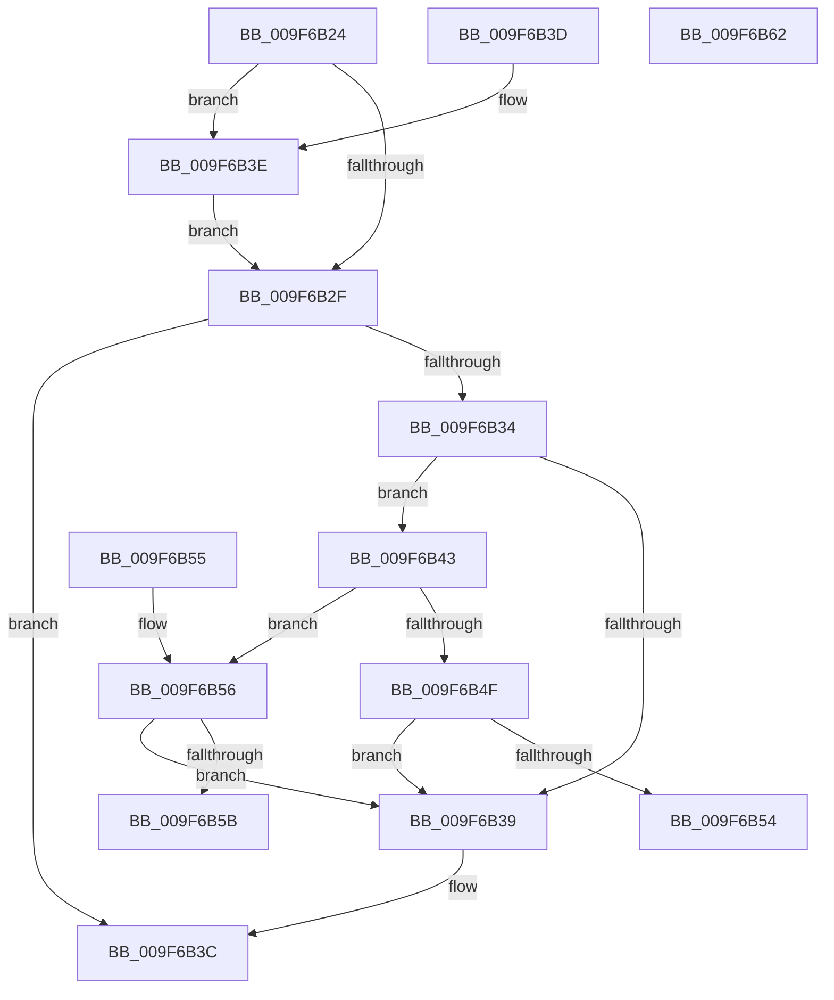

# CmGetVisibleValueCount

- RVA: `0x009F6B24`–`0x009F6B63` (길이 `63` bytes)
- VA: `0x00000001409F6B24`
- 실행 섹션: `PAGE`
- PDB 이름 있음: `예`; PDB Function 태그: `아니요`
- unwind 정보 RVA: `0x000DB714`
- 디코드: `25`개 명령, `63/63` bytes 표시
- 미해석 바이트: `0` (있으면 어셈블리에 `.byte`로 보존)

> 이 문서는 커널 이미지의 기계어와 PDB 기호를 분석해 생성했습니다. 4번과 5번은 함수 원형과 자료형을 바이너리 사용 방식에서 추정한 C 해석이며 원본 소스 복구 결과는 아닙니다.

## 1. Dependencies

- 직접 호출 지점: **0**; 고유 호출 대상: **0**
- 직접 호출자로 확인된 함수: **1**
- RIP 상대 이미지 참조: **0**

### Outgoing calls
- 직접 디코드된 call 명령이 없습니다.

### Direct callers
- [CmpQueryKeyDataFromNode](../84/CmpQueryKeyDataFromNode_function_0084EAE0.md) at `0x0084ED30`

### Static image references
- 디코드된 RIP-relative 메모리 참조가 없습니다.

## 2. Other-region calls and transfers

- 다른 실행 섹션으로 향하는 call: **0**
- 별도 외부 분기/꼬리 이동을 확인하지 못했습니다.

## 3. Assembly (complete function range)

```asm
009F6B24  83 C8 FF                        or eax, 0xffffffff
009F6B27  4D 8B C8                        mov r9, r8
009F6B2A  48 85 D2                        test rdx, rdx
009F6B2D  75 0F                           jne 0x1409f6b3e
009F6B2F  48 85 C9                        test rcx, rcx
009F6B32  74 08                           je 0x1409f6b3c
009F6B34  4D 85 C9                        test r9, r9
009F6B37  75 0A                           jne 0x1409f6b43
009F6B39  8B 41 60                        mov eax, dword ptr [rcx + 0x60]
009F6B3C  C3                              ret
009F6B3D  CC                              int3
009F6B3E  8B 42 24                        mov eax, dword ptr [rdx + 0x24]
009F6B41  EB EC                           jmp 0x1409f6b2f
009F6B43  4C 8B 81 20 01 00 00            mov r8, qword ptr [rcx + 0x120]
009F6B4A  4D 85 C0                        test r8, r8
009F6B4D  75 07                           jne 0x1409f6b56
009F6B4F  48 85 D2                        test rdx, rdx
009F6B52  74 E5                           je 0x1409f6b39
009F6B54  C3                              ret
009F6B55  CC                              int3
009F6B56  4D 3B C1                        cmp r8, r9
009F6B59  75 DE                           jne 0x1409f6b39
009F6B5B  8B 81 18 01 00 00               mov eax, dword ptr [rcx + 0x118]
009F6B61  C3                              ret
009F6B62  CC                              int3
```

## 4. C-style interpretation (structured pseudocode)

```c
__int64 __fastcall CmGetVisibleValueCount(__int64 a1, __int64 a2, __int64 a3)
{
    __int64 result;

    result = (unsigned int)((result) | (0xFFFFFFFFULL));
    if (a2 != 0) goto loc_009F6B3E;
loc_009F6B2F:
    if (a1 == 0) goto loc_009F6B3C;
    if (a3 != 0) goto loc_009F6B43;
loc_009F6B39:
loc_009F6B3C:
    return (unsigned int)(*(unsigned int *)(a1 + 96));
loc_009F6B3E:
    goto loc_009F6B2F;
loc_009F6B43:
    if (*(unsigned __int64 *)(a1 + 288) != 0) goto loc_009F6B56;
    if (a2 == 0) goto loc_009F6B39;
    return (unsigned int)(*(unsigned int *)(a2 + 36));
loc_009F6B56:
    if ((*(unsigned __int64 *)(a1 + 288)) != a3) goto loc_009F6B39;
    return (unsigned int)(*(unsigned int *)(a1 + 280));
}
```

## 5. (Beta) C Style

```c
int64_t CmGetVisibleValueCount(int64_t Arg1, int64_t Arg2, int64_t Arg3)
{
    int64_t result;

    result = (uint32_t)((result) | (0xFFFFFFFFULL));
    if (Arg2 != 0) goto loc_009F6B3E;
loc_009F6B2F:
    if (Arg1 == 0) goto loc_009F6B3C;
    if (Arg3 != 0) goto loc_009F6B43;
loc_009F6B39:
loc_009F6B3C:
    return (uint32_t)(*(uint32_t *)(Arg1 + 0x60));
loc_009F6B3E:
    goto loc_009F6B2F;
loc_009F6B43:
    if (*(uint64_t *)(Arg1 + 0x120) != 0) goto loc_009F6B56;
    if (Arg2 == 0) goto loc_009F6B39;
    return (uint32_t)(*(uint32_t *)(Arg2 + 0x24));
loc_009F6B56:
    if ((*(uint64_t *)(Arg1 + 0x120)) != Arg3) goto loc_009F6B39;
    return (uint32_t)(*(uint32_t *)(Arg1 + 0x118));
}
```

## 6. Execution-region graph

[열기: 2D/3D 그래프와 함수 탐색 컨트롤 패널](../../../control-panel.html?section=page&rva=0x009F6B24&view=graph)

- 2D 그래프는 위에서 아래로 흐르고, 3D 그래프는 빈 공간을 드래그해 회전합니다. Shift+드래그는 이동, 휠은 확대·축소, 함수 노드 선택은 대상 보고서 이동입니다.

### Static fallback


