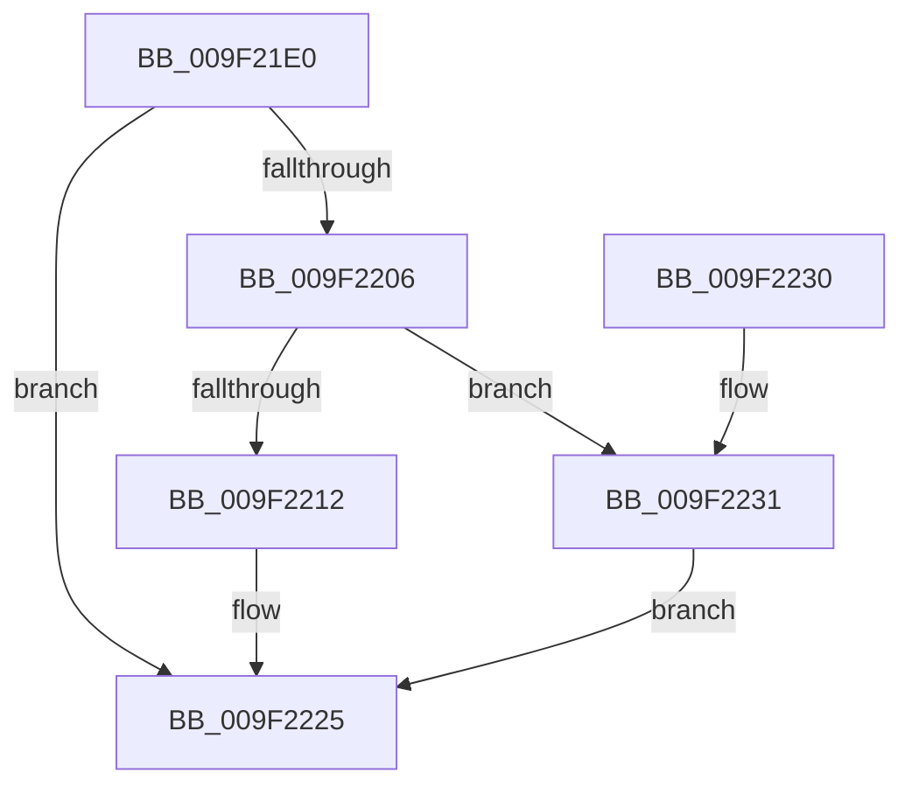

# CmIsDeviceInterfaceEnabled

- RVA: `0x009F21E0`–`0x009F2238` (길이 `88` bytes)
- VA: `0x00000001409F21E0`
- 실행 섹션: `PAGE`
- PDB 이름 있음: `예`; PDB Function 태그: `아니요`
- unwind 정보 RVA: `0x000A60F8`
- 디코드: `26`개 명령, `88/88` bytes 표시
- 미해석 바이트: `0` (있으면 어셈블리에 `.byte`로 보존)

> 이 문서는 커널 이미지의 기계어와 PDB 기호를 분석해 생성했습니다. 4번과 5번은 함수 원형과 자료형을 바이너리 사용 방식에서 추정한 C 해석이며 원본 소스 복구 결과는 아닙니다.

## 1. Dependencies

- 직접 호출 지점: **2**; 고유 호출 대상: **2**
- 직접 호출자로 확인된 함수: **1**
- RIP 상대 이미지 참조: **0**

### Outgoing calls
- `0x009F21FD` → [RtlInitUnicodeStringEx](../../text/46/RtlInitUnicodeStringEx_function_00463960.md) (function, `0x00463960`)
- `0x009F2220` → [guard_dispatch_icall](../../text/6B/guard_dispatch_icall_function_006BAAD0.md) (function, `0x006BAAD0`)

### Direct callers
- [CmDeviceClassesSubkeyCallback](../82/CmDeviceClassesSubkeyCallback_function_0082C940.md) at `0x0082CD7B`

### Static image references
- 디코드된 RIP-relative 메모리 참조가 없습니다.

## 2. Other-region calls and transfers

- 다른 실행 섹션으로 향하는 call: **2**
  - `0x009F21FD` → [RtlInitUnicodeStringEx](../../text/46/RtlInitUnicodeStringEx_function_00463960.md) (`PAGE` → `.text`)
  - `0x009F2220` → [guard_dispatch_icall](../../text/6B/guard_dispatch_icall_function_006BAAD0.md) (`PAGE` → `.text`)
- 별도 외부 분기/꼬리 이동을 확인하지 못했습니다.

## 3. Assembly (complete function range)

```asm
009F21E0  48 89 5C 24 08                  mov qword ptr [rsp + 8], rbx
009F21E5  57                              push rdi
009F21E6  48 83 EC 40                     sub rsp, 0x40
009F21EA  48 8B D9                        mov rbx, rcx
009F21ED  0F 57 C0                        xorps xmm0, xmm0
009F21F0  48 8D 4C 24 30                  lea rcx, [rsp + 0x30]
009F21F5  49 8B F9                        mov rdi, r9
009F21F8  0F 11 44 24 30                  movups xmmword ptr [rsp + 0x30], xmm0
009F21FD  E8 5E 17 A7 FF                  call 0x140463960
009F2202  85 C0                           test eax, eax
009F2204  78 1F                           js 0x1409f2225
009F2206  48 8B 83 20 01 00 00            mov rax, qword ptr [rbx + 0x120]
009F220D  48 85 C0                        test rax, rax
009F2210  74 1F                           je 0x1409f2231
009F2212  45 33 C9                        xor r9d, r9d
009F2215  48 8D 54 24 30                  lea rdx, [rsp + 0x30]
009F221A  4C 8B C7                        mov r8, rdi
009F221D  48 8B CB                        mov rcx, rbx
009F2220  E8 AB 88 CC FF                  call 0x1406baad0
009F2225  48 8B 5C 24 50                  mov rbx, qword ptr [rsp + 0x50]
009F222A  48 83 C4 40                     add rsp, 0x40
009F222E  5F                              pop rdi
009F222F  C3                              ret
009F2230  CC                              int3
009F2231  B8 02 00 00 C0                  mov eax, 0xc0000002
009F2236  EB ED                           jmp 0x1409f2225
```

## 4. C-style interpretation (structured pseudocode)

```c
__int64 __fastcall CmIsDeviceInterfaceEnabled(__int64 a1, __int64 a2, __int64 a3, __int64 a4)
{
    __int64 result;
    __int64 v_rsp;
    unsigned __int64 v_stack_m18;
    unsigned __int64 v_stack_p8;

    v_stack_p8 = v_rbx;
    v_rsp = (v_rsp) - (64);
    v_stack_m18 = v_xmm0;
    result = RtlInitUnicodeStringEx(v_stack_m18, a2, a3, a4);
    if (sign_flag) goto loc_009F2225;
    if (*(unsigned __int64 *)(a1 + 288) == 0) goto loc_009F2231;
    a4 = 0;
    result = guard_dispatch_icall(a1, v_stack_m18, 0, a4);
loc_009F2225:
    v_rsp = (v_rsp) + (64);
    return result;
loc_009F2231:
    goto loc_009F2225;
}
```

## 5. (Beta) C Style

```c
int64_t CmIsDeviceInterfaceEnabled(void *Arg1, int64_t Arg2, int64_t Arg3, int64_t Arg4)
{
    uint8_t *arg1 = (uint8_t *)Arg1;

    int64_t result;
    int64_t local_rsp;
    uint64_t v_stack_m18;
    uint64_t v_stack_p8;

    v_stack_p8 = local_rbx;
    local_rsp = (local_rsp) - (64);
    v_stack_m18 = v_xmm0;
    result = RtlInitUnicodeStringEx(v_stack_m18, Arg2, Arg3, Arg4);
    if (sign_flag) goto loc_009F2225;
    if (*(uint64_t *)(arg1 + 0x120) == 0) goto loc_009F2231;
    Arg4 = 0;
    result = guard_dispatch_icall(Arg1, v_stack_m18, 0, Arg4);
loc_009F2225:
    local_rsp = (local_rsp) + (64);
    return result;
loc_009F2231:
    goto loc_009F2225;
}
```

### 관측된 메모리 오프셋

구조체 형식이 확인되지 않은 접근은 인자 기준의 오프셋으로만 기록했습니다.

| 기준 인자 | 오프셋 표현 | 폭 (bit) | 접근 |
|---|---:|---:|---|
| `Arg1` | `+ 0x120` | `64` | `R` |

## 6. Execution-region graph

[열기: 2D/3D 그래프와 함수 탐색 컨트롤 패널](../../../control-panel.html?section=page&rva=0x009F21E0&view=graph)

- 2D 그래프는 위에서 아래로 흐르고, 3D 그래프는 빈 공간을 드래그해 회전합니다. Shift+드래그는 이동, 휠은 확대·축소, 함수 노드 선택은 대상 보고서 이동입니다.

### Static fallback


