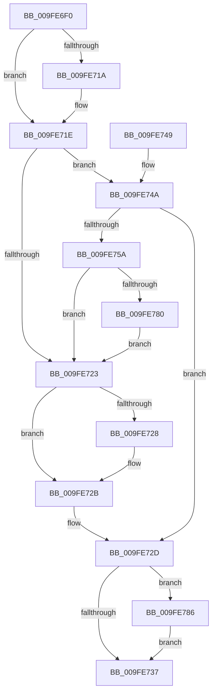

# CmpConstructAndCacheName

- RVA: `0x009FE6F0`–`0x009FE792` (길이 `162` bytes)
- VA: `0x00000001409FE6F0`
- 실행 섹션: `PAGE`
- PDB 이름 있음: `예`; PDB Function 태그: `아니요`
- unwind 정보 RVA: `0x000A7594`
- 디코드: `48`개 명령, `162/162` bytes 표시
- 미해석 바이트: `0` (있으면 어셈블리에 `.byte`로 보존)

> 이 문서는 커널 이미지의 기계어와 PDB 기호를 분석해 생성했습니다. 4번과 5번은 함수 원형과 자료형을 바이너리 사용 방식에서 추정한 C 해석이며 원본 소스 복구 결과는 아닙니다.

## 1. Dependencies

- 직접 호출 지점: **2**; 고유 호출 대상: **2**
- 직접 호출자로 확인된 함수: **1**
- RIP 상대 이미지 참조: **0**

### Outgoing calls
- `0x009FE74F` → [CmpConstructNameWithStatus](../85/CmpConstructNameWithStatus_function_008562A0.md) (function, `0x008562A0`)
- `0x009FE78B` → [CmpFreePoolWithTag](../../text/44/CmpFreePoolWithTag_function_004489E0.md) (function, `0x004489E0`)

### Direct callers
- [sub_00857A33](../85/Unknown_function_00857A33.md) at `0x00857B10`

### Static image references
- 디코드된 RIP-relative 메모리 참조가 없습니다.

## 2. Other-region calls and transfers

- 다른 실행 섹션으로 향하는 call: **1**
  - `0x009FE78B` → [CmpFreePoolWithTag](../../text/44/CmpFreePoolWithTag_function_004489E0.md) (`PAGE` → `.text`)
- 별도 외부 분기/꼬리 이동을 확인하지 못했습니다.

## 3. Assembly (complete function range)

```asm
009FE6F0  48 8B C4                        mov rax, rsp
009FE6F3  48 89 58 08                     mov qword ptr [rax + 8], rbx
009FE6F7  48 89 70 10                     mov qword ptr [rax + 0x10], rsi
009FE6FB  4C 89 40 18                     mov qword ptr [rax + 0x18], r8
009FE6FF  57                              push rdi
009FE700  48 83 EC 20                     sub rsp, 0x20
009FE704  48 83 60 18 00                  and qword ptr [rax + 0x18], 0
009FE709  48 8B FA                        mov rdi, rdx
009FE70C  48 8B 81 28 01 00 00            mov rax, qword ptr [rcx + 0x128]
009FE713  48 8B F1                        mov rsi, rcx
009FE716  A8 01                           test al, 1
009FE718  74 04                           je 0x1409fe71e
009FE71A  48 83 E0 FE                     and rax, 0xfffffffffffffffe
009FE71E  48 85 C0                        test rax, rax
009FE721  74 27                           je 0x1409fe74a
009FE723  48 85 FF                        test rdi, rdi
009FE726  74 03                           je 0x1409fe72b
009FE728  48 89 07                        mov qword ptr [rdi], rax
009FE72B  33 DB                           xor ebx, ebx
009FE72D  48 8B 4C 24 40                  mov rcx, qword ptr [rsp + 0x40]
009FE732  48 85 C9                        test rcx, rcx
009FE735  75 4F                           jne 0x1409fe786
009FE737  48 8B 74 24 38                  mov rsi, qword ptr [rsp + 0x38]
009FE73C  8B C3                           mov eax, ebx
009FE73E  48 8B 5C 24 30                  mov rbx, qword ptr [rsp + 0x30]
009FE743  48 83 C4 20                     add rsp, 0x20
009FE747  5F                              pop rdi
009FE748  C3                              ret
009FE749  CC                              int3
009FE74A  48 8D 54 24 40                  lea rdx, [rsp + 0x40]
009FE74F  E8 4C 7B E5 FF                  call 0x1408562a0
009FE754  8B D8                           mov ebx, eax
009FE756  85 C0                           test eax, eax
009FE758  78 D3                           js 0x1409fe72d
009FE75A  48 8B 4C 24 40                  mov rcx, qword ptr [rsp + 0x40]
009FE75F  33 C0                           xor eax, eax
009FE761  F0 48 0F B1 8E 28 01 00 00      lock cmpxchg qword ptr [rsi + 0x128], rcx
009FE76A  48 F7 D8                        neg rax
009FE76D  48 8B 86 28 01 00 00            mov rax, qword ptr [rsi + 0x128]
009FE774  48 1B C9                        sbb rcx, rcx
009FE777  48 21 4C 24 40                  and qword ptr [rsp + 0x40], rcx
009FE77C  A8 01                           test al, 1
009FE77E  74 A3                           je 0x1409fe723
009FE780  48 83 E0 FE                     and rax, 0xfffffffffffffffe
009FE784  EB 9D                           jmp 0x1409fe723
009FE786  BA 43 4D 4E 62                  mov edx, 0x624e4d43
009FE78B  E8 50 A2 A4 FF                  call 0x1404489e0
009FE790  EB A5                           jmp 0x1409fe737
```

## 4. C-style interpretation (structured pseudocode)

```c
__int64 __fastcall CmpConstructAndCacheName(__int64 a1, __int64 a2, __int64 a3)
{
    __int64 result;
    __int64 v_rbx;
    __int64 v_rsp;
    unsigned __int64 v_stack_p10;
    unsigned __int64 v_stack_p18;
    unsigned __int64 v_stack_p40;
    unsigned __int64 v_stack_p8;

    *(unsigned __int64 *)(v_rsp + 8) = v_rbx;
    *(unsigned __int64 *)(v_rsp + 16) = v_rsi;
    *(unsigned __int64 *)(v_rsp + 24) = a3;
    v_rsp = (v_rsp) - (32);
    result = *(unsigned __int64 *)(a1 + 296);
    if ((((unsigned __int8)(*(unsigned __int64 *)(a1 + 296))) & (1)) != 0) {
        result = (*(unsigned __int64 *)(a1 + 296)) & (-2);
    }
    if (result == 0) goto loc_009FE74A;
loc_009FE723:
    if (a2 != 0) {
        *(unsigned __int64 *)(a2) = result;
    }
    v_rbx = 0;
loc_009FE72D:
    if (v_stack_p18 != 0) goto loc_009FE786;
loc_009FE737:
    v_rsp = (v_rsp) + (32);
    return 0;
loc_009FE74A:
    result = CmpConstructNameWithStatus(v_stack_p18, v_stack_p40, a3, a4);
    if (sign_flag) goto loc_009FE72D;
    result = 0;
    result = -(result);
    if ((((unsigned __int8)(*(unsigned __int64 *)(v_stack_p10 + 296))) & (1)) == 0) goto loc_009FE723;
    result = (*(unsigned __int64 *)(v_stack_p10 + 296)) & (-2);
    goto loc_009FE723;
loc_009FE786:
    result = CmpFreePoolWithTag(v_stack_p40, (unsigned int)(0x624E4D43ULL), a3, a4);
    goto loc_009FE737;
}
```

## 5. (Beta) C Style

```c
int64_t CmpConstructAndCacheName(void *Arg1, int64_t Arg2, int64_t Arg3)
{
    uint8_t *arg1 = (uint8_t *)Arg1;

    int64_t result;
    int64_t local_rbx;
    int64_t local_rsp;
    uint64_t v_stack_p10;
    uint64_t v_stack_p18;
    uint64_t v_stack_p40;
    uint64_t v_stack_p8;

    *(uint64_t *)(local_rsp + 0x8) = local_rbx;
    *(uint64_t *)(local_rsp + 0x10) = local_rsi;
    *(uint64_t *)(local_rsp + 0x18) = Arg3;
    local_rsp = (local_rsp) - (32);
    result = *(uint64_t *)(arg1 + 0x128);
    if ((((uint8_t)(*(uint64_t *)(arg1 + 0x128))) & (1)) != 0) {
        result = (*(uint64_t *)(arg1 + 0x128)) & (-2);
    }
    if (result == 0) goto loc_009FE74A;
loc_009FE723:
    if (Arg2 != 0) {
        *(uint64_t *)(Arg2) = result;
    }
    local_rbx = 0;
loc_009FE72D:
    if (v_stack_p18 != 0) goto loc_009FE786;
loc_009FE737:
    local_rsp = (local_rsp) + (32);
    return 0;
loc_009FE74A:
    result = CmpConstructNameWithStatus(v_stack_p18, v_stack_p40, Arg3, a4);
    if (sign_flag) goto loc_009FE72D;
    result = 0;
    result = -(result);
    if ((((uint8_t)(*(uint64_t *)(v_stack_p10 + 0x128))) & (1)) == 0) goto loc_009FE723;
    result = (*(uint64_t *)(v_stack_p10 + 0x128)) & (-2);
    goto loc_009FE723;
loc_009FE786:
    result = CmpFreePoolWithTag(v_stack_p40, (uint32_t)(0x624E4D43ULL), Arg3, a4);
    goto loc_009FE737;
}
```

### 관측된 메모리 오프셋

구조체 형식이 확인되지 않은 접근은 인자 기준의 오프셋으로만 기록했습니다.

| 기준 인자 | 오프셋 표현 | 폭 (bit) | 접근 |
|---|---:|---:|---|
| `Arg1` | `+ 0x128` | `64` | `R` |

## 6. Execution-region graph

[열기: 2D/3D 그래프와 함수 탐색 컨트롤 패널](../../../control-panel.html?section=page&rva=0x009FE6F0&view=graph)

- 2D 그래프는 위에서 아래로 흐르고, 3D 그래프는 빈 공간을 드래그해 회전합니다. Shift+드래그는 이동, 휠은 확대·축소, 함수 노드 선택은 대상 보고서 이동입니다.

### Static fallback


