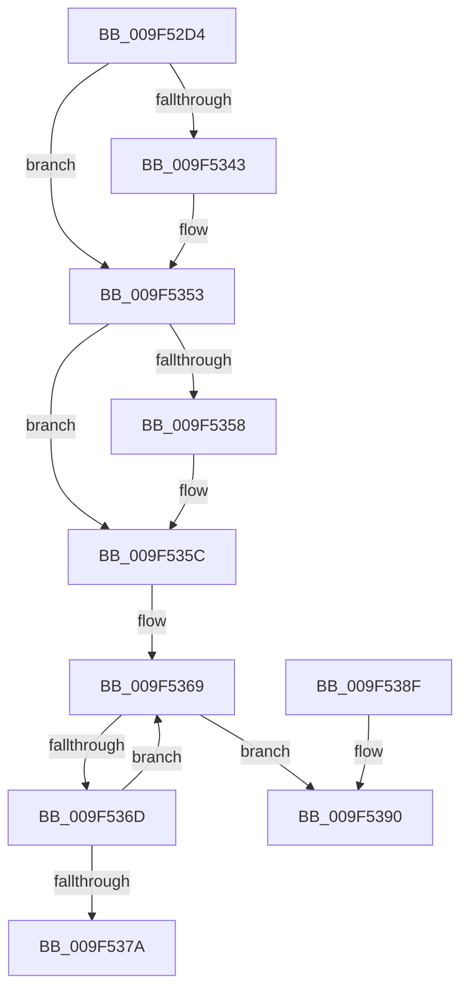

# CmpLockHashEntrySharedByKcb

- RVA: `0x009F52D4`–`0x009F53AB` (길이 `215` bytes)
- VA: `0x00000001409F52D4`
- 실행 섹션: `PAGE`
- PDB 이름 있음: `예`; PDB Function 태그: `아니요`
- unwind 정보 RVA: `0x00096B6C`
- 디코드: `60`개 명령, `215/215` bytes 표시
- 미해석 바이트: `0` (있으면 어셈블리에 `.byte`로 보존)

> 이 문서는 커널 이미지의 기계어와 PDB 기호를 분석해 생성했습니다. 4번과 5번은 함수 원형과 자료형을 바이너리 사용 방식에서 추정한 C 해석이며 원본 소스 복구 결과는 아닙니다.

## 1. Dependencies

- 직접 호출 지점: **3**; 고유 호출 대상: **3**
- 직접 호출자로 확인된 함수: **2**
- RIP 상대 이미지 참조: **0**

### Outgoing calls
- `0x009F532D` → [KeAbPreAcquire](../../text/21/KeAbPreAcquire_function_00210230.md) (function, `0x00210230`)
- `0x009F534E` → [ExfAcquirePushLockSharedEx](../../text/21/ExfAcquirePushLockSharedEx_function_0021044C.md) (function, `0x0021044C`)
- `0x009F53A5` → [KeBugCheckEx](../../text/4F/KeBugCheckEx_function_004FD660.md) (function, `0x004FD660`)

### Direct callers
- [CmpPerformCompleteKcbCacheLookup](../84/CmpPerformCompleteKcbCacheLookup_function_0084FD20.md) at `0x00850A6A`
- [CmpDoParseKey](../85/CmpDoParseKey_function_0085F750.md) at `0x0085FDAC`
- [CmpDoParseKey](../85/CmpDoParseKey_function_0085F750.md) at `0x00860B7C`

### Static image references
- 디코드된 RIP-relative 메모리 참조가 없습니다.

## 2. Other-region calls and transfers

- 다른 실행 섹션으로 향하는 call: **3**
  - `0x009F532D` → [KeAbPreAcquire](../../text/21/KeAbPreAcquire_function_00210230.md) (`PAGE` → `.text`)
  - `0x009F534E` → [ExfAcquirePushLockSharedEx](../../text/21/ExfAcquirePushLockSharedEx_function_0021044C.md) (`PAGE` → `.text`)
  - `0x009F53A5` → [KeBugCheckEx](../../text/4F/KeBugCheckEx_function_004FD660.md) (`PAGE` → `.text`)
- 별도 외부 분기/꼬리 이동을 확인하지 못했습니다.

## 3. Assembly (complete function range)

```asm
009F52D4  48 89 5C 24 10                  mov qword ptr [rsp + 0x10], rbx
009F52D9  48 89 6C 24 18                  mov qword ptr [rsp + 0x18], rbp
009F52DE  48 89 74 24 20                  mov qword ptr [rsp + 0x20], rsi
009F52E3  57                              push rdi
009F52E4  48 83 EC 30                     sub rsp, 0x30
009F52E8  8B 41 10                        mov eax, dword ptr [rcx + 0x10]
009F52EB  48 8B E9                        mov rbp, rcx
009F52EE  48 8B 59 20                     mov rbx, qword ptr [rcx + 0x20]
009F52F2  8B D0                           mov edx, eax
009F52F4  C1 EA 09                        shr edx, 9
009F52F7  33 D0                           xor edx, eax
009F52F9  69 C2 A3 8A 01 00               imul eax, edx, 0x18aa3
009F52FF  8B D0                           mov edx, eax
009F5301  44 8B C0                        mov r8d, eax
009F5304  8B 83 78 06 00 00               mov eax, dword ptr [rbx + 0x678]
009F530A  49 C1 E8 09                     shr r8, 9
009F530E  FF C8                           dec eax
009F5310  4C 33 C2                        xor r8, rdx
009F5313  33 D2                           xor edx, edx
009F5315  4C 23 C0                        and r8, rax
009F5318  48 8B 83 70 06 00 00            mov rax, qword ptr [rbx + 0x670]
009F531F  4B 8D 0C 40                     lea rcx, [r8 + r8*2]
009F5323  45 33 C0                        xor r8d, r8d
009F5326  48 8D 34 C8                     lea rsi, [rax + rcx*8]
009F532A  48 8B CE                        mov rcx, rsi
009F532D  E8 FE AE 81 FF                  call 0x140210230
009F5332  48 8B F8                        mov rdi, rax
009F5335  B9 11 00 00 00                  mov ecx, 0x11
009F533A  33 C0                           xor eax, eax
009F533C  F0 48 0F B1 0E                  lock cmpxchg qword ptr [rsi], rcx
009F5341  74 10                           je 0x1409f5353
009F5343  4C 8B CE                        mov r9, rsi
009F5346  4C 8B C7                        mov r8, rdi
009F5349  33 D2                           xor edx, edx
009F534B  48 8B CE                        mov rcx, rsi
009F534E  E8 F9 B0 81 FF                  call 0x14021044c
009F5353  48 85 FF                        test rdi, rdi
009F5356  74 04                           je 0x1409f535c
009F5358  C6 47 0A 01                     mov byte ptr [rdi + 0xa], 1
009F535C  0F 0D 8B 88 10 00 00            prefetchw byte ptr [rbx + 0x1088]
009F5363  8B 83 88 10 00 00               mov eax, dword ptr [rbx + 0x1088]
009F5369  85 C0                           test eax, eax
009F536B  74 23                           je 0x1409f5390
009F536D  8D 48 01                        lea ecx, [rax + 1]
009F5370  F0 0F B1 8B 88 10 00 00         lock cmpxchg dword ptr [rbx + 0x1088], ecx
009F5378  75 EF                           jne 0x1409f5369
009F537A  48 8B 5C 24 48                  mov rbx, qword ptr [rsp + 0x48]
009F537F  48 8B 6C 24 50                  mov rbp, qword ptr [rsp + 0x50]
009F5384  48 8B 74 24 58                  mov rsi, qword ptr [rsp + 0x58]
009F5389  48 83 C4 30                     add rsp, 0x30
009F538D  5F                              pop rdi
009F538E  C3                              ret
009F538F  CC                              int3
009F5390  41 B9 07 00 00 00               mov r9d, 7
009F5396  48 89 6C 24 20                  mov qword ptr [rsp + 0x20], rbp
009F539B  4C 8B C3                        mov r8, rbx
009F539E  41 8D 51 10                     lea edx, [r9 + 0x10]
009F53A2  8D 4A 3A                        lea ecx, [rdx + 0x3a]
009F53A5  E8 B6 82 B0 FF                  call 0x1404fd660
009F53AA  CC                              int3
```

## 4. C-style interpretation (structured pseudocode)

```c
__int64 __fastcall CmpLockHashEntrySharedByKcb(__int64 a1)
{
    __int64 result;
    __int64 v_rsp;
    unsigned __int64 v_stack_p10;
    unsigned __int64 v_stack_p18;
    unsigned __int64 v_stack_p20;

    v_stack_p10 = v_rbx;
    v_stack_p18 = v_rbp;
    v_stack_p20 = v_rsi;
    v_rsp = (v_rsp) - (48);
    a2 = (unsigned int)(((unsigned int)((unsigned int)((unsigned int)(*(unsigned int *)(a1 + 16))))) >> (9));
    a2 = (unsigned int)((a2) ^ ((unsigned int)((unsigned int)(*(unsigned int *)(a1 + 16)))));
    result = (unsigned int)(((unsigned int)(*(unsigned int *)(a1 + 16))) * ((unsigned int)(a2)));
    a3 = ((unsigned int)((unsigned int)(result))) >> (9);
    result = (unsigned int)(((unsigned int)(*(unsigned int *)(*(unsigned __int64 *)(a1 + 32) + 1656))) - 1);
    a3 = (a3) ^ ((unsigned int)((unsigned int)(result)));
    a2 = 0;
    a3 = (a3) & (result);
    a3 = 0;
    result = KeAbPreAcquire(*(unsigned __int64 *)(*(unsigned __int64 *)(a1 + 32) + 1648) + a3 + a3 * 2 * 8, a2, a3, a4);
    result = 0;
    if (!(condition_is_equal)) {
        a4 = *(unsigned __int64 *)(*(unsigned __int64 *)(a1 + 32) + 1648) + a3 + a3 * 2 * 8;
        a3 = 0;
        a2 = 0;
        a1 = *(unsigned __int64 *)(*(unsigned __int64 *)(a1 + 32) + 1648) + a3 + a3 * 2 * 8;
        result = ExfAcquirePushLockSharedEx(a1, a2, a3, a4);
    }
    if (result != 0) {
        *(unsigned __int8 *)(result + 10) = 1;
    }
loc_009F5369:
    if ((unsigned int)((unsigned int)(*(unsigned int *)(*(unsigned __int64 *)(a1 + 32) + 4232))) == 0) goto loc_009F5390;
    if ((unsigned int)((unsigned int)(*(unsigned int *)(*(unsigned __int64 *)(a1 + 32) + 4232))) != 0) goto loc_009F5369;
    v_rsp = (v_rsp) + (48);
    return (unsigned int)(*(unsigned int *)(*(unsigned __int64 *)(a1 + 32) + 4232));
loc_009F5390:
    v_stack_p20 = v_stack_p18;
    result = KeBugCheckEx(7 + 16 + 58, 7 + 16, v_stack_p10, 7);
    return result;
}
```

## 5. (Beta) C Style

```c
int64_t CmpLockHashEntrySharedByKcb(void *Arg1)
{
    uint8_t *arg1 = (uint8_t *)Arg1;

    int64_t result;
    int64_t local_rsp;
    uint64_t v_stack_p10;
    uint64_t v_stack_p18;
    uint64_t v_stack_p20;

    v_stack_p10 = local_rbx;
    v_stack_p18 = local_rbp;
    v_stack_p20 = local_rsi;
    local_rsp = (local_rsp) - (48);
    a2 = (uint32_t)(((uint32_t)((uint32_t)((uint32_t)(*(uint32_t *)(arg1 + 0x10))))) >> (9));
    a2 = (uint32_t)((a2) ^ ((uint32_t)((uint32_t)(*(uint32_t *)(arg1 + 0x10)))));
    result = (uint32_t)(((uint32_t)(*(uint32_t *)(arg1 + 0x10))) * ((uint32_t)(a2)));
    a3 = ((uint32_t)((uint32_t)(result))) >> (9);
    result = (uint32_t)(((uint32_t)(*(uint32_t *)(*(uint64_t *)(arg1 + 0x20) + 0x678))) - 1);
    a3 = (a3) ^ ((uint32_t)((uint32_t)(result)));
    a2 = 0;
    a3 = (a3) & (result);
    a3 = 0;
    result = KeAbPreAcquire(*(uint64_t *)(*(uint64_t *)(arg1 + 0x20) + 0x670) + a3 + a3 * 2 * 8, a2, a3, a4);
    result = 0;
    if (!(condition_is_equal)) {
        a4 = *(uint64_t *)(*(uint64_t *)(arg1 + 0x20) + 0x670) + a3 + a3 * 2 * 8;
        a3 = 0;
        a2 = 0;
        Arg1 = *(uint64_t *)(*(uint64_t *)(arg1 + 0x20) + 0x670) + a3 + a3 * 2 * 8;
        result = ExfAcquirePushLockSharedEx(Arg1, a2, a3, a4);
    }
    if (result != 0) {
        *(uint8_t *)(result + 0xA) = 1;
    }
loc_009F5369:
    if ((uint32_t)((uint32_t)(*(uint32_t *)(*(uint64_t *)(arg1 + 0x20) + 0x1088))) == 0) goto loc_009F5390;
    if ((uint32_t)((uint32_t)(*(uint32_t *)(*(uint64_t *)(arg1 + 0x20) + 0x1088))) != 0) goto loc_009F5369;
    local_rsp = (local_rsp) + (48);
    return (uint32_t)(*(uint32_t *)(*(uint64_t *)(arg1 + 0x20) + 0x1088));
loc_009F5390:
    v_stack_p20 = v_stack_p18;
    result = KeBugCheckEx(7 + 16 + 58, 7 + 16, v_stack_p10, 7);
    return result;
}
```

### 관측된 메모리 오프셋

구조체 형식이 확인되지 않은 접근은 인자 기준의 오프셋으로만 기록했습니다.

| 기준 인자 | 오프셋 표현 | 폭 (bit) | 접근 |
|---|---:|---:|---|
| `Arg1` | `+ 0x10` | `32` | `R` |
| `Arg1` | `+ 0x20` | `64` | `R` |

## 6. Execution-region graph

[열기: 2D/3D 그래프와 함수 탐색 컨트롤 패널](../../../control-panel.html?section=page&rva=0x009F52D4&view=graph)

- 2D 그래프는 위에서 아래로 흐르고, 3D 그래프는 빈 공간을 드래그해 회전합니다. Shift+드래그는 이동, 휠은 확대·축소, 함수 노드 선택은 대상 보고서 이동입니다.

### Static fallback


