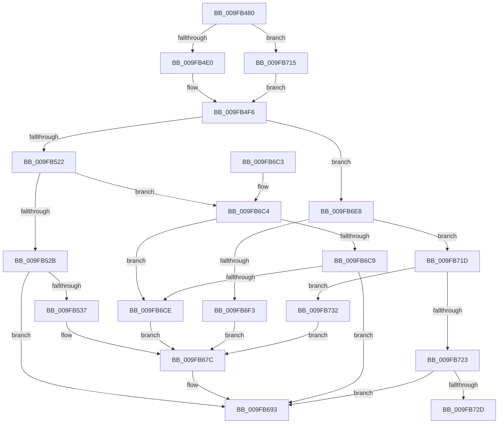

# EtwTraceJobSetQuery

- RVA: `0x009FB480`–`0x009FB85A` (길이 `986` bytes)
- VA: `0x00000001409FB480`
- 실행 섹션: `PAGE`
- PDB 이름 있음: `예`; PDB Function 태그: `예`
- unwind 정보 RVA: `0x000A7088`
- 디코드: `211`개 명령, `986/986` bytes 표시
- 미해석 바이트: `0` (있으면 어셈블리에 `.byte`로 보존)

> 이 문서는 커널 이미지의 기계어와 PDB 기호를 분석해 생성했습니다. 4번과 5번은 함수 원형과 자료형을 바이너리 사용 방식에서 추정한 C 해석이며 원본 소스 복구 결과는 아닙니다.

## 1. Dependencies

- 직접 호출 지점: **2**; 고유 호출 대상: **2**
- 직접 호출자로 확인된 함수: **3**
- RIP 상대 이미지 참조: **1**

### Outgoing calls
- `0x009FB68E` → [EtwTraceKernelEvent](../../text/23/EtwTraceKernelEvent_function_00235350.md) (function, `0x00235350`)
- `0x009FB69D` → [_security_check_cookie](../../text/6A/_security_check_cookie_function_006AC640.md) (function, `0x006AC640`)

### Direct callers
- [PspSetNetRateControl](../78/PspSetNetRateControl_function_00785944.md) at `0x00785BAC`
- [NtSetInformationJobObject](NtSetInformationJobObject_function_009F84C0.md) at `0x009FA0FD`
- [NtSetInformationJobObject](NtSetInformationJobObject_function_009F84C0.md) at `0x009FA7DC`
- [NtSetInformationJobObject](NtSetInformationJobObject_function_009F84C0.md) at `0x009FB02D`
- [NtQueryInformationJobObject](NtQueryInformationJobObject_function_009FB860.md) at `0x009FBF8B`

### Static image references
- `0x009FB4A6` → RVA `0x00E0A740` (`.data`; read)

## 2. Other-region calls and transfers

- 다른 실행 섹션으로 향하는 call: **2**
  - `0x009FB68E` → [EtwTraceKernelEvent](../../text/23/EtwTraceKernelEvent_function_00235350.md) (`PAGE` → `.text`)
  - `0x009FB69D` → [_security_check_cookie](../../text/6A/_security_check_cookie_function_006AC640.md) (`PAGE` → `.text`)
- call이 아닌 외부 분기/꼬리 이동: **1**
  - `0x009FB72D` → [sub_00B3163A](../B3/Unknown_function_00B3163A.md) (`tail-transfer`)

## 3. Assembly (complete function range)

```asm
009FB480  48 8B C4                        mov rax, rsp
009FB483  48 89 58 10                     mov qword ptr [rax + 0x10], rbx
009FB487  48 89 70 18                     mov qword ptr [rax + 0x18], rsi
009FB48B  48 89 78 20                     mov qword ptr [rax + 0x20], rdi
009FB48F  55                              push rbp
009FB490  41 54                           push r12
009FB492  41 55                           push r13
009FB494  41 56                           push r14
009FB496  41 57                           push r15
009FB498  48 8D A8 08 FF FF FF            lea rbp, [rax - 0xf8]
009FB49F  48 81 EC D0 01 00 00            sub rsp, 0x1d0
009FB4A6  48 8B 05 93 F2 40 00            mov rax, qword ptr [rip + 0x40f293]
009FB4AD  48 33 C4                        xor rax, rsp
009FB4B0  48 89 85 C0 00 00 00            mov qword ptr [rbp + 0xc0], rax
009FB4B7  33 DB                           xor ebx, ebx
009FB4B9  4D 8B D9                        mov r11, r9
009FB4BC  89 5C 24 30                     mov dword ptr [rsp + 0x30], ebx
009FB4C0  44 8B D2                        mov r10d, edx
009FB4C3  48 89 5C 24 40                  mov qword ptr [rsp + 0x40], rbx
009FB4C8  48 89 5C 24 38                  mov qword ptr [rsp + 0x38], rbx
009FB4CD  48 89 5C 24 70                  mov qword ptr [rsp + 0x70], rbx
009FB4D2  48 89 5C 24 78                  mov qword ptr [rsp + 0x78], rbx
009FB4D7  48 85 C9                        test rcx, rcx
009FB4DA  0F 84 35 02 00 00               je 0x1409fb715
009FB4E0  0F 10 81 C0 05 00 00            movups xmm0, xmmword ptr [rcx + 0x5c0]
009FB4E7  8B 81 BC 05 00 00               mov eax, dword ptr [rcx + 0x5bc]
009FB4ED  89 45 80                        mov dword ptr [rbp - 0x80], eax
009FB4F0  F3 0F 7F 44 24 70               movdqu xmmword ptr [rsp + 0x70], xmm0
009FB4F6  44 0F B7 8D 28 01 00 00         movzx r9d, word ptr [rbp + 0x128]
009FB4FE  48 8D 44 24 70                  lea rax, [rsp + 0x70]
009FB503  41 8B C9                        mov ecx, r9d
009FB506  44 89 55 84                     mov dword ptr [rbp - 0x7c], r10d
009FB50A  48 89 45 90                     mov qword ptr [rbp - 0x70], rax
009FB50E  48 C7 45 98 18 00 00 00         mov qword ptr [rbp - 0x68], 0x18
009FB516  81 E9 25 07 00 00               sub ecx, 0x725
009FB51C  0F 84 C6 01 00 00               je 0x1409fb6e8
009FB522  83 E9 01                        sub ecx, 1
009FB525  0F 85 99 01 00 00               jne 0x1409fb6c4
009FB52B  8D 51 0D                        lea edx, [rcx + 0xd]
009FB52E  44 3B D2                        cmp r10d, edx
009FB531  0F 85 5C 01 00 00               jne 0x1409fb693
009FB537  49 8D 40 04                     lea rax, [r8 + 4]
009FB53B  4C 89 45 A0                     mov qword ptr [rbp - 0x60], r8
009FB53F  48 89 45 B0                     mov qword ptr [rbp - 0x50], rax
009FB543  8D 51 13                        lea edx, [rcx + 0x13]
009FB546  49 8D 40 08                     lea rax, [r8 + 8]
009FB54A  48 C7 45 A8 04 00 00 00         mov qword ptr [rbp - 0x58], 4
009FB552  48 89 45 C0                     mov qword ptr [rbp - 0x40], rax
009FB556  41 B9 2B 07 00 00               mov r9d, 0x72b
009FB55C  49 8D 40 10                     lea rax, [r8 + 0x10]
009FB560  48 C7 45 B8 04 00 00 00         mov qword ptr [rbp - 0x48], 4
009FB568  48 89 45 D0                     mov qword ptr [rbp - 0x30], rax
009FB56C  49 8D 40 18                     lea rax, [r8 + 0x18]
009FB570  48 89 45 E0                     mov qword ptr [rbp - 0x20], rax
009FB574  49 8D 40 20                     lea rax, [r8 + 0x20]
009FB578  48 89 45 F0                     mov qword ptr [rbp - 0x10], rax
009FB57C  49 8D 40 28                     lea rax, [r8 + 0x28]
009FB580  48 89 45 00                     mov qword ptr [rbp], rax
009FB584  49 8D 40 30                     lea rax, [r8 + 0x30]
009FB588  48 89 45 10                     mov qword ptr [rbp + 0x10], rax
009FB58C  49 8D 40 38                     lea rax, [r8 + 0x38]
009FB590  48 89 45 20                     mov qword ptr [rbp + 0x20], rax
009FB594  49 8D 40 50                     lea rax, [r8 + 0x50]
009FB598  48 89 45 30                     mov qword ptr [rbp + 0x30], rax
009FB59C  49 8D 40 40                     lea rax, [r8 + 0x40]
009FB5A0  48 89 45 40                     mov qword ptr [rbp + 0x40], rax
009FB5A4  49 8D 40 48                     lea rax, [r8 + 0x48]
009FB5A8  48 89 45 50                     mov qword ptr [rbp + 0x50], rax
009FB5AC  49 8D 40 4C                     lea rax, [r8 + 0x4c]
009FB5B0  48 89 45 60                     mov qword ptr [rbp + 0x60], rax
009FB5B4  49 8D 40 58                     lea rax, [r8 + 0x58]
009FB5B8  48 89 45 70                     mov qword ptr [rbp + 0x70], rax
009FB5BC  49 8D 40 5C                     lea rax, [r8 + 0x5c]
009FB5C0  48 89 85 80 00 00 00            mov qword ptr [rbp + 0x80], rax
009FB5C7  49 8D 40 60                     lea rax, [r8 + 0x60]
009FB5CB  48 89 85 90 00 00 00            mov qword ptr [rbp + 0x90], rax
009FB5D2  49 8D 40 64                     lea rax, [r8 + 0x64]
009FB5D6  48 89 85 A0 00 00 00            mov qword ptr [rbp + 0xa0], rax
009FB5DD  41 8B 03                        mov eax, dword ptr [r11]
009FB5E0  89 44 24 30                     mov dword ptr [rsp + 0x30], eax
009FB5E4  48 8D 44 24 30                  lea rax, [rsp + 0x30]
009FB5E9  48 89 85 B0 00 00 00            mov qword ptr [rbp + 0xb0], rax
009FB5F0  48 C7 45 C8 08 00 00 00         mov qword ptr [rbp - 0x38], 8
009FB5F8  48 C7 45 D8 08 00 00 00         mov qword ptr [rbp - 0x28], 8
009FB600  48 C7 45 E8 08 00 00 00         mov qword ptr [rbp - 0x18], 8
009FB608  48 C7 45 F8 08 00 00 00         mov qword ptr [rbp - 8], 8
009FB610  48 C7 45 08 08 00 00 00         mov qword ptr [rbp + 8], 8
009FB618  48 C7 45 18 08 00 00 00         mov qword ptr [rbp + 0x18], 8
009FB620  48 C7 45 28 08 00 00 00         mov qword ptr [rbp + 0x28], 8
009FB628  48 C7 45 38 08 00 00 00         mov qword ptr [rbp + 0x38], 8
009FB630  48 C7 45 48 08 00 00 00         mov qword ptr [rbp + 0x48], 8
009FB638  48 C7 45 58 04 00 00 00         mov qword ptr [rbp + 0x58], 4
009FB640  48 C7 45 68 04 00 00 00         mov qword ptr [rbp + 0x68], 4
009FB648  48 C7 45 78 04 00 00 00         mov qword ptr [rbp + 0x78], 4
009FB650  48 C7 85 88 00 00 00 04 00 00 00  mov qword ptr [rbp + 0x88], 4
009FB65B  48 C7 85 98 00 00 00 04 00 00 00  mov qword ptr [rbp + 0x98], 4
009FB666  48 C7 85 A8 00 00 00 04 00 00 00  mov qword ptr [rbp + 0xa8], 4
009FB671  48 C7 85 B8 00 00 00 04 00 00 00  mov qword ptr [rbp + 0xb8], 4
009FB67C  41 B8 00 00 08 00               mov r8d, 0x80000
009FB682  C7 44 24 20 04 19 60 00         mov dword ptr [rsp + 0x20], 0x601904
009FB68A  48 8D 4D 90                     lea rcx, [rbp - 0x70]
009FB68E  E8 BD 9C 83 FF                  call 0x140235350
009FB693  48 8B 8D C0 00 00 00            mov rcx, qword ptr [rbp + 0xc0]
009FB69A  48 33 CC                        xor rcx, rsp
009FB69D  E8 9E 0F CB FF                  call 0x1406ac640
009FB6A2  4C 8D 9C 24 D0 01 00 00         lea r11, [rsp + 0x1d0]
009FB6AA  49 8B 5B 38                     mov rbx, qword ptr [r11 + 0x38]
009FB6AE  49 8B 73 40                     mov rsi, qword ptr [r11 + 0x40]
009FB6B2  49 8B 7B 48                     mov rdi, qword ptr [r11 + 0x48]
009FB6B6  49 8B E3                        mov rsp, r11
009FB6B9  41 5F                           pop r15
009FB6BB  41 5E                           pop r14
009FB6BD  41 5D                           pop r13
009FB6BF  41 5C                           pop r12
009FB6C1  5D                              pop rbp
009FB6C2  C3                              ret
009FB6C3  CC                              int3
009FB6C4  83 E9 01                        sub ecx, 1
009FB6C7  74 05                           je 0x1409fb6ce
009FB6C9  83 F9 01                        cmp ecx, 1
009FB6CC  75 C5                           jne 0x1409fb693
009FB6CE  48 8D 85 20 01 00 00            lea rax, [rbp + 0x120]
009FB6D5  48 C7 45 A8 04 00 00 00         mov qword ptr [rbp - 0x58], 4
009FB6DD  48 89 45 A0                     mov qword ptr [rbp - 0x60], rax
009FB6E1  BA 02 00 00 00                  mov edx, 2
009FB6E6  EB 94                           jmp 0x1409fb67c
009FB6E8  B9 04 00 00 00                  mov ecx, 4
009FB6ED  41 83 FA 0F                     cmp r10d, 0xf
009FB6F1  75 2A                           jne 0x1409fb71d
009FB6F3  49 8D 40 04                     lea rax, [r8 + 4]
009FB6F7  4C 89 45 A0                     mov qword ptr [rbp - 0x60], r8
009FB6FB  48 89 45 B0                     mov qword ptr [rbp - 0x50], rax
009FB6FF  8D 51 FF                        lea edx, [rcx - 1]
009FB702  48 89 4D A8                     mov qword ptr [rbp - 0x58], rcx
009FB706  41 B9 2C 07 00 00               mov r9d, 0x72c
009FB70C  48 89 4D B8                     mov qword ptr [rbp - 0x48], rcx
009FB710  E9 67 FF FF FF                  jmp 0x1409fb67c
009FB715  89 5D 80                        mov dword ptr [rbp - 0x80], ebx
009FB718  E9 D9 FD FF FF                  jmp 0x1409fb4f6
009FB71D  41 83 FA 0C                     cmp r10d, 0xc
009FB721  74 0F                           je 0x1409fb732
009FB723  41 83 FA 20                     cmp r10d, 0x20
009FB727  0F 85 66 FF FF FF               jne 0x1409fb693
009FB72D  E9 08 5F 13 00                  jmp 0x140b3163a
009FB732  48 8D 45 10                     lea rax, [rbp + 0x10]
009FB736  BA 0D 00 00 00                  mov edx, 0xd
009FB73B  48 89 44 24 48                  mov qword ptr [rsp + 0x48], rax
009FB740  48 8D 5D A0                     lea rbx, [rbp - 0x60]
009FB744  48 8D 45 20                     lea rax, [rbp + 0x20]
009FB748  48 89 44 24 50                  mov qword ptr [rsp + 0x50], rax
009FB74D  48 8D 7D B0                     lea rdi, [rbp - 0x50]
009FB751  48 8D 45 30                     lea rax, [rbp + 0x30]
009FB755  48 89 44 24 58                  mov qword ptr [rsp + 0x58], rax
009FB75A  48 8D 75 C0                     lea rsi, [rbp - 0x40]
009FB75E  48 8D 45 40                     lea rax, [rbp + 0x40]
009FB762  48 89 44 24 60                  mov qword ptr [rsp + 0x60], rax
009FB767  4C 8D 75 D0                     lea r14, [rbp - 0x30]
009FB76B  48 8D 45 50                     lea rax, [rbp + 0x50]
009FB76F  4C 8D 7D E0                     lea r15, [rbp - 0x20]
009FB773  4C 8D 65 F0                     lea r12, [rbp - 0x10]
009FB777  4C 8D 6D 00                     lea r13, [rbp]
009FB77B  4D 8D 50 08                     lea r10, [r8 + 8]
009FB77F  4D 8D 58 10                     lea r11, [r8 + 0x10]
009FB783  83 63 0C 00                     and dword ptr [rbx + 0xc], 0
009FB787  4C 8B 4C 24 48                  mov r9, qword ptr [rsp + 0x48]
009FB78C  89 4B 08                        mov dword ptr [rbx + 8], ecx
009FB78F  48 89 44 24 68                  mov qword ptr [rsp + 0x68], rax
009FB794  49 8D 40 28                     lea rax, [r8 + 0x28]
009FB798  48 89 03                        mov qword ptr [rbx], rax
009FB79B  49 8B 40 30                     mov rax, qword ptr [r8 + 0x30]
009FB79F  4C 89 07                        mov qword ptr [rdi], r8
009FB7A2  48 C7 47 08 08 00 00 00         mov qword ptr [rdi + 8], 8
009FB7AA  4C 89 16                        mov qword ptr [rsi], r10
009FB7AD  48 C7 46 08 08 00 00 00         mov qword ptr [rsi + 8], 8
009FB7B5  4D 89 1E                        mov qword ptr [r14], r11
009FB7B8  49 C7 46 08 08 00 00 00         mov qword ptr [r14 + 8], 8
009FB7C0  49 C7 47 08 08 00 00 00         mov qword ptr [r15 + 8], 8
009FB7C8  48 C1 E8 0C                     shr rax, 0xc
009FB7CC  48 89 44 24 38                  mov qword ptr [rsp + 0x38], rax
009FB7D1  48 8D 44 24 38                  lea rax, [rsp + 0x38]
009FB7D6  49 89 07                        mov qword ptr [r15], rax
009FB7D9  49 8B 40 18                     mov rax, qword ptr [r8 + 0x18]
009FB7DD  49 C7 44 24 08 08 00 00 00      mov qword ptr [r12 + 8], 8
009FB7E6  48 C1 E8 0C                     shr rax, 0xc
009FB7EA  48 89 44 24 40                  mov qword ptr [rsp + 0x40], rax
009FB7EF  48 8D 44 24 40                  lea rax, [rsp + 0x40]
009FB7F4  49 89 04 24                     mov qword ptr [r12], rax
009FB7F8  49 8D 40 20                     lea rax, [r8 + 0x20]
009FB7FC  49 89 45 00                     mov qword ptr [r13], rax
009FB800  49 8D 40 24                     lea rax, [r8 + 0x24]
009FB804  49 89 4D 08                     mov qword ptr [r13 + 8], rcx
009FB808  49 89 01                        mov qword ptr [r9], rax
009FB80B  49 8D 40 2C                     lea rax, [r8 + 0x2c]
009FB80F  49 89 49 08                     mov qword ptr [r9 + 8], rcx
009FB813  4C 8B 4C 24 50                  mov r9, qword ptr [rsp + 0x50]
009FB818  49 89 01                        mov qword ptr [r9], rax
009FB81B  49 8D 40 38                     lea rax, [r8 + 0x38]
009FB81F  49 89 49 08                     mov qword ptr [r9 + 8], rcx
009FB823  4C 8B 4C 24 58                  mov r9, qword ptr [rsp + 0x58]
009FB828  49 89 01                        mov qword ptr [r9], rax
009FB82B  49 8D 40 3C                     lea rax, [r8 + 0x3c]
009FB82F  49 89 49 08                     mov qword ptr [r9 + 8], rcx
009FB833  4C 8B 4C 24 60                  mov r9, qword ptr [rsp + 0x60]
009FB838  49 89 01                        mov qword ptr [r9], rax
009FB83B  49 8D 40 40                     lea rax, [r8 + 0x40]
009FB83F  4C 8B 44 24 68                  mov r8, qword ptr [rsp + 0x68]
009FB844  49 89 49 08                     mov qword ptr [r9 + 8], rcx
009FB848  41 B9 29 07 00 00               mov r9d, 0x729
009FB84E  49 89 00                        mov qword ptr [r8], rax
009FB851  49 89 48 08                     mov qword ptr [r8 + 8], rcx
009FB855  E9 22 FE FF FF                  jmp 0x1409fb67c
```

## 4. C-style interpretation (structured pseudocode)

```c
__int64 __fastcall EtwTraceJobSetQuery(__int64 a1, int a2, __int64 a3, __int64 a4)
{
    __int64 result;
    __int64 v_rbx;
    __int64 v_rsp;
    unsigned __int64 v_stack_m168;
    unsigned __int64 v_stack_m170;
    unsigned __int64 v_stack_m178;
    unsigned __int64 v_stack_m180;
    unsigned __int64 v_stack_m188;
    unsigned __int64 v_stack_m190;
    unsigned __int64 v_stack_m198;
    unsigned __int64 v_stack_m1B8;
    unsigned __int64 v_stack_m1C0;
    unsigned int v_stack_m1C8;
    unsigned int v_stack_m1D8;
    unsigned __int64 v_stack_m28;

    *(unsigned __int64 *)(v_rsp + 16) = v_rbx;
    *(unsigned __int64 *)(v_rsp + 24) = v_rsi;
    *(unsigned __int64 *)(v_rsp + 32) = v_rdi;
    v_rsp = (v_rsp) - (464);
    result = (*(unsigned __int64 *)(v_rip + 4256403)) ^ (v_rsp);
    *(unsigned __int64 *)(v_rsp - 248 + 192) = result;
    v_rbx = 0;
    v_stack_m1C8 = 0;
    v_stack_m1B8 = 0;
    v_stack_m1C0 = 0;
    v_stack_m188 = 0;
    v_stack_m180 = 0;
    if (a1 == 0) goto loc_009FB715;
    *(unsigned int *)(v_rsp - 248 - 128) = (unsigned int)((unsigned int)(*(unsigned int *)(a1 + 1468)));
    v_stack_m188 = v_xmm0;
loc_009FB4F6:
    *(unsigned int *)(v_rsp - 248 - 124) = (unsigned int)((unsigned int)(a2));
    *(unsigned __int64 *)(v_rsp - 248 - 112) = v_stack_m188;
    *(unsigned __int64 *)(v_rsp - 248 - 104) = 24;
    a1 = (unsigned int)(((unsigned int)((unsigned int)(*(unsigned __int16 *)(v_rsp - 248 + 296)))) - (0x725ULL));
    if (condition_is_equal) goto loc_009FB6E8;
    a1 = (unsigned int)((a1) - (1));
    if (condition_is_not_equal) goto loc_009FB6C4;
    if (((unsigned int)((unsigned int)(a2))) != ((unsigned int)(a1 + 13))) goto loc_009FB693;
    *(unsigned __int64 *)(v_rsp - 248 - 96) = a3;
    *(unsigned __int64 *)(v_rsp - 248 - 80) = a3 + 4;
    *(unsigned __int64 *)(v_rsp - 248 - 88) = 4;
    *(unsigned __int64 *)(v_rsp - 248 - 64) = a3 + 8;
    *(unsigned __int64 *)(v_rsp - 248 - 72) = 4;
    *(unsigned __int64 *)(v_rsp - 248 - 48) = a3 + 16;
    *(unsigned __int64 *)(v_rsp - 248 - 32) = a3 + 24;
    *(unsigned __int64 *)(v_rsp - 248 - 16) = a3 + 32;
    *(unsigned __int64 *)(v_rsp - 248) = a3 + 40;
    *(unsigned __int64 *)(v_rsp - 248 + 16) = a3 + 48;
    *(unsigned __int64 *)(v_rsp - 248 + 32) = a3 + 56;
    *(unsigned __int64 *)(v_rsp - 248 + 48) = a3 + 80;
    *(unsigned __int64 *)(v_rsp - 248 + 64) = a3 + 64;
    *(unsigned __int64 *)(v_rsp - 248 + 80) = a3 + 72;
    *(unsigned __int64 *)(v_rsp - 248 + 96) = a3 + 76;
    *(unsigned __int64 *)(v_rsp - 248 + 112) = a3 + 88;
    *(unsigned __int64 *)(v_rsp - 248 + 128) = a3 + 92;
    *(unsigned __int64 *)(v_rsp - 248 + 144) = a3 + 96;
    *(unsigned __int64 *)(v_rsp - 248 + 160) = a3 + 100;
    v_stack_m1C8 = (unsigned int)((unsigned int)(*(unsigned int *)(a4)));
    *(unsigned __int64 *)(v_rsp - 248 + 176) = v_stack_m1C8;
    *(unsigned __int64 *)(v_rsp - 248 - 56) = 8;
    *(unsigned __int64 *)(v_rsp - 248 - 40) = 8;
    *(unsigned __int64 *)(v_rsp - 248 - 24) = 8;
    *(unsigned __int64 *)(v_rsp - 248 - 8) = 8;
    *(unsigned __int64 *)(v_rsp - 248 + 8) = 8;
    *(unsigned __int64 *)(v_rsp - 248 + 24) = 8;
    *(unsigned __int64 *)(v_rsp - 248 + 40) = 8;
    *(unsigned __int64 *)(v_rsp - 248 + 56) = 8;
    *(unsigned __int64 *)(v_rsp - 248 + 72) = 8;
    *(unsigned __int64 *)(v_rsp - 248 + 88) = 4;
    *(unsigned __int64 *)(v_rsp - 248 + 104) = 4;
    *(unsigned __int64 *)(v_rsp - 248 + 120) = 4;
    *(unsigned __int64 *)(v_rsp - 248 + 136) = 4;
    *(unsigned __int64 *)(v_rsp - 248 + 152) = 4;
    *(unsigned __int64 *)(v_rsp - 248 + 168) = 4;
    *(unsigned __int64 *)(v_rsp - 248 + 184) = 4;
loc_009FB67C:
    v_stack_m1D8 = 0x601904ULL;
    result = EtwTraceKernelEvent(v_rsp - 248 - 112, a1 + 19, (unsigned int)(0x80000ULL), (unsigned int)(0x72BULL));
loc_009FB693:
    a1 = (*(unsigned __int64 *)(v_rsp - 248 + 192)) ^ (v_rsp);
    result = _security_check_cookie(a1, a1 + 19, (unsigned int)(0x80000ULL), (unsigned int)(0x72BULL));
    return result;
loc_009FB6C4:
    a1 = (unsigned int)((a1) - (1));
    if (condition_is_equal) goto loc_009FB6CE;
    if (((unsigned int)(a1)) != 1) goto loc_009FB693;
loc_009FB6CE:
    *(unsigned __int64 *)(v_rsp - 248 - 88) = 4;
    *(unsigned __int64 *)(v_rsp - 248 - 96) = v_rsp - 248 + 288;
    goto loc_009FB67C;
loc_009FB6E8:
    if (((unsigned int)((unsigned int)(a2))) != 15) goto loc_009FB71D;
    *(unsigned __int64 *)(v_rsp - 248 - 96) = (unsigned int)(0x80000ULL);
    *(unsigned __int64 *)(v_rsp - 248 - 80) = (unsigned int)(0x80000ULL) + 4;
    *(unsigned __int64 *)(v_rsp - 248 - 88) = 4;
    *(unsigned __int64 *)(v_rsp - 248 - 72) = 4;
    goto loc_009FB67C;
loc_009FB715:
    *(unsigned int *)(v_rsp - 248 - 128) = (unsigned int)(*(unsigned __int64 *)(v_stack_m28 + 56));
    goto loc_009FB4F6;
loc_009FB71D:
    if (((unsigned int)((unsigned int)(a2))) == 12) goto loc_009FB732;
    if (((unsigned int)((unsigned int)(a2))) != 32) goto loc_009FB693;
loc_009FB732:
    v_stack_m188 = v_rsp - 248 + 16;
    v_stack_m180 = v_rsp - 248 + 32;
    v_stack_m178 = v_rsp - 248 + 48;
    v_stack_m170 = v_rsp - 248 + 64;
    *(unsigned int *)(v_rsp - 248 - 96 + 8) = 4;
    v_stack_m168 = v_rsp - 248 + 80;
    *(unsigned __int64 *)(v_rsp - 248 - 96) = (unsigned int)(0x80000ULL) + 40;
    *(unsigned __int64 *)(v_rsp - 248 - 80) = (unsigned int)(0x80000ULL);
    *(unsigned __int64 *)(v_rsp - 248 - 80 + 8) = 8;
    *(unsigned __int64 *)(v_rsp - 248 - 64) = (unsigned int)(0x80000ULL) + 8;
    *(unsigned __int64 *)(v_rsp - 248 - 64 + 8) = 8;
    *(unsigned __int64 *)(v_rsp - 248 - 48) = (unsigned int)(0x80000ULL) + 16;
    *(unsigned __int64 *)(v_rsp - 248 - 48 + 8) = 8;
    *(unsigned __int64 *)(v_rsp - 248 - 32 + 8) = 8;
    result = (*(unsigned __int64 *)((unsigned int)(0x80000ULL) + 48)) >> (12);
    v_stack_m198 = result;
    *(unsigned __int64 *)(v_rsp - 248 - 32) = v_stack_m198;
    *(unsigned __int64 *)(v_rsp - 248 - 16 + 8) = 8;
    result = (*(unsigned __int64 *)((unsigned int)(0x80000ULL) + 24)) >> (12);
    v_stack_m190 = result;
    *(unsigned __int64 *)(v_rsp - 248 - 16) = v_stack_m190;
    *(unsigned __int64 *)(v_rsp - 248) = (unsigned int)(0x80000ULL) + 32;
    *(unsigned __int64 *)(v_rsp - 248 + 8) = 4;
    *(unsigned __int64 *)(v_stack_m188) = (unsigned int)(0x80000ULL) + 36;
    *(unsigned __int64 *)(v_stack_m188 + 8) = 4;
    *(unsigned __int64 *)(v_stack_m180) = (unsigned int)(0x80000ULL) + 44;
    *(unsigned __int64 *)(v_stack_m180 + 8) = 4;
    *(unsigned __int64 *)(v_stack_m178) = (unsigned int)(0x80000ULL) + 56;
    *(unsigned __int64 *)(v_stack_m178 + 8) = 4;
    *(unsigned __int64 *)(v_stack_m170) = (unsigned int)(0x80000ULL) + 60;
    *(unsigned __int64 *)(v_stack_m170 + 8) = 4;
    *(unsigned __int64 *)(v_stack_m168) = (unsigned int)(0x80000ULL) + 64;
    *(unsigned __int64 *)(v_stack_m168 + 8) = 4;
    goto loc_009FB67C;
}
```

## 5. (Beta) C Style

```c
int64_t EtwTraceJobSetQuery(int64_t Arg1, int32_t Arg2, void *Arg3, void *Arg4)
{
    uint8_t *arg3 = (uint8_t *)Arg3;
    uint8_t *arg4 = (uint8_t *)Arg4;

    int64_t result;
    int64_t local_rbx;
    int64_t local_rsp;
    uint64_t v_stack_m168;
    uint64_t v_stack_m170;
    uint64_t v_stack_m178;
    uint64_t v_stack_m180;
    uint64_t v_stack_m188;
    uint64_t v_stack_m190;
    uint64_t v_stack_m198;
    uint64_t v_stack_m1B8;
    uint64_t v_stack_m1C0;
    uint32_t v_stack_m1C8;
    uint32_t v_stack_m1D8;
    uint64_t v_stack_m28;

    *(uint64_t *)(local_rsp + 0x10) = local_rbx;
    *(uint64_t *)(local_rsp + 0x18) = local_rsi;
    *(uint64_t *)(local_rsp + 0x20) = local_rdi;
    local_rsp = (local_rsp) - (464);
    result = (*(uint64_t *)(v_rip + 0x40F293)) ^ (local_rsp);
    *(uint64_t *)(local_rsp - 0xF8 + 0xC0) = result;
    local_rbx = 0;
    v_stack_m1C8 = 0;
    v_stack_m1B8 = 0;
    v_stack_m1C0 = 0;
    v_stack_m188 = 0;
    v_stack_m180 = 0;
    if (Arg1 == 0) goto loc_009FB715;
    *(uint32_t *)(local_rsp - 0xF8 - 0x80) = (uint32_t)((uint32_t)(*(uint32_t *)(Arg1 + 0x5BC)));
    v_stack_m188 = v_xmm0;
loc_009FB4F6:
    *(uint32_t *)(local_rsp - 0xF8 - 0x7C) = (uint32_t)((uint32_t)(Arg2));
    *(uint64_t *)(local_rsp - 0xF8 - 0x70) = v_stack_m188;
    *(uint64_t *)(local_rsp - 0xF8 - 0x68) = 24;
    Arg1 = (uint32_t)(((uint32_t)((uint32_t)(*(uint16_t *)(local_rsp - 0xF8 + 0x128)))) - (0x725ULL));
    if (condition_is_equal) goto loc_009FB6E8;
    Arg1 = (uint32_t)((Arg1) - (1));
    if (condition_is_not_equal) goto loc_009FB6C4;
    if (((uint32_t)((uint32_t)(Arg2))) != ((uint32_t)(Arg1 + 13))) goto loc_009FB693;
    *(void **)(local_rsp - 0xF8 - 0x60) = Arg3;
    *(void **)(local_rsp - 0xF8 - 0x50) = Arg3 + 4;
    *(uint64_t *)(local_rsp - 0xF8 - 0x58) = 4;
    *(void **)(local_rsp - 0xF8 - 0x40) = Arg3 + 8;
    *(uint64_t *)(local_rsp - 0xF8 - 0x48) = 4;
    *(void **)(local_rsp - 0xF8 - 0x30) = Arg3 + 16;
    *(void **)(local_rsp - 0xF8 - 0x20) = Arg3 + 24;
    *(void **)(local_rsp - 0xF8 - 0x10) = Arg3 + 32;
    *(void **)(local_rsp - 0xF8) = Arg3 + 40;
    *(void **)(local_rsp - 0xF8 + 0x10) = Arg3 + 48;
    *(void **)(local_rsp - 0xF8 + 0x20) = Arg3 + 56;
    *(void **)(local_rsp - 0xF8 + 0x30) = Arg3 + 80;
    *(void **)(local_rsp - 0xF8 + 0x40) = Arg3 + 64;
    *(void **)(local_rsp - 0xF8 + 0x50) = Arg3 + 72;
    *(void **)(local_rsp - 0xF8 + 0x60) = Arg3 + 76;
    *(void **)(local_rsp - 0xF8 + 0x70) = Arg3 + 88;
    *(void **)(local_rsp - 0xF8 + 0x80) = Arg3 + 92;
    *(void **)(local_rsp - 0xF8 + 0x90) = Arg3 + 96;
    *(void **)(local_rsp - 0xF8 + 0xA0) = Arg3 + 100;
    v_stack_m1C8 = (uint32_t)((uint32_t)(*(uint32_t *)(arg4)));
    *(uint64_t *)(local_rsp - 0xF8 + 0xB0) = v_stack_m1C8;
    *(uint64_t *)(local_rsp - 0xF8 - 0x38) = 8;
    *(uint64_t *)(local_rsp - 0xF8 - 0x28) = 8;
    *(uint64_t *)(local_rsp - 0xF8 - 0x18) = 8;
    *(uint64_t *)(local_rsp - 0xF8 - 0x8) = 8;
    *(uint64_t *)(local_rsp - 0xF8 + 0x8) = 8;
    *(uint64_t *)(local_rsp - 0xF8 + 0x18) = 8;
    *(uint64_t *)(local_rsp - 0xF8 + 0x28) = 8;
    *(uint64_t *)(local_rsp - 0xF8 + 0x38) = 8;
    *(uint64_t *)(local_rsp - 0xF8 + 0x48) = 8;
    *(uint64_t *)(local_rsp - 0xF8 + 0x58) = 4;
    *(uint64_t *)(local_rsp - 0xF8 + 0x68) = 4;
    *(uint64_t *)(local_rsp - 0xF8 + 0x78) = 4;
    *(uint64_t *)(local_rsp - 0xF8 + 0x88) = 4;
    *(uint64_t *)(local_rsp - 0xF8 + 0x98) = 4;
    *(uint64_t *)(local_rsp - 0xF8 + 0xA8) = 4;
    *(uint64_t *)(local_rsp - 0xF8 + 0xB8) = 4;
loc_009FB67C:
    v_stack_m1D8 = 0x601904ULL;
    result = EtwTraceKernelEvent(local_rsp - 248 - 112, Arg1 + 19, (uint32_t)(0x80000ULL), (uint32_t)(0x72BULL));
loc_009FB693:
    Arg1 = (*(uint64_t *)(local_rsp - 0xF8 + 0xC0)) ^ (local_rsp);
    result = _security_check_cookie(Arg1, Arg1 + 19, (uint32_t)(0x80000ULL), (uint32_t)(0x72BULL));
    return result;
loc_009FB6C4:
    Arg1 = (uint32_t)((Arg1) - (1));
    if (condition_is_equal) goto loc_009FB6CE;
    if (((uint32_t)(Arg1)) != 1) goto loc_009FB693;
loc_009FB6CE:
    *(uint64_t *)(local_rsp - 0xF8 - 0x58) = 4;
    *(uint64_t *)(local_rsp - 0xF8 - 0x60) = local_rsp - 248 + 288;
    goto loc_009FB67C;
loc_009FB6E8:
    if (((uint32_t)((uint32_t)(Arg2))) != 15) goto loc_009FB71D;
    *(uint64_t *)(local_rsp - 0xF8 - 0x60) = (uint32_t)(0x80000ULL);
    *(uint64_t *)(local_rsp - 0xF8 - 0x50) = (uint32_t)(0x80000ULL) + 4;
    *(uint64_t *)(local_rsp - 0xF8 - 0x58) = 4;
    *(uint64_t *)(local_rsp - 0xF8 - 0x48) = 4;
    goto loc_009FB67C;
loc_009FB715:
    *(uint32_t *)(local_rsp - 0xF8 - 0x80) = (uint32_t)(*(uint64_t *)(v_stack_m28 + 0x38));
    goto loc_009FB4F6;
loc_009FB71D:
    if (((uint32_t)((uint32_t)(Arg2))) == 12) goto loc_009FB732;
    if (((uint32_t)((uint32_t)(Arg2))) != 32) goto loc_009FB693;
loc_009FB732:
    v_stack_m188 = local_rsp - 248 + 16;
    v_stack_m180 = local_rsp - 248 + 32;
    v_stack_m178 = local_rsp - 248 + 48;
    v_stack_m170 = local_rsp - 248 + 64;
    *(uint32_t *)(local_rsp - 0xF8 - 0x60 + 0x8) = 4;
    v_stack_m168 = local_rsp - 248 + 80;
    *(uint64_t *)(local_rsp - 0xF8 - 0x60) = (uint32_t)(0x80000ULL) + 40;
    *(uint64_t *)(local_rsp - 0xF8 - 0x50) = (uint32_t)(0x80000ULL);
    *(uint64_t *)(local_rsp - 0xF8 - 0x50 + 0x8) = 8;
    *(uint64_t *)(local_rsp - 0xF8 - 0x40) = (uint32_t)(0x80000ULL) + 8;
    *(uint64_t *)(local_rsp - 0xF8 - 0x40 + 0x8) = 8;
    *(uint64_t *)(local_rsp - 0xF8 - 0x30) = (uint32_t)(0x80000ULL) + 16;
    *(uint64_t *)(local_rsp - 0xF8 - 0x30 + 0x8) = 8;
    *(uint64_t *)(local_rsp - 0xF8 - 0x20 + 0x8) = 8;
    result = (*(uint64_t *)((uint32_t)(0x80000ULL) + 0x30)) >> (12);
    v_stack_m198 = result;
    *(uint64_t *)(local_rsp - 0xF8 - 0x20) = v_stack_m198;
    *(uint64_t *)(local_rsp - 0xF8 - 0x10 + 0x8) = 8;
    result = (*(uint64_t *)((uint32_t)(0x80000ULL) + 0x18)) >> (12);
    v_stack_m190 = result;
    *(uint64_t *)(local_rsp - 0xF8 - 0x10) = v_stack_m190;
    *(uint64_t *)(local_rsp - 0xF8) = (uint32_t)(0x80000ULL) + 32;
    *(uint64_t *)(local_rsp - 0xF8 + 0x8) = 4;
    *(uint64_t *)(v_stack_m188) = (uint32_t)(0x80000ULL) + 36;
    *(uint64_t *)(v_stack_m188 + 0x8) = 4;
    *(uint64_t *)(v_stack_m180) = (uint32_t)(0x80000ULL) + 44;
    *(uint64_t *)(v_stack_m180 + 0x8) = 4;
    *(uint64_t *)(v_stack_m178) = (uint32_t)(0x80000ULL) + 56;
    *(uint64_t *)(v_stack_m178 + 0x8) = 4;
    *(uint64_t *)(v_stack_m170) = (uint32_t)(0x80000ULL) + 60;
    *(uint64_t *)(v_stack_m170 + 0x8) = 4;
    *(uint64_t *)(v_stack_m168) = (uint32_t)(0x80000ULL) + 64;
    *(uint64_t *)(v_stack_m168 + 0x8) = 4;
    goto loc_009FB67C;
}
```

### 관측된 메모리 오프셋

구조체 형식이 확인되지 않은 접근은 인자 기준의 오프셋으로만 기록했습니다.

| 기준 인자 | 오프셋 표현 | 폭 (bit) | 접근 |
|---|---:|---:|---|
| `Arg3` | `+ 0x4` | `64` | `R` |
| `Arg3` | `+ 0x8` | `64` | `R` |
| `Arg3` | `+ 0x10` | `64` | `R` |
| `Arg3` | `+ 0x18` | `64` | `R` |
| `Arg3` | `+ 0x20` | `64` | `R` |
| `Arg3` | `+ 0x24` | `64` | `R` |
| `Arg3` | `+ 0x28` | `64` | `R` |
| `Arg3` | `+ 0x2C` | `64` | `R` |
| `Arg3` | `+ 0x30` | `64` | `R` |
| `Arg3` | `+ 0x38` | `64` | `R` |
| `Arg3` | `+ 0x3C` | `64` | `R` |
| `Arg3` | `+ 0x40` | `64` | `R` |
| `Arg3` | `+ 0x48` | `64` | `R` |
| `Arg3` | `+ 0x4C` | `64` | `R` |
| `Arg3` | `+ 0x50` | `64` | `R` |
| `Arg3` | `+ 0x58` | `64` | `R` |
| `Arg3` | `+ 0x5C` | `64` | `R` |
| `Arg3` | `+ 0x60` | `64` | `R` |
| `Arg3` | `+ 0x64` | `64` | `R` |
| `Arg4` | `+ 0x0` | `32` | `R` |

## 6. Execution-region graph

[열기: 2D/3D 그래프와 함수 탐색 컨트롤 패널](../../../control-panel.html?section=page&rva=0x009FB480&view=graph)

- 2D 그래프는 위에서 아래로 흐르고, 3D 그래프는 빈 공간을 드래그해 회전합니다. Shift+드래그는 이동, 휠은 확대·축소, 함수 노드 선택은 대상 보고서 이동입니다.

### Static fallback


