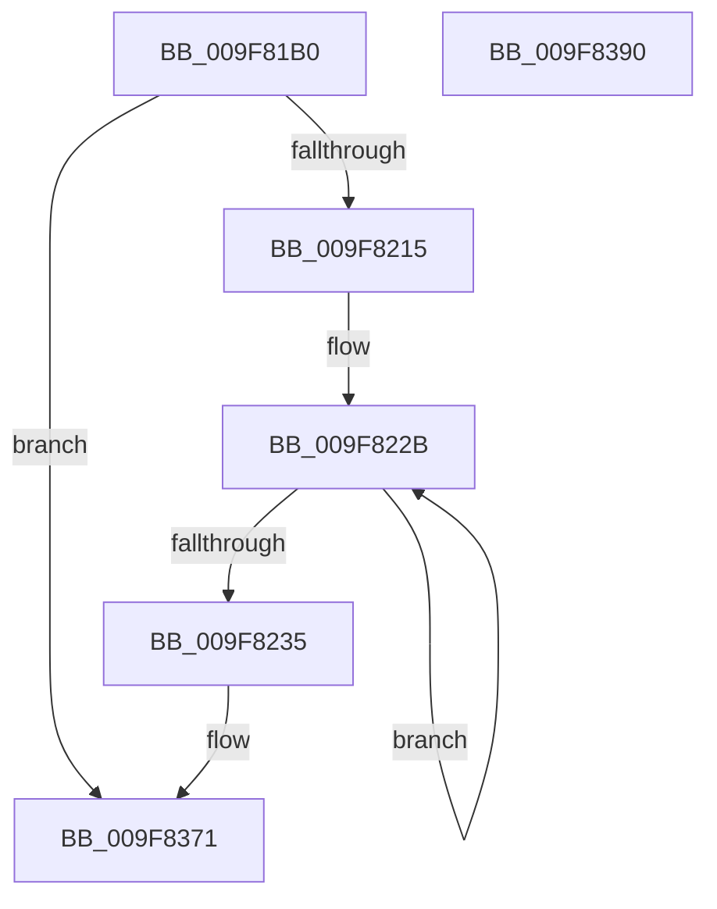

# EtwTracePsIoRateControl

- RVA: `0x009F81B0`–`0x009F8391` (길이 `481` bytes)
- VA: `0x00000001409F81B0`
- 실행 섹션: `PAGE`
- PDB 이름 있음: `예`; PDB Function 태그: `아니요`
- unwind 정보 RVA: `0x000A6DE8`
- 디코드: `101`개 명령, `481/481` bytes 표시
- 미해석 바이트: `0` (있으면 어셈블리에 `.byte`로 보존)

> 이 문서는 커널 이미지의 기계어와 PDB 기호를 분석해 생성했습니다. 4번과 5번은 함수 원형과 자료형을 바이너리 사용 방식에서 추정한 C 해석이며 원본 소스 복구 결과는 아닙니다.

## 1. Dependencies

- 직접 호출 지점: **3**; 고유 호출 대상: **3**
- 직접 호출자로 확인된 함수: **1**
- RIP 상대 이미지 참조: **5**

### Outgoing calls
- `0x009F8205` → [EtwEventEnabled](../../text/39/EtwEventEnabled_function_00392450.md) (function, `0x00392450`)
- `0x009F836C` → [EtwWrite](../../text/41/EtwWrite_function_0041C720.md) (function, `0x0041C720`)
- `0x009F8378` → [_security_check_cookie](../../text/6A/_security_check_cookie_function_006AC640.md) (function, `0x006AC640`)

### Direct callers
- [PspSetJobIoRateControl](PspSetJobIoRateControl_function_009F78EC.md) at `0x009F7ABC`

### Static image references
- `0x009F81D0` → RVA `0x00E0A740` (`.data`; read)
- `0x009F81DE` → RVA `0x00EFF9E8` (`.data`; read)
- `0x009F81EB` → RVA `0x000149F0` (`.rdata`; read)
- `0x009F81F7` → RVA `0x00014A00` (`.rdata`; read)
- `0x009F8219` → RVA `0x00B013F0` (` ?? ::NNGAKEGL::`string'`; read)

## 2. Other-region calls and transfers

- 다른 실행 섹션으로 향하는 call: **3**
  - `0x009F8205` → [EtwEventEnabled](../../text/39/EtwEventEnabled_function_00392450.md) (`PAGE` → `.text`)
  - `0x009F836C` → [EtwWrite](../../text/41/EtwWrite_function_0041C720.md) (`PAGE` → `.text`)
  - `0x009F8378` → [_security_check_cookie](../../text/6A/_security_check_cookie_function_006AC640.md) (`PAGE` → `.text`)
- 별도 외부 분기/꼬리 이동을 확인하지 못했습니다.

## 3. Assembly (complete function range)

```asm
009F81B0  48 8B C4                        mov rax, rsp
009F81B3  48 89 58 10                     mov qword ptr [rax + 0x10], rbx
009F81B7  44 89 48 20                     mov dword ptr [rax + 0x20], r9d
009F81BB  4C 89 40 18                     mov qword ptr [rax + 0x18], r8
009F81BF  89 48 08                        mov dword ptr [rax + 8], ecx
009F81C2  55                              push rbp
009F81C3  56                              push rsi
009F81C4  57                              push rdi
009F81C5  48 8D 68 98                     lea rbp, [rax - 0x68]
009F81C9  48 81 EC 50 01 00 00            sub rsp, 0x150
009F81D0  48 8B 05 69 25 41 00            mov rax, qword ptr [rip + 0x412569]
009F81D7  48 33 C4                        xor rax, rsp
009F81DA  48 89 45 40                     mov qword ptr [rbp + 0x40], rax
009F81DE  48 8B 0D 03 78 50 00            mov rcx, qword ptr [rip + 0x507803]
009F81E5  48 8D 72 24                     lea rsi, [rdx + 0x24]
009F81E9  8B 06                           mov eax, dword ptr [rsi]
009F81EB  48 8D 3D FE C7 61 FF            lea rdi, [rip - 0x9e3802]
009F81F2  A8 01                           test al, 1
009F81F4  48 8B DA                        mov rbx, rdx
009F81F7  48 8D 05 02 C8 61 FF            lea rax, [rip - 0x9e37fe]
009F81FE  48 0F 44 F8                     cmove rdi, rax
009F8202  48 8B D7                        mov rdx, rdi
009F8205  E8 46 A2 99 FF                  call 0x140392450
009F820A  45 33 D2                        xor r10d, r10d
009F820D  84 C0                           test al, al
009F820F  0F 84 5C 01 00 00               je 0x1409f8371
009F8215  48 8B 43 18                     mov rax, qword ptr [rbx + 0x18]
009F8219  4C 8D 05 D0 91 10 00            lea r8, [rip + 0x1091d0]
009F8220  48 85 C0                        test rax, rax
009F8223  4C 0F 45 C0                     cmovne r8, rax
009F8227  48 83 C9 FF                     or rcx, 0xffffffffffffffff
009F822B  48 FF C1                        inc rcx
009F822E  66 45 39 14 48                  cmp word ptr [r8 + rcx*2], r10w
009F8233  75 F6                           jne 0x1409f822b
009F8235  48 8D 45 70                     lea rax, [rbp + 0x70]
009F8239  4C 89 45 20                     mov qword ptr [rbp + 0x20], r8
009F823D  48 89 44 24 30                  mov qword ptr [rsp + 0x30], rax
009F8242  8D 0C 4D 02 00 00 00            lea ecx, [rcx*2 + 2]
009F8249  48 8D 85 80 00 00 00            lea rax, [rbp + 0x80]
009F8250  89 4D 28                        mov dword ptr [rbp + 0x28], ecx
009F8253  48 8B 0D 8E 77 50 00            mov rcx, qword ptr [rip + 0x50778e]
009F825A  41 B9 11 00 00 00               mov r9d, 0x11
009F8260  48 89 44 24 40                  mov qword ptr [rsp + 0x40], rax
009F8265  45 33 C0                        xor r8d, r8d
009F8268  48 8D 43 08                     lea rax, [rbx + 8]
009F826C  48 C7 44 24 38 04 00 00 00      mov qword ptr [rsp + 0x38], 4
009F8275  48 89 44 24 60                  mov qword ptr [rsp + 0x60], rax
009F827A  48 8B D7                        mov rdx, rdi
009F827D  48 8D 43 48                     lea rax, [rbx + 0x48]
009F8281  48 C7 44 24 48 08 00 00 00      mov qword ptr [rsp + 0x48], 8
009F828A  48 89 44 24 70                  mov qword ptr [rsp + 0x70], rax
009F828F  48 8D 43 10                     lea rax, [rbx + 0x10]
009F8293  48 89 45 80                     mov qword ptr [rbp - 0x80], rax
009F8297  48 8D 43 38                     lea rax, [rbx + 0x38]
009F829B  48 89 45 90                     mov qword ptr [rbp - 0x70], rax
009F829F  48 8D 43 50                     lea rax, [rbx + 0x50]
009F82A3  48 89 45 A0                     mov qword ptr [rbp - 0x60], rax
009F82A7  48 8D 43 30                     lea rax, [rbx + 0x30]
009F82AB  48 89 45 B0                     mov qword ptr [rbp - 0x50], rax
009F82AF  48 8D 43 40                     lea rax, [rbx + 0x40]
009F82B3  48 89 45 C0                     mov qword ptr [rbp - 0x40], rax
009F82B7  48 8D 43 58                     lea rax, [rbx + 0x58]
009F82BB  48 89 45 D0                     mov qword ptr [rbp - 0x30], rax
009F82BF  48 8D 43 60                     lea rax, [rbx + 0x60]
009F82C3  48 89 45 E0                     mov qword ptr [rbp - 0x20], rax
009F82C7  48 8D 43 68                     lea rax, [rbx + 0x68]
009F82CB  48 89 45 F0                     mov qword ptr [rbp - 0x10], rax
009F82CF  48 8D 43 70                     lea rax, [rbx + 0x70]
009F82D3  48 89 45 00                     mov qword ptr [rbp], rax
009F82D7  48 8D 85 88 00 00 00            lea rax, [rbp + 0x88]
009F82DE  48 89 45 30                     mov qword ptr [rbp + 0x30], rax
009F82E2  48 8D 44 24 30                  lea rax, [rsp + 0x30]
009F82E7  48 89 44 24 20                  mov qword ptr [rsp + 0x20], rax
009F82EC  48 89 5C 24 50                  mov qword ptr [rsp + 0x50], rbx
009F82F1  48 C7 44 24 58 08 00 00 00      mov qword ptr [rsp + 0x58], 8
009F82FA  48 C7 44 24 68 08 00 00 00      mov qword ptr [rsp + 0x68], 8
009F8303  48 C7 44 24 78 08 00 00 00      mov qword ptr [rsp + 0x78], 8
009F830C  48 C7 45 88 08 00 00 00         mov qword ptr [rbp - 0x78], 8
009F8314  48 C7 45 98 08 00 00 00         mov qword ptr [rbp - 0x68], 8
009F831C  48 C7 45 A8 08 00 00 00         mov qword ptr [rbp - 0x58], 8
009F8324  48 C7 45 B8 08 00 00 00         mov qword ptr [rbp - 0x48], 8
009F832C  48 C7 45 C8 08 00 00 00         mov qword ptr [rbp - 0x38], 8
009F8334  48 C7 45 D8 08 00 00 00         mov qword ptr [rbp - 0x28], 8
009F833C  48 C7 45 E8 08 00 00 00         mov qword ptr [rbp - 0x18], 8
009F8344  48 C7 45 F8 08 00 00 00         mov qword ptr [rbp - 8], 8
009F834C  48 C7 45 08 08 00 00 00         mov qword ptr [rbp + 8], 8
009F8354  48 89 75 10                     mov qword ptr [rbp + 0x10], rsi
009F8358  48 C7 45 18 04 00 00 00         mov qword ptr [rbp + 0x18], 4
009F8360  44 89 55 2C                     mov dword ptr [rbp + 0x2c], r10d
009F8364  48 C7 45 38 04 00 00 00         mov qword ptr [rbp + 0x38], 4
009F836C  E8 AF 43 A2 FF                  call 0x14041c720
009F8371  48 8B 4D 40                     mov rcx, qword ptr [rbp + 0x40]
009F8375  48 33 CC                        xor rcx, rsp
009F8378  E8 C3 42 CB FF                  call 0x1406ac640
009F837D  48 8B 9C 24 78 01 00 00         mov rbx, qword ptr [rsp + 0x178]
009F8385  48 81 C4 50 01 00 00            add rsp, 0x150
009F838C  5F                              pop rdi
009F838D  5E                              pop rsi
009F838E  5D                              pop rbp
009F838F  C3                              ret
009F8390  CC                              int3
```

## 4. C-style interpretation (structured pseudocode)

```c
__int64 __fastcall EtwTracePsIoRateControl(int a1, __int64 a2, __int64 a3, int a4)
{
    __int64 result;
    __int64 v_r10;
    __int64 v_rdi;
    __int64 v_rsp;
    unsigned __int64 v_stack_m100;
    unsigned __int64 v_stack_m108;
    unsigned __int64 v_stack_m110;
    unsigned __int64 v_stack_m118;
    unsigned __int64 v_stack_m120;
    unsigned __int64 v_stack_m128;
    unsigned __int64 v_stack_m130;
    unsigned __int64 v_stack_m138;
    unsigned __int64 v_stack_m148;
    unsigned __int64 v_stack_mF0;
    unsigned __int64 v_stack_mF8;
    unsigned __int64 v_stack_p10;

    *(unsigned __int64 *)(v_rsp + 16) = v_rbx;
    *(unsigned int *)(v_rsp + 32) = a4;
    *(unsigned __int64 *)(v_rsp + 24) = a3;
    *(unsigned int *)(v_rsp + 8) = a1;
    v_rsp = (v_rsp) - (336);
    result = (*(unsigned __int64 *)(v_rip + 4269417)) ^ (v_rsp);
    *(unsigned __int64 *)(v_rsp - 104 + 64) = result;
    v_rdi = v_rip - 10369026;
    if ((((unsigned __int8)((unsigned int)(*(unsigned int *)(a2 + 36)))) & (1)) == 0) { v_rdi = v_rip - 10369022; }
    result = EtwEventEnabled(*(unsigned __int64 *)(v_rip + 5273603), v_rdi, a3, a4);
    v_r10 = 0;
    if ((unsigned __int8)(result) == 0) goto loc_009F8371;
    a3 = v_rip + 1085904;
    if (*(unsigned __int64 *)(a2 + 24) != 0) { a3 = *(unsigned __int64 *)(a2 + 24); }
    a1 = (*(unsigned __int64 *)(v_rip + 5273603)) | (-1);
loc_009F822B:
    a1 = (a1) + 1;
    if ((*(unsigned __int16 *)(a3 + a1 * 2)) != 0) goto loc_009F822B;
    *(unsigned __int64 *)(v_rsp - 104 + 32) = a3;
    v_stack_m138 = v_rsp - 104 + 112;
    *(unsigned int *)(v_rsp - 104 + 40) = (unsigned int)(a1 * 2 + 2);
    v_stack_m128 = v_rsp - 104 + 128;
    a3 = 0;
    v_stack_m130 = 4;
    v_stack_m108 = a2 + 8;
    v_stack_m120 = 8;
    v_stack_mF8 = a2 + 72;
    *(unsigned __int64 *)(v_rsp - 104 - 128) = a2 + 16;
    *(unsigned __int64 *)(v_rsp - 104 - 112) = a2 + 56;
    *(unsigned __int64 *)(v_rsp - 104 - 96) = a2 + 80;
    *(unsigned __int64 *)(v_rsp - 104 - 80) = a2 + 48;
    *(unsigned __int64 *)(v_rsp - 104 - 64) = a2 + 64;
    *(unsigned __int64 *)(v_rsp - 104 - 48) = a2 + 88;
    *(unsigned __int64 *)(v_rsp - 104 - 32) = a2 + 96;
    *(unsigned __int64 *)(v_rsp - 104 - 16) = a2 + 104;
    *(unsigned __int64 *)(v_rsp - 104) = a2 + 112;
    *(unsigned __int64 *)(v_rsp - 104 + 48) = v_rsp - 104 + 136;
    v_stack_m148 = v_stack_m138;
    v_stack_m118 = a2;
    v_stack_m110 = 8;
    v_stack_m100 = 8;
    v_stack_mF0 = 8;
    *(unsigned __int64 *)(v_rsp - 104 - 120) = 8;
    *(unsigned __int64 *)(v_rsp - 104 - 104) = 8;
    *(unsigned __int64 *)(v_rsp - 104 - 88) = 8;
    *(unsigned __int64 *)(v_rsp - 104 - 72) = 8;
    *(unsigned __int64 *)(v_rsp - 104 - 56) = 8;
    *(unsigned __int64 *)(v_rsp - 104 - 40) = 8;
    *(unsigned __int64 *)(v_rsp - 104 - 24) = 8;
    *(unsigned __int64 *)(v_rsp - 104 - 8) = 8;
    *(unsigned __int64 *)(v_rsp - 104 + 8) = 8;
    *(unsigned __int64 *)(v_rsp - 104 + 16) = a2 + 36;
    *(unsigned __int64 *)(v_rsp - 104 + 24) = 4;
    *(unsigned int *)(v_rsp - 104 + 44) = 0;
    *(unsigned __int64 *)(v_rsp - 104 + 56) = 4;
    result = EtwWrite(*(unsigned __int64 *)(v_rip + 5273486), v_rdi, a3, 17);
loc_009F8371:
    a1 = (*(unsigned __int64 *)(v_rsp - 104 + 64)) ^ (v_rsp);
    result = _security_check_cookie(a1, v_rdi, a3, 17);
    v_rsp = (v_rsp) + (336);
    return result;
}
```

## 5. (Beta) C Style

```c
int64_t EtwTracePsIoRateControl(int32_t Arg1, void *Arg2, int64_t Arg3, int32_t Arg4)
{
    uint8_t *arg2 = (uint8_t *)Arg2;

    int64_t result;
    int64_t local_r10;
    int64_t local_rdi;
    int64_t local_rsp;
    uint64_t v_stack_m100;
    uint64_t v_stack_m108;
    uint64_t v_stack_m110;
    uint64_t v_stack_m118;
    uint64_t v_stack_m120;
    uint64_t v_stack_m128;
    uint64_t v_stack_m130;
    uint64_t v_stack_m138;
    uint64_t v_stack_m148;
    uint64_t v_stack_mF0;
    uint64_t v_stack_mF8;
    uint64_t v_stack_p10;

    *(uint64_t *)(local_rsp + 0x10) = local_rbx;
    *(uint32_t *)(local_rsp + 0x20) = Arg4;
    *(uint64_t *)(local_rsp + 0x18) = Arg3;
    *(uint32_t *)(local_rsp + 0x8) = Arg1;
    local_rsp = (local_rsp) - (336);
    result = (*(uint64_t *)(v_rip + 0x412569)) ^ (local_rsp);
    *(uint64_t *)(local_rsp - 0x68 + 0x40) = result;
    local_rdi = v_rip - 10369026;
    if ((((uint8_t)((uint32_t)(*(uint32_t *)(arg2 + 0x24)))) & (1)) == 0) { local_rdi = v_rip - 10369022; }
    result = EtwEventEnabled(*(uint64_t *)(v_rip + 0x507803), local_rdi, Arg3, Arg4);
    local_r10 = 0;
    if ((uint8_t)(result) == 0) goto loc_009F8371;
    Arg3 = v_rip + 1085904;
    if (*(uint64_t *)(arg2 + 0x18) != 0) { Arg3 = *(uint64_t *)(arg2 + 0x18); }
    Arg1 = (*(uint64_t *)(v_rip + 0x507803)) | (-1);
loc_009F822B:
    Arg1 = (Arg1) + 1;
    if ((*(uint16_t *)(Arg3 + Arg1 * 2)) != 0) goto loc_009F822B;
    *(uint64_t *)(local_rsp - 0x68 + 0x20) = Arg3;
    v_stack_m138 = local_rsp - 104 + 112;
    *(uint32_t *)(local_rsp - 0x68 + 0x28) = (uint32_t)(Arg1 * 2 + 2);
    v_stack_m128 = local_rsp - 104 + 128;
    Arg3 = 0;
    v_stack_m130 = 4;
    v_stack_m108 = Arg2 + 8;
    v_stack_m120 = 8;
    v_stack_mF8 = Arg2 + 72;
    *(void **)(local_rsp - 0x68 - 0x80) = Arg2 + 16;
    *(void **)(local_rsp - 0x68 - 0x70) = Arg2 + 56;
    *(void **)(local_rsp - 0x68 - 0x60) = Arg2 + 80;
    *(void **)(local_rsp - 0x68 - 0x50) = Arg2 + 48;
    *(void **)(local_rsp - 0x68 - 0x40) = Arg2 + 64;
    *(void **)(local_rsp - 0x68 - 0x30) = Arg2 + 88;
    *(void **)(local_rsp - 0x68 - 0x20) = Arg2 + 96;
    *(void **)(local_rsp - 0x68 - 0x10) = Arg2 + 104;
    *(void **)(local_rsp - 0x68) = Arg2 + 112;
    *(uint64_t *)(local_rsp - 0x68 + 0x30) = local_rsp - 104 + 136;
    v_stack_m148 = v_stack_m138;
    v_stack_m118 = Arg2;
    v_stack_m110 = 8;
    v_stack_m100 = 8;
    v_stack_mF0 = 8;
    *(uint64_t *)(local_rsp - 0x68 - 0x78) = 8;
    *(uint64_t *)(local_rsp - 0x68 - 0x68) = 8;
    *(uint64_t *)(local_rsp - 0x68 - 0x58) = 8;
    *(uint64_t *)(local_rsp - 0x68 - 0x48) = 8;
    *(uint64_t *)(local_rsp - 0x68 - 0x38) = 8;
    *(uint64_t *)(local_rsp - 0x68 - 0x28) = 8;
    *(uint64_t *)(local_rsp - 0x68 - 0x18) = 8;
    *(uint64_t *)(local_rsp - 0x68 - 0x8) = 8;
    *(uint64_t *)(local_rsp - 0x68 + 0x8) = 8;
    *(void **)(local_rsp - 0x68 + 0x10) = Arg2 + 36;
    *(uint64_t *)(local_rsp - 0x68 + 0x18) = 4;
    *(uint32_t *)(local_rsp - 0x68 + 0x2C) = 0;
    *(uint64_t *)(local_rsp - 0x68 + 0x38) = 4;
    result = EtwWrite(*(uint64_t *)(v_rip + 0x50778E), local_rdi, Arg3, 17);
loc_009F8371:
    Arg1 = (*(uint64_t *)(local_rsp - 0x68 + 0x40)) ^ (local_rsp);
    result = _security_check_cookie(Arg1, local_rdi, Arg3, 17);
    local_rsp = (local_rsp) + (336);
    return result;
}
```

### 관측된 메모리 오프셋

구조체 형식이 확인되지 않은 접근은 인자 기준의 오프셋으로만 기록했습니다.

| 기준 인자 | 오프셋 표현 | 폭 (bit) | 접근 |
|---|---:|---:|---|
| `Arg2` | `+ 0x0` | `32` | `R` |
| `Arg2` | `+ 0x8` | `64` | `R` |
| `Arg2` | `+ 0x10` | `64` | `R` |
| `Arg2` | `+ 0x18` | `64` | `R` |
| `Arg2` | `+ 0x24` | `64` | `R` |
| `Arg2` | `+ 0x30` | `64` | `R` |
| `Arg2` | `+ 0x38` | `64` | `R` |
| `Arg2` | `+ 0x40` | `64` | `R` |
| `Arg2` | `+ 0x48` | `64` | `R` |
| `Arg2` | `+ 0x50` | `64` | `R` |
| `Arg2` | `+ 0x58` | `64` | `R` |
| `Arg2` | `+ 0x60` | `64` | `R` |
| `Arg2` | `+ 0x68` | `64` | `R` |
| `Arg2` | `+ 0x70` | `64` | `R` |

## 6. Execution-region graph

[열기: 2D/3D 그래프와 함수 탐색 컨트롤 패널](../../../control-panel.html?section=page&rva=0x009F81B0&view=graph)

- 2D 그래프는 위에서 아래로 흐르고, 3D 그래프는 빈 공간을 드래그해 회전합니다. Shift+드래그는 이동, 휠은 확대·축소, 함수 노드 선택은 대상 보고서 이동입니다.

### Static fallback


