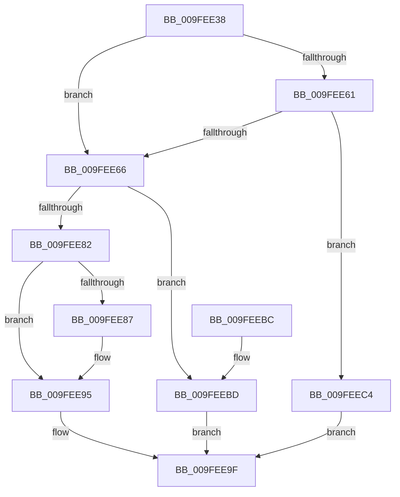

# EtwpAllocDataBlock

- RVA: `0x009FEE38`–`0x009FEECB` (길이 `147` bytes)
- VA: `0x00000001409FEE38`
- 실행 섹션: `PAGE`
- PDB 이름 있음: `예`; PDB Function 태그: `아니요`
- unwind 정보 RVA: `0x000A76B0`
- 디코드: `44`개 명령, `147/147` bytes 표시
- 미해석 바이트: `0` (있으면 어셈블리에 `.byte`로 보존)

> 이 문서는 커널 이미지의 기계어와 PDB 기호를 분석해 생성했습니다. 4번과 5번은 함수 원형과 자료형을 바이너리 사용 방식에서 추정한 C 해석이며 원본 소스 복구 결과는 아닙니다.

## 1. Dependencies

- 직접 호출 지점: **2**; 고유 호출 대상: **2**
- 직접 호출자로 확인된 함수: **3**
- RIP 상대 이미지 참조: **0**

### Outgoing calls
- `0x009FEE75` → [ExAllocatePool2](../../poolcode/B8/ExAllocatePool2_function_00B820F0.md) (function, `0x00B820F0`)
- `0x009FEE90` → [memcpy](../../text/6C/memcpy_function_006C6840.md) (function, `0x006C6840`)

### Direct callers
- [EtwpNotifyGuid](../8C/EtwpNotifyGuid_function_008C8110.md) at `0x008C8283`
- [EtwpNotifyGuid](../8C/EtwpNotifyGuid_function_008C8110.md) at `0x008C83ED`
- [EtwpQueueReply](EtwpQueueReply_function_009FEDB0.md) at `0x009FEDCB`
- [EtwpEnableGuid](../A5/EtwpEnableGuid_function_00A5CD28.md) at `0x00A5D2DD`
- [EtwpEnableGuid](../A5/EtwpEnableGuid_function_00A5CD28.md) at `0x00A5D7C5`

### Static image references
- 디코드된 RIP-relative 메모리 참조가 없습니다.

## 2. Other-region calls and transfers

- 다른 실행 섹션으로 향하는 call: **2**
  - `0x009FEE75` → [ExAllocatePool2](../../poolcode/B8/ExAllocatePool2_function_00B820F0.md) (`PAGE` → `POOLCODE`)
  - `0x009FEE90` → [memcpy](../../text/6C/memcpy_function_006C6840.md) (`PAGE` → `.text`)
- 별도 외부 분기/꼬리 이동을 확인하지 못했습니다.

## 3. Assembly (complete function range)

```asm
009FEE38  48 8B C4                        mov rax, rsp
009FEE3B  48 89 58 08                     mov qword ptr [rax + 8], rbx
009FEE3F  48 89 68 10                     mov qword ptr [rax + 0x10], rbp
009FEE43  48 89 70 18                     mov qword ptr [rax + 0x18], rsi
009FEE47  48 89 78 20                     mov qword ptr [rax + 0x20], rdi
009FEE4B  41 56                           push r14
009FEE4D  48 83 EC 20                     sub rsp, 0x20
009FEE51  33 DB                           xor ebx, ebx
009FEE53  4D 8B F0                        mov r14, r8
009FEE56  49 89 18                        mov qword ptr [r8], rbx
009FEE59  48 8B FA                        mov rdi, rdx
009FEE5C  48 85 D2                        test rdx, rdx
009FEE5F  74 05                           je 0x1409fee66
009FEE61  39 4A 04                        cmp dword ptr [rdx + 4], ecx
009FEE64  75 5E                           jne 0x1409feec4
009FEE66  8B E9                           mov ebp, ecx
009FEE68  41 B8 45 74 77 44               mov r8d, 0x44777445
009FEE6E  8B D1                           mov edx, ecx
009FEE70  B9 00 01 00 00                  mov ecx, 0x100
009FEE75  E8 76 32 18 00                  call 0x140b820f0
009FEE7A  48 8B F0                        mov rsi, rax
009FEE7D  48 85 C0                        test rax, rax
009FEE80  74 3B                           je 0x1409feebd
009FEE82  48 85 FF                        test rdi, rdi
009FEE85  74 0E                           je 0x1409fee95
009FEE87  44 8B C5                        mov r8d, ebp
009FEE8A  48 8B D7                        mov rdx, rdi
009FEE8D  48 8B C8                        mov rcx, rax
009FEE90  E8 AB 79 CC FF                  call 0x1406c6840
009FEE95  C7 46 08 01 00 00 00            mov dword ptr [rsi + 8], 1
009FEE9C  49 89 36                        mov qword ptr [r14], rsi
009FEE9F  48 8B 6C 24 38                  mov rbp, qword ptr [rsp + 0x38]
009FEEA4  8B C3                           mov eax, ebx
009FEEA6  48 8B 5C 24 30                  mov rbx, qword ptr [rsp + 0x30]
009FEEAB  48 8B 74 24 40                  mov rsi, qword ptr [rsp + 0x40]
009FEEB0  48 8B 7C 24 48                  mov rdi, qword ptr [rsp + 0x48]
009FEEB5  48 83 C4 20                     add rsp, 0x20
009FEEB9  41 5E                           pop r14
009FEEBB  C3                              ret
009FEEBC  CC                              int3
009FEEBD  BB 17 00 00 C0                  mov ebx, 0xc0000017
009FEEC2  EB DB                           jmp 0x1409fee9f
009FEEC4  BB 04 00 00 C0                  mov ebx, 0xc0000004
009FEEC9  EB D4                           jmp 0x1409fee9f
```

## 4. C-style interpretation (structured pseudocode)

```c
__int64 __fastcall EtwpAllocDataBlock(int a1, __int64 a2, __int64 a3)
{
    __int64 result;
    __int64 v_rbx;
    __int64 v_rsp;
    unsigned __int64 v_stack_p10;
    unsigned __int64 v_stack_p18;
    unsigned __int64 v_stack_p20;
    unsigned __int64 v_stack_p8;

    *(unsigned __int64 *)(v_rsp + 8) = v_rbx;
    *(unsigned __int64 *)(v_rsp + 16) = v_rbp;
    *(unsigned __int64 *)(v_rsp + 24) = v_rsi;
    *(unsigned __int64 *)(v_rsp + 32) = v_rdi;
    v_rsp = (v_rsp) - (32);
    v_rbx = 0;
    *(unsigned __int64 *)(a3) = 0;
    if (a2 == 0) goto loc_009FEE66;
    if ((*(unsigned int *)(a2 + 4)) != a1) goto loc_009FEEC4;
loc_009FEE66:
    result = ExAllocatePool2(256, (unsigned int)(a1), (unsigned int)(0x44777445ULL), a4);
    if (result == 0) goto loc_009FEEBD;
    if (a2 != 0) {
        a3 = (unsigned int)((unsigned int)(a1));
        a2 = a2;
        a1 = result;
        result = memcpy(a1, a2, a3, a4);
    }
    *(unsigned int *)(result + 8) = 1;
    *(unsigned __int64 *)(a3) = result;
loc_009FEE9F:
    v_rsp = (v_rsp) + (32);
    return 0;
loc_009FEEBD:
    goto loc_009FEE9F;
loc_009FEEC4:
    goto loc_009FEE9F;
}
```

## 5. (Beta) C Style

```c
int64_t EtwpAllocDataBlock(int32_t Arg1, int64_t Arg2, void *Arg3)
{
    uint8_t *arg3 = (uint8_t *)Arg3;

    int64_t result;
    int64_t local_rbx;
    int64_t local_rsp;
    uint64_t v_stack_p10;
    uint64_t v_stack_p18;
    uint64_t v_stack_p20;
    uint64_t v_stack_p8;

    *(uint64_t *)(local_rsp + 0x8) = local_rbx;
    *(uint64_t *)(local_rsp + 0x10) = local_rbp;
    *(uint64_t *)(local_rsp + 0x18) = local_rsi;
    *(uint64_t *)(local_rsp + 0x20) = local_rdi;
    local_rsp = (local_rsp) - (32);
    local_rbx = 0;
    *(uint64_t *)(arg3) = 0;
    if (Arg2 == 0) goto loc_009FEE66;
    if ((*(uint32_t *)(Arg2 + 0x4)) != Arg1) goto loc_009FEEC4;
loc_009FEE66:
    result = ExAllocatePool2(256, (uint32_t)(Arg1), (uint32_t)(0x44777445ULL), a4);
    if (result == 0) goto loc_009FEEBD;
    if (Arg2 != 0) {
        Arg3 = (uint32_t)((uint32_t)(Arg1));
        Arg2 = Arg2;
        Arg1 = result;
        result = memcpy(Arg1, Arg2, Arg3, a4);
    }
    *(uint32_t *)(result + 0x8) = 1;
    *(uint64_t *)(arg3) = result;
loc_009FEE9F:
    local_rsp = (local_rsp) + (32);
    return 0;
loc_009FEEBD:
    goto loc_009FEE9F;
loc_009FEEC4:
    goto loc_009FEE9F;
}
```

### 관측된 메모리 오프셋

구조체 형식이 확인되지 않은 접근은 인자 기준의 오프셋으로만 기록했습니다.

| 기준 인자 | 오프셋 표현 | 폭 (bit) | 접근 |
|---|---:|---:|---|
| `Arg3` | `+ 0x0` | `64` | `W` |

## 6. Execution-region graph

[열기: 2D/3D 그래프와 함수 탐색 컨트롤 패널](../../../control-panel.html?section=page&rva=0x009FEE38&view=graph)

- 2D 그래프는 위에서 아래로 흐르고, 3D 그래프는 빈 공간을 드래그해 회전합니다. Shift+드래그는 이동, 휠은 확대·축소, 함수 노드 선택은 대상 보고서 이동입니다.

### Static fallback


