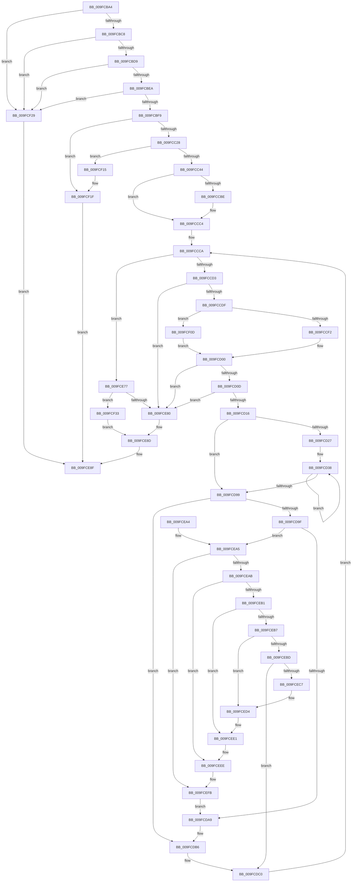

# EtwpAllocateEventNameFilter

- RVA: `0x009FCBA4`–`0x009FCF40` (길이 `924` bytes)
- VA: `0x00000001409FCBA4`
- 실행 섹션: `PAGE`
- PDB 이름 있음: `예`; PDB Function 태그: `아니요`
- unwind 정보 RVA: `0x000A7210`
- 디코드: `256`개 명령, `924/924` bytes 표시
- 미해석 바이트: `0` (있으면 어셈블리에 `.byte`로 보존)

> 이 문서는 커널 이미지의 기계어와 PDB 기호를 분석해 생성했습니다. 4번과 5번은 함수 원형과 자료형을 바이너리 사용 방식에서 추정한 C 해석이며 원본 소스 복구 결과는 아닙니다.

## 1. Dependencies

- 직접 호출 지점: **6**; 고유 호출 대상: **5**
- 직접 호출자로 확인된 함수: **1**
- RIP 상대 이미지 참조: **0**

### Outgoing calls
- `0x009FCC17` → [ExAllocatePool2](../../poolcode/B8/ExAllocatePool2_function_00B820F0.md) (function, `0x00B820F0`)
- `0x009FCC33` → [ExAllocatePool2](../../poolcode/B8/ExAllocatePool2_function_00B820F0.md) (function, `0x00B820F0`)
- `0x009FCC8A` → [memcpy](../../text/6C/memcpy_function_006C6840.md) (function, `0x006C6840`)
- `0x009FCCF7` → [strnlen](../../text/50/strnlen_function_00501590.md) (function, `0x00501590`)
- `0x009FCE88` → [EtwpFreeEventNameFilter](EtwpFreeEventNameFilter_function_009FD69C.md) (function, `0x009FD69C`)
- `0x009FCF1A` → [ExFreePoolWithTag](../../poolcode/B8/ExFreePoolWithTag_function_00B82870.md) (function, `0x00B82870`)

### Direct callers
- [EtwpAllocateFilter](EtwpAllocateFilter_function_009FC948.md) at `0x009FC9BD`
- [EtwpAllocateFilter](EtwpAllocateFilter_function_009FC948.md) at `0x009FCB5D`

### Static image references
- 디코드된 RIP-relative 메모리 참조가 없습니다.

## 2. Other-region calls and transfers

- 다른 실행 섹션으로 향하는 call: **5**
  - `0x009FCC17` → [ExAllocatePool2](../../poolcode/B8/ExAllocatePool2_function_00B820F0.md) (`PAGE` → `POOLCODE`)
  - `0x009FCC33` → [ExAllocatePool2](../../poolcode/B8/ExAllocatePool2_function_00B820F0.md) (`PAGE` → `POOLCODE`)
  - `0x009FCC8A` → [memcpy](../../text/6C/memcpy_function_006C6840.md) (`PAGE` → `.text`)
  - `0x009FCCF7` → [strnlen](../../text/50/strnlen_function_00501590.md) (`PAGE` → `.text`)
  - `0x009FCF1A` → [ExFreePoolWithTag](../../poolcode/B8/ExFreePoolWithTag_function_00B82870.md) (`PAGE` → `POOLCODE`)
- 별도 외부 분기/꼬리 이동을 확인하지 못했습니다.

## 3. Assembly (complete function range)

```asm
009FCBA4  48 89 5C 24 08                  mov qword ptr [rsp + 8], rbx
009FCBA9  48 89 54 24 10                  mov qword ptr [rsp + 0x10], rdx
009FCBAE  55                              push rbp
009FCBAF  56                              push rsi
009FCBB0  57                              push rdi
009FCBB1  41 54                           push r12
009FCBB3  41 55                           push r13
009FCBB5  41 56                           push r14
009FCBB7  41 57                           push r15
009FCBB9  48 83 EC 20                     sub rsp, 0x20
009FCBBD  33 DB                           xor ebx, ebx
009FCBBF  48 39 1A                        cmp qword ptr [rdx], rbx
009FCBC2  0F 85 61 03 00 00               jne 0x1409fcf29
009FCBC8  8B 69 08                        mov ebp, dword ptr [rcx + 8]
009FCBCB  8D 45 E8                        lea eax, [rbp - 0x18]
009FCBCE  3D E8 0F 00 00                  cmp eax, 0xfe8
009FCBD3  0F 87 50 03 00 00               ja 0x1409fcf29
009FCBD9  48 8B 39                        mov rdi, qword ptr [rcx]
009FCBDC  44 0F B7 77 12                  movzx r14d, word ptr [rdi + 0x12]
009FCBE1  45 85 F6                        test r14d, r14d
009FCBE4  0F 84 3F 03 00 00               je 0x1409fcf29
009FCBEA  83 C5 EC                        add ebp, -0x14
009FCBED  43 8D 04 36                     lea eax, [r14 + r14]
009FCBF1  3B E8                           cmp ebp, eax
009FCBF3  0F 82 30 03 00 00               jb 0x1409fcf29
009FCBF9  47 8D 2C 76                     lea r13d, [r14 + r14*2]
009FCBFD  44 8B E5                        mov r12d, ebp
009FCC00  41 C1 E5 03                     shl r13d, 3
009FCC04  48 8D 55 28                     lea rdx, [rbp + 0x28]
009FCC08  41 BF 45 74 77 46               mov r15d, 0x46777445
009FCC0E  8D 4B 40                        lea ecx, [rbx + 0x40]
009FCC11  49 03 D5                        add rdx, r13
009FCC14  45 8B C7                        mov r8d, r15d
009FCC17  E8 D4 54 18 00                  call 0x140b820f0
009FCC1C  48 8B F0                        mov rsi, rax
009FCC1F  48 85 C0                        test rax, rax
009FCC22  0F 84 F7 02 00 00               je 0x1409fcf1f
009FCC28  45 8B C7                        mov r8d, r15d
009FCC2B  8D 4B 40                        lea ecx, [rbx + 0x40]
009FCC2E  BA 00 01 00 00                  mov edx, 0x100
009FCC33  E8 B8 54 18 00                  call 0x140b820f0
009FCC38  4C 8B F8                        mov r15, rax
009FCC3B  48 85 C0                        test rax, rax
009FCC3E  0F 84 D1 02 00 00               je 0x1409fcf15
009FCC44  8A 47 11                        mov al, byte ptr [rdi + 0x11]
009FCC47  48 8D 57 14                     lea rdx, [rdi + 0x14]
009FCC4B  88 06                           mov byte ptr [rsi], al
009FCC4D  B9 FF 00 00 00                  mov ecx, 0xff
009FCC52  0F B6 47 10                     movzx eax, byte ptr [rdi + 0x10]
009FCC56  45 8B C4                        mov r8d, r12d
009FCC59  84 C0                           test al, al
009FCC5B  0F 44 C1                        cmove eax, ecx
009FCC5E  48 83 C9 FF                     or rcx, 0xffffffffffffffff
009FCC62  88 46 01                        mov byte ptr [rsi + 1], al
009FCC65  48 8B 07                        mov rax, qword ptr [rdi]
009FCC68  48 85 C0                        test rax, rax
009FCC6B  48 0F 44 C1                     cmove rax, rcx
009FCC6F  48 89 46 08                     mov qword ptr [rsi + 8], rax
009FCC73  48 8B 47 08                     mov rax, qword ptr [rdi + 8]
009FCC77  48 89 46 10                     mov qword ptr [rsi + 0x10], rax
009FCC7B  49 8D 45 28                     lea rax, [r13 + 0x28]
009FCC7F  48 03 C6                        add rax, rsi
009FCC82  48 8B C8                        mov rcx, rax
009FCC85  48 89 44 24 78                  mov qword ptr [rsp + 0x78], rax
009FCC8A  E8 B1 9B CC FF                  call 0x1406c6840
009FCC8F  4C 8D 5E 18                     lea r11, [rsi + 0x18]
009FCC93  49 8D 8F 00 01 00 00            lea rcx, [r15 + 0x100]
009FCC9A  41 89 1B                        mov dword ptr [r11], ebx
009FCC9D  49 8B C3                        mov rax, r11
009FCCA0  4D 89 7B 08                     mov qword ptr [r11 + 8], r15
009FCCA4  48 83 C8 01                     or rax, 1
009FCCA8  41 C7 43 04 00 04 00 00         mov dword ptr [r11 + 4], 0x400
009FCCB0  49 3B CF                        cmp rcx, r15
009FCCB3  48 1B C9                        sbb rcx, rcx
009FCCB6  48 F7 D1                        not rcx
009FCCB9  83 E1 20                        and ecx, 0x20
009FCCBC  76 06                           jbe 0x1409fccc4
009FCCBE  49 8B FF                        mov rdi, r15
009FCCC1  F3 48 AB                        rep stosq qword ptr [rdi], rax
009FCCC4  44 8B FB                        mov r15d, ebx
009FCCC7  44 8B EB                        mov r13d, ebx
009FCCCA  45 3B EE                        cmp r13d, r14d
009FCCCD  0F 83 A4 01 00 00               jae 0x1409fce77
009FCCD3  8D 45 FF                        lea eax, [rbp - 1]
009FCCD6  44 3B F8                        cmp r15d, eax
009FCCD9  0F 83 A1 01 00 00               jae 0x1409fce80
009FCCDF  8B FD                           mov edi, ebp
009FCCE1  45 8B E7                        mov r12d, r15d
009FCCE4  41 2B FF                        sub edi, r15d
009FCCE7  4C 03 64 24 78                  add r12, qword ptr [rsp + 0x78]
009FCCEC  0F 84 1B 02 00 00               je 0x1409fcf0d
009FCCF2  8B D7                           mov edx, edi
009FCCF4  49 8B CC                        mov rcx, r12
009FCCF7  E8 94 48 B0 FF                  call 0x140501590
009FCCFC  4C 8D 5E 18                     lea r11, [rsi + 0x18]
009FCD00  44 8D 50 01                     lea r10d, [rax + 1]
009FCD04  44 3B D7                        cmp r10d, edi
009FCD07  0F 87 73 01 00 00               ja 0x1409fce80
009FCD0D  45 85 D2                        test r10d, r10d
009FCD10  0F 84 6A 01 00 00               je 0x1409fce80
009FCD16  44 8B C0                        mov r8d, eax
009FCD19  49 8B FC                        mov rdi, r12
009FCD1C  BA 2F CB 04 00                  mov edx, 0x4cb2f
009FCD21  49 83 F8 08                     cmp r8, 8
009FCD25  72 72                           jb 0x1409fcd99
009FCD27  45 8B C8                        mov r9d, r8d
009FCD2A  49 C1 E9 03                     shr r9, 3
009FCD2E  49 8B C1                        mov rax, r9
009FCD31  48 F7 D8                        neg rax
009FCD34  4D 8D 04 C0                     lea r8, [r8 + rax*8]
009FCD38  0F B6 07                        movzx eax, byte ptr [rdi]
009FCD3B  48 6B CA 25                     imul rcx, rdx, 0x25
009FCD3F  48 03 C8                        add rcx, rax
009FCD42  0F B6 47 01                     movzx eax, byte ptr [rdi + 1]
009FCD46  48 6B D1 25                     imul rdx, rcx, 0x25
009FCD4A  48 03 D0                        add rdx, rax
009FCD4D  0F B6 47 02                     movzx eax, byte ptr [rdi + 2]
009FCD51  48 6B CA 25                     imul rcx, rdx, 0x25
009FCD55  48 03 C8                        add rcx, rax
009FCD58  0F B6 47 03                     movzx eax, byte ptr [rdi + 3]
009FCD5C  48 6B D1 25                     imul rdx, rcx, 0x25
009FCD60  48 03 D0                        add rdx, rax
009FCD63  0F B6 47 04                     movzx eax, byte ptr [rdi + 4]
009FCD67  48 6B CA 25                     imul rcx, rdx, 0x25
009FCD6B  48 03 C8                        add rcx, rax
009FCD6E  0F B6 47 05                     movzx eax, byte ptr [rdi + 5]
009FCD72  48 6B D1 25                     imul rdx, rcx, 0x25
009FCD76  48 03 D0                        add rdx, rax
009FCD79  0F B6 47 06                     movzx eax, byte ptr [rdi + 6]
009FCD7D  48 6B CA 25                     imul rcx, rdx, 0x25
009FCD81  48 03 C8                        add rcx, rax
009FCD84  0F B6 47 07                     movzx eax, byte ptr [rdi + 7]
009FCD88  48 6B D1 25                     imul rdx, rcx, 0x25
009FCD8C  48 83 C7 08                     add rdi, 8
009FCD90  48 03 D0                        add rdx, rax
009FCD93  49 83 E9 01                     sub r9, 1
009FCD97  75 9F                           jne 0x1409fcd38
009FCD99  49 83 E8 01                     sub r8, 1
009FCD9D  74 17                           je 0x1409fcdb6
009FCD9F  49 83 E8 01                     sub r8, 1
009FCDA3  0F 85 FC 00 00 00               jne 0x1409fcea5
009FCDA9  0F B6 07                        movzx eax, byte ptr [rdi]
009FCDAC  48 6B D2 25                     imul rdx, rdx, 0x25
009FCDB0  48 03 D0                        add rdx, rax
009FCDB3  48 FF C7                        inc rdi
009FCDB6  0F B6 07                        movzx eax, byte ptr [rdi]
009FCDB9  48 6B D2 25                     imul rdx, rdx, 0x25
009FCDBD  48 03 D0                        add rdx, rax
009FCDC0  41 8B C5                        mov eax, r13d
009FCDC3  45 03 FA                        add r15d, r10d
009FCDC6  4C 8D 04 45 05 00 00 00         lea r8, [rax*2 + 5]
009FCDCE  4C 03 C0                        add r8, rax
009FCDD1  48 83 C8 FF                     or rax, 0xffffffffffffffff
009FCDD5  4E 8D 04 C6                     lea r8, [rsi + r8*8]
009FCDD9  49 89 50 08                     mov qword ptr [r8 + 8], rdx
009FCDDD  4D 89 60 10                     mov qword ptr [r8 + 0x10], r12
009FCDE1  41 8B 4B 04                     mov ecx, dword ptr [r11 + 4]
009FCDE5  8B F9                           mov edi, ecx
009FCDE7  83 E1 1F                        and ecx, 0x1f
009FCDEA  C1 EF 05                        shr edi, 5
009FCDED  48 D3 E0                        shl rax, cl
009FCDF0  48 23 C2                        and rax, rdx
009FCDF3  48 89 44 24 70                  mov qword ptr [rsp + 0x70], rax
009FCDF8  0F B6 C0                        movzx eax, al
009FCDFB  48 05 CB 5D B1 00               add rax, 0xb15dcb
009FCE01  48 6B C8 25                     imul rcx, rax, 0x25
009FCE05  0F B6 44 24 71                  movzx eax, byte ptr [rsp + 0x71]
009FCE0A  48 03 C8                        add rcx, rax
009FCE0D  0F B6 44 24 72                  movzx eax, byte ptr [rsp + 0x72]
009FCE12  48 6B D1 25                     imul rdx, rcx, 0x25
009FCE16  48 03 D0                        add rdx, rax
009FCE19  0F B6 44 24 73                  movzx eax, byte ptr [rsp + 0x73]
009FCE1E  48 6B CA 25                     imul rcx, rdx, 0x25
009FCE22  48 03 C8                        add rcx, rax
009FCE25  0F B6 44 24 74                  movzx eax, byte ptr [rsp + 0x74]
009FCE2A  48 6B D1 25                     imul rdx, rcx, 0x25
009FCE2E  48 03 D0                        add rdx, rax
009FCE31  0F B6 44 24 75                  movzx eax, byte ptr [rsp + 0x75]
009FCE36  48 6B CA 25                     imul rcx, rdx, 0x25
009FCE3A  48 03 C8                        add rcx, rax
009FCE3D  0F B6 44 24 76                  movzx eax, byte ptr [rsp + 0x76]
009FCE42  48 6B D1 25                     imul rdx, rcx, 0x25
009FCE46  48 03 D0                        add rdx, rax
009FCE49  0F B6 44 24 77                  movzx eax, byte ptr [rsp + 0x77]
009FCE4E  48 6B CA 25                     imul rcx, rdx, 0x25
009FCE52  8D 57 FF                        lea edx, [rdi - 1]
009FCE55  48 03 C1                        add rax, rcx
009FCE58  49 8B 4B 08                     mov rcx, qword ptr [r11 + 8]
009FCE5C  8B C0                           mov eax, eax
009FCE5E  48 23 D0                        and rdx, rax
009FCE61  48 8B 04 D1                     mov rax, qword ptr [rcx + rdx*8]
009FCE65  49 89 00                        mov qword ptr [r8], rax
009FCE68  4C 89 04 D1                     mov qword ptr [rcx + rdx*8], r8
009FCE6C  41 FF 03                        inc dword ptr [r11]
009FCE6F  41 FF C5                        inc r13d
009FCE72  E9 53 FE FF FF                  jmp 0x1409fccca
009FCE77  44 3B FD                        cmp r15d, ebp
009FCE7A  0F 84 B3 00 00 00               je 0x1409fcf33
009FCE80  BB 0D 00 00 C0                  mov ebx, 0xc000000d
009FCE85  48 8B CE                        mov rcx, rsi
009FCE88  E8 0F 08 00 00                  call 0x1409fd69c
009FCE8D  8B C3                           mov eax, ebx
009FCE8F  48 8B 5C 24 60                  mov rbx, qword ptr [rsp + 0x60]
009FCE94  48 83 C4 20                     add rsp, 0x20
009FCE98  41 5F                           pop r15
009FCE9A  41 5E                           pop r14
009FCE9C  41 5D                           pop r13
009FCE9E  41 5C                           pop r12
009FCEA0  5F                              pop rdi
009FCEA1  5E                              pop rsi
009FCEA2  5D                              pop rbp
009FCEA3  C3                              ret
009FCEA4  CC                              int3
009FCEA5  49 83 E8 01                     sub r8, 1
009FCEA9  74 50                           je 0x1409fcefb
009FCEAB  49 83 E8 01                     sub r8, 1
009FCEAF  74 3D                           je 0x1409fceee
009FCEB1  49 83 E8 01                     sub r8, 1
009FCEB5  74 2A                           je 0x1409fcee1
009FCEB7  49 83 E8 01                     sub r8, 1
009FCEBB  74 17                           je 0x1409fced4
009FCEBD  49 83 F8 01                     cmp r8, 1
009FCEC1  0F 85 F9 FE FF FF               jne 0x1409fcdc0
009FCEC7  0F B6 07                        movzx eax, byte ptr [rdi]
009FCECA  48 6B D2 25                     imul rdx, rdx, 0x25
009FCECE  48 03 D0                        add rdx, rax
009FCED1  48 FF C7                        inc rdi
009FCED4  0F B6 07                        movzx eax, byte ptr [rdi]
009FCED7  48 6B D2 25                     imul rdx, rdx, 0x25
009FCEDB  48 03 D0                        add rdx, rax
009FCEDE  48 FF C7                        inc rdi
009FCEE1  0F B6 07                        movzx eax, byte ptr [rdi]
009FCEE4  48 6B D2 25                     imul rdx, rdx, 0x25
009FCEE8  48 03 D0                        add rdx, rax
009FCEEB  48 FF C7                        inc rdi
009FCEEE  0F B6 07                        movzx eax, byte ptr [rdi]
009FCEF1  48 6B D2 25                     imul rdx, rdx, 0x25
009FCEF5  48 03 D0                        add rdx, rax
009FCEF8  48 FF C7                        inc rdi
009FCEFB  0F B6 07                        movzx eax, byte ptr [rdi]
009FCEFE  48 6B D2 25                     imul rdx, rdx, 0x25
009FCF02  48 03 D0                        add rdx, rax
009FCF05  48 FF C7                        inc rdi
009FCF08  E9 9C FE FF FF                  jmp 0x1409fcda9
009FCF0D  48 8B C3                        mov rax, rbx
009FCF10  E9 EB FD FF FF                  jmp 0x1409fcd00
009FCF15  33 D2                           xor edx, edx
009FCF17  48 8B CE                        mov rcx, rsi
009FCF1A  E8 51 59 18 00                  call 0x140b82870
009FCF1F  B8 17 00 00 C0                  mov eax, 0xc0000017
009FCF24  E9 66 FF FF FF                  jmp 0x1409fce8f
009FCF29  B8 0D 00 00 C0                  mov eax, 0xc000000d
009FCF2E  E9 5C FF FF FF                  jmp 0x1409fce8f
009FCF33  48 8B 44 24 68                  mov rax, qword ptr [rsp + 0x68]
009FCF38  48 89 30                        mov qword ptr [rax], rsi
009FCF3B  E9 4D FF FF FF                  jmp 0x1409fce8d
```

## 4. C-style interpretation (structured pseudocode)

```c
__int64 __fastcall EtwpAllocateEventNameFilter(__int64 a1, __int64 a2)
{
    __int64 result;
    __int64 v_r12;
    __int64 v_r13;
    __int64 v_r15;
    __int64 v_rbp;
    __int64 v_rbx;
    __int64 v_rdi;
    __int64 v_rsp;
    unsigned __int64 v_stack_p10;
    unsigned __int64 v_stack_p18;
    unsigned __int8 v_stack_p19;
    unsigned __int8 v_stack_p1A;
    unsigned __int8 v_stack_p1B;
    unsigned __int8 v_stack_p1C;
    unsigned __int8 v_stack_p1D;
    unsigned __int8 v_stack_p1E;
    unsigned __int8 v_stack_p1F;
    unsigned __int64 v_stack_p20;
    unsigned __int64 v_stack_p68;
    unsigned __int64 v_stack_p8;

    v_stack_p8 = v_rbx;
    v_stack_p10 = a2;
    v_rsp = (v_rsp) - (32);
    v_rbx = 0;
    if ((*(unsigned __int64 *)(a2)) != 0) goto loc_009FCF29;
    if (((unsigned int)((unsigned int)(*(unsigned int *)(a1 + 8)) - 24)) > 0xFE8ULL) goto loc_009FCF29;
    if ((unsigned int)(*(unsigned __int16 *)(*(unsigned __int64 *)(a1) + 18)) == 0) goto loc_009FCF29;
    v_rbp = (unsigned int)(((unsigned int)(*(unsigned int *)(a1 + 8))) + (-20));
    if (((unsigned int)(v_rbp)) < ((unsigned int)(*(unsigned __int16 *)(*(unsigned __int64 *)(a1) + 18) + *(unsigned __int16 *)(*(unsigned __int64 *)(a1) + 18) * 1))) goto loc_009FCF29;
    v_r13 = (unsigned int)((*(unsigned __int16 *)(*(unsigned __int64 *)(a1) + 18) + *(unsigned __int16 *)(*(unsigned __int64 *)(a1) + 18) * 2) << (3));
    a2 = (v_rbp + 40) + (v_r13);
    result = ExAllocatePool2(v_rbx + 64, a2, (unsigned int)((unsigned int)((unsigned int)(0x46777445ULL))), a4);
    if (result == 0) goto loc_009FCF1F;
    result = ExAllocatePool2(v_rbx + 64, 256, (unsigned int)((unsigned int)((unsigned int)(0x46777445ULL))), a4);
    if (result == 0) goto loc_009FCF15;
    *(unsigned __int8 *)(result) = (unsigned __int8)(*(unsigned __int8 *)(*(unsigned __int64 *)(a1) + 17));
    result = *(unsigned __int8 *)(*(unsigned __int64 *)(a1) + 16);
    if ((unsigned __int8)(*(unsigned __int8 *)(*(unsigned __int64 *)(a1) + 16)) == 0) { result = 255; }
    a1 = (255) | (-1);
    *(unsigned __int8 *)(result + 1) = (unsigned __int8)(result);
    result = *(unsigned __int64 *)(*(unsigned __int64 *)(a1));
    if (*(unsigned __int64 *)(*(unsigned __int64 *)(a1)) == 0) { result = a1; }
    *(unsigned __int64 *)(result + 8) = result;
    *(unsigned __int64 *)(result + 16) = *(unsigned __int64 *)(*(unsigned __int64 *)(a1) + 8);
    result = (v_r13 + 40) + (result);
    v_stack_p20 = result;
    result = memcpy(result, *(unsigned __int64 *)(a1) + 20, (unsigned int)((unsigned int)((unsigned int)((unsigned int)(v_rbp)))), a4);
    *(unsigned int *)(result + 24) = 0;
    *(unsigned __int64 *)(result + 24 + 8) = result;
    result = (result + 24) | (1);
    *(unsigned int *)(result + 24 + 4) = 0x400ULL;
    a1 = ~(result + 256);
    a1 = (unsigned int)((a1) & (32));
    v_rdi = *(unsigned __int64 *)(a1);
    if (!(condition_is_below_or_equal)) {
        v_rdi = result;
    }
loc_009FCCCA:
    if (0 >= ((unsigned int)(*(unsigned __int16 *)(*(unsigned __int64 *)(a1) + 18)))) goto loc_009FCE77;
    if (0 >= ((unsigned int)(v_rbp - 1))) goto loc_009FCE80;
    v_rdi = (unsigned int)(((unsigned int)((unsigned int)(v_rbp))) - (0));
    v_r12 = (0) + (v_stack_p20);
    if (condition_is_equal) goto loc_009FCF0D;
    result = strnlen(v_r12, (unsigned int)((unsigned int)(v_rdi)), (unsigned int)((unsigned int)((unsigned int)((unsigned int)(v_rbp)))), a4);
loc_009FCD00:
    if (((unsigned int)(result + 1)) > ((unsigned int)(v_rdi))) goto loc_009FCE80;
    if ((unsigned int)(result + 1) == 0) goto loc_009FCE80;
    if (((unsigned int)((unsigned int)(result))) < 8) goto loc_009FCD99;
    a4 = ((unsigned int)((unsigned int)((unsigned int)((unsigned int)(result))))) >> (3);
    result = -(a4);
loc_009FCD38:
    a1 = (v_r12) * ((unsigned int)(0x4CB2FULL));
    a1 = (a1) + (*(unsigned __int8 *)(v_r12));
    a2 = ((unsigned int)(0x4CB2FULL)) * (a1);
    a2 = (a2) + (*(unsigned __int8 *)(v_r12 + 1));
    a1 = (a1) * (a2);
    a1 = (a1) + (*(unsigned __int8 *)(v_r12 + 2));
    a2 = (a2) * (a1);
    a2 = (a2) + (*(unsigned __int8 *)(v_r12 + 3));
    a1 = (a1) * (a2);
    a1 = (a1) + (*(unsigned __int8 *)(v_r12 + 4));
    a2 = (a2) * (a1);
    a2 = (a2) + (*(unsigned __int8 *)(v_r12 + 5));
    a1 = (a1) * (a2);
    a1 = (a1) + (*(unsigned __int8 *)(v_r12 + 6));
    a2 = (a2) * (a1);
    v_rdi = (v_r12) + (8);
    a2 = (a2) + (*(unsigned __int8 *)(v_r12 + 7));
    a4 = (a4) - (1);
    if (condition_is_not_equal) goto loc_009FCD38;
loc_009FCD99:
    a3 = ((unsigned int)((unsigned int)(result)) + result * 8) - (1);
    if (condition_is_equal) goto loc_009FCDB6;
    a3 = (a3) - (1);
    if (condition_is_not_equal) goto loc_009FCEA5;
loc_009FCDA9:
    a2 = (a2) * (a2);
    a2 = (a2) + (*(unsigned __int8 *)(v_rdi));
    v_rdi = (v_rdi) + 1;
loc_009FCDB6:
    a2 = (a2) * (a2);
    a2 = (a2) + (*(unsigned __int8 *)(v_rdi));
loc_009FCDC0:
    v_r15 = (unsigned int)((0) + ((unsigned int)(result + 1)));
    a3 = (0 * 2 + 5) + (0);
    result = (0) | (-1);
    *(unsigned __int64 *)(result + a3 * 8 + 8) = a2;
    *(unsigned __int64 *)(result + a3 * 8 + 16) = v_r12;
    a1 = (unsigned int)(((unsigned int)(*(unsigned int *)(result + 24 + 4))) & (31));
    v_rdi = (unsigned int)(((unsigned int)((unsigned int)((unsigned int)(*(unsigned int *)(result + 24 + 4))))) >> (5));
    result = (result) << ((unsigned __int8)(a1));
    result = (result) & (a2);
    v_stack_p18 = result;
    result = ((unsigned __int8)(result)) + (0xB15DCBULL);
    a1 = (a1) * (result);
    a1 = (a1) + (v_stack_p19);
    a2 = (a2) * (a1);
    a2 = (a2) + (v_stack_p1A);
    a1 = (a1) * (a2);
    a1 = (a1) + (v_stack_p1B);
    a2 = (a2) * (a1);
    a2 = (a2) + (v_stack_p1C);
    a1 = (a1) * (a2);
    a1 = (a1) + (v_stack_p1D);
    a2 = (a2) * (a1);
    a2 = (a2) + (v_stack_p1E);
    a1 = (a1) * (a2);
    result = (v_stack_p1F) + (a1);
    a2 = (v_rdi - 1) & ((unsigned int)((unsigned int)(result)));
    *(unsigned __int64 *)(result + a3 * 8) = *(unsigned __int64 *)(*(unsigned __int64 *)(result + 24 + 8) + a2 * 8);
    *(unsigned __int64 *)(*(unsigned __int64 *)(result + 24 + 8) + a2 * 8) = result + a3 * 8;
    v_r13 = (unsigned int)((0) + 1);
    goto loc_009FCCCA;
loc_009FCE77:
    if (((unsigned int)(v_r15)) == ((unsigned int)(v_rbp))) goto loc_009FCF33;
loc_009FCE80:
    result = EtwpFreeEventNameFilter(result, a2, result + a3 * 8, a4);
loc_009FCE8D:
loc_009FCE8F:
    v_rsp = (v_rsp) + (32);
    return (unsigned int)((unsigned int)((unsigned int)(0xC000000DULL)));
loc_009FCEA5:
    a3 = (result + a3 * 8) - (1);
    if (condition_is_equal) goto loc_009FCEFB;
    a3 = (a3) - (1);
    if (condition_is_equal) goto loc_009FCEEE;
    a3 = (a3) - (1);
    if (condition_is_equal) goto loc_009FCEE1;
    a3 = (a3) - (1);
    if (condition_is_equal) goto loc_009FCED4;
    if (a3 != 1) goto loc_009FCDC0;
    a2 = (a2) * (a2);
    a2 = (a2) + (*(unsigned __int8 *)(v_rdi));
    v_rdi = (v_rdi) + 1;
loc_009FCED4:
    a2 = (a2) * (a2);
    a2 = (a2) + (*(unsigned __int8 *)(v_rdi));
    v_rdi = (v_rdi) + 1;
loc_009FCEE1:
    a2 = (a2) * (a2);
    a2 = (a2) + (*(unsigned __int8 *)(v_rdi));
    v_rdi = (v_rdi) + 1;
loc_009FCEEE:
    a2 = (a2) * (a2);
    a2 = (a2) + (*(unsigned __int8 *)(v_rdi));
    v_rdi = (v_rdi) + 1;
loc_009FCEFB:
    a2 = (a2) * (a2);
    a2 = (a2) + (*(unsigned __int8 *)(v_rdi));
    v_rdi = (v_rdi) + 1;
    goto loc_009FCDA9;
loc_009FCF0D:
    goto loc_009FCD00;
loc_009FCF15:
    a2 = 0;
    result = ExFreePoolWithTag(result, a2, a3, a4);
loc_009FCF1F:
    goto loc_009FCE8F;
loc_009FCF29:
    goto loc_009FCE8F;
loc_009FCF33:
    *(unsigned __int64 *)(v_stack_p68) = result;
    goto loc_009FCE8D;
}
```

## 5. (Beta) C Style

```c
int64_t EtwpAllocateEventNameFilter(void *Arg1, void *Arg2)
{
    uint8_t *arg1 = (uint8_t *)Arg1;
    uint8_t *arg2 = (uint8_t *)Arg2;

    int64_t result;
    int64_t local_r12;
    int64_t local_r13;
    int64_t local_r15;
    int64_t local_rbp;
    int64_t local_rbx;
    int64_t local_rdi;
    int64_t local_rsp;
    uint64_t v_stack_p10;
    uint64_t v_stack_p18;
    uint8_t v_stack_p19;
    uint8_t v_stack_p1A;
    uint8_t v_stack_p1B;
    uint8_t v_stack_p1C;
    uint8_t v_stack_p1D;
    uint8_t v_stack_p1E;
    uint8_t v_stack_p1F;
    uint64_t v_stack_p20;
    uint64_t v_stack_p68;
    uint64_t v_stack_p8;

    v_stack_p8 = local_rbx;
    v_stack_p10 = Arg2;
    local_rsp = (local_rsp) - (32);
    local_rbx = 0;
    if ((*(uint64_t *)(arg2)) != 0) goto loc_009FCF29;
    if (((uint32_t)((uint32_t)(*(uint32_t *)(arg1 + 0x8)) - 24)) > 0xFE8ULL) goto loc_009FCF29;
    if ((uint32_t)(*(uint16_t *)(*(uint64_t *)(arg1) + 0x12)) == 0) goto loc_009FCF29;
    local_rbp = (uint32_t)(((uint32_t)(*(uint32_t *)(arg1 + 0x8))) + (-20));
    if (((uint32_t)(local_rbp)) < ((uint32_t)(*(uint16_t *)(*(uint64_t *)(arg1) + 0x12) + *(uint16_t *)(*(uint64_t *)(arg1) + 0x12) * 1))) goto loc_009FCF29;
    local_r13 = (uint32_t)((*(uint16_t *)(*(uint64_t *)(arg1) + 0x12) + *(uint16_t *)(*(uint64_t *)(arg1) + 0x12) * 2) << (3));
    Arg2 = (local_rbp + 40) + (local_r13);
    result = ExAllocatePool2(local_rbx + 64, Arg2, (uint32_t)((uint32_t)((uint32_t)(0x46777445ULL))), a4);
    if (result == 0) goto loc_009FCF1F;
    result = ExAllocatePool2(local_rbx + 64, 256, (uint32_t)((uint32_t)((uint32_t)(0x46777445ULL))), a4);
    if (result == 0) goto loc_009FCF15;
    *(uint8_t *)(result) = (uint8_t)(*(uint8_t *)(*(uint64_t *)(arg1) + 0x11));
    result = *(uint8_t *)(*(uint64_t *)(arg1) + 0x10);
    if ((uint8_t)(*(uint8_t *)(*(uint64_t *)(arg1) + 0x10)) == 0) { result = 255; }
    Arg1 = (255) | (-1);
    *(uint8_t *)(result + 0x1) = (uint8_t)(result);
    result = *(uint64_t *)(*(uint64_t *)(arg1));
    if (*(uint64_t *)(*(uint64_t *)(arg1)) == 0) { result = Arg1; }
    *(uint64_t *)(result + 0x8) = result;
    *(uint64_t *)(result + 0x10) = *(uint64_t *)(*(uint64_t *)(arg1) + 0x8);
    result = (local_r13 + 40) + (result);
    v_stack_p20 = result;
    result = memcpy(result, *(uint64_t *)(arg1) + 20, (uint32_t)((uint32_t)((uint32_t)((uint32_t)(local_rbp)))), a4);
    *(uint32_t *)(result + 0x18) = 0;
    *(uint64_t *)(result + 0x18 + 0x8) = result;
    result = (result + 24) | (1);
    *(uint32_t *)(result + 0x18 + 0x4) = 0x400ULL;
    Arg1 = ~(result + 256);
    Arg1 = (uint32_t)((Arg1) & (32));
    local_rdi = *(uint64_t *)(arg1);
    if (!(condition_is_below_or_equal)) {
        local_rdi = result;
    }
loc_009FCCCA:
    if (0 >= ((uint32_t)(*(uint16_t *)(*(uint64_t *)(arg1) + 0x12)))) goto loc_009FCE77;
    if (0 >= ((uint32_t)(local_rbp - 1))) goto loc_009FCE80;
    local_rdi = (uint32_t)(((uint32_t)((uint32_t)(local_rbp))) - (0));
    local_r12 = (0) + (v_stack_p20);
    if (condition_is_equal) goto loc_009FCF0D;
    result = strnlen(local_r12, (uint32_t)((uint32_t)(local_rdi)), (uint32_t)((uint32_t)((uint32_t)((uint32_t)(local_rbp)))), a4);
loc_009FCD00:
    if (((uint32_t)(result + 1)) > ((uint32_t)(local_rdi))) goto loc_009FCE80;
    if ((uint32_t)(result + 1) == 0) goto loc_009FCE80;
    if (((uint32_t)((uint32_t)(result))) < 8) goto loc_009FCD99;
    a4 = ((uint32_t)((uint32_t)((uint32_t)((uint32_t)(result))))) >> (3);
    result = -(a4);
loc_009FCD38:
    Arg1 = (local_r12) * ((uint32_t)(0x4CB2FULL));
    Arg1 = (Arg1) + (*(uint8_t *)(local_r12));
    Arg2 = ((uint32_t)(0x4CB2FULL)) * (Arg1);
    Arg2 = (Arg2) + (*(uint8_t *)(local_r12 + 0x1));
    Arg1 = (Arg1) * (Arg2);
    Arg1 = (Arg1) + (*(uint8_t *)(local_r12 + 0x2));
    Arg2 = (Arg2) * (Arg1);
    Arg2 = (Arg2) + (*(uint8_t *)(local_r12 + 0x3));
    Arg1 = (Arg1) * (Arg2);
    Arg1 = (Arg1) + (*(uint8_t *)(local_r12 + 0x4));
    Arg2 = (Arg2) * (Arg1);
    Arg2 = (Arg2) + (*(uint8_t *)(local_r12 + 0x5));
    Arg1 = (Arg1) * (Arg2);
    Arg1 = (Arg1) + (*(uint8_t *)(local_r12 + 0x6));
    Arg2 = (Arg2) * (Arg1);
    local_rdi = (local_r12) + (8);
    Arg2 = (Arg2) + (*(uint8_t *)(local_r12 + 0x7));
    a4 = (a4) - (1);
    if (condition_is_not_equal) goto loc_009FCD38;
loc_009FCD99:
    a3 = ((uint32_t)((uint32_t)(result)) + result * 8) - (1);
    if (condition_is_equal) goto loc_009FCDB6;
    a3 = (a3) - (1);
    if (condition_is_not_equal) goto loc_009FCEA5;
loc_009FCDA9:
    Arg2 = (Arg2) * (Arg2);
    Arg2 = (Arg2) + (*(uint8_t *)(local_rdi));
    local_rdi = (local_rdi) + 1;
loc_009FCDB6:
    Arg2 = (Arg2) * (Arg2);
    Arg2 = (Arg2) + (*(uint8_t *)(local_rdi));
loc_009FCDC0:
    local_r15 = (uint32_t)((0) + ((uint32_t)(result + 1)));
    a3 = (0 * 2 + 5) + (0);
    result = (0) | (-1);
    *(void **)(result + a3 * 8 + 0x8) = Arg2;
    *(uint64_t *)(result + a3 * 8 + 0x10) = local_r12;
    Arg1 = (uint32_t)(((uint32_t)(*(uint32_t *)(result + 0x18 + 0x4))) & (31));
    local_rdi = (uint32_t)(((uint32_t)((uint32_t)((uint32_t)(*(uint32_t *)(result + 0x18 + 0x4))))) >> (5));
    result = (result) << ((uint8_t)(Arg1));
    result = (result) & (Arg2);
    v_stack_p18 = result;
    result = ((uint8_t)(result)) + (0xB15DCBULL);
    Arg1 = (Arg1) * (result);
    Arg1 = (Arg1) + (v_stack_p19);
    Arg2 = (Arg2) * (Arg1);
    Arg2 = (Arg2) + (v_stack_p1A);
    Arg1 = (Arg1) * (Arg2);
    Arg1 = (Arg1) + (v_stack_p1B);
    Arg2 = (Arg2) * (Arg1);
    Arg2 = (Arg2) + (v_stack_p1C);
    Arg1 = (Arg1) * (Arg2);
    Arg1 = (Arg1) + (v_stack_p1D);
    Arg2 = (Arg2) * (Arg1);
    Arg2 = (Arg2) + (v_stack_p1E);
    Arg1 = (Arg1) * (Arg2);
    result = (v_stack_p1F) + (Arg1);
    Arg2 = (local_rdi - 1) & ((uint32_t)((uint32_t)(result)));
    *(uint64_t *)(result + a3 * 8) = *(uint64_t *)(*(uint64_t *)(result + 0x18 + 0x8) + arg2 * 8);
    *(uint64_t *)(*(uint64_t *)(result + 0x18 + 0x8) + arg2 * 8) = result + a3 * 8;
    local_r13 = (uint32_t)((0) + 1);
    goto loc_009FCCCA;
loc_009FCE77:
    if (((uint32_t)(local_r15)) == ((uint32_t)(local_rbp))) goto loc_009FCF33;
loc_009FCE80:
    result = EtwpFreeEventNameFilter(result, Arg2, result + a3 * 8, a4);
loc_009FCE8D:
loc_009FCE8F:
    local_rsp = (local_rsp) + (32);
    return (uint32_t)((uint32_t)((uint32_t)(0xC000000DULL)));
loc_009FCEA5:
    a3 = (result + a3 * 8) - (1);
    if (condition_is_equal) goto loc_009FCEFB;
    a3 = (a3) - (1);
    if (condition_is_equal) goto loc_009FCEEE;
    a3 = (a3) - (1);
    if (condition_is_equal) goto loc_009FCEE1;
    a3 = (a3) - (1);
    if (condition_is_equal) goto loc_009FCED4;
    if (a3 != 1) goto loc_009FCDC0;
    Arg2 = (Arg2) * (Arg2);
    Arg2 = (Arg2) + (*(uint8_t *)(local_rdi));
    local_rdi = (local_rdi) + 1;
loc_009FCED4:
    Arg2 = (Arg2) * (Arg2);
    Arg2 = (Arg2) + (*(uint8_t *)(local_rdi));
    local_rdi = (local_rdi) + 1;
loc_009FCEE1:
    Arg2 = (Arg2) * (Arg2);
    Arg2 = (Arg2) + (*(uint8_t *)(local_rdi));
    local_rdi = (local_rdi) + 1;
loc_009FCEEE:
    Arg2 = (Arg2) * (Arg2);
    Arg2 = (Arg2) + (*(uint8_t *)(local_rdi));
    local_rdi = (local_rdi) + 1;
loc_009FCEFB:
    Arg2 = (Arg2) * (Arg2);
    Arg2 = (Arg2) + (*(uint8_t *)(local_rdi));
    local_rdi = (local_rdi) + 1;
    goto loc_009FCDA9;
loc_009FCF0D:
    goto loc_009FCD00;
loc_009FCF15:
    Arg2 = 0;
    result = ExFreePoolWithTag(result, Arg2, a3, a4);
loc_009FCF1F:
    goto loc_009FCE8F;
loc_009FCF29:
    goto loc_009FCE8F;
loc_009FCF33:
    *(uint64_t *)(v_stack_p68) = result;
    goto loc_009FCE8D;
}
```

### 관측된 메모리 오프셋

구조체 형식이 확인되지 않은 접근은 인자 기준의 오프셋으로만 기록했습니다.

| 기준 인자 | 오프셋 표현 | 폭 (bit) | 접근 |
|---|---:|---:|---|
| `Arg1` | `+ 0x0` | `64` | `R` |
| `Arg1` | `+ 0x8` | `32` | `R` |
| `Arg2` | `+ 0x0` | `64` | `R` |

## 6. Execution-region graph

[열기: 2D/3D 그래프와 함수 탐색 컨트롤 패널](../../../control-panel.html?section=page&rva=0x009FCBA4&view=graph)

- 2D 그래프는 위에서 아래로 흐르고, 3D 그래프는 빈 공간을 드래그해 회전합니다. Shift+드래그는 이동, 휠은 확대·축소, 함수 노드 선택은 대상 보고서 이동입니다.

### Static fallback


